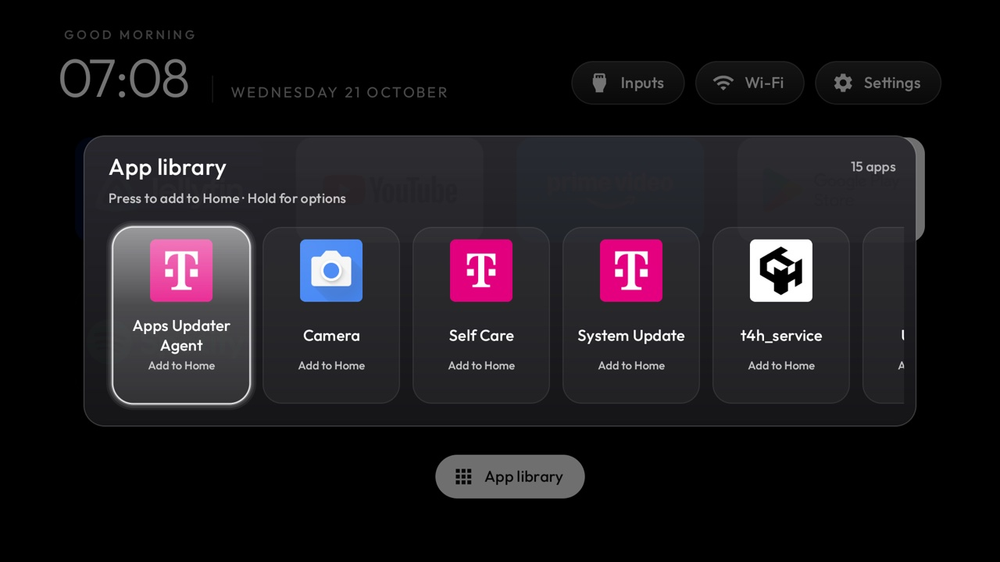

<div dir="rtl" lang="ckb">

<p align="center">
  <a href="https://cleanyour.tv"></a>
</p>

<p align="center" dir="ltr">
  بە زمانەکانی تر بخوێنەوە: <a href="README.md">English</a> · <a href="README.he.md" lang="he" dir="rtl">עברית</a> · <a href="README.zh-CN.md">简体中文</a> · <a href="README.zh-TW.md">正體中文</a> · <a href="README.vi.md">Tiếng Việt</a> · <a href="README.ja.md">日本語</a> · <a href="README.it.md">Italiano</a> · <a href="README.pt-BR.md">Português</a> · <a href="README.nl.md">Nederlands</a> · <a href="README.de.md">Deutsch</a> · <a href="README.uk.md">Українська</a> · <a href="README.tr.md">Türkçe</a> · <a href="README.uz.md">Oʻzbekcha</a> · <a href="README.fr.md">Français</a> · <a href="README.es.md">Español</a> · <strong lang="ckb" dir="rtl">کوردی سۆرانی</strong>
</p>

<p align="center">
  <a href="https://github.com/Gathin23/cleanyourtv/stargazers"></a>
  <a href="https://github.com/Gathin23/cleanyourtv/pulls?q=is%3Amerged"></a>
  <a href="https://github.com/Gathin23/cleanyourtv/network/members"></a>
  <a href="https://github.com/Gathin23/cleanyourtv/graphs/contributors"></a>
  <a href="https://buymeacoffee.com/gathint"></a>
  <a href="https://www.producthunt.com/products/cleanyourtv"></a>
</p>

<p align="center">
  <a href="https://trendshift.io/repositories/310225"></a>
</p>

# CleanYourTV: ڕێنمایی بە کوردیی سۆرانی

## لێرەوە دەست پێ بکە

| چیت هەیە | بڕۆ بۆ |
|---|---|
| **تەلەڤیزیۆنی Android TV یان Google TV** | [دەستپێکی خێرا](#دەستپێکی-خێرا): یاریدەدەرێکی کۆدنووسین لە نزیکەی پازدە خولەکدا کارەکە ئەنجام دەدات. |
| **تەلەڤیزیۆنی Samsung، LG، Roku، Vizio یان Hisense VIDAA** | [cleanyour.tv/not-android](https://cleanyour.tv/not-android): CleanYourTV لەوێ ناتوانێت کار بکات، بەڵام بە ڕیمۆتەکەت دەتوانیت شوێنپێهەڵگرتنی تەلەڤیزیۆنەکە ناچالاک بکەیت. |
| **مۆبایل یان لاپتۆپ، بەبێ یاریدەدەری کۆدنووسین** | یەکێک لە [ئەپەکانی کۆمەڵگە](https://cleanyour.tv/app) بۆ مۆبایلی Android، Mac و Windows، کە گەشەپێدەرانی سەربەخۆ دروستیان کردووە. |
| **دەتەوێت سەرەتا ببینیت** | [ئەوەی دەستت دەکەوێت](#ئەوەی-دەستت-دەکەوێت): وێنەی شاشەی سەرەکیی نوێ. |

**بەستەرە فەرمییەکان:** [cleanyour.tv](https://cleanyour.tv) و ئەم کۆگایە. دۆمەینەکانی تر کە هەمان ناو بەکاردەهێنن، وەک cleanyourtv.com، لەلایەن ئەم پرۆژەیەوە بەڕێوە نابرێن ([#1004](https://github.com/Gathin23/cleanyourtv/issues/1004)). CleanYourTV هیچ ئەپێک لە هیچ فرۆشگایەکی ئەپدا بڵاو ناکاتەوە، و clean-your-tv.net هەروەها هی ئێمە نییە.

[چۆن کار دەکات](#چۆن-کار-دەکات) · [دەستپێکی خێرا](#دەستپێکی-خێرا) · [ئەوەی دەستت دەکەوێت](#ئەوەی-دەستت-دەکەوێت) · [تەلەڤیزیۆنە پشتگیریکراوەکان](#تەلەڤیزیۆنە-پشتگیریکراوەکان) · [بە دەستی خۆت](#بە-دەستی-خۆت) · [لانچەر](#لانچەر) · [گەڕاندنەوەی تەلەڤیزیۆن](#گەڕاندنەوەی-تەلەڤیزیۆن) · [نوێکردنەوەی فێرموایر](#دوای-نوێکردنەوەی-فێرموایر) · [پرسیارە باوەکان](#پرسیارە-باوەکان) · [بەشداری](#چۆن-بەشداری-بکەیت)

## چۆن کار دەکات

تەلەڤیزیۆنەکانی Android هەمان ADB (Android Debug Bridge) بەکاردەهێنن کە مۆبایلەکانیش بەکاری دەهێنن. **USB debugging** لە هەڵبژاردەکانی گەشەپێدەری تەلەڤیزیۆنەکەدا چالاک بکە، کۆمپیوتەرەکەت یەک جار ڕێگە پێ بدە، و ئیتر هەموو کارەکە بە ئامرازە ئاساییەکانی Android ئەنجام دەدرێت:

| هەنگاو | چی ڕوودەدات |
|---|---|
| **پاشەکەوت** | لیستی پاکێجە دامەزراوەکان و ڕێکخستنەکان. |
| **ناچالاککردن** | تێلیمێتریی دروستکەر، خزمەتگوزارییەکانی ڕێکلام، ڕیزەکانی ناوەڕۆک و ئەپە پێشدامەزراوە بێکەڵکەکان، بە <code dir="ltr">pm disable-user</code>. هیچ شتێک لانابرێت، بۆیە سکریپتی گەڕاندنەوە دەتوانێت هەر هەنگاوێک هەڵبوەشێنێتەوە. |
| **دامەزراندن** | لانچەرێکی بچووکی ناتیڤ دادەمەزرێت و دەکرێت بە شاشەی سەرەکیی بنەڕەتی. |

**بێ root، بێ کەیبڵ، هیچ شتێک لانابرێت، و ئەگەر بیرت گۆڕی بە یەک دێڕ دەتوانیت بیگەڕێنیتەوە.**

ئەپە نەویستراوەکان لە براندێکەوە بۆ براندێکی تر جیاوازن. بۆیە پرۆمپتەکە وا دەکات یاریدەدەری کۆدنووسینەکەت لەسەر تەلەڤیزیۆنەکەت بیاندۆزێتەوە، و پێش ئەوەی دەست لە هەر شتێک بدات کە ڕەنگە تۆ بەکاری بهێنیت، لێت بپرسێت.

## دەستپێکی خێرا

| چیت هەیە | ئەمە بکە |
|---|---|
| **کۆمپیوتەر** | پرۆمپتەکە بەکاربهێنە لەگەڵ یاریدەدەرێکی کۆدنووسین: سێ هەنگاوەکەی خوارەوە. |
| **کۆمپیوتەر، بەبێ یاریدەدەری کۆدنووسین** | سێ هەنگاوەکە خۆت ئەنجام بدە؛ فەرمانەکان لە [بە دەستی خۆت](#بە-دەستی-خۆت) دان. |
| **مۆبایل یان لاپتۆپ، بەبێ یاریدەدەری کۆدنووسین** | یەکێک لە [ئەپەکانی کۆمەڵگە](https://cleanyour.tv/app) هەڵبژێرە: ئەپی بەخۆڕایی و سەرچاوەی کراوە (open-source) کە گەشەپێدەرانی سەربەخۆ لەسەر بنەمای ئەم لیستانە دروستیان کردووە. |

سێ هەنگاوەکەی خوارەوە بۆ یاریدەدەری کۆدنووسین نووسراون: کۆمپیوتەرەکە پێویستە لەسەر هەمان Wi-Fi بێت وەک تەلەڤیزیۆنەکە، تێرمینالێکی تێدا بێت، و هەروەها Python 3، JDK لە 17 تا 22، و Android SDK platform 34 لەگەڵ build-tools 34 (یاریدەدەرەکە لەوێ لانچەرەکە دروست دەکات). ئەگەر یاریدەدەرت نییە، [بە دەستی خۆت](#بە-دەستی-خۆت) هەمان کارە، بەڵام تۆ خۆت ئەنجامی دەدەیت، و فەرمانی دامەزراندنەکانی تێدایە.

هەر یەکێک لەمانە کار دەکات: Claude Code (لەسەر [0G Private Computer](https://pc.0g.ai/?utm_source=cleanyourtv&utm_medium=github&utm_campaign=readme) یان بە [پلانی Anthropic](https://claude.com/pricing))، [Codex](https://github.com/openai/codex)، [Gemini CLI](https://github.com/google-gemini/gemini-cli)، [Antigravity CLI](https://antigravity.google/product/antigravity-cli) یان [DeepSeek Harness](https://github.com/deepseek-ai/deepseek-harness).

| کوێ | چی بکە |
|---|---|
| **1. لەسەر تەلەڤیزیۆنەکە** | Settings → Device Preferences → About → هەوت جار دوگمەی OK لە **Build** بدە → گەڕانەوە → Developer options → **USB debugging** چالاک بکە. ئەگەر دوگمەی Network یان ADB debugging دەبینیت، ئەویشی چالاک بکە. تەلەڤیزیۆنەکە کراوە بهێڵەوە. |
| **2. لەسەر کۆمپیوتەرەکەت** | کۆگاکە کلۆن بکە و ئەو فۆڵدەرە لە یاریدەدەرەکەتدا بکەرەوە (<code dir="ltr">git clone https://github.com/Gathin23/cleanyourtv</code>)، پاشان [PROMPT.md](PROMPT.md) بیلکێنە و مۆدێلی تەلەڤیزیۆنەکەت بنووسە. |
| **3. بەردەوام بە** | لەسەر تەلەڤیزیۆنەکە «Allow USB debugging?» قبوڵ بکە، پاشان وەڵامی لیستی پرسیارەکان بدەرەوە: کام ئەپانە بەکاردەهێنیت، قەبارەی دۆک و ڕیزبەندی ئەپەکان، ئایا یاریدەدەری دەنگ و Chromecast و نوێکردنەوەکان بهێڵیتەوە. |

کلۆنکردن گرنگە: یاریدەدەرەکە <code dir="ltr">tools/disable.sh</code> و <code dir="ltr">launcher/build-and-install.sh</code> ی ئەم کۆگایە بەکاردەهێنێت و سکریپتی خۆی نانووسێت. پاشەکەوت، پاراستنی شاشەی سەرەکی و تۆماری گەڕاندنەوە لەو دوو سکریپتەدان.

یاریدەدەرەکە پاشەکەوت دەکات، پاکسازی دەکات، لانچەر دروست و دامەزرێنێت، و هەر هەنگاوێک بە وێنەی شاشە کە لە تەلەڤیزیۆنەوە وەردەگیرێت دەپشکنێت. ئەگەر یاریدەدەرەکە ئەم کۆگایە لەبەردەستدا بێت، نزیکەی پازدە خولەک دەخایەنێت.

## ئەوەی دەستت دەکەوێت

شاشەیەکی سەرەکی کە وەک Apple TV دەچێت و ڕێگە لە کارەکانت ناگرێت:

| بەش | چۆن دەردەکەوێت |
|---|---|
| **شاشەی سەرەکیی ڕەشی تەواو** | دۆکێک لە چوار ئەپی دڵخوازت لە شریتێکی گۆشە-نەرمدا، لەو شوێنەی Apple TV دایدەنێت. |
| **شریتی سەرەوە** | ناوی ئەپی هەڵبژێردراو بە نووسینێکی گەورە پیشان دەدات، لەگەڵ ڕووناکییەکی دەوروبەر کە ڕەنگەکەی لە وێنەی ئەپەکە وەرگیراوە. |
| **ئەپەکانی تر لە گرید** | بەرەو سەرەوە دەلغزێت کاتێک دوگمەی Down دەدەیت. |
| **هایلایتێکی شووشەیی و ڕەوان** | لە خانەیەکەوە بۆ خانەیەکی تر باز دەدات. خانەی هەڵبژێردراو بەرز دەبێتەوە و ناوەکەی پیشان دەدات. |
| **سێ دوگمەی تەماوی** | Inputs (پۆرتەکانی HDMI بە ناوەکانی کە لە ڕێکخستنەکانی تەلەڤیزیۆنەکەدا داتناون، AV، Live TV)، Wi-Fi یان Ethernet لەگەڵ ناوی تۆڕەکە، و Settings. |
| **پیرۆزباییەک، کاتژمێرێکی باریک و بەروار** | بە فۆنتی [Outfit](https://fonts.google.com/specimen/Outfit)، و شاشەپارێزی کاتژمێری هاوتا. ئەگەر `show_stats` لە config یان لە تێمێکدا دابنێیت، یەک دێڕ لە ژێر کاتژمێرەکە نیشان دەدرێت: CPU، بیرگەی بەتاڵ و شوێنی بەتاڵی هەڵگرتن. بە کوژاوەیی دەمێنێتەوە مەگەر تۆ چالاکی بکەیت، و تەنها کاتێک نوێ دەبێتەوە کە شاشەی سەرەکی دەردەکەوێت. |
| **تێمەکان و کارتی مۆدیوڵەکان** | تێمەکان ڕەنگ، وێنەی پاشبنەما، دۆک و ستوونەکان دەگۆڕن بەبێ دووبارە دروستکردنەوە، و کارتی مۆدیوڵەکانیش ڕێگە بە ئەپەکانی تر دەدەن خانەیەک بخەنە ناو لانچەرەکە، تەنها بە ڕەزامەندیی تۆ. |

تەلەڤیزیۆنێک کە دژی تۆ کار ناکات: ڕیزی ئەپی ڕێکلامکراو نییە، ئاگاداریی بێزارکەری «Discover» نییە، شیکاری (analytics) نییە کە داتا بنێرێتەوە، و هیچ ئەپێک دانامەزرێت کە تۆ داوای نەکردبێت.

| | |
|---|---|
|  |  |
| *شریتی سەرەوە و ڕووناکیی دەوروبەر* | *Inputs: HDMI بە دۆخی پەیوەندی، AV، Live TV* |
|  |  |
| *گرید، هایلایتی شووشەیی، ناوی خانە* | *شاشەپارێزی کاتژمێر، دەجووڵێت تا هیچ شتێک لەسەر شاشە نەسوتێت* |
|  |  |
| *تێمی Aurora، بە `tools/theme.sh` بار کراوە* | *شەش ستوون و دۆکی شەش ئەپ، هەمان لانچەر* |
|  |  |
| *OK لەسەر خانەیەک ڕابگرە و Move هەڵبژێرە: تیرەکان دەیگوێزنەوە، Back دایدەنێتەوە* | *کتێبخانەی ئەپ: یەک دوگمە ئەپێکی لابراو دەگەڕێنێتەوە بۆ Home* |

## تەلەڤیزیۆنە پشتگیریکراوەکان

هەر تەلەڤیزیۆنێک کە **Android TV** یان **Google TV** کار دەکات.

| پلاتفۆرم | ئەوەی کار دەکات |
|---|---|
| **Android TV، Google TV** | پاککردنەوە و لانچەر. |
| **Fire TV** | تەنها بەشی پاککردنەوە، چونکە Fire OS ڕێگە نادات Home بدرێتە لانچەرێکی تر. لەسەر Fire TV Box ی 2015 (Fire OS 5) تەنانەت ئەو بەشەش سەرناکەوێت: هەموو ڕێگاکانی `pm` ڕەت دەکرێنەوە. |
| **چەند تەلەڤیزیۆنی TCL بازاڕی چین** | ڕێگە نادەن هیچ لانچەرێک دابمەزرێت؛ لیستەکانیان ئەمە لە سەرەتاکەیاندا دەڵێن. |
| **Samsung (Tizen)، LG (webOS)، Roku، Vizio، Hisense VIDAA** | پشتگیری ناکرێت (ADB نییە). لە جیاتی ئەوە شوێنپێهەڵگرتن ناچالاک بکە: [cleanyour.tv/not-android](https://cleanyour.tv/not-android). بۆ چوار پۆرتکردنی webOS بڕوانە [SHOWCASE.md](SHOWCASE.md#other-platforms-fire-tv-and-lg-webos)، و ئەگەر بیر لە پۆرتکردنی Tizen دەکەیتەوە، [docs/devices/samsung-tizen.md](docs/devices/samsung-tizen.md) ببینە بۆ ئەوەی بزانیت یەک تەلەڤیزیۆنی Samsung ی 2021 لەسەر Wi-Fi چی وەڵام دەداتەوە (ADB نییە، بۆیە `pm disable-user` نییە). بۆ تەلەڤیزیۆنی LG webOS 26، [docs/devices/lg-webos.md](docs/devices/lg-webos.md) ڕێکخستنەکان و فلتەرکردنی DNS باس دەکات، لەگەڵ یاسایەکی فایەرواڵ بەرامبەر بە DNS ی تر. |

لیستی تاقیکراو لە بەشداربووانەوە، بۆ هەر مۆدێلێک فۆڵدەرێکی تایبەت لە [`examples/`](examples/) دا هەیە.

**پەیدا کردنی تەلەڤیزیۆنەکەت:** لە [cleanyour.tv/tvs](https://cleanyour.tv/tvs) بگەڕێ، یان خشتەی تەواو لە [examples/README.md](examples/README.md) ببینە.

ئەگەر تەلەڤیزیۆنەکەت لێرە نییە؟ پرۆمپتەکە خۆی ئەپە نەویستراوەکان دەدۆزێتەوە. دواتر لیستەکەت زیاد بکە، کەسی داهاتوو کە هەمان مۆدێلی هەیە ئەو هەنگاوە دەپەڕێنێت: [CONTRIBUTING.md](CONTRIBUTING.md).

## بە دەستی خۆت

هەموو ئەو کارانەی یاریدەدەرەکە دەیکات، خۆت دەتوانیت ئەنجامی بدەیت. پێشتر دوو شت دەبێت لەسەر کۆمپیوتەرەکە هەبن:

| پێویستت پێیەتی | بۆ |
|---|---|
| **Python 3** (هەر وەشانێکی 3.x) | ئامرازەکان. فەرمانی venv ی خوارەوە ئەو شتانە دادەمەزرێنێت کە ئامرازەکان هاوردەیان دەکەن. |
| **JDK لە 17 تا 22** (JDK ی تەواو، لەگەڵ `jlink`) و **Android SDK platform 34** لەگەڵ **build-tools 34.0.0 یان هەر وەشانێکی نوێتری 34.x** | دروستکردنی لانچەر. JDK 23 و نوێتر وا دەکەن Gradle 8.9 کار نەکات. بیناکە platform 34 دەخوێنێتەوە؛ platform ی نوێتر جێی ناگرێتەوە. لەسەر macOS، کاتێک هیچیان دانەمەزراوە: `brew install openjdk@17 android-commandlinetools`، پاشان `sdkmanager "platforms;android-34" "build-tools;34.0.0"`. لەسەر Linux، سکریپتی دامەزراندن لە `~/Android/Sdk` و بۆ `java` لە PATH دەگەڕێت. |

`tools/tv.py` بە ADB ی تۆڕ لەسەر پۆرتی 5555 قسە دەکات. ئەگەر ئەو پۆرتە داخراو بمێنێتەوە و تەلەڤیزیۆنەکە Wireless debugging لەگەڵ کۆدی جووتکردن پێشکەش بکات (Chromecast with Google TV و Google TV Streamer وایە)، یەک جار بە `adb` ی ئاسایی جووتی بکە. پاشان، یان فەرمانی `adb tcpip 5555` بەکاربهێنە بۆ کردنەوەی پۆرتەکە، کە زۆرجار تەنها تا دووبارە دەستپێکردنەوەی تەلەڤیزیۆنەکە دەمێنێتەوە، یان داخراوی بهێڵەرەوە: `TV_ADB_BINARY` ئاماژە بکە بۆ هەمان `adb`، و `TV_HOST` بۆ ئەو پۆرتەی کە شاشەی Wireless debugging پیشان دەدات. ئیتر ئامرازەکان لە ڕێگەی ئەو پەیوەندییە جووتکراوەوە دەگەنە تەلەڤیزیۆنەکە، بەبێ ئەوەی هیچ شتێک لەسەر 5555 گوێ بگرێت ([tools/native-adb.md](tools/native-adb.md)). [چارەسەرکردنی کێشەکان](docs/TROUBLESHOOTING.md#connecting) هەردووکیان تێدایە، لەگەڵ هەنگاوەکانی جووتکردن.

<div dir="ltr" align="left">

```bash
python3 -m venv tools/venv && tools/venv/bin/pip install -r tools/requirements.txt
export TV_HOST=192.168.1.50                                   # your TV's IP address

tools/venv/bin/python -I tools/tv.py --probe                 # model, Android version, firmware
tools/venv/bin/python -I tools/tv.py 'pm list packages'      # one shell command on the TV
tools/disable.sh examples/xiaomi-mi-tv-4a/debloat.txt        # apply a debloat list
tools/restore.sh examples/xiaomi-mi-tv-4a/debloat.txt        # undo it, stock launcher back
tools/venv/bin/python -I tools/check.py examples/xiaomi-mi-tv-4a/debloat.txt   # what a firmware update undid
launcher/build-and-install.sh                                # build the launcher and make it Home (needs the TV_HOST export above)
tools/theme.sh themes/aurora                                 # push a theme; --reset removes it
tools/venv/bin/python -I tools/wallpaper_prep.py ~/Pictures/trip mytheme/wallpapers   # your photos, sized and darkened for the TV
```

</div>

| ئامراز | ئەوەی دەیکات |
|---|---|
| [`tools/tv.py`](tools/tv.py) | کلاینتی ADB بە تەنها Python: shell، batch، push، pull، reboot و وێنەی شاشە، بەدڵخوازیش دوگمەی ڕیمۆت پێش ئەوە دەدات. لەو شوێنانە کار دەکات کە `adb` ی ئاسایی بلۆک کراوە. [کلاینتی Google ADB ی جووتکراو](tools/native-adb.md) بۆ Wireless debugging ی شیفرەکراو هەڵبژاردەیە. |
| [`tools/docker-build.sh`](tools/docker-build.sh) | لانچەر یان add-on لە Docker دروست دەکات (JDK 17، Android SDK 34)، بۆیە ئەم کۆمپیوتەرە تەنها Docker پێویستی پێیەتی. ئەنجامەکە بە `SKIP_BUILD=1` دابمەزرێنە. [ڕێنمای](tools/docker-build.md). |
| [`tools/b64push.py`](tools/b64push.py) | فایلە گەورەکان وەک APK بە پارچەی base64 بار دەکات و checksum دەپشکنێت. |
| [`tools/relay.py`](tools/relay.py) | پۆرتێکی ناوخۆیی ئاراستەی پۆرتی ADB ی تەلەڤیزیۆن دەکات، بۆ ئەو یاریدەدەرانەی سەندباکسەکەیان ناتوانێت بگاتە تۆڕەکەت. تەنها لەسەر ئەم کۆمپیوتەرە گوێ دەگرێت. [ڕێنمای](tools/relay.md). |
| [`tools/disable.sh`](tools/disable.sh)، [`restore.sh`](tools/restore.sh) | لیستی پاککردنەوە جێبەجێ یان هەڵدەوەشێنێتەوە، بە گەڕانەوە بۆ ئەو دۆخەی پێش گۆڕانکارییەکە تۆمارکراوە. |
| [`tools/recovery.py`](tools/recovery.py) | ئەو تۆمارە دەنووسێت کە `disable.sh` پێویستی پێیەتی بۆ هەڵوەشاندنەوەی خۆی، و ڕیزی فەرمانی گەڕاندنەوە چاپ دەکات. |
| [`tools/check.py`](tools/check.py) | تەلەڤیزیۆنەکە بەراورد دەکات لەگەڵ ئەو لیستەی کە جێبەجێ کراوە، بۆ ئەوەی بزانیت نوێکردنەوەی فێرموایر چی هەڵوەشاندەوە؛ `--fix` دەیگەڕێنێتەوە. |
| [`tools/match.py`](tools/match.py) | `pm list packages` ی پاشەکەوتکراو دەخوێنێتەوە و بۆ هەر پاکێجێک دەڵێت چەند لیست لە `examples/` ناچالاکی دەکەن، چەندیان بە کۆمێنت هێشتوونەتەوە، و باوترین تێبینییان چییە. پاکێجە بنەڕەتییەکانی Android وەک `never` پیشان دەدرێن. ئۆفلاینە و هیچ ناگۆڕێت (`tools/venv/bin/python -I tools/match.py packages.txt`). |
| [`tools/adb-closed.py`](tools/adb-closed.py) | دەپشکنێت کە پۆرتی ADB ی تۆڕی تەلەڤیزیۆن داخراوە کاتێک debugging داخراوە: کۆدی دەرچوون 0 دەگەڕێنێتەوە کاتێک تەلەڤیزیۆن پەیوەندییەکە ڕەت دەکاتەوە، 1 لەکاتێکدا هێشتا کراوەیە، و 2 کاتێک هیچ وەڵامێک نەبێت یان خودی پشکنینەکە نەتوانرێت ئەنجام بدرێت. پێویست بە `nc` نییە. |
| [`tools/philips-api.py`](tools/philips-api.py) | تەنها بۆ Philips: دەپشکنێت کە API ی کۆنترۆڵی JointSpace کە Home Assistant بەکاری دەهێنێت هێشتا وەڵام دەداتەوە، پێش و پاش پاککردنەوە (`tools/venv/bin/python -I tools/philips-api.py <tv ip>`). سەرەتا پۆرتی 1926 لەسەر HTTPS، پاشان 1925؛ تەنها ئەوە دەخوێنێتەوە کە بەبێ جووتکردن وەڵام دەداتەوە. |
| [`tools/privacy.py`](tools/privacy.py) | پشکنین دەکات بۆ شتە گومانلێکراوەکان: دەنگ، ACR و تێلیمێتری، و بەڵگەی هەریەکەیان پیشان دەدات؛ `--write` ئەوانە دەکات بە لیستێک کە `disable.sh` و `restore.sh` لێی تێدەگەن. |
| [`tools/theme.sh`](tools/theme.sh)، [`theme_restart.py`](tools/theme_restart.py) | فۆڵدەرێک لە [`themes/`](themes/) دەنێرێت بۆ لانچەر و شاشەی سەرەکی دووبارە دەست پێدەکاتەوە. |
| [`tools/wallpaper_prep.py`](tools/wallpaper_prep.py) | فۆڵدەرێکی وێنەکانی خۆت (JPEG، PNG، WebP، HEIC) دەگۆڕێت بۆ JPEG ی 1280×720 ی تاریککراو کە لە ژێر 300 KB دایە، بۆ فۆڵدەری `wallpapers/` ی تێمێک. پێویستی بە Pillow هەیە، و بۆ HEIC پێویستە pillow-heif هەبێت (`tools/requirements-photos.txt`). هەرگیز دەست لە ڕەسەنەکان نادات. [چۆنیەتی بەکارهێنان](#لانچەر). |
| [`tools/manage.py`](tools/manage.py) | هەموو add-on، تێم و سویچەکان بە وێنەی شاشەکانیانەوە نیشان دەدات، ئەوەی لەسەر تەلەڤیزیۆنەکەیە پیشان دەدات، و هەریەکێک دەدات بە دامەزراندن، نوێکردنەوە یان لابردن بە ڕاکردنی سکریپتی دروستکەرەکەی خۆی. |
| [`tools/bench.py`](tools/bench.py) | ئەو لانچەرەی وەڵامی HOME دەداتەوە پێوانە دەکات: ماوەی وەڵامدانەوەی دوگمە، چەندە جەختەکە (focus) گواستراوەتەوە، فریمە لەرزۆکەکان، دەستپێکردنی سارد، گەڕانەوە بۆ Home، و CPU ی بێکار و PSS ی کە خەرجی دەکات. هیچ ناگۆڕێت لەسەر تەلەڤیزیۆنەکە و داتای خاوی هەر دوگمەیەک بە JSON دەنووسێت؛ هیچ دامەزراندنێکی زیاتری ناوێت. |
| [`tools/trace.py`](tools/trace.py)، [`trace_report.py`](tools/trace_report.py) | Perfetto trace ی لانچەر تۆمار دەکات (گەڕانەوە بۆ Home، دەستپێکردنی سارد، D-pad) و ڕادەگەیەنێت کاتەکەی لە کوێ خەرج دەبێت، بۆ هەر ڕاکردنێک و بەراورد لە پێش و دوای. بەدڵخوازە: پێویستی بە [requirements-perf.txt](tools/requirements-perf.txt) هەیە. [ڕێنمای](tools/trace.md). |
| [`tools/flamechart.py`](tools/flamechart.py) | ڕەسمی flame chart ی پێش و دوای لەو trace انە دەکێشێت، بۆ داواکاری pull: هێڵێک بۆ هەر thread لەسەر تەوەرەیەکی کاتی هاوبەش، و ئەو کارەی گۆڕانکارییەکە ئامانجی کردووە بە magenta لەگەڵ کۆی کاتەکەی. بەدڵخوازە، وەک ئامرازەکانی trace. [ڕێنمای](tools/flamechart.md). |
| [`tools/screendiff.py`](tools/screendiff.py) | وێنەی پێش و دوای بە پیکسڵ بەراورد دەکات، کاتژمێر یان هەر شتێکی تۆ ماسک بکەیت لادەبات، و جووتەکە دەنووسێتەوە کە ناوی تۆڕەکەت بە blur دەشارێتەوە. بەدڵخوازە، وەک ئامرازەکانی trace. [ڕێنمای](tools/screendiff.md). |
| [`tools/race_calendar.py`](tools/race_calendar.py) | کالێندەری ئەم وەرزەی F1 دەنووسێت بۆ ناو تێمێک بۆ دۆخی ڕۆژی پێشبڕکێ، لە API ی بەخۆڕایی Jolpica. |
| [`launcher/build-and-install.sh`](launcher/build-and-install.sh) | ڤێرژنی release ی بچووککراو دروست دەکات (نزیکەی 572 KB)، دایدەمەزرێنێت، Home دەگۆڕێت، و ئەگەر Home لەسەری نەچووبێت دەگەڕێتەوە بۆ پێشوو. |

سکریپتەکان هەرگیز تەلەڤیزیۆنەکە بەبێ ئەپی Home بەجێ ناهێڵن: تەنها لانچەری کارخانەیی ناچالاک دەکەن کە دەیناسنەوە، و ئەپی Home لە لیستێکدا دەپەڕێنن تا لانچەرێکی تر وەڵامی HOME بداتەوە. لیستی خۆتیش دەتوانیت لە دەرەوەی کۆگاکە هەبێت: ڕێگەی لیستەکان لەسەر بنەمای ئەو فۆڵدەرەی کە فەرمانەکەی لێ دەدەیت دیاری دەکرێن، و ڕێگەی ڕەهاش (absolute) کار دەکات.

<details>
<summary><b>Windows (PowerShell)</b></summary>

هەر سکریپتێک هاوتای PowerShell ی لە تەنیشتەوەیە. Python 3 و JDK لە 17 تا 22 دابمەزرێنە، و لە SDK Manager دا platform 34 و build-tools 34 زیاد بکە (34.0.0 یان هەر وەشانێکی نوێتری 34.x). سکریپتەکە `JAVA_HOME` بەکاردەهێنێت ئەگەر لەو ڕێزەدا JDK یەک نیشان بدات، و ئەگەر نا JDK ی ناوەکیی Android Studio، ئەگەر ئەویش لەو ڕێزەدا بێت:

```powershell
python -m venv tools\venv; tools\venv\Scripts\python.exe -m pip install -r tools\requirements.txt
powershell -ExecutionPolicy Bypass -File launcher\build-and-install.ps1 -TvHost 192.168.1.50
powershell -ExecutionPolicy Bypass -File tools\disable.ps1 -TvHost 192.168.1.50 examples\xiaomi-mi-tv-4a\debloat.txt
powershell -ExecutionPolicy Bypass -File tools\restore.ps1 -TvHost 192.168.1.50 examples\xiaomi-mi-tv-4a\debloat.txt
powershell -ExecutionPolicy Bypass -File tools\theme.ps1 -TvHost 192.168.1.50 themes\aurora
```

دوو فەرمانی کۆتایی گەڕاندنەوە و ناردنی تێم، هاوتای ئەو دێڕانەی `tools/restore.sh` و `tools/theme.sh` کە لە بەشەکانی سەرەوەدا بە bash دراون. لەسەر Google TV، گەڕاندنەوەش لانچەری کارخانەیی دەگەڕێنێتەوە، بە ئاماژەی `-Stock com.google.android.apps.tv.launcherx`.

</details>

<details>
<summary><b>How the scripts protect Home</b></summary>

سکریپتەکانی دامەزراندن لە تەلەڤیزیۆنەکە دەپرسن کام لانچەر خاوەنی Home ە، و تەنها ئەوەیان ناچالاک دەکەن کە دەیناسنەوە، کە ئەو چوارەن لە `KNOWN_STOCK_LAUNCHERS`: `com.google.android.tvlauncher`، `com.google.android.apps.tv.launcherx`، `com.google.android.leanbacklauncher` و `com.mitv.tvhome` ی شاومی (PatchWall). بۆ دیاریکردنی لانچەرێکی تر، `STOCK_LAUNCHER=<package>` (`-StockLauncher`) بنووسە، یان `none` بۆ ئەوەی هیچ نەگۆڕدرێت.

`tools/disable.sh` (`disable.ps1`) هەمان یاسا جێبەجێ دەکات پێش ئەوەی هیچ ناچالاک بکات:

- ئەگەر لیستەکە ئەو ئەپەی تێدا بێت کە خاوەنی Home ە، و هیچ ئەپێکی تری تەلەڤیزیۆنەکە وەڵامی HOME نەداتەوە، ئەو بڕگەیە دەپەڕێنێت و هۆکارەکەی دەڵێت، و بەشی ماوەی لیستەکە ناچالاک دەکات. بۆیە لیستێک کە پێش گواستنەوەی Home جێبەجێ دەکرێت ناتوانێت تەلەڤیزیۆنەکە بێ هیچ لانچەرێکی وەڵامدەر بەجێ بهێڵێت.
- ڕێنمای دامەزراندن، ئەپەکانی ڕێکخستن، `FallbackHome` ی فرۆشیار و ئەپە تاقیکردنەوەکانی کارخانە (`com.duokan.factorytest` ی شاومی) وەڵامی HOME دەدەنەوە، بەڵام ناژمێردرێن.
- لەسەر Google TV، سکریپتەکە خاوەنی ئێستا (لانچەری کارخانەیی) دەهێڵێتەوە هەتا setupwraith وەڵام دەداتەوە و چالاکە (لە لیستدا نییە، یان بۆ تۆڕی Wi-Fi هێشتراوەتەوە): setupwraith پێش لانچەرێکی دامەزراو کە هێشتا Home نییە وەڵام دەداتەوە، بۆیە Home دەگرێتەوە.

دووبارە هەمان لیست بەڕێوە ببە دوای ئەوەی `launcher/build-and-install.sh` لانچەری نوێی کرد بە Home و بڕگەکە جێبەجێ کرا؛ `FORCE_HOME=1` (`$env:FORCE_HOME`) بە هەر حاڵ ناچالاکی دەکات.

</details>

## مایک، و ئەوەی دەربارەیەوە دەتوانرێت بوترێت

«کام لەم پاکێجانە گوێ دەگرێت؟» وەڵامێکی ڕاستگۆیانەی یەک دێڕی نییە: پشکنینی مۆڵەتەکان پەنجا پاکێجی سیستەم پیشان دەدات کە `RECORD_AUDIO` یان هەیە و هیچ تۆمار ناکەن، و کلاینتەکانی ACR شاشە دەبینن بەبێ هیچ مۆڵەتی دەنگێک. [`tools/privacy.py`](tools/privacy.py) ڕادەگەیەنێت تەلەڤیزیۆنەکە ڕاستەقینە چی دەڵێت، لەگەڵ بەڵگەی هەریەکەی دەنگ، ACR و تێلیمێتریی گومانلێکراو: `TV_HOST=192.168.1.50 tools/venv/bin/python -I tools/privacy.py`، و `--write` ئەوانە دەکات بە لیستێکی ئاسایی پاککردنەوە. ئەوەی پشکنینەکە ناتوانێت مەبەست بسەلمێنێت، [docs/privacy.md](docs/privacy.md) ڕوونی دەکاتەوە بۆچی.

## لانچەر

شاشەی سەرەکیی بچووکی ناتیڤ بۆ Android TV: **نزیکەی 572 KB**، Java ی سادە، بۆ تەلەڤیزیۆن بە 1 GB ڕام دروستکراوە. بڵۆر نییە، ڤیدیۆ نییە، مۆڵەتی تۆڕ نییە، خزمەتگوزاریی پاشبنەما نییە. **تەلەڤیزیۆنەکە** پێویستە Android 8.0 (API 26) یان نوێتر بێت، واتە `minSdk` لە [`launcher/app/build.gradle`](launcher/app/build.gradle)؛ ئەوەی لەسەر تەلەڤیزیۆنی کۆنتر دەمێنێتەوە لە [چارەسەرکردنی کێشەکان](docs/TROUBLESHOOTING.md) دایە.

| شت | چۆن کار دەکات |
|---|---|
| **ڕێکخستن** | ڕیزبەندی دۆک، ئەپە شاراوەکان، ئەپی Live TV، 4 تا 7 خانە بۆ هەر ڕیزێک، جووڵەی کەمکراوە. هەموو لە [`config.xml`](launcher/app/src/main/res/values/config.xml) دایە |
| **ڕێکخستنەکان لەسەر تەلەڤیزیۆن** | OK لەسەر Settings ڕابگرە بۆ ڕێکخستنەکانی لانچەر. ئەگەر `launcher_settings_button` ت چالاک کردبێت، کلیکی ئاسایی ڕاستەوخۆ ڕێکخستنەکانی لانچەر دەکاتەوە؛ ڕێکخستنەکانی تەلەڤیزیۆن لەسەر پەڕەی ڕێکخستنەکان و خانەی ئەپەکەی خۆیان دەمێننەوە. |
| **تێمەکان** | پاشبنەما، وێنەی پاشبنەما و ڕیزبەندی لە `config.json` بە Wi-Fi دەنێردرێن، بەبێ دووبارە دروستکردنەوە. 29 بابەت لە [themes](themes/) دان، `default/` ی ناوەکیشی تێدایە. |
| **31 زمان** | بە پێی زمانی تەلەڤیزیۆنەکە خۆی دەگۆڕێت، و بۆ هیبرۆ ڕووکارەکە بە تەواوی ڕاست-بۆ-چەپ ئاوێنە دەکرێت. |
| **کتێبخانەی ئەپ** | هەڵبژاردەیی: هەموو ئەپێکی دامەزراو ببینە و کورتەڕێگەی Home زیاد یان لابدە. بڕوانە [ڕێنمای کتێبخانەی ئەپ](docs/app-library.md). |
| **مێنیوی خانە** | بە بنەڕەتی چالاکە (`tile_menu`): OK لەسەر خانەیەک ڕابگرە بۆ Move و App info، لەگەڵ Remove from Home کاتێک کتێبخانەی ئەپ چالاکە. کاتێک کوژاوەیە، ڕاگرتنی OK App info دەکاتەوە. |
| **کارتی مۆدیوڵ** | هەر ئەپێکی تەلەڤیزیۆن دەتوانێت خانەی تایبەتی خۆی پێشکەش بکات؛ هەر یەکێکیان یەک جار پەسەند دەکەیت. بڕوانە [docs/modules.md](docs/modules.md). |
| **Add-on** | ئەپی هەڵبژاردەیی کە وەک کارتی مۆدیوڵ دەچنە ناو لانچەرەوە، لە [`addons/`](addons/) دا هەڵگیراون و هەرگیز ناکرێنە بەشێک لە خودی لانچەرەکە. |
| **شاشەپارێزی کاتژمێر** | کاتژمێرێکی جووڵاو بەسەر ڕووناکییەکەدا، بۆ ئەوەی هیچ شتێک نەسوتێت. |
| **دوگمەکانی ڕیمۆت** | دوگمەی Input و YouTube و دوگمەی چەرخ کار دەکەن دوای ئەوەی لانچەری کارخانەیی ناچالاککرا. |

تێمەکان، سویچەکان و زیادکراوەکان (add-ons) پێکەوە، لەگەڵ وێنەی شاشەکانیان: [cleanyour.tv/addons](https://cleanyour.tv/addons).

**زیاتر:** [docs/launcher.md](docs/launcher.md) پەڕەی ڕێکخستنەکانی لانچەر ڕیز بە ڕیز دەخاتە ڕوو، و هەروەها گۆڕینی شاشەی سەرەکیی بنەڕەتی، زمانەکان، دوگمەکانی ڕیمۆت، شاشەپارێزی کاتژمێر، ڕێنوێنیی ئاراستەکان و دروستکردنی لانچەرەکە بە دەستی خۆت.

<details>
<summary><b>وێنەکانی خۆت وەک پاشبنەما</b></summary>

تێم دەتوانێت فۆڵدەرێک وێنە لە پشتی شاشەی سەرەکییەوە بسووڕێنێت، بەبێ دووبارە دروستکردنەوە. هیچ وێنەیەک لەگەڵ کۆگاکەدا نایەت: وێنەی خۆت دەهێنیت، و خۆت بڕیار دەدەیت کە مافی ئەوەت هەیە پیشانیان بدەیت.

1. **فۆڵدەرێکی تێم دەست پێ بکە.** تێمێکی دڵخواز لە [فۆڵدەری themes](themes/) کۆپی بکە، وەک `themes/aurora`، بۆ فۆڵدەرێکی نوێ وەک `mytheme/`، یان بە فایلێکی بەتاڵی `config.json` دەست پێ بکە.
2. **وێنەکان ئامادە بکە.** وێنەیەکی ڕووناکی 12 MP بۆ تەلەڤیزیۆنێکی 1 تا 2 GB قورسە و کاتژمێر و خانەکان دادەپۆشێت. `tools/wallpaper_prep.py` بە ناوەڕاست 16:9 دەبڕێت، JPEG ی 1280×720 ی لە ژێر 300 KB پاشەکەوت دەکات، و خودی وێنەکە تاریک دەکات، بۆیە `wallpaper_dim` دەتوانێت لەسەر 0 بمێنێتەوە. وێنەی مۆبایلی HEIC کار دەکات. ڕەسەنەکانت هەرگیز دەست لێ نادرێن. Pillow دەچێتە ناو `tools/venv` ی دەستپێکردنی خێرا کە دروستی دەکات، نەک بۆ Python ی سیستەم، کە نە پاکێجەکەی تێدایە و نە (لەسەر Ubuntu) pip یەک هەیە کە بتوانێت دایبمەزرێنێت.

   ```bash
   tools/venv/bin/pip install -r tools/requirements-photos.txt
   tools/venv/bin/python -I tools/wallpaper_prep.py ~/Pictures/trip mytheme/wallpapers
   ```

   هەڵبژاردەکان: `--brightness 0.25` (0.1 تا 1.0)، `--gradient 0.6` (ڕەشی زیاتر بەرەو دۆک)، `--size 1280x720`، `--max-kb 300`.
3. **سووڕانەوە دابنێ** لە `mytheme/config.json`:

   ```json
   { "wallpaper": true, "wallpaper_rotation_minutes": 1, "wallpaper_order": "shuffle", "wallpaper_dim": 0 }
   ```

   | کلیل | تێبینی |
   |---|---|
   | `wallpaper_rotation_minutes` | خولەکی تەواو، 0 تا 1440. **1 خێراترینە.** `0` بەو مانایەیە سووڕانەوە نییە، و ژمارەی کەسری وەک `0.25` دەبێتە `0`، و بەمەش سووڕانەوە دەوەستێت. |
   | `wallpaper_order` | `shuffle` هەمان وێنە بەدوای یەکدا نیشان نادات؛ `sequential` بەپێی ناوی فایلەکان دەڕوات. |
   | `wallpaper_dim` | ڕووپۆشی ڕەش بە ڕێژەی سەدی. لەسەر 0 بهێڵەرەوە کاتێک وێنەکان پێشتر تاریک کراون. |
   | `dock_glass`، `dock_opacity` | شریتی دۆکی شووشەیی تەماوی (30 تا 100%)، بۆ ئەوەی وێنەکە لە پشت خانەکانەوە دیار بێت. |
   | `greeting_name` | ناوێک لە دوای پیرۆزباییەکە: «ئێوارەت باش، Sam». |
   | `show_stats`، `app_library`، `reduced_motion` | یەک دێڕی ئامار لە ژێر کاتژمێر، دوگمەی کتێبخانەی ئەپ، جووڵەی ئارامتر بۆ GPU ی لاواز. |

4. **بۆ تەلەڤیزیۆنەکە بینێرە** (ئەمە Home یەک جار دووبارە دەست پێدەکاتەوە، و یاریدەدەری دوگمەی Home بەردەوام کار دەکات):

   ```bash
   tools/theme.sh mytheme            # Windows: tools\theme.ps1 -TvHost 192.168.1.50 mytheme
   ```

   لە **Launcher settings → Wallpaper** یەک وێنە، **None** یان **Theme default** هەڵدەبژێریت، کە دووبارە دەسووڕێتەوە.
5. **لایبە** بە `tools/theme.sh --reset`.

ئەوەی ناتوانێت بیکات: crossfade نییە (وێنەکە بە پچڕان دەگۆڕێت)، سووڕانەوەیەک خێراتر لە خولەکێک نییە، و شاشەپارێزی کاتژمێر تەنها کات و بەروار نیشان دەدات، هەرگیز وێنە. ئەگەر فۆڵدەری `wallpapers/` نەبێت، تێمەکە هەر کار دەکات و Home ڕەنگی سادەی خۆی دەهێڵێتەوە. وێنەیەک لە کاتی نیشاندانی Home لە بیرگەدا دەکرێتەوە: نزیکەی 4 MB لە 1080p بە ڕەنگی 16-bit ی بنەڕەتی، 8 MB بە `wallpaper_true_color` (بڕوانە [themes/README.md](themes/README.md))، بۆیە وێنەکان بچووک بهێڵەرەوە لەسەر تەلەڤیزیۆنی 1 GB.

</details>

## گەڕاندنەوەی تەلەڤیزیۆن

لیستی جێبەجێکراوەکەت بپارێزە. یەک دێڕ تەلەڤیزیۆنەکە دەگەڕێنێتەوە بۆ ئەو دۆخەی پێشتر بوو:

<div dir="ltr" align="left">

```bash
TV_HOST=192.168.1.50 tools/restore.sh examples/<your tv>/debloat.txt                                    # Android TV
TV_HOST=192.168.1.50 tools/restore.sh examples/<your tv>/debloat.txt com.google.android.apps.tv.launcherx  # Google TV
```

</div>

| چی | چۆن |
|---|---|
| **تۆمار یەکەم دێت** | پێش ئەوەی `tools/disable.sh` هیچ بگۆڕێت، ئەوە تۆمار دەکات کە تەلەڤیزیۆنەکە چۆن بوو، لە `~/.cleanyourtv/`. |
| **گەڕاندنەوە تۆمارەکە دووبارە جێبەجێ دەکاتەوە** | پاکێجێک کە تۆ خۆت ناچالاکت کردبوو، ناچالاک دەمێنێتەوە، و Home دەگەڕێتەوە بۆ ئەو پێکهاتەیەی کە خاوەنی بوو. |
| **لانچەرەکە دامەزراو دەمێنێتەوە** | ئەگەر دەتەوێت نەمێنێت، لە Settings → Apps ی تەلەڤیزیۆنەکە لایبە. |
| **کۆمپیوتەرت نییە؟** | ئەگەر پەیوەندی بە تەلەڤیزیۆنەکەوە نەکرا، پەڕەی Settings → Apps ی خودی تەلەڤیزیۆنەکە دەتوانێت پاکێجەکان دووبارە چالاک بکاتەوە. |

**زیاتر:** [docs/restore.md](docs/restore.md) ئەوەی تۆمارەکە تێیدایە، کەی ئارگیومێنتی لانچەری کارخانەیی کاریگەرە، و ئەوەی ڕوو دەدات ئەگەر تۆمار نەبێت، ڕوون دەکاتەوە.

## دوای نوێکردنەوەی فێرموایر

نوێکردنەوە لەسەر سیستەمە پاککراوەکە دادەمەزرێت: پاکێجە لیستکراوەکان دەگەڕێنەوە، Home دەچێتە سەر لانچەری کارخانەیی، و ئەپی پێشدامەزراوی نوێ دەردەکەون کە هیچ لیستێک ناویان نەهێناوە. ADB دووبارە چالاک بکە وەک لە [دەستپێکی خێرا](#دەستپێکی-خێرا) هەنگاوی 1، پاشان تەلەڤیزیۆنەکە بەراورد بکە لەگەڵ ئەو لیستەی جێبەجێت کردووە؛ `--fix` دەیگەڕێنێتەوە:

<div dir="ltr" align="left">

```bash
TV_HOST=192.168.1.50 tools/venv/bin/python -I tools/check.py examples/<your tv>/debloat.txt
```

</div>

**زیاتر:** [docs/firmware-updates.md](docs/firmware-updates.md) کۆدەکانی دەرچوون، پشکنینی هەفتانە، ئەوەی `--fix` دەیگۆڕێت، تەلەڤیزیۆنەکان کە لانچەری کارخانەیی وەک Home دەهێڵنەوە، و لیستەکان کە نوێکەرەوە ناچالاک دەکەن، ڕوون دەکاتەوە.

## کاتێک کێشە ڕوو دەدات

لیستی تەواوی ئەو کێشانەی کە تووشی ئێمە بوون لە [docs/TROUBLESHOOTING.md](docs/TROUBLESHOOTING.md) دایە. ئەو سێیانەی گرنگترینن:

- 🍎 **macOS دەڵێت "No route to host" هەرچەندە پۆرتەکە کراوەیە**: تایبەتمەندیی Local Network ئەپی تێرمینال لە تۆڕی ناوخۆیی دوور دەخاتەوە، و مۆڵەتەکە هی ئەو ئەپەیە نەک کلاینتەکە، بۆیە `adb` ی ئاسایی و `tools/tv.py` بە هەمان شێوە شکست دەهێنن (لە macOS 26 بینراوە). Terminal، iTerm2 یان VS Code لە System Settings → Privacy & Security → Local Network ڕێگە پێ بدە، پاشان دایخە و دووبارەی بکەرەوە ([چارەسەرکردنی کێشەکان](docs/TROUBLESHOOTING.md#connecting)).
- ⚠️ **لانچەری کارخانەیی تەنها دوای ئەوە ناچالاک بکە کە لانچەری نوێ دامەزراوە و کار دەکات**، وەگەرنە Home دەچێتە سەر ئەپێکی تاقیکردنەوەی کارخانە. سکریپتی دامەزراندن ئەم ڕیزبەندییە بۆ تۆ ڕێک دەخات.
- 🔁 **لەسەر Google TV ڕێنمای دامەزراندن** (`com.google.android.tungsten.setupwraith`) دەتوانێت Home بگرێتە دەست و سیستەم بخاتە کراشی بەردەوام دوای ناچالاککردنی لانچەری کارخانەیی. ئەویشی ناچالاک بکە، و لە لیستەکەتی `debloat.txt` دا زیادی بکە، بۆ ئەوەی گەڕاندنەوە بیگەڕێنێتەوە.
  - بەڵام پێش ئەوە `dumpsys wifi | grep -o 'cname=[^ ]*'` بپشکنە: ئەگەر تۆڕی Wi-Fi لە کاتی ڕێکخستندا پاشەکەوت کرابێت، ئەوە setupwraith خاوەنیەتی، و ناچالاککردنی setupwraith تۆڕەکە دەسڕێتەوە (یەکەمجار لە Settings دووبارە بچۆرە سەر تۆڕەکە؛ `tools/disable.sh` تا ئەو کاتە setupwraith دەپەڕێنێت).
  - هەروەها لەسەر Chromecast with Google TV و Google TV Streamer، ڕەوانەکردن لە مۆبایلەوە (phone casting) لەدەست دەدەیت. بڕوانە [چارەسەرکردنی کێشەکان](docs/TROUBLESHOOTING.md).
  - ئێستا گیرت کردووە؟ `tools/tv.py 'pm enable --user 0 com.google.android.apps.tv.launcherx'`. ئەم فەرمانە لەسەر هەندێک تەلەڤیزیۆن (لە TCL Smart TV Pro، Android 14 بینراوە) یەکلایەنەیە: بۆ گەڕانەوە بۆ ئەم لانچەرە پێویستت بە ADB دەبێت، یان launcherx چالاک بهێڵەرەوە و `stock_home_redirect` بەکاربهێنە. بڕوانە [چارەسەرکردنی کێشەکان](docs/TROUBLESHOOTING.md#working-on-the-tv).

## پرسیارە باوەکان

<details>
<summary><b>من کۆد نانووسم و لاپتۆپم نییە. ئایا هێشتا دەتوانم ئەمە بکەم؟</b></summary>

بەڵێ. گەشەپێدەرانی سەربەخۆ ئەپی بەخۆڕایی و سەرچاوەی کراوەیان دروست کردووە لەسەر لیستی تەلەڤیزیۆنەکانی CleanYourTV کە لە ڕێگەی Wi-Fi پاکیان دەکەنەوە، بەبێ یاریدەدەری کۆدنووسین. هەریەکەیان سەرەتا پلانێک پیشان دەدات، تەنها ئەپەکان ناچالاک دەکات، و دەتوانێت هەموو شتێک بگەڕێنێتەوە:

| ئەپ | بۆ | لەلایەن |
|---|---|---|
| [Clean Your TV app](https://github.com/udhaykumarbala/cleanyourtv-app) | مۆبایلی Android | [@udhaykumarbala](https://github.com/udhaykumarbala) |
| [Tellyscope](https://github.com/man15h/tellyscope) | مۆبایلی Android | [@man15h](https://github.com/man15h) |
| [TidyTV](https://github.com/jolan94/tidytv) | مۆبایلی Android، Google Play | [@jolan94](https://github.com/jolan94) |
| [CleanMyTV](https://github.com/wingedpanther/cleanmytv) | Mac و Windows | [@wingedpanther](https://github.com/wingedpanther) |

ئەم ئەپانە پرۆژەی سەربەخۆن، پەیوەندییان بە CleanYourTV و بەڕێوەبەرەکەیەوە نییە، و لەلایەن ئەوانەوە پشتگیری ناکرێن. هەریەکەیان وەک خۆی پێشکەش دەکرێت، لەژێر مۆڵەتی تایبەتی خۆیدا. کێشەی هەر ئەپێک لە کۆگای ئەو ئەپە ڕاپۆرت بکە. زیاتر لە [cleanyour.tv/app](https://cleanyour.tv/app).

</details>

<details>
<summary><b>ئایا ئەمە پارێزراوە؟ ئایا دەتوانێت تەلەڤیزیۆنەکە لە کار بخات؟</b></summary>

هیچ شتێک فلاش ناکرێت، root ناکرێت، و هیچ شتێک نەسڕدرێتەوە؛ پاکێجەکان لە پرۆفایلی بەکارهێنەردا ناچالاک دەکرێن. مەترسییەکە ئەوەیە شتێک ناچالاک بکەیت کە تەلەڤیزیۆنەکە پشتی پێ دەبەستێت، بۆیە لیستەکان بە بەشی بچووک جێبەجێ دەکرێن و سکریپتی گەڕاندنەوە ئامادەیە. پەڕەی Settings → Apps ی خودی تەلەڤیزیۆنەکە دەتوانێت پاکێجەکان دووبارە چالاک بکاتەوە، تەنانەت بەبێ ئامرازەکان. ئەگەر تەلەڤیزیۆنەکە ئیتر ئەوەندە دەست پێ ناکاتەوە کە ئەو پەڕەیە بکاتەوە، ڕیسێتی کارخانە لە مینیوی ڕیکاڤەری (recovery) زۆرجار ڕێگای گەڕانەوەیە.

زیاتر: [docs/faq.md](docs/faq.md#is-this-safe-can-it-brick-the-tv)

</details>

<details>
<summary><b>ئەی نوێکردنەوەی فێرموایر چی؟</b></summary>

نوێکەر لە زۆربەی لیستەکاندا چالاک دەهێڵرێتەوە، بۆیە نوێکردنەوەی فێرموایر وەک ئاسایی دێت. هەندێک لیست نوێکەری خودی تەلەڤیزیۆنەکە ناچالاک دەکەن، و لەسەر ئەوانە نوێکردنەوەی فێرموایر تەنها کاتێک دێت کە دووبارە چالاکی بکەیتەوە. کاتێک نوێکردنەوەیەک دێت، لەسەر سیستەمی پاککراوە دادەمەزرێت، بۆیە پاکێجێک دەگەڕێتەوە و تۆ سکریپتەکە دووبارە دەکەیتەوە: بڕوانە [دوای نوێکردنەوەی فێرموایر](#دوای-نوێکردنەوەی-فێرموایر).

</details>

<details>
<summary><b>ئەپەکان تێک ناچن؟</b></summary>

ئەپە ستریمینگەکان هێشتا لە ڕێگەی Play Store نوێ دەبنەوە، و Play Store دەست لێ نادرێت. لانچەرەکە تەنها ئەوە لیست دەکات کە دامەزراوە، و بە intents ی کە دە ساڵە جێگیرن دەیکاتەوە.

</details>

<details>
<summary><b>چۆن ئەپەکانم ڕێک دەخەمەوە؟</b></summary>

OK لەسەر **Settings** (لە سەرەوەی ڕاستدا) ڕابگرە و **Reorder apps** هەڵبژێرە. OK ئەپێک هەڵدەگرێت، تیرەکان دەیجووڵێنن، دوگمەی Back دایدەنێت، و دوگمەی Back دووبارە کارەکە تەواو دەکات. هەروەها ڕاگرتنی OK لەسەر خانەیەک **Move** پێشکەش دەکات (`tile_menu`، بە بنەڕەتی چالاکە)، کە ئەو ئەپە ڕاستەوخۆ هەڵدەگرێت. زیاتر: [docs/launcher.md](docs/launcher.md#launcher-settings-and-the-default-home)

</details>

<details>
<summary><b>ئەمە بۆ کەسێک لە ماڵێکی تر بکەم؟</b></summary>

بەڵێ، بە بەستەرێکی تایبەتی [Tailscale](https://tailscale.com)، لەجیاتی هەمان Wi-Fi: یان Tailscale لەسەر تەلەڤیزیۆنەکەی ئەو کە لەگەڵ تۆ هاوبەش کراوە، یان کۆمپیوتەرێک یان Apple TV لە ماڵەکەی ئەو کە ڕێگای ڕاستەوخۆ بۆ تەلەڤیزیۆنەکە دەکاتەوە. هەرگز پۆرتی ADB لە ڕۆتەرەکەی ئەودا مەکەرەوە. هەنگاو بە هەنگاو لە [docs/REMOTE.md](docs/REMOTE.md).

</details>

<details>
<summary><b>ئایا دەستگەیشتنی ADB کونێکی ئاسایشی نییە؟</b></summary>

تەنها یەک تاپی ڕوون لەسەر تەلەڤیزیۆنەکە هەیە بۆ «ڕێگە بدە بەم کۆمپیوتەرە»، وەک گەشەپێدانی ئەپێکی Android. ADB ی تۆڕ بە دەقی ساف (plaintext) ە لەسەر پۆرتی 5555، و لەسەر هەندێک فێرموایر هەر ئامێرێک لەسەر LAN دەتوانێت shell بەدەست بهێنێت، بۆیە کاتێک کارەکەت تەواو کرد، داخەی:

1. لەسەر تەلەڤیزیۆنەکە: Developer options → **USB debugging**، **Network/ADB debugging** و **Wireless debugging** ناچالاک بکە، هەرکامێکیان تەلەڤیزیۆنەکە هەیەتی، و مۆڵەتە پەسەندکراوەکانی USB debugging هەڵبوەشێنەوە.
2. تەلەڤیزیۆنەکە دووبارە دەست پێ بکەرەوە، پاشان لە کۆمپیوتەرەکەت دڵنیابەوە کە پۆرتەکە نەماوە: `python3 tools/adb-closed.py <tv ip>` دەبێت بڵێت کە پۆرتەکە داخراوە.

لانچەرەکە بەبێ هەڵەدۆزینەوە هەر کار دەکات. زیاتر، لەگەڵ پشکنینی پۆرتی تایبەتی Wireless debugging: [docs/faq.md](docs/faq.md#isnt-adb-access-a-security-hole)

</details>

<details>
<summary><b>ئایا ڕێکلامی ناو ئەپەکانیش ڕێگری لێ دەکات؟</b></summary>

بەشێک، بە Private DNS ی Android (Android 9 و نوێتر). ڕێنمایی بکە بۆ سێرڤەرێکی DNS ی بلۆککەری ڕێکلام، وەک [AdGuard DNS](https://adguard-dns.io)، بۆیە دۆمەینەکانی ڕێکلام و شوێنپێهەڵگرەکانی هەموو ئەپێک لەسەر کۆی سیستەم چارەسەر ناکرێن، و لە دوای دووبارە دەستپێکردنەوەشەوە هەر وا دەمێننەوە. کەموکوڕییەکەی ئەوەیە کە ئەو سێرڤەرە هەموو داواکارییەکی DNS ی تەلەڤیزیۆنەکە دەبینێت، و ڕێکلامی YouTube لا نابات.

زیاتر، لەگەڵ دوو فەرمانەکە و چۆنیەتی گەڕانەوە: [docs/faq.md](docs/faq.md#can-it-block-ads-inside-apps-too)

</details>

<details>
<summary><b>ئایا لە Settings ی خودی تەلەڤیزیۆنەکەدا سویچی شایانی گۆڕین هەیە؟</b></summary>

چەند شتێک، و پێویستیان بە ADB نییە: ناسنامەی ڕێکلام، Location، Usage & diagnostics و Scanning always available، لەگەڵ دۆخی Apps only کە لانچەری کارخانەیی تێیدا دەمێنێتەوە. پێش پاککردنەوە Usage & diagnostics بگۆڕە؛ لەسەر هەندێک تەلەڤیزیۆن، پاککردنەوەکە پەڕەکەش لەگەڵ خۆیدا دەبات.

زیاتر، لەگەڵ ڕێگەکانی Google TV و Android TV و Fire OS: [docs/faq.md](docs/faq.md#are-there-switches-in-the-tvs-own-settings-worth-flipping-too)

</details>

<details>
<summary><b>AirPlay؟</b></summary>

لەم کۆگایەدا نییە. Chromecast built-in بۆ مۆبایلەکانی Android دەمێنێتەوە. بۆ iPhone، [jqssun/android-airplay-server](https://github.com/jqssun/android-airplay-server) کار دەکات؛ سکریپتێکی دامەزراندنی بۆی لە [PR #84](https://github.com/Gathin23/cleanyourtv/pull/84) دایە.

</details>

<details>
<summary><b>ئایا دەتوانم تەنها APK دابەزێنم؟</b></summary>

بە سکریپتی یەک دێڕ دروستی بکە کە لە [بە دەستی خۆت](#بە-دەستی-خۆت) هەیە؛ یەک خولەک دەخایەنێت و تۆ کۆنترۆڵی ئەوە دەکەیت کە چی دەچێتە سەر تەلەڤیزیۆنەکەت. ئەمەش پێویستی بە JDK و Android SDK یە کە لەوێ ناویان هاتوون. لەم کۆگایەدا هیچ فایلێکی binary ی ئامادەکراو نییە.

</details>

## چیرۆکەکە

لە 17ی تشرینی یەکەمی 2026 [وێنەی پێش و دوای تەلەڤیزیۆنی دایک و باوکم](https://x.com/gathint/status/2111379569030939102) بڵاوم کردەوە، کە Claude Code لە ڕێگەی Wi-Fi پاکی کردبووەوە. گەیشتە 8.6M بینین، خەڵک دەستیان کرد بە هەمان کار لەسەر تەلەڤیزیۆنەکانی خۆیان، و وەڵامەکانیان بوون بە ئەو لیستانەی لێرەدان: لە چوار ڕۆژی یەکەمدا 170+ مۆدێلی تەلەڤیزیۆن لەلایەن 200+ بەشداربووەوە. کۆگاکە تا ڕۆژی 19 ناوی tv-vibehack بوو؛ بەستەرە کۆنەکان کار دەکەن.

دوو هەفتە دواتر، بوو بە یەکەم کۆگای ترێندی GitHub بۆ هەفتەی 19 تا 25ی تشرینی یەکەم، لەگەڵ زیاتر لە 46K ئەستێرە و 5.7K فۆرک، و 1.4M بینین و 260K کلۆن لە ماوەی 14 ڕۆژدا. تا 14ی تشرینی دووەم 57K ئەستێرە و 7.4K فۆرکی هەبوو. ئێستا لیستەکان 472 مۆدێلی تەلەڤیزیۆن لە 129 براند دەگرنەوە. ڕاپۆرتەکانی ڕۆژنامەوانی: 546 وتار لە 57 وڵات و 673 ڤیدیۆ لە YouTube و Bilibili، هەموویان لە [docs/PRESS.md](docs/PRESS.md) دان (ژمارەکان لە 14ی تشرینی دووەم 2026).

## چۆن بەشداری بکەیت

گرنگترین بەشداری لیستی پاککردنەوەی تەلەڤیزیۆنەکەتە، بۆ ئەوەی کەسی داهاتوو کە هەمان مۆدێلی هەیە، پێویست نەکات هەمان شت دووبارە بدۆزێتەوە. [CONTRIBUTING.md](CONTRIBUTING.md) فۆرمات و ئەو تاقیکردنەوانەی داوامان لێدەکەین لە خۆ دەگرێت. بەشداری لە ڕێگەی یاریدەدەرێکی کۆدنووسینەوە؟ [AGENTS.md](AGENTS.md) هەمان یاساکانی پێدەدات.

| چۆن یارمەتی بدەیت | مانای چییە |
|---|---|
| **لیستی پاککردنەوەی تەلەڤیزیۆنەکەت** | گرنگترینە: کەسی داهاتوو کە ئەو مۆدێلەی هەیە، دۆزینەوەکە پێویست ناکات. |
| **لانچەر و پرۆمپت** | باشترکردنی لانچەر و ڕوونتر کردنەوەی دەقی پرۆمپتیش بەخێرهاتنە. |
| **شتێکت لەسەری دروست کردووە؟** | لانچەر، پۆرت یان تێم: زیادی بکە بۆ [SHOWCASE.md](SHOWCASE.md)، کە ئێستا 243 پڕۆژە تێیدایە، دابەشکراون بەسەر شاشەی سەرەکی، فۆرک، add-on، ئامراز و پلاتفۆرمەکانی تردا، لەگەڵ ئیندێکسێک بە پێی براندی تەلەڤیزیۆن. |

ئەو کەسانەی کارەکەیان لەم کۆگایەدایە:

<a href="https://github.com/Gathin23/cleanyourtv/graphs/contributors"></a>

<details>
<summary><strong>مێژووی ئەستێرەکان</strong></summary>

<a href="https://star-history.com/#Gathin23/cleanyourtv&Date"></a>

</details>

## پەیوەندی

| بۆ | کوێ |
|---|---|
| **پرسیار دەربارەی تەلەڤیزیۆنەکەت** | [GitHub Discussions](https://github.com/Gathin23/cleanyourtv/discussions) |
| **ڕۆژنامەوانی و پرسیار** | [hello@itsgathin.com](mailto:hello@itsgathin.com) |
| **کێشەی ئاسایش** | بە شێوەیەکی تایبەت ڕاپۆرتی بکە لە ڕێگەی [Security tab](https://github.com/Gathin23/cleanyourtv/security)، بڕوانە [`SECURITY.md`](SECURITY.md) |

## یاسایی

- CleanYourTV پرۆژەیەکی سەربەخۆی سەرچاوەی کراوەیە. هیچ پەیوەندییەکی بە هیچ دروستکەرێکی تەلەڤیزیۆن یان پلاتفۆرمێکەوە نییە، و هیچیان پشتگیری ناکەن یان سپۆنسەری ناکەن. ناوی براند و مۆدێل تەنها بۆ ئەوە بەکاردێن کە بڵێن لیستەکە لەسەر کام تەلەڤیزیۆن تاقی کراوەتەوە، و هەر تراکمارکی خاوەنەکانیانن.
- تەنها لە ڕێگەی ئەو ڕێکخستنانەوە کار دەکات کە خودی تەلەڤیزیۆنەکە بە خاوەنەکەی دەدات: Developer options، هەڵەدۆزینەوەی ADB و `pm disable-user` ی خودی Android، کە هەمان سویچە وەک Settings > Apps > Disable. root ناکات، firmware فلاش ناکات، و هیچ قوفڵ، DRM یان پاراستنی کۆپی ناپەڕێنێت، و کۆگاکە هیچ نەرمەواڵەی سازکەر، firmware یان APK ی تێدا نییە.
- هیچ شتێک لانابرێت، و `tools/restore.sh` هەموو شتێک دەگەڕێنێتەوە. تۆ لەسەر تەلەڤیزیۆنێک بەکاری دەهێنیت کە خۆت خاوەنیەتی، بە مەترسیی خۆت، و گۆڕینی نەرمەواڵەی تەلەڤیزیۆن ڕەنگە کاریگەری لەسەر گەرەنتی یان پشتگیریەکەی هەبێت.
- هەموو ئەمانە وەک خۆیان پێشکەش دەکرێن، بەبێ هیچ گەرەنتییەک، لەژێر مۆڵەتی MIT ی خوارەوە.

## مۆڵەت

MIT، بڕوانە [`LICENSE`](LICENSE). فۆنتی Outfit لەژێر SIL Open Font License دایە، بڕوانە `launcher/FONT-LICENSE-OFL.txt`.

</div>
