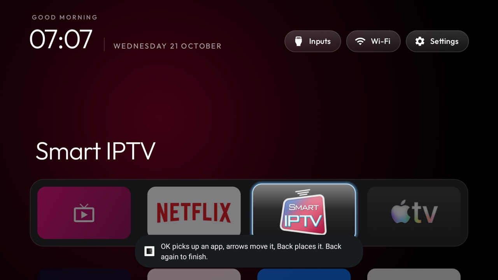

<div dir="rtl" lang="ckb">

<p align="center">
  <a href="https://cleanyour.tv"></a>
</p>

<p align="center" dir="ltr">
  بخوێنەرەوە بە: <a href="README.md">English</a> · <a href="README.he.md" lang="he" dir="rtl">עברית</a> · <a href="README.zh-CN.md">简体中文</a> · <a href="README.zh-TW.md">正體中文</a> · <a href="README.vi.md">Tiếng Việt</a> · <a href="README.ja.md">日本語</a> · <a href="README.it.md">Italiano</a> · <a href="README.pt-BR.md">Português</a> · <a href="README.nl.md">Nederlands</a> · <a href="README.de.md">Deutsch</a> · <a href="README.uk.md">Українська</a> · <a href="README.tr.md">Türkçe</a> · <a href="README.uz.md">Oʻzbekcha</a> · <a href="README.fr.md">Français</a> · <a href="README.es.md">Español</a> · <strong lang="ckb" dir="rtl">کوردی سۆرانی</strong>
</p>

<p align="center">
  <a href="https://github.com/Gathin23/cleanyourtv/stargazers"></a>
  <a href="https://github.com/Gathin23/cleanyourtv/pulls?q=is%3Amerged"></a>
  <a href="https://github.com/Gathin23/cleanyourtv/network/members"></a>
  <a href="https://github.com/Gathin23/cleanyourtv/graphs/contributors"></a>
  <a href="https://buymeacoffee.com/gathint"></a>
  <a href="https://www.producthunt.com/products/cleanyourtv"></a>
</p>

<p align="center">
  <a href="https://trendshift.io/repositories/310225"></a>
</p>

# CleanYourTV: ڕێنمایی بە کوردیی سۆرانی

لە ڕێگەی Wi-Fiی ماڵەوە بە Android TV یان Google TV دەبەسترێیتەوە. ئەو ئەپانە ناچالاک دەکەیت کە لەگەڵ ئامێرەکە دانراون و بەکاریان ناهێنیت: ڕێکلام و خزمەتگوزاریی کۆکردنەوەی زانیاری. پاشان لەسەر ئەو تەلەڤیزیۆنانەی پشتگیری دەکەن لانچەرێکی خاوێن دادەنێیت.

پێویستت بە ڕووت نییە، نە بە دامەزراندنەوەی فێرموایر، نە بە کەیبڵی USB. ئەپەکانی سیستەم تەنها **ناچالاک** دەکرێن و هەرگیز ناسڕدرێنەوە. سکریپتێک هەیە کە بە یەک دێڕ هەمووی دەگەڕێنێتەوە.

ئەم پەڕەیە تایبەتمەندییە سەرەکییەکان و بەکارهێنانی گشتی دەڵێت. هەر مۆدێل، ناوچە و وەشانێکی فێرموایر لیستی ئەپ و وردەکاریی خۆی هەیە. سەرەتا تێبینیی تایبەت بە تەلەڤیزیۆنەکەت بخوێنەرەوە.

ئەگەر جیاوازی هەبوو، [READMEی ئینگلیزی](README.md) پەسەندە. تێبینیی هەر مۆدێلێک لە [لیستی تەلەڤیزیۆنە پشتگیریکراوەکان](examples/README.md)ە.

> [!WARNING]
> **تەلەڤیزیۆنەکەت Samsung یان LG یان Roku یە، یان براندێکی ترە کە Android نییە؟**
> <br>CleanYourTV لەسەر ئەو ئامێرانە کار ناکات، بەڵام هێشتا دەتوانیت بە دوگمەکانی ڕیمۆت بە تەنها شوێنپێهەڵگرتن بکوژێنیتەوە: [cleanyour.tv/not-android](https://cleanyour.tv/not-android).


## لێرەوە دەست پێ بکە

| چیت هەیە | بڕۆ بۆ |
|---:|---:|
| **Android TV یان Google TV** | [دەستپێکی خێرا](#دەستپێکی-خێرا): یاریدەدەری کۆد کارەکە لە نزیکەی پازدە خولەکدا دەکات. |
| **تەلەڤیزیۆنی Samsung یان LG یان Roku یان Vizio یان Hisense VIDAA** | [cleanyour.tv/not-android](https://cleanyour.tv/not-android): CleanYourTV لێرە کار ناکات، بەڵام دەتوانیت شوێنپێهەڵگرتن بە ڕیمۆت بکوژێنیتەوە. |
| **مۆبایل یان لاپتۆپ، بەبێ یاریدەدەری کۆد** | یەکێک لە [ئەپەکانی کۆمەڵگە](https://cleanyour.tv/app) بۆ مۆبایلی Android و Mac و Windows، لەلایەن گەشەپێدەری سەربەخۆ. |
| **دەتەوێت سەرەتا بیبینیت** | [ئەوەی دەستت دەکەوێت](#ئەوەی-دەستت-دەکەوێت): وێنەی شاشەی سەرەکیی نوێ. |

**بەستەری فەرمی:** [cleanyour.tv](https://cleanyour.tv) و ئەم کۆگایە. دۆمەینی تر کە هەمان ناو بەکاردەهێنن، وەک cleanyourtv.com، هی ئەم پڕۆژەیە نین ([#1004](https://github.com/Gathin23/cleanyourtv/issues/1004)). CleanYourTV هیچ ئەپێک لە هیچ فرۆشگایەک بڵاو ناکاتەوە، و clean-your-tv.net هی ئێمە نییە.

[چۆن کار دەکات](#چۆن-کار-دەکات) · [دەستپێکی خێرا](#دەستپێکی-خێرا) · [ئەوەی دەستت دەکەوێت](#ئەوەی-دەستت-دەکەوێت) · [تەلەڤیزیۆنە پشتگیریکراوەکان](#تەلەڤیزیۆنە-پشتگیریکراوەکان) · [بە دەستی خۆت](#بە-دەستی-خۆت) · [لانچەر](#لانچەر) · [گەڕاندنەوە](#گەڕاندنەوەی-تەلەڤیزیۆن) · [نوێکردنەوەی فێرموایر](#دوای-نوێکردنەوەی-فێرموایر) · [پرسیارە باوەکان](#پرسیارە-باوەکان) · [بەشداری](#چۆن-بەشداری-بکەیت)

## چۆن کار دەکات

تەلەڤیزیۆنە Androidەکان هەمان پردی هەڵەدۆزیانیان هەیە کە مۆبایلە Androidەکان هەیانە. هەڵەدۆزی USB لە هەڵبژاردەکانی گەشەپێدەر دابگیرسێنە، کۆمپیوتەرەکەت یەک جار ڕێگە پێ بدە، و ئەوەی دەمێنێتەوە ئامرازی ئاسایی Androidە:

| هەنگاو | چی ڕوودەدات |
|---:|---:|
| **پاشەکەوت** | لیستی پاکێجە دامەزراوەکان و ڕێکخستنەکان. |
| **ناچالاککردن** | تەلەمەتری دروستکەر، خزمەتگوزاریی ڕێکلام، ڕیزی ناوەڕۆک و ئەپە زیادەکان بە <code dir="ltr">pm disable-user</code>. هیچ ناسڕدرێتەوە، بۆیە سکریپتی گەڕاندنەوە دەتوانێت هەر هەنگاوێک بگەڕێنێتەوە. |
| **دامەزراندن** | لانچەرێکی بچووکی ناوخۆیی دادەنرێت و دەکرێت بە شاشەی سەرەکیی بنەڕەت. |

**بێ ڕووت، بێ کەیبڵ، هیچ ناسڕدرێتەوە، و گەڕاندنەوە بە یەک دێڕ ئەگەر بیرت کردەوە.**

ئەپە زیادەکان بەپێی براند دەگۆڕێن. بۆیە داواکارییەکە وای لێ دەکات یاریدەدەرەکەت لەسەر تەلەڤیزیۆنەکەت بدۆزێتەوە و پێش دەستلێدان لەوەی بەکاری دەهێنیت پرسیارت لێ بکات.

## دەستپێکی خێرا

| چیت هەیە | چی بکە |
|---:|---:|
| **کۆمپیوتەر** | داواکارییەکە لەگەڵ یاریدەدەری کۆد بەکاربهێنە: سێ هەنگاوەکەی خوارەوە. |
| **کۆمپیوتەر، بەبێ یاریدەدەری کۆد** | سێ هەنگاوەکە خۆت ڕابکە: فەرمانەکان لە [بە دەستی خۆت](#بە-دەستی-خۆت)دان. |
| **مۆبایل یان لاپتۆپ، بەبێ یاریدەدەری کۆد** | یەکێک لە [ئەپەکانی کۆمەڵگە](https://cleanyour.tv/app) هەڵبژێرە: ئەپی خۆڕایی و سەرچاوەکراوە، لەسەر ئەم لیستانە، لەلایەن گەشەپێدەری سەربەخۆ. |

سێ هەنگاوەکەی خوارەوە بۆ یاریدەدەری کۆد نووسراون. کۆمپیوتەرەکە دەبێت لە هەمان Wi-Fiی تەلەڤیزیۆن بێت، لەگەڵ شێڵ، Python 3، JDK لە <span dir="ltr">17</span> تا <span dir="ltr">22</span>، و Android SDK platform 34 لەگەڵ build-tools 34 (یاریدەدەرەکە لانچەرەکە لەوێ دروست دەکات). بەبێ یاریدەدەر، [بە دەستی خۆت](#بە-دەستی-خۆت) هەمان کارە، تۆ ڕایدەکەیت، و فەرمانی دامەزراندنی تێدایە.

هەر کام لەمانە دەبێت: Claude Code (لە [0G Private Computer](https://pc.0g.ai/?utm_source=cleanyourtv&utm_medium=github&utm_campaign=readme) یان [پلانی Anthropic](https://claude.com/pricing))، [Codex](https://github.com/openai/codex)، [Gemini CLI](https://github.com/google-gemini/gemini-cli)، [Antigravity CLI](https://antigravity.google/product/antigravity-cli) یان [DeepSeek Harness](https://github.com/deepseek-ai/deepseek-harness).

| لە کوێ | چی بکە |
|---:|---:|
| **1. لەسەر تەلەڤیزیۆن** | ڕێکخستن → هەڵبژاردەی ئامێر → دەربارە → حەوت جار OK لەسەر **Build** → گەڕانەوە → هەڵبژاردەکانی گەشەپێدەر → **هەڵەدۆزی USB** دابگیرسێنە. ئەگەر هەڵەدۆزی تۆڕ یان ADB دەبینیت، ئەوەش دابگیرسێنە. تەلەڤیزیۆنەکە داگیرسێنراو بهێڵەرەوە. |
| **2. لەسەر کۆمپیوتەر** | کۆگاکە کلۆن بکە و ئەو فۆڵدەرە لە یاریدەدەرەکەت بکەرەوە (<code dir="ltr">git clone https://github.com/Gathin23/cleanyourtv</code>)، پاشان [PROMPT.md](PROMPT.md) بلکێنە و مۆدێلی تەلەڤیزیۆنەکە بنووسە. |
| **3. لەگەڵیدا بڕۆ** | «ڕێگە بە هەڵەدۆزی USB بدەیت؟» لەسەر تەلەڤیزیۆن قبوڵ بکە، پاشان وەڵامی لیستەکە بدەرەوە: کام ئەپ بەکاردەهێنیت، قەبارەی دۆک و ڕیزی ئەپەکان، و ئایا یاریدەدەری دەنگ و Chromecast و نوێکردنەوەکان بهێڵیتەوە. |

کلۆنکردنی کۆگاکە گرنگە: یاریدەدەرەکە <code dir="ltr">tools/disable.sh</code> و <code dir="ltr">launcher/build-and-install.sh</code>ی ئەم پڕۆژەیە دووبارە بەکاردەهێنێت، لە جیاتی ئەوەی هی خۆی بنووسێت. پاشەکەوت، پاراستنی شاشەی سەرەکی و تۆماری گەڕاندنەوە لەو سکریپتانەدان.

یاریدەدەرەکە پاشەکەوت دەکات، ئەپە زیادەکان ناچالاک دەکات، لانچەرەکە دروست دەکات و دادەنێت، و هەر هەنگاوێک بە وێنەی شاشە لە خودی تەلەڤیزیۆن دەپشکنێت. کاتێک ئەم کۆگایە کۆنتێکستی بێت، کارەکە نزیکەی پازدە خولەک دەخایەنێت.

## ئەوەی دەستت دەکەوێت

شاشەیەکی سەرەکی خێرا و بێ سەرقاڵی، لە شێوەی Apple TV:

| بەش | چۆنە |
|---:|---:|
| **شاشەیەکی سەرەکیی ڕەش** | دۆکێک بە چوار ئەپی دڵخوازت لە شریتێکی خڕ، وەک Apple TV. |
| **ناوچەیەکی دیار لە سەرەوە** | ناوی ئەپی هەڵبژێردراو بە پیتی گەورە، لەگەڵ درەوشانەوەیەک بە ڕەنگی وێنۆچکەکە. |
| **ئەپەکانی تر لە تۆڕێکدا** | کاتێک لە ڕیمۆتەکە خوارەوە دەگریت، بەرەو سەرەوە دەجوڵێن. |
| **یەک فۆکەسی شوشەیی** | بە نەرمی لە دانەیەکەوە بۆ دانەیەکی تر دەڕوات. وێنۆچکەی هەڵبژێردراو بەرز دەبێتەوە و ناوەکەی پیشان دەدات. |
| **سێ دوگمەی شوشەی مات** | سەرچاوەکان (دەرچەی HDMI بەو ناوانەی لە ڕێکخستنی تەلەڤیزیۆن دانراون، AV و تەلەڤیزیۆنی ڕاستەوخۆ)، Wi-Fi یان Ethernet بە ناوی تۆڕ، و ڕێکخستن. |
| **سڵاو، کاتژمێرێکی باریک و بەروار** | بە فۆنتی [Outfit](https://fonts.google.com/specimen/Outfit)، لەگەڵ شاشەپارێزێکی کاتژمێر بە هەمان شێوە. <code dir="ltr">show_stats</code> لە ڕێکخستن یان بابەتێکدا هێڵێک لەژێر کاتژمێر پیشان دەدات: CPU، RAMی بەتاڵ و بیرگەی بەتاڵ. تا خۆت نەیکەیتەوە ناچالاک دەمێنێتەوە و تەنها کاتێک نوێ دەبێتەوە کە شاشەی سەرەکی دیار بێت. |
| **بابەت و کارتی مۆدیول** | بابەتەکان ڕەنگ و وێنەی دیوار و دۆک و ستوون دەگۆڕن بەبێ دووبارە دروستکردن. کارتی مۆدیول ڕێگە دەدات ئەپێکی تر بلۆکێک زیاد بکات، هەمیشە بە ڕەزامەندیی ئاشکرای تۆ. |

و تەلەڤیزیۆنێک کە وازت لێ دەهێنێت: بێ ڕیزی سپۆنسەرکراو، بێ پێشنیاری «بدۆزەرەوە»، بێ تەلەمەتری بۆ سێرڤەری دەرەوە، و بێ ئەو ئەپانەی هەرگیز داوات نەکردوون.

| | |
|---:|---:|
|  |  |
| *ناوچەی دیار و درەوشانەوە* | *سەرچاوەکان: HDMI لەگەڵ دۆخی پەیوەندی، AV و تەلەڤیزیۆنی ڕاستەوخۆ* |
|  |  |
| *تۆڕەکە، فۆکەسی شوشە و ناوی دانەکە* | *شاشەپارێزی کاتژمێر، بە جوڵە بۆ ئەوەی نەخش لەسەر شاشە نەمێنێت* |
|  |  |
| *بابەتی Aurora، بە <code dir="ltr">tools/theme.sh</code>* | *شەش ستوون و دۆکی شەش ئەپ، لە هەمان لانچەر* |
|  |  |
| *OK لەسەر دانەیەک ڕابگرە و گواستنەوە هەڵبژێرە: تیرەکان دەیگوازنەوە و گەڕانەوە دەیخاتەوە* | *کتێبخانەی ئەپ: یەک دەستلێدان ئەپێکی لابراو دەگەڕێنێتەوە* |

## تەلەڤیزیۆنە پشتگیریکراوەکان

هەر تەلەڤیزیۆنێک کە **Android TV** یان **Google TV** بێت.

| پلاتفۆرم | چی کار دەکات |
|---:|---:|
| **Android TV، Google TV** | ناچالاککردنی ئەپە زیادەکان و لانچەرەکە. |
| **Fire TV** | تەنها ناچالاککردنی ئەپە زیادەکان، چونکە Fire OS ڕێگە نادات لانچەری کەسی سێیەم ببێت بە شاشەی سەرەکی. لە Fire TV Boxی ساڵی 2015 (Fire OS 5) تەنانەت ئەوەش نا: هەموو فەرمانەکانی <code dir="ltr">pm</code> ڕەت دەکرێنەوە. |
| **هەندێک مۆدێلی TCL کە لە چین دەفرۆشرێن** | ڕێگە نادەن هیچ لانچەرێک دابنرێت. فایلی ئەو مۆدێلانە لە سەرەوەی لیستەکەدا ئەوە دەڵێن. |
| **Samsung (Tizen)، LG (webOS)، Roku، Vizio، Hisense VIDAA** | پشتگیری ناکرێن (ADBیان نییە). لە جیاتی ئەوە شوێنپێهەڵگرتن بە دەست بکوژێنەرەوە: [cleanyour.tv/not-android](https://cleanyour.tv/not-android). [SHOWCASE.md](SHOWCASE.md#other-platforms-fire-tv-and-lg-webos) چوار گونجاندن بۆ webOS پیشان دەدات، و [docs/devices/samsung-tizen.md](docs/devices/samsung-tizen.md) دەڵێت تەلەڤیزیۆنی Samsungی ساڵی 2021 لە ڕێگەی Wi-Fi چی وەڵام دەداتەوە (بێ ADB، کەواتە بێ <code dir="ltr">pm disable-user</code>) ئەگەر گونجاندنێک بۆ Tizen لەبەرچاو بگریت. |

لیستە تاقیکراوەکان کە کۆمەڵگە ناردوویەتی، بە فۆڵدەری مۆدێل لە [examples](examples/).

**تەلەڤیزیۆنەکەت بدۆزەرەوە:** لە [cleanyour.tv/tvs](https://cleanyour.tv/tvs) بگەڕێ، یان خشتەی تەواو لە [examples/README.md](examples/README.md) ببینە.

تەلەڤیزیۆنەکەت لە لیستەکەدا نییە؟ داواکارییەکە خۆی ئەپە زیادەکان دەناسێتەوە. پاشان لیستەکەت زیاد بکە بۆ ئەوەی کەسی داهاتوو بە هەمان مۆدێل دووبارەی نەکاتەوە: [CONTRIBUTING.md](CONTRIBUTING.md).

## بە دەستی خۆت

هەرچی یاریدەدەرەکە دەیکات، خۆت دەتوانیت ڕای بکەیت. پێش ئەوە دوو شت لەسەر کۆمپیوتەرەکەت دابنێ:

| پێویستە | بۆچی |
|---:|---:|
| **Python 3** (هەر وەشانێکی 3.x) | بۆ ئامرازەکان. فەرمانی ژینگەی تایبەت پاشبەستەکان خۆی دادەنێت. |
| **JDK 17 تا 22** (JDKی تەواو، لەگەڵ <code dir="ltr">jlink</code>) و **Android SDK platform 34** لەگەڵ **build-tools 34.0.0 یان هەر 34.xێکی نوێتر** | بۆ دروستکردنی لانچەر. JDK 23 و دواتر Gradle 8.9 ڕادەگرن. پلاتفۆرمی 34 ئەوەیە کە دروستکردن داوای دەکات. وەشانی دواتر جێگەی ناگرێتەوە. لە macOS ئەگەر هیچت نییە: <code dir="ltr">brew install openjdk@17 android-commandlinetools</code> و پاشان <code dir="ltr">sdkmanager "platforms;android-34" "build-tools;34.0.0"</code>. لە Linux سکریپتی دامەزراندن SDK لە <code dir="ltr">~/Android/Sdk</code> و <code dir="ltr">java</code> لە PATHدا دەدۆزێتەوە. |

<code dir="ltr">tools/tv.py</code> لە ڕێگەی ADBی تۆڕ لە پۆرتی 5555 قسە لەگەڵ تەلەڤیزیۆن دەکات. ئەگەر ئەو پۆرتە داخرا بێت و تەلەڤیزیۆن هەڵەدۆزی بێتەل بە کۆدی جووتکردن پێشکەش بکات (وەک Chromecast لەگەڵ Google TV و Google TV Streamer)، یەک جار بە <code dir="ltr">adb</code>ی ئاسایی جووتی بکە. پاشان دەتوانیت <code dir="ltr">adb tcpip 5555</code> ڕابکەیت بۆ کردنەوەی پۆرتەکە، کە زۆربەی کات تەنها تا ڕیستارت دەمێنێتەوە، یان داخراوی بهێڵیتەوە: <code dir="ltr">TV_ADB_BINARY</code> بۆ هەمان <code dir="ltr">adb</code> و <code dir="ltr">TV_HOST</code> بۆ ئەو پۆرتەی لەسەر شاشەی هەڵەدۆزی بێتەل دیارە. ئامرازەکان لە ڕێگەی کەناڵی کۆدکراو دەبەسترێنەوە و هیچ شتێک لە پۆرتی 5555 گوێ ناگرێت ([tools/native-adb.md](tools/native-adb.md)). [چارەسەری کێشە](docs/TROUBLESHOOTING.md#connecting) هەردوو ڕێگە و هەنگاوەکانی جووتکردن دەڵێت.

<div dir="ltr" align="left">

```bash
python3 -m venv tools/venv && tools/venv/bin/pip install -r tools/requirements.txt
export TV_HOST=192.168.1.50                                   # ناونیشانی IPی تەلەڤیزیۆنەکەت

tools/venv/bin/python -I tools/tv.py --probe                 # مۆدێل، وەشانی Android و فێرموایر
tools/venv/bin/python -I tools/tv.py 'pm list packages'      # فەرمانێک لەسەر تەلەڤیزیۆن ڕادەکات
tools/disable.sh examples/xiaomi-mi-tv-4a/debloat.txt        # لیستی پاککردنەوە جێبەجێ دەکات
tools/restore.sh examples/xiaomi-mi-tv-4a/debloat.txt        # گۆڕانکارییەکان دەگەڕێنێتەوە و لانچەری ئەسڵی دەگەڕێنێت
tools/venv/bin/python -I tools/check.py examples/xiaomi-mi-tv-4a/debloat.txt   # دەپشکنێت نوێکردنەوە چی گەڕاندووەتەوە
TV_HOST=192.168.1.50 launcher/build-and-install.sh           # لانچەر دروست دەکات و دەیکات بە شاشەی سەرەکی
tools/theme.sh themes/aurora                                 # بابەتێک جێبەجێ دەکات؛ --reset لای دەبات
```

</div>

| ئامراز | چی دەکات |
|---:|---:|
| [<code dir="ltr">tools/tv.py</code>](tools/tv.py) | کلایەنتی ADB بە Python: شێڵ، کار بە کۆمەڵ، ناردن و داگرتنی فایل، ڕیستارت و وێنەی شاشە، لەگەڵ توانای گرتنی دوگمەی ڕیمۆت پێش ئەوە. کاتێکیش کار دەکات کە <code dir="ltr">adb</code>ی سیستەم قوفڵ بێت. هەروەها [پاشەکەوتی Google ADB بە جووتکردن](tools/native-adb.md)ی هەیە، ئارەزوومەندانە، بۆ هەڵەدۆزی بێتەلی کۆدکراو. |
| [<code dir="ltr">tools/docker-build.sh</code>](tools/docker-build.sh) | لانچەر یان زیادکراوێک لەناو Docker دروست دەکات (JDK 17، Android SDK 34)، بەبێ ئامرازی تر لەسەر ئەم کۆمپیوتەرە جیا لە Docker. ئەنجامەکە بە <code dir="ltr">SKIP_BUILD=1</code> دادەنرێت. [ڕێنمایی](tools/docker-build.md). |
| [<code dir="ltr">tools/b64push.py</code>](tools/b64push.py) | فایلی گەورە، وەک APK، بە پارچەی base64 دەنێرێت و کۆی پشکنین دەپشکنێت. |
| [<code dir="ltr">tools/relay.py</code>](tools/relay.py) | پۆرتێکی ناوخۆیی دەگوازێتەوە بۆ پۆرتی ADBی تەلەڤیزیۆن، بۆ یاریدەدەرێک کە ژینگەکەی ناتوانێت بگاتە تۆڕی ناوخۆیی. تەنها لەسەر ئەم ئامێرە گوێ دەگرێت. [ڕێنمایی](tools/relay.md). |
| [<code dir="ltr">tools/disable.sh</code>](tools/disable.sh)، [<code dir="ltr">restore.sh</code>](tools/restore.sh) | لیستی پاککردنەوە جێبەجێ دەکەن یان دەیگەڕێننەوە. گەڕاندنەوە ئەو دۆخە بەکاردەهێنێت کە پێش گۆڕانکاری تۆمار کراوە. |
| [<code dir="ltr">tools/recovery.py</code>](tools/recovery.py) | ئەو تۆمارە دروست دەکات کە <code dir="ltr">disable.sh</code> پێویستیەتی بۆ گەڕاندنەوەی گۆڕانکارییەکانی خۆی، و فەرمانەکانی گەڕاندنەوە بە کۆمەڵ پیشان دەدات. |
| [<code dir="ltr">tools/check.py</code>](tools/check.py) | دۆخی تەلەڤیزیۆن لەگەڵ لیستی جێبەجێکراو دەپشکنێت بۆ ئەوەی بزانێت نوێکردنەوەی فێرموایر چی گەڕاندووەتەوە. <code dir="ltr">--fix</code> گۆڕانکارییەکان دووبارە جێبەجێ دەکات. |
| [<code dir="ltr">tools/adb-closed.py</code>](tools/adb-closed.py) | دەپشکنێت پۆرتی ADBی تۆڕ دوای کوژاندنەوەی هەڵەدۆزی داخراوە یان نا: 0 کاتێک تەلەڤیزیۆن پەیوەندی ڕەت دەکاتەوە، 1 تا کراوە بێت، و 2 کاتێک وەڵام نییە یان پشکنینەکە ڕاناچێت. پێویستی بە <code dir="ltr">nc</code> نییە. |
| [<code dir="ltr">tools/philips-api.py</code>](tools/philips-api.py) | تەنها بۆ Philips: دەپشکنێت APIی کۆنترۆڵی JointSpace، کە Home Assistant بەکاری دەهێنێت، پێش و دوای پاککردنەوە هێشتا وەڵام دەداتەوە (<code dir="ltr">tools/venv/bin/python -I tools/philips-api.py &lt;tv ip&gt;</code>). سەرەتا پۆرتی 1926 بە HTTPS، پاشان 1925. تەنها ئەوە دەخوێنێتەوە کە وەڵام دەداتەوە، بەبێ جووتکردن. |
| [<code dir="ltr">tools/privacy.py</code>](tools/privacy.py) | تەلەڤیزیۆن دەپشکنێت بۆ ئەپ و پاکێجی پەیوەست بە دەنگ و ACR و تەلەمەتری، و بەڵگەی هەر یەکێک پیشان دەدات. بە <code dir="ltr">--write</code> ئەنجامەکان دەکات بە لیستێک کە <code dir="ltr">disable.sh</code> و <code dir="ltr">restore.sh</code> دەیخوێننەوە. |
| [<code dir="ltr">tools/theme.sh</code>](tools/theme.sh)، [<code dir="ltr">theme_restart.py</code>](tools/theme_restart.py) | فۆڵدەرێک لە [themes](themes/) دەنێرن بۆ لانچەر و شاشەی سەرەکی دەستپێدەکەنەوە. |
| [<code dir="ltr">tools/manage.py</code>](tools/manage.py) | هەموو زیادکراو و بابەت و هەڵبژاردنەکان لەگەڵ وێنەی شاشە پیشان دەدات. دەڵێت چی لەسەر تەلەڤیزیۆن دانراوە و ڕێگە دەدات هەر دانەیەک دابمەزرێت، نوێ بکرێتەوە یان لاببرێت بە سکریپتی خاوەنەکەی. |
| [<code dir="ltr">tools/bench.py</code>](tools/bench.py) | کارایی ئەو لانچەرە دەپێوێت کە دوگمەی HOME وەڵام دەداتەوە: دواکەوتنی دوگمە، مەودای فۆکەس، دابەزینی فرێم، دەستپێکردنی سارد، گەڕانەوە بۆ سەرەکی، و CPU و بیرگەی PSS لە پشوودا. هیچ لەسەر تەلەڤیزیۆن ناگۆڕێت و داتای خاو بە JSON دەهێڵێتەوە. |
| [<code dir="ltr">tools/trace.py</code>](tools/trace.py)، [<code dir="ltr">trace_report.py</code>](tools/trace_report.py) | تراکی Perfettoی لانچەر دەگرن (گەڕانەوە بۆ سەرەکی، دەستپێکردنی سارد و گەشت بە دوگمەکان) و دەڵێن کات لە کوێ دەڕوات، بۆ هەر جارێک و بەراوردی پێش و دوای. ئارەزوومەندانەیە: پێویستی بە [<code dir="ltr">requirements-perf.txt</code>](tools/requirements-perf.txt) هەیە. [ڕێنمایی](tools/trace.md). |
| [<code dir="ltr">tools/flamechart.py</code>](tools/flamechart.py) | flame chartێک دروست دەکات کە تراکی پێش و دوای دەبەستێتەوە، بۆ داواکاریی تێکەڵکردن: ڕێڕەوێک بۆ هەر threadێک لە هەمان پێوەری کات، کارە شیکراوەکە بە ڕەنگی مەجێنتا و کاتی کۆی. ئارەزوومەندانەیە، وەک ئامرازەکانی تراک. [ڕێنمایی](tools/flamechart.md). |
| [<code dir="ltr">tools/screendiff.py</code>](tools/screendiff.py) | وێنەی پێش و دوای پیکسەڵ بە پیکسەڵ دەبەستێتەوە، کاتژمێر یان هەر ناوچەیەک کە دیاری بکەیت فەرامۆش دەکات. جووتە وێنەکەش دەهێڵێتەوە بە ناوی تۆڕی Wi-Fi کاڵکراو. ئارەزوومەندانەیە. [ڕێنمایی](tools/screendiff.md). |
| [<code dir="ltr">tools/race_calendar.py</code>](tools/race_calendar.py) | ڕۆژژمێری وەرزی ئێستای F1 دەخاتە ناو بابەتێک بۆ دۆخی کۆتایی هەفتەی پێشبڕکێ، لە ڕێگەی APIی خۆڕایی Jolpica. |
| [<code dir="ltr">launcher/build-and-install.sh</code>](launcher/build-and-install.sh) | وەشانێکی بەرهەمهێنان دروست دەکات (نزیکەی 572 KB)، دادەنێت، دەیکات بە شاشەی سەرەکی، و ئەگەر لانچەرەکە کۆنترۆڵی نەگرتەوە دەیگەڕێنێتەوە. |

سکریپتەکان هەرگیز تەلەڤیزیۆن بەبێ ئەپی سەرەکی ناهێڵنەوە: تەنها لانچەرێکی ئەسڵی ناچالاک دەکەن کە دەیناسن، و ئەو ئەپە لە لیستەکە دەپەڕێنن تا لانچەرێکی تر دوگمەی HOME وەڵام بداتەوە. لیستی خۆت دەتوانێت لە دەرەوەی کۆگاکە بێت: ڕێچکەکان بەرامبەر ئەو بوخچەیەن کە فەرمانەکەی لێوە ڕادەکەیت، و ڕێچکەی ڕەهاش دروستە.

<details>
<summary><b>Windows (PowerShell)</b></summary>

هەر سکریپتێک هاوتای PowerShellی لە تەنیشتی خۆی هەیە. Python 3 و JDK لە 17 تا 22 دابنێ، و لە SDK Manager پلاتفۆرمی 34 و build-tools 34 زیاد بکە (34.0.0 یان هەر 34.xێکی نوێتر). سکریپتەکە <code dir="ltr">JAVA_HOME</code> بەکاردەهێنێت کاتێک ئاماژە بە JDKێک دەکات لەو مەودایە. ئەگەر نا، دەچێتە سەر JDKی ناو Android Studio ئەگەر مەرجەکە جێبەجێ بکات:

<div dir="ltr" align="left">

```powershell
python -m venv tools\venv; tools\venv\Scripts\python.exe -m pip install -r tools\requirements.txt
powershell -ExecutionPolicy Bypass -File launcher\build-and-install.ps1 -TvHost 192.168.1.50
powershell -ExecutionPolicy Bypass -File tools\disable.ps1 -TvHost 192.168.1.50 examples\xiaomi-mi-tv-4a\debloat.txt
powershell -ExecutionPolicy Bypass -File tools\restore.ps1 -TvHost 192.168.1.50 examples\xiaomi-mi-tv-4a\debloat.txt
powershell -ExecutionPolicy Bypass -File tools\theme.ps1 -TvHost 192.168.1.50 themes\aurora
```

</div>

دوو دێڕەکەی کۆتایی گەڕاندنەوە و جێبەجێکردنی بابەتن، هاوتای <code dir="ltr">tools/restore.sh</code> و <code dir="ltr">tools/theme.sh</code> لە سەرەوە. لە Google TV گەڕاندنەوە لانچەری ئەسڵیش دەگەڕێنێتەوە: <code dir="ltr">-Stock com.google.android.apps.tv.launcherx</code>.

</details>

<details>
<summary><b>چۆن سکریپتەکان شاشەی سەرەکی دەپارێزن</b></summary>

سکریپتەکانی دامەزراندن لە تەلەڤیزیۆن دەپرسن کام لانچەر شاشەی سەرەکی بەڕێوە دەبات، و تەنها ئەوە ناچالاک دەکەن کە دەیناسن. چوار لانچەری ئەسڵی لە <code dir="ltr">KNOWN_STOCK_LAUNCHERS</code>: <code dir="ltr">com.google.android.tvlauncher</code>، <code dir="ltr">com.google.android.apps.tv.launcherx</code>، <code dir="ltr">com.google.android.leanbacklauncher</code> و <code dir="ltr">com.mitv.tvhome</code>ی Xiaomi (PatchWall). <code dir="ltr">STOCK_LAUNCHER=&lt;package&gt;</code> (<code dir="ltr">-StockLauncher</code>) ئەم نرخە دەگۆڕێت، یان <code dir="ltr">none</code> بۆ ئەوەی هیچ لانچەرێک ناچالاک نەکرێت.

<code dir="ltr">tools/disable.sh</code> (<code dir="ltr">disable.ps1</code>) هەمان پاراستن بەکاردەهێنێت پێش ناچالاککردنی هەر ئەپێک:

- ئەگەر لیستەکە ئەو ئەپەی تێدابێت کە شاشەی سەرەکی بەڕێوە دەبات و هیچ ئەپێکی تر دوگمەی HOME وەڵام نەداتەوە، ئەو دانەیە دەپەڕێنێت، هۆکارەکە دەڵێت، و بەردەوام دەبێت لەگەڵ باقی لیستەکە. بەم شێوەیە لیستێک کە پێش گۆڕینی لانچەر جێبەجێ بکرێت تەلەڤیزیۆن بەبێ ڕووکار ناهێڵێتەوە.
- یاریدەدەری ڕێکخستنی سەرەتایی، ڕێکخستنی سیستەم، <code dir="ltr">FallbackHome</code>ی دروستکەر و ئەپی تاقیکردنەوەی کارگە (وەک <code dir="ltr">com.duokan.factorytest</code>ی Xiaomi) هەروەها دوگمەی HOME وەڵام دەدەنەوە و بە ئەنقەست لەو ژماردنە دەرکراون.
- لە Google TV سکریپتەکە لانچەری ئەسڵی چالاک دەهێڵێتەوە تا <code dir="ltr">setupwraith</code> دوگمەی HOME وەڵام بداتەوە و چالاک بێت (چونکە لە لیستەکەدا نییە، یان هێڵدراوەتەوە بۆ هێشتنەوەی Wi-Fi). <code dir="ltr">setupwraith</code> پێش لانچەرێکی نوێ دێت کە هێشتا وەک شاشەی سەرەکی هەڵنەبژێردراوە، و بەبێ ئەم پاراستنە کۆنترۆڵ دەگرێت.

هەمان لیست دووبارە ڕابکە دوای ئەوەی <code dir="ltr">launcher/build-and-install.sh</code> لانچەری نوێ دەکات بە شاشەی سەرەکی، بۆ ئەوەی ئەو دانەیەش جێبەجێ بکرێت. <code dir="ltr">FORCE_HOME=1</code> (<code dir="ltr">$env:FORCE_HOME</code>) ناچالاککردن لە هەموو بارێکدا دەسەپێنێت.

</details>

## مایک و ئەوەی دەتوانرێت لەسەری بوترێت

پرسیاری «کام لەم پاکێجانە گوێ دەگرن؟» وەڵامێکی ڕاستگۆی یەک ڕستەیی نییە. پشکنینی مۆڵەت پەنجا پاکێجی سیستەم دەردەخات بە <code dir="ltr">RECORD_AUDIO</code> کە هیچ تۆمار ناکەن، لە کاتێکدا مۆدیولی ACR دەتوانێت شاشە شیکار بکات بەبێ مۆڵەتی دەنگ. [<code dir="ltr">tools/privacy.py</code>](tools/privacy.py) ئەوە پیشان دەدات کە تەلەڤیزیۆن بەڕاستی ڕایدەگەیەنێت، لەگەڵ بەڵگە بۆ هەر ئەرکێکی دەنگ و ACR و تەلەمەتری: <code dir="ltr">TV_HOST=192.168.1.50 tools/venv/bin/python -I tools/privacy.py</code>. <code dir="ltr">--write</code> دۆزینەوەکان دەکات بە لیستی ئاسایی ناچالاککردن. ئەوەی ئەم پشکنینە ناتوانێت دیاری بکات مەبەستی پشت هەر ئەرکێکە: [docs/privacy.md](docs/privacy.md) هۆکارەکان دەڵێت.

## لانچەر

شاشەیەکی سەرەکیی ناوخۆیی و زۆر سووک بۆ Android TV: **نزیکەی 572 KB**، بە Javaی سادە، بۆ تەلەڤیزیۆن بە 1 GB بیرگە. بێ لێڵی قورس، بێ ڤیدیۆی پاشبنەما، بێ مۆڵەتی تۆڕ، و بێ خزمەتگوزاریی پاشبنەما. **تەلەڤیزیۆن** پێویستی بە Android 8.0 (API 26) یان نوێتر هەیە، بەپێی <code dir="ltr">minSdk</code> لە [<code dir="ltr">launcher/app/build.gradle</code>](launcher/app/build.gradle). بۆ ئەوەی لە وەشانی کۆنتر چی دەمێنێتەوە، [چارەسەری کێشە](docs/TROUBLESHOOTING.md) ببینە.

| تایبەتمەندی | چۆن کار دەکات |
|---:|---:|
| **ڕێکخستن** | ڕیزی دۆک، ئەپی شاراوە، ئەپی تەلەڤیزیۆنی ڕاستەوخۆ، 4 تا 7 دانە لە هەر ڕیزێک، و جوڵەی کەم. هەمووی لە [<code dir="ltr">config.xml</code>](launcher/app/src/main/res/values/config.xml). |
| **ڕێکخستن لەسەر تەلەڤیزیۆن** | OK لەسەر ڕێکخستن ڕابگرە بۆ هەڵبژاردەکانی لانچەر. بە ئارەزوو <code dir="ltr">launcher_settings_button</code> وای لێ دەکات یەک داگرتن ڕاستەوخۆ بیکاتەوە. ڕێکخستنی تەلەڤیزیۆن لە خودی پەڕەی ڕێکخستن و لە وێنۆچکەکە دەمێنێتەوە. |
| **بابەتەکان** | پاشبنەما و وێنەی دیوار و ڕیزبەند لە <code dir="ltr">config.json</code>، بە Wi-Fi دەنێردرێت، بەبێ دووبارە دروستکردن. 29 بابەت لە [themes](themes/) دان، لەگەڵ <code dir="ltr">default/</code>ی ناوخۆیی. |
| **31 زمان** | شوێنی زمانی تەلەڤیزیۆن دەکەوێت. بۆ عیبری ڕیزبەندەکە لە ڕاستەوە بۆ چەپ دەڕوات. |
| **کتێبخانەی ئەپ** | ئارەزوومەندانە: هەموو ئەپە دامەزراوەکان بگەڕێ و شۆرتکەت لە شاشەی سەرەکی زیاد بکە یان لای ببە. [ڕێنمایی کتێبخانەی ئەپ](docs/app-library.md). |
| **مێنیوی دانە** | بە بنەڕەت چالاکە (<code dir="ltr">tile_menu</code>): OK لەسەر دانەیەک ڕابگرە بۆ گواستنەوە، لابردن لە شاشەی سەرەکی، و زانیاریی ئەپ. ئەگەر بکوژێتەوە، ڕاگرتنی OK ڕاستەوخۆ زانیاریی ئەپ دەکاتەوە. |
| **کارتی مۆدیول** | هەر ئەپێکی تەلەڤیزیۆن دەتوانێت بلۆکی زانیاریی خۆی بهێنێت. هەر یەکەیان یەک جار ڕێگە پێ دەدەیت. [<code dir="ltr">docs/modules.md</code>](docs/modules.md). |
| **زیادکراوەکان** | ئەپی ئارەزوومەندانە کە وەک کارتی مۆدیول دەبەسترێنەوە، لە [addons](addons/)، و هەرگیز لەناو لانچەر نانرێن. |
| **شاشەپارێزی کاتژمێر** | کاتژمێرێک بەردەوام دەجوڵێت لەسەر درەوشانەوە، بۆ ئەوەی نەخش لەسەر OLED و LCD نەمێنێت. |
| **دوگمەکانی ڕیمۆت** | دوگمەی سەرچاوەکان و YouTube و ڕێکخستن کارا دەهێڵێتەوە تەنانەت دوای ناچالاککردنی لانچەری ئەسڵی. |

بابەت و هەڵبژاردن و زیادکراو، هەموویان لەگەڵ وێنەی شاشە: [cleanyour.tv/addons](https://cleanyour.tv/addons).

**زیاتر بزانە:** [docs/launcher.md](docs/launcher.md) هەر پارامێترێکی پەڕەی ڕێکخستنی لانچەر دەڵێت، چۆن لانچەری بنەڕەت بگۆڕیت، زمانەکان، دوگمەکانی ڕیمۆت، شاشەپارێزی کاتژمێر، گەشتکردن، و چۆن پڕۆژەکە خۆت دروست بکەیت.

## گەڕاندنەوەی تەلەڤیزیۆن

ئەو لیستە بپارێزە کە جێبەجێت کردووە. یەک دێڕ تەلەڤیزیۆن دەگەڕێنێتەوە بۆ دۆخی ئەسڵی:

<div dir="ltr" align="left">

```bash
TV_HOST=192.168.1.50 tools/restore.sh examples/<your-tv>/debloat.txt                                    # Android TV
TV_HOST=192.168.1.50 tools/restore.sh examples/<your-tv>/debloat.txt com.google.android.apps.tv.launcherx  # Google TV
```

</div>

| بەش | چۆن کار دەکات |
|---:|---:|
| **تۆمارەکە سەرەتا دروست دەبێت** | پێش ئەوەی <code dir="ltr">tools/disable.sh</code> هیچ بگۆڕێت، دۆخی پێشووی تەلەڤیزیۆن لە <code dir="ltr">~/.cleanyourtv/</code> دەهێڵێتەوە. |
| **گەڕاندنەوە ئەو دۆخە دەگەڕێنێتەوە** | پاکێجێک کە پێشتر خۆت ناچالاکت کردبێت ناچالاک دەمێنێتەوە، و شاشەی سەرەکی دەگەڕێتەوە بۆ ئەو پێکهاتەیەی پێشتر بەڕێوەی دەبرد. |
| **لانچەرەکە دانراو دەمێنێتەوە** | ئەگەر دەتەوێت بە تەواوی لای ببەیت، لە ڕێکخستن → ئەپەکان لەسەر خودی تەلەڤیزیۆن دەتوانیت. |
| **کۆمپیوتەر لەبەردەست نییە؟** | ئەگەر ناتوانیت ببەسترێیتەوە، مێنیوی ڕێکخستن → ئەپەکانی خودی سیستەم ڕێگە دەدات پاکێجەکان بە دەست چالاک بکەیتەوە. |

**زیاتر:** [docs/restore.md](docs/restore.md) دەڵێت تۆماری گەڕاندنەوە چی تێدایە، کەی پێویستە لانچەری ئەسڵی دیاری بکەیت، و چۆن هەڵسوکەوت بکەیت ئەگەر ئەو تۆمارە نەبێت.

## دوای نوێکردنەوەی فێرموایر

نوێکردنەوەیەکی فەرمی لەسەر سیستەمی ڕێکخراو دادەنرێت: پاکێجی ناچالاک دەکرێت چالاک ببنەوە، شاشەی سەرەکی دەگەڕێتەوە ژێر لانچەری ئەسڵی، و ئەپی نوێ دەردەکەون کە لە لیستەکەدا نین. ADB دووبارە دابگیرسێنە، وەک هەنگاوی 1ی [دەستپێکی خێرا](#دەستپێکی-خێرا)، و دۆخی تەلەڤیزیۆن لەگەڵ لیستە جێبەجێکراوەکەت ببەستەوە. <code dir="ltr">--fix</code> گۆڕانکارییەکان دەگەڕێنێتەوە:

<div dir="ltr" align="left">

```bash
TV_HOST=192.168.1.50 tools/venv/bin/python -I tools/check.py examples/<your-tv>/debloat.txt
```

</div>

**زیاتر:** [docs/firmware-updates.md](docs/firmware-updates.md) کۆدی دەرچوون، چۆن پشکنینێکی خولی دابنێیت، <code dir="ltr">--fix</code> چی دەگۆڕێت، کام براند لانچەری ئەسڵی دەهێڵێتەوە، و کامە نوێکەرەوەی سیستەم ناچالاک دەکات.

## کاتێک شتێک هەڵە دەچێت

کۆکردنەوەی تەواوی کێشە و چارەسەر لە [docs/TROUBLESHOOTING.md](docs/TROUBLESHOOTING.md)ە. ئەم سێ خاڵە بنەڕەتن:

- **macOS <code dir="ltr">adb connect</code> دەگرێت** («No route to host») بەهۆی مۆڵەتی تایبەتمەندیی تۆڕی ناوخۆیی. <code dir="ltr">tools/tv.py</code> ئەم کێشەیە چارەسەر دەکات بەبێ باینەری سیستەم.
- **لانچەری ئەسڵی تەنها کاتێک ناچالاک بکە کە نوێیەکە دانرابێت و کار بکات**، ئەگەر نا شاشەی سەرەکی دەکرێت ئەپی تاقیکردنەوەی کارگە بکاتەوە. سکریپتی دامەزراندن ڕیزەکە خۆی ڕادەگرێت.
- **لە Google TV، یاریدەدەری ڕێکخستنی سەرەتایی** (<code dir="ltr">com.google.android.tungsten.setupwraith</code>) دەتوانێت کۆنترۆڵی شاشەی سەرەکی بگرێت و دوای ناچالاککردنی لانچەری ئەسڵی دەورێکی داخستنی بەزۆر دروست بکات. ئەویش ناچالاک بکە و بیخە ناو <code dir="ltr">debloat.txt</code> بۆ ئەوەی سکریپتی گەڕاندنەوە بتوانێت چالاکی بکاتەوە ئەگەر پێویست بوو.
  - بەڵام پێش ئەوە <code dir="ltr">dumpsys wifi | grep -o 'cname=[^ ]*'</code> بپشکنە: ئەگەر پەیوەندیی Wi-Fi لە کاتی ڕێکخستنی سەرەتایی پاشەکەوت کرابێت، هی <code dir="ltr">setupwraith</code>ە، و ناچالاککردنی تۆڕە پاشەکەوتکراوەکە دەسڕێتەوە. پێش بەردەوامبوون دووبارە لە ڕێکخستن ببەسترەوە. <code dir="ltr">tools/disable.sh</code> <code dir="ltr">setupwraith</code> دەپەڕێنێت تا ئەو هەنگاوە بکەیت.
  - لە Chromecast لەگەڵ Google TV و Google TV Streamer ئەمە هەروەها ناردن لە مۆبایلەوە دەگرێت. [چارەسەری کێشە](docs/TROUBLESHOOTING.md) ببینە.
  - لەو دۆخە گیرت؟ ئەمە ڕابکە: <code dir="ltr">tools/tv.py 'pm enable --user 0 com.google.android.apps.tv.launcherx'</code>.

## پرسیارە باوەکان

<details>
<summary><b>ناتوانم کۆد بنووسم و لاپتۆپم نییە. هێشتا دەتوانم بەکاری بهێنم؟</b></summary>

بەڵێ. گەشەپێدەری سەربەخۆ ئەپی خۆڕایی و سەرچاوەکراوەیان لەسەر لیستەکانی تەلەڤیزیۆنی CleanYourTV دروست کردووە. پاککردنەوە لە ڕێگەی Wi-Fi دەکەن بەبێ یاریدەدەری کۆد. هەر ئەپێک سەرەتا پلانێکی گۆڕانکاری پیشان دەدات، تەنها ئەپ ناچالاک دەکات، و ڕێگە دەدات هەموو سیستەم بگەڕێنیتەوە:

| ئەپ | پلاتفۆرم | دروستکەر |
|---:|---:|---:|
| [Clean Your TV app](https://github.com/udhaykumarbala/cleanyourtv-app) | مۆبایلی Android | [@udhaykumarbala](https://github.com/udhaykumarbala) |
| [Tellyscope](https://github.com/man15h/tellyscope) | مۆبایلی Android | [@man15h](https://github.com/man15h) |
| [TidyTV](https://github.com/jolan94/tidytv) | مۆبایلی Android، Google Play | [@jolan94](https://github.com/jolan94) |
| [CleanMyTV](https://github.com/wingedpanther/cleanmytv) | Mac و Windows | [@wingedpanther](https://github.com/wingedpanther) |

ئەم ئەپانە کاری سەربەخۆن، بەبێ پەیوەندیی فەرمی یان پشتیوانی لە CleanYourTV یان چاودێرەکەی. هەر یەکەیان بەو دۆخەی هەیە لەژێر مۆڵەتی خۆی پێشکەش دەکرێت. کێشە لە کۆگای خۆیان ڕابگەیەنە. زیاتر لە [cleanyour.tv/app](https://cleanyour.tv/app).

</details>

<details>
<summary><b>سەلامەتە؟ دەتوانم تەلەڤیزیۆنەکەم بەکارنەهاتوو بکەم؟</b></summary>

هیچ لە بیرگەی فێرموایر نانووسرێت، ڕووت بەکارناهێنرێت، و هیچ فایلێک ناسڕدرێتەوە. پاکێجەکان تەنها بۆ پرۆفایلی بەکارهێنەر ناچالاک دەکرێن. مەترسییەکە لە ناچالاککردنی پێکهاتەیەکە کە تەلەڤیزیۆن پشتی پێ دەبەستێت. بۆیە لیستەکان بە پارچەی بچووک جێبەجێ دەکرێن و سکریپتی گەڕاندنەوە دەبێت ئامادە بێت. خودی شاشەی ڕێکخستن → ئەپەکان ڕێگە دەدات پاکێج چالاک بکەیتەوە، تەنانەت بەبێ ئامرازی دەرەکی. ئەگەر تەلەڤیزیۆن ئەوەندە هەڵنەستا کە بگەیتە ئەوێ، زۆربەی کات دەتوانیت لە مێنیوی recovery بگەڕێیتەوە بۆ دۆخی کارگە.

زیاتر: [docs/faq.md](docs/faq.md#is-this-safe-can-it-brick-the-tv)

</details>

<details>
<summary><b>نوێکردنەوەی فێرموایر چی لێ دێت؟</b></summary>

نوێکەرەوەی سیستەم لە زۆربەی لیستەکان چالاک دەمێنێتەوە، بۆیە نوێکردنەوەی فێرموایر وەک خۆی دەگات. هەندێک لیست خودی نوێکەرەوەی تەلەڤیزیۆن ناچالاک دەکەن. لەو بارەدا نوێکردنەوە دانانرێت تا دووبارە چالاکی بکەیتەوە. کاتێک نوێکردنەوەیەک دادەنرێت، بەشێک لە سیستەمی ڕێکخراو دەنووسێتەوە و هەندێک پاکێج دەردەکەونەوە. ئەو کاتە سکریپتەکە دووبارە ڕابکە: [دوای نوێکردنەوەی فێرموایر](#دوای-نوێکردنەوەی-فێرموایر).

</details>

<details>
<summary><b>ئەپەکانم لە کار دەکەون؟</b></summary>

ئەپەکانی پەخشکردن نوێکردنەوەکانیان لە Google Play Store وەردەگرن، کە دەستیان لێ نادرێت. لانچەرەکە تەنها ئەپە دامەزراوەکان دەژمێرێت و بە intentی ئاسایی Android دەیانکاتەوە، کە زیاتر لە دە ساڵە جێگیرن.

</details>

<details>
<summary><b>چۆن ئەپەکانم ڕیز بکەمەوە؟</b></summary>

OK لەسەر **ڕێکخستن** ڕابگرە (گۆشەی سەرەوەی ڕاست) و **ڕیزکردنەوەی ئەپەکان** هەڵبژێرە. OK بگرە بۆ هەڵگرتنی ئەپێک، تیرەکان بۆ گواستنەوە، گەڕانەوە بۆ دانانی شوێنی نوێ، و گەڕانەوەیەکی تر بۆ تەواوبوون. ڕاگرتنی OK لەسەر دانەیەک هەروەها **گواستنەوە** پێشکەش دەکات (<code dir="ltr">tile_menu</code>، بە بنەڕەت چالاک)، کە ئەپەکە دەستبەجێ هەڵدەگرێت. زیاتر: [docs/launcher.md](docs/launcher.md#launcher-settings-and-the-default-home)

</details>

<details>
<summary><b>دەتوانم لە ماڵی کەسێکی تر بیکەم؟</b></summary>

بەڵێ، بە پەیوەندییەکی تایبەت لە ڕێگەی [Tailscale](https://tailscale.com)، لە جیاتی ئەوەی هەمان Wi-Fiی ناوخۆیی هاوبەش بکەیت. دەتوانیت Tailscale لەسەر تەلەڤیزیۆنی کەسەکە دابنێیت و دەستگەیشتن لەگەڵ هەژمارەکەت هاوبەش بکەیت، یان کۆمپیوتەر یان Apple TV لە ماڵەکەیان بەکاربهێنیت بۆ گواستنەوەی پەیوەندی. هەرگیز ئەم کارە مەکە بە کردنەوەی پۆرتی ADB ڕاستەوخۆ لەسەر ڕاوتەری ماڵەکەیان. ڕێکارەکە لە [docs/REMOTE.md](docs/REMOTE.md)ە.

</details>

<details>
<summary><b>دەستگەیشتنی ADB کونێکی ئاسایش نییە؟</b></summary>

پێویستە یەک جار «هەمیشە لەم کۆمپیوتەرە ڕێگە بدە» لەسەر شاشەی تەلەڤیزیۆن بگریت، وەک کاتی گەشەپێدانی ئەپێکی Android. ADBی تۆڕ داتا بەبێ کۆدکردن لە پۆرتی 5555 دەنێرێت، و لە هەندێک فێرموایر هەر ئامێرێک لە تۆڕی ناوخۆیی دەتوانێت شێڵێک بکاتەوە. بۆیە کاتێک تەواو بوویت ئەو پۆرتە دابخە:

1. لەسەر تەلەڤیزیۆن: هەڵبژاردەکانی گەشەپێدەر → **هەڵەدۆزی USB**، **هەڵەدۆزی تۆڕ/ADB** و **هەڵەدۆزی بێتەل** بکوژێنەرەوە، بەپێی ئەوەی مۆدێلەکەت کامەیان هەیە، و ڕێگەپێدانەکانی هەڵەدۆزی USB هەڵبوەشێنەرەوە.
2. تەلەڤیزیۆن ڕیستارت بکە و لەسەر کۆمپیوتەر دڵنیا بە کە پۆرتەکە داخراوە: <code dir="ltr">python3 tools/adb-closed.py &lt;tv ip&gt;</code> دەبێت بڵێت پۆرتەکە داخراوە.

لانچەرەکە بە تەواوی کار دەکات دوای ئەوەی هەڵەدۆزی چیتر چالاک نەبێت. وردەکاریی زیاتر، لەگەڵ چۆن پۆرتی تایبەتی هەڵەدۆزی بێتەل بپشکنیت: [docs/faq.md](docs/faq.md#isnt-adb-access-a-security-hole)

</details>

<details>
<summary><b>ڕێکلامی ناو ئەپەکانیش دەگرێت؟</b></summary>

بەشێکی، لە ڕێگەی DNSی تایبەتی Android (Android 9 یان نوێتر). سێرڤەرێکی DNS دابنێ کە ڕێکلام فلتەر بکات، وەک [AdGuard DNS](https://adguard-dns.io)، و دۆمەینی ڕێکلام و شوێنپێهەڵگر لە هەموو ئەپەکان چیتر شیکار نابن، تەنانەت دوای ڕیستارت. بەرامبەرەکەی: ئەو دابینکەرە پرسیارەکانی DNSی تەلەڤیزیۆن وەردەگرێت، و ئەمە ڕێکلامی ناو ڤیدیۆی YouTube لاناچێت.

زیاتر، لەگەڵ دوو فەرمانە پێویستەکە و ڕێنمایی گەڕاندنەوە بۆ نرخی ئەسڵی: [docs/faq.md](docs/faq.md#can-it-block-ads-inside-apps-too)

</details>

<details>
<summary><b>هەڵبژاردن لە خودی ڕێکخستنی تەلەڤیزیۆن هەیە کە باشە بکوژێنرێتەوە؟</b></summary>

بەڵێ، چەند دانەیەک، و هیچیان پێویستیان بە ADB نییە: ناسنامەی ڕێکلام، شوێن، بەکارهێنان و دەستنیشانکردن، و گەڕان بەدوای تۆڕ هەمیشە، لەگەڵ دۆخی تەنها ئەپ ئەگەر لانچەری ئەسڵی بهێڵیتەوە. بەکارهێنان و دەستنیشانکردن پێش پاککردنەوەی ئەپەکان بکوژێنەرەوە. لە هەندێک مۆدێل پەڕەی ئەو هەڵبژاردنە لە کاتی کارەکەدا لادەبرێت.

زیاتر، لەگەڵ ڕێچکەی ورد بۆ Google TV و Android TV و Fire OS: [docs/faq.md](docs/faq.md#are-there-switches-in-the-tvs-own-settings-worth-flipping-too)

</details>

<details>
<summary><b>AirPlay؟</b></summary>

نا، ڕاستەوخۆ لەم کۆگایەوە. Chromecastی ناوخۆیی بۆ ئامێری Android کارا دەمێنێتەوە. بۆ iPhone چارەسەری کۆمەڵگە [jqssun/android-airplay-server](https://github.com/jqssun/android-airplay-server) باش کار دەکات. سکریپتی دامەزراندن لە [PR #84](https://github.com/Gathin23/cleanyourtv/pull/84) هەیە.

</details>

<details>
<summary><b>دەتوانم تەنها APK دابگرم؟</b></summary>

بەو سکریپتە یەک دێڕەیەی [بە دەستی خۆت](#بە-دەستی-خۆت) دروستی بکە. نزیکەی یەک خولەک دەخایەنێت و کۆنترۆڵی تەواوت دەداتێ لەسەر ئەو نەرمەکاڵایەی لە تەلەڤیزیۆن دادەنرێت. JDK و Android SDK کە لەو بەشەدا باس کران پێویستن. باینەری پێشوەختە بڵاو ناکرێتەوە.

</details>

## چیرۆکەکە

لە 17ی تشرینی یەکەمی 2026 [بەراوردێکی پێش و دوای](https://x.com/gathint/status/2111379569030939102)م بڵاوکردەوە لە تەلەڤیزیۆنی دایک و باوکم، پاککراوە بە Claude Code لە ڕێگەی Wi-Fi. بڵاوکراوەکە گەیشتە 8.6 ملیۆن بینین. کەسانی تر هەمان کارەیان لەسەر تەلەڤیزیۆنی خۆیان کرد، و وەڵامەکانیان بوون بە لیستەکانی ئەم کۆگایە: زیاتر لە 170 مۆدێل، لە زیاتر لە 200 بەشداربوو، لە چوار ڕۆژی یەکەمدا. تا 19ی تشرینی یەکەم کۆگاکە ناوی tv-vibehack بوو. بەستەرە کۆنەکان هێشتا ڕاستەوخۆ دەگوازنەوە.

دوو هەفتە دواتر پڕۆژەکە بوو بە کۆگای ژمارە یەکی هەفتە لە GitHub، لە هەفتەی 19 تا 25ی تشرینی یەکەم، بە زیاتر لە 46000 ئەستێرە و 5700 فۆرک، و 1.4 ملیۆن بینین و 260000 کلۆن لە 14 ڕۆژدا. تا 14ی تشرینی دووەم 57000 ئەستێرە و 7400 فۆرکی هەیە. لیستەکان ئێستا 472 مۆدێلی تەلەڤیزیۆن لە 129 براند دەگرنەوە. ڕووماڵ: 546 وتار لە 57 وڵات و 673 ڤیدیۆ لە YouTube و Bilibili، هەموویان لە [docs/PRESS.md](docs/PRESS.md) (ژمارەکان لە 14ی تشرینی دووەم 2026).

## چۆن بەشداری بکەیت

بەنرخترین بەشداری لیستی پاککردنەوەی تەلەڤیزیۆنەکەتە. بەو شێوەیە کەسی داهاتوو بە هەمان مۆدێل پێویست ناکات هەموو شت لە سفر بدۆزێتەوە. [CONTRIBUTING.md](CONTRIBUTING.md) فۆرمات و پشکنینە پێویستەکان دەڵێت. ئەگەر بە یاریدەدەری کۆد بەشداری دەکەیت، [AGENTS.md](AGENTS.md) هەمان ڕێنمایی بۆ ئەو دەڵێت.

| چۆن یارمەتی بدەیت | ماناکەی |
|---:|---:|
| **لیستی پاککردنەوەی تەلەڤیزیۆنەکەت** | بەسوودترین بەشدارییە: کەسی داهاتوو بەو مۆدێلە هەنگاوی ناسینەوەی نامێنێت. |
| **لانچەر و داواکاری** | باشترکردنی لانچەر و ڕوونکردنەوەی داواکارییەکە هەروەها بەخێرهاتوون. |
| **شتێکت لەسەر ئەم پڕۆژەیە دروست کردووە؟** | لانچەرێک، گونجاندنێک یان بابەتێک: زیادی بکە بۆ [SHOWCASE.md](SHOWCASE.md)، کە ئێستا 243 پڕۆژە کۆدەکاتەوە لە شاشەی سەرەکی و فۆرک و زیادکراو و ئامراز و پلاتفۆرمی تر، لەگەڵ پێڕستێک بەپێی براندی تەلەڤیزیۆن. |

ئەو کەسانەی کارەکەیان بەشێکە لەم کۆگایە:

<a href="https://github.com/Gathin23/cleanyourtv/graphs/contributors"></a>

<details>
<summary><strong>مێژووی ئەستێرەکان</strong></summary>

<a href="https://star-history.com/#Gathin23/cleanyourtv&Date"></a>

</details>

## پەیوەندی

| هۆکار | لە کوێ |
|---:|---:|
| **پرسیار دەربارەی تەلەڤیزیۆنەکەت** | [GitHub Discussions](https://github.com/Gathin23/cleanyourtv/discussions) |
| **ڕۆژنامەوانی و پرسیاری گشتی** | [hello@itsgathin.com](mailto:hello@itsgathin.com) |
| **کێشەی ئاسایش** | بە نهێنی لە ڕێگەی تابی [Security](https://github.com/Gathin23/cleanyourtv/security) ڕایبگەیەنە. هەروەها [<code dir="ltr">SECURITY.md</code>](SECURITY.md) ببینە. |

## یاسایی

- CleanYourTV پڕۆژەیەکی سەرچاوەکراوەی سەربەخۆیە. پەیوەندی، پشتیوانی یان سپۆنسەری هیچ دروستکەری تەلەڤیزیۆن یان پلاتفۆرمێک نییە. ناوی بازرگانی و مۆدێل تەنها بۆ ئاماژەدان بەو ئامێرانە بەکاردەهێنرێن کە لیستێک لەسەریان تاقی کراوەتەوە، و هێشتا نیشانەی بازرگانی خاوەنەکانیانن.
- پڕۆژەکە تەنها ئەو ڕێکخستنانە بەکاردەهێنێت کە خودی تەلەڤیزیۆن دەیانخاتە بەردەم خاوەنەکەی: هەڵبژاردەکانی گەشەپێدەر، هەڵەدۆزی ADB، و فەرمانی <code dir="ltr">pm disable-user</code>ی Android، کە هاوتای هەڵبژاردنی ناچالاککردنە لە ڕێکخستن > ئەپەکان. ڕووت ناکات، فێرموایر نانوسێت، و قوفڵ و DRM و پاراستنی کۆپی تێناپەڕێنێت. کۆگاکە نەرمەکاڵا و فێرموایر و APKی دروستکەری تێدا نییە.
- هیچ ناسڕدرێتەوە، و <code dir="ltr">tools/restore.sh</code> هەموو گۆڕانکارییەکان دەگەڕێنێتەوە. کارەکە لەسەر تەلەڤیزیۆنێک دەکەیت کە هی خۆتە، بە بەرپرسیارێتی خۆت. گۆڕینی نەرمەکاڵای تەلەڤیزیۆن دەکرێت کاریگەری لەسەر گەرەنتی یان خزمەتگوزاریی فەرمی هەبێت.
- هەموو ناوەڕۆک «بەو دۆخەی هەیە» پێشکەش دەکرێت، بەبێ هیچ گەرەنتییەک، لەژێر مۆڵەتی MIT کە لە خوارەوە ئاماژەی پێ کراوە.

## مۆڵەت

MIT. [<code dir="ltr">LICENSE</code>](LICENSE) ببینە. فۆنتی Outfit لەژێر مۆڵەتی SIL Open Font License بڵاو دەکرێتەوە. <code dir="ltr">launcher/FONT-LICENSE-OFL.txt</code> ببینە.

</div>
