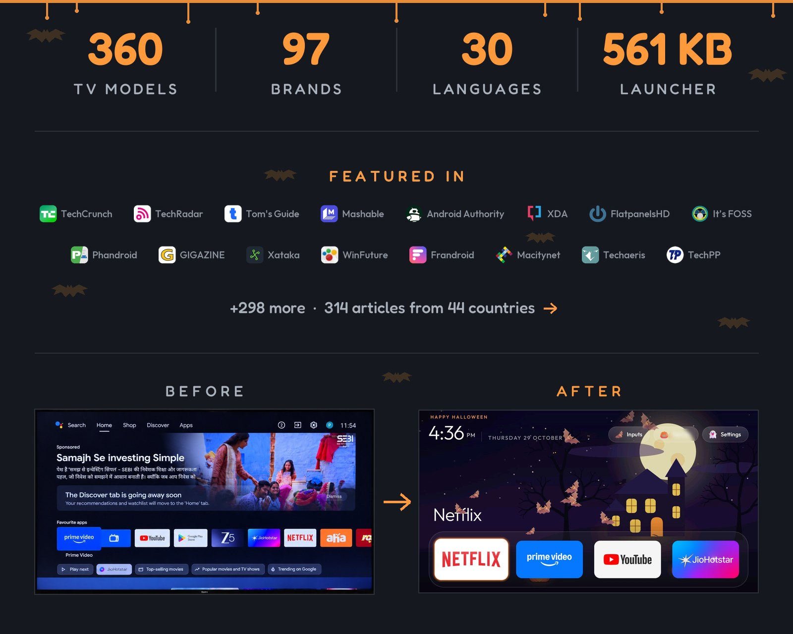

<p align="center">
  <a href="https://cleanyour.tv"></a>
</p>

<p align="center">
  <a href="README.md">English</a> · <a href="README.zh-CN.md">简体中文</a> · <a href="README.zh-TW.md">正體中文</a> · <a href="README.vi.md">Tiếng Việt</a> · <a href="README.ja.md">日本語</a> · <a href="README.it.md">Italiano</a> · <a href="README.nl.md">Nederlands</a> · Deutsch
</p>

<p align="center">
  <a href="https://github.com/Gathin23/cleanyourtv/stargazers"></a>
  <a href="https://github.com/Gathin23/cleanyourtv/pulls?q=is%3Amerged"></a>
  <a href="https://github.com/Gathin23/cleanyourtv/network/members"></a>
  <a href="https://github.com/Gathin23/cleanyourtv/graphs/contributors"></a>
  <a href="https://buymeacoffee.com/gathint"></a>
  <a href="https://www.producthunt.com/products/cleanyourtv"></a>
</p>

<p align="center">
  <a href="https://trendshift.io/repositories/310225"></a>
</p>

<p align="center">
  <a href="docs/PRESS.md"></a>
</p>

## Einstieg

| Du hast | Geh zu |
|---|---|
| **Einen Android TV oder Google TV** | [Schnellstart](#schnellstart): ein Coding-Assistent erledigt die Arbeit in etwa fünfzehn Minuten. |
| **Einen Samsung, LG, Roku, Vizio oder Hisense VIDAA** | [cleanyour.tv/not-android](https://cleanyour.tv/not-android): CleanYourTV läuft dort nicht, das Tracking lässt sich mit der Fernbedienung abschalten. |
| **Nur ein Android-Telefon** | Die von der Community gebaute [Clean-Your-TV-App](https://cleanyour.tv/app): kein Laptop, kein Coding-Agent. |
| **Willst es erst sehen** | [Was du bekommst](#was-du-bekommst): Bilder des neuen Startbildschirms. |

**Offizielle Links:** [cleanyour.tv](https://cleanyour.tv) und dieses Repo. Andere Domains mit dem Namen, etwa
cleanyourtv.com, gehören nicht zu diesem Projekt ([#1004](https://github.com/Gathin23/cleanyourtv/issues/1004)).

[So funktioniert es](#so-funktioniert-es) · [Schnellstart](#schnellstart) · [Was du bekommst](#was-du-bekommst) ·
[Unterstützte Fernseher](#unterstützte-fernseher) · [Von Hand](#von-hand) · [Der Launcher](#der-launcher) ·
[Wiederherstellen](#fernseher-wiederherstellen) · [Firmware-Updates](#nach-einem-firmware-update) ·
[Fragen](#häufige-fragen) · [Mitmachen](#mitmachen)

## So funktioniert es

Android-Fernseher haben dieselbe Debug-Brücke wie Android-Telefone. Schalte USB-Debugging in den
Entwickleroptionen des Fernsehers ein, erlaube dem Computer einmal den Zugriff, der Rest ist normales Android-Werkzeug:

| Schritt | Was passiert |
|---|---|
| **Sichern** | Die Liste der installierten Pakete und die Einstellungen. |
| **Deaktivieren** | Telemetrie des Herstellers, Werbedienste, Inhaltszeilen und vorinstallierter Ballast, mit `pm disable-user`. Nichts wird deinstalliert, ein Wiederherstellungs-Skript kann jeden Schritt rückgängig machen. |
| **Installieren** | Ein kleiner nativer Launcher, der zum Standard-Startbildschirm wird. |

**Kein Root, kein Kabel, nichts wird deinstalliert, und eine Zeile stellt alles wieder her, wenn du es dir anders überlegst.**

Der Ballast unterscheidet sich je nach Marke. Der Prompt lässt den Coding-Assistenten ihn auf deinem Fernseher finden und nachfragen,
bevor etwas angefasst wird, das du vielleicht nutzt.

## Schnellstart

| Du hast | Tu dies |
|---|---|
| **Einen Computer** | Den Prompt mit einem Coding-Assistenten nutzen: die drei Schritte unten. |
| **Einen Computer, keinen Coding-Assistenten** | Die drei Schritte selbst ausführen: die Befehle stehen unter [Von Hand](#von-hand). |
| **Nur ein Android-Telefon** | Die von der Community gebaute [Clean-Your-TV-App](https://cleanyour.tv/app) von [@udhaykumarbala](https://github.com/udhaykumarbala): verbinden, analysieren, aufräumen, in etwa fünf Minuten. Kein Laptop, kein Coding-Agent. |

Die drei Schritte unten sind für einen Coding-Assistenten geschrieben: der Computer muss im selben WLAN sein wie
der Fernseher, mit einer Shell darauf. Ohne Assistenten ist [Von Hand](#von-hand) dieselbe Arbeit,
von dir ausgeführt.

Jedes davon geht: Claude Code (auf [0G Private Computer](https://pc.0g.ai/?utm_source=cleanyourtv&utm_medium=github&utm_campaign=readme) oder einem [Anthropic-Tarif](https://claude.com/pricing)), [Codex](https://github.com/openai/codex), [Gemini CLI](https://github.com/google-gemini/gemini-cli) oder [Antigravity CLI](https://antigravity.google/product/antigravity-cli).

| Wo | Was zu tun ist |
|---|---|
| **1. Am Fernseher** | Einstellungen → Gerätepräferenzen → Info → siebenmal OK auf **Build** → zurück → Entwickleroptionen → **USB-Debugging** ein. Wenn ein Schalter für Netzwerk- oder ADB-Debugging da ist, den auch einschalten. Den Fernseher eingeschaltet lassen. |
| **2. Am Computer** | Klone das Repo und öffne den Ordner im Assistenten (`git clone https://github.com/Gathin23/cleanyourtv`), danach [`PROMPT.md`](PROMPT.md) einfügen und das TV-Modell eintragen. |
| **3. Mitgehen** | „USB-Debugging zulassen?“ am Fernseher bestätigen, dann die Checkliste beantworten: welche Apps du nutzt, die Dock-Größe und die App-Reihenfolge, ob Sprachassistent, Chromecast und Updates bleiben sollen. |

Klonen zählt: der Assistent verwendet `tools/disable.sh` und `launcher/build-and-install.sh` aus diesem Repo,
statt eigene Skripte zu schreiben. Dort liegen die Sicherung, die Home-Sicherung und der Wiederherstellungs-Eintrag.

Der Assistent sichert, räumt auf, baut und installiert den Launcher und prüft jeden Schritt mit
Screenshots vom Fernseher. Mit diesem Repo als Kontext dauert das etwa fünfzehn Minuten.

## Was du bekommst

Einen Startbildschirm, der wie ein Apple TV aussieht und sich zurückhält:

| Teil | So sieht es aus |
|---|---|
| **Ein tiefschwarzes Home** | Ein Dock mit deinen vier Lieblings-Apps in einem abgerundeten Band, dort, wo Apple TV es hinlegt. |
| **Ein Top-Regal** | Nennt die fokussierte App in großer Schrift, mit einem Umgebungsleuchten in einer Farbe aus ihrem Bild. |
| **Die übrigen Apps in einem Raster** | Schiebt sich nach oben, wenn du Unten drückst. |
| **Eine schwebende Glas-Markierung** | Springt von Kachel zu Kachel. Die fokussierte Kachel hebt sich und zeigt ihren Namen. |
| **Drei mattierte Knöpfe** | Eingänge (HDMI-Anschlüsse unter den Namen aus den TV-Einstellungen, AV, Live-TV), WLAN oder Ethernet mit dem Netzwerknamen, Einstellungen. |
| **Eine Begrüßung, eine dünne Uhr und das Datum** | In [Outfit](https://fonts.google.com/specimen/Outfit), und ein passender Uhr-Bildschirmschoner. `show_stats` in der Config oder einem Theme setzt eine Zeile unter die Uhr: CPU, freier Speicher und freier Speicherplatz. Sie bleibt aus, bis du sie einschaltest, und aktualisiert sich nur, solange Home auf dem Bildschirm ist. |
| **Themes und Modul-Karten** | Themes ändern Farben, Hintergrund, Dock und Spalten ohne neuen Build, und Modul-Karten lassen andere Apps eine Kachel einhängen, nur mit deinem Einverständnis. |

Und ein Fernseher, der aufhört, gegen dich zu arbeiten: keine gesponserten Zeilen, kein „Entdecken“-Generve, keine Analytik,
die nach Hause telefoniert, keine Apps, um die du nie gebeten hast.

| | |
|---|---|
|  |  |
| *Top-Regal und Umgebungsleuchten* | *Eingänge: HDMI mit Verbindungsstatus, AV, Live-TV* |
|  |  |
| *Das Raster, eine Glas-Markierung, der Name der Kachel* | *Uhr-Bildschirmschoner, wandert, damit nichts einbrennt* |
|  |  |
| *Aurora-Theme, aufgespielt mit `tools/theme.sh`* | *Sechs Spalten und ein Dock mit sechs Apps, derselbe Launcher* |
|  |  |
| *Mit `tile_menu`: OK auf einer Kachel halten, Verschieben: Pfeile tragen sie, Zurück legt sie ab* | *App-Bibliothek: ein Druck legt eine entfernte App wieder auf Home* |

## Unterstützte Fernseher

Alles, worauf **Android TV** oder **Google TV** läuft.

| Plattform | Was funktioniert |
|---|---|
| **Android TV, Google TV** | Das Aufräumen und der Launcher. |
| **Fire TV** | Nur die Aufräum-Hälfte, weil Fire OS Home keinem Launcher von Dritten überlässt. Auf der Fire TV Box von 2015 (Fire OS 5) scheitert auch diese Hälfte: jeder `pm`-Weg wird abgelehnt. |
| **Einige TCL-Geräte für den chinesischen Markt** | Sie verweigern jede Launcher-Installation; ihre Listen sagen das in der Kopfzeile. |
| **Samsung (Tizen), LG (webOS), Roku, Vizio, Hisense VIDAA** | Nicht unterstützt (kein ADB). Schalte stattdessen das Tracking aus: [cleanyour.tv/not-android](https://cleanyour.tv/not-android). Vier webOS-Portierungen stehen in [SHOWCASE.md](SHOWCASE.md#other-platforms-fire-tv-and-lg-webos), und [docs/devices/samsung-tizen.md](docs/devices/samsung-tizen.md) beschreibt, was ein Samsung von 2021 über WLAN antwortet (kein ADB, also kein `pm disable-user`), wenn du eine Tizen-Portierung abwägst. |

Getestete Listen von Mitwirkenden, ein Ordner pro Modell in [`examples/`](examples/). Die Marken mit den
meisten Listen, jede mit ihren Modellen auf der Website verlinkt:

<!-- tv-brands:start: generated by tools/gen_tables.py from examples/*/tv.json; edit those, not this -->

| | | | | | |
|---|---|---|---|---|---|
| [TCL](https://cleanyour.tv/tvs?q=TCL) · 77 | [Sony](https://cleanyour.tv/tvs?q=Sony) · 41 | [Xiaomi](https://cleanyour.tv/tvs?q=Xiaomi) · 34 | [Philips](https://cleanyour.tv/tvs?q=Philips) · 19 | [Skyworth](https://cleanyour.tv/tvs?q=Skyworth) · 15 | [Hisense](https://cleanyour.tv/tvs?q=Hisense) · 11 |
| [Amazon Fire TV](https://cleanyour.tv/tvs?q=Amazon%20Fire%20TV) · 7 | [SHARP](https://cleanyour.tv/tvs?q=SHARP) · 7 | [Panasonic](https://cleanyour.tv/tvs?q=Panasonic) · 6 | [BenQ](https://cleanyour.tv/tvs?q=BenQ) · 5 | [JVC](https://cleanyour.tv/tvs?q=JVC) · 5 | [OnePlus](https://cleanyour.tv/tvs?q=OnePlus) · 4 |
| [Thomson](https://cleanyour.tv/tvs?q=Thomson) · 4 | [Google](https://cleanyour.tv/tvs?q=Google) · 3 | [Grundig](https://cleanyour.tv/tvs?q=Grundig) · 3 | [Haier](https://cleanyour.tv/tvs?q=Haier) · 3 | [Motorola](https://cleanyour.tv/tvs?q=Motorola) · 3 | [NVIDIA Shield](https://cleanyour.tv/tvs?q=NVIDIA%20Shield) · 3 |
| [RCA](https://cleanyour.tv/tvs?q=RCA) · 3 | [Redmi](https://cleanyour.tv/tvs?q=Redmi) · 3 | [Toshiba](https://cleanyour.tv/tvs?q=Toshiba) · 3 | [Vu](https://cleanyour.tv/tvs?q=Vu) · 3 | [CHiQ](https://cleanyour.tv/tvs?q=CHiQ) · 2 | [EKO](https://cleanyour.tv/tvs?q=EKO) · 2 |
| [FFalcon](https://cleanyour.tv/tvs?q=FFalcon) · 2 | [Hitachi](https://cleanyour.tv/tvs?q=Hitachi) · 2 | [Insignia Fire TV](https://cleanyour.tv/tvs?q=Insignia%20Fire%20TV) · 2 | [Kalley](https://cleanyour.tv/tvs?q=Kalley) · 2 | [Kogan](https://cleanyour.tv/tvs?q=Kogan) · 2 | [Nokia](https://cleanyour.tv/tvs?q=Nokia) · 2 |

<details>
<summary>+53 more brands and 14 projector brands</summary>

**onn** 2 · **RockTek** 2 · **Sankey** 2 · **Sber** 2 · **Vidda** 2 ·
Acer · AiPro2K · AIWA · AQUA · Artel · ASUS · Beko · BGH · Caxium · Cecotec · Challenger · Compac · Dcolor · Dialog ·
DYON · Freebox · Home+ · Impex · INCLO · Karbonn · Koryo · KTC · Liberton · Lumio · Master-G · MECOOL · MTC · Next ·
Noblex · OK. · OPPO · Panavox · PEAQ · Polytron · PPTV · PRISM+ · Prosonic · SANYO · Seleco · Super General · Síragon ·
Tele System · TiVo · Tornado · Turkcell · Tuvio · Verizon · Vision ·
Alwtniet, Anker Nebula, BYINTEK, Epson, Formovie, Gadnic, HOTACK, HY320, JMGO, Magcubic, Portronics, Stellamore, Wanbo and XGIMI projectors

</details>

<!-- tv-brands:end -->

**Deinen Fernseher finden:** suche auf [cleanyour.tv/tvs](https://cleanyour.tv/tvs) oder in der ganzen Tabelle in
[examples/README.md](examples/README.md).

Dein Fernseher fehlt? Der Prompt findet den Ballast selbst. Häng deine Liste danach an, dann überspringt die nächste
Person mit deinem Modell diesen Schritt: [CONTRIBUTING.md](CONTRIBUTING.md).

## Von Hand

Alles, was der Assistent tut, kannst du selbst ausführen. Die Werkzeuge brauchen Python 3 und sonst nichts.
`tools/tv.py` spricht Netzwerk-ADB auf Port 5555. Bleibt dieser Port zu und der Fernseher bietet
Wireless debugging mit einem Pairing-Code an (Chromecast mit Google TV und der Google TV Streamer
tun das), paare ihn einmal mit dem mitgelieferten `adb` und führe zuerst `adb tcpip 5555` aus, wie
[Fehlerbehebung](docs/TROUBLESHOOTING.md#connecting) beschreibt.

```bash
python3 -m venv tools/venv && tools/venv/bin/pip install -r tools/requirements.txt
export TV_HOST=192.168.1.50                                   # IP-Adresse deines Fernsehers

tools/venv/bin/python -I tools/tv.py --probe                 # Modell, Android-Version, Firmware
tools/venv/bin/python -I tools/tv.py 'pm list packages'      # ein Shell-Befehl auf dem Fernseher
tools/disable.sh examples/xiaomi-mi-tv-4a/debloat.txt        # eine Debloat-Liste anwenden
tools/restore.sh examples/xiaomi-mi-tv-4a/debloat.txt        # rückgängig, der Hersteller-Launcher ist wieder da
tools/venv/bin/python -I tools/check.py examples/xiaomi-mi-tv-4a/debloat.txt   # was ein Firmware-Update zurückgeholt hat
TV_HOST=192.168.1.50 launcher/build-and-install.sh           # Launcher bauen und zum Home machen
tools/theme.sh themes/aurora                                 # ein Theme aufspielen; --reset nimmt es weg
```

| Werkzeug | Was es tut |
|---|---|
| [`tools/tv.py`](tools/tv.py) | ADB-Client in reinem Python: Shell, Stapel, Push, Pull, Neustart und Screenshots, auf Wunsch zuerst mit Tasten der Fernbedienung. Funktioniert dort, wo die mitgelieferte `adb`-Datei blockiert ist. Optionales [gekoppeltes Google-ADB-Backend](tools/native-adb.md) für verschlüsseltes Wireless debugging. |
| [`tools/b64push.py`](tools/b64push.py) | Lädt große Dateien wie APKs in Base64-Stücken hoch und prüft die Prüfsumme. |
| [`tools/relay.py`](tools/relay.py) | Leitet einen lokalen Port an den ADB-Port des Fernsehers weiter, für Assistenten, deren Sandbox dein Netz nicht erreicht. Lauscht nur auf diesem Computer. [Anleitung](tools/relay.md). |
| [`tools/disable.sh`](tools/disable.sh), [`restore.sh`](tools/restore.sh) | Eine Debloat-Liste anwenden oder zurücknehmen, die Rücknahme aus dem Zustand vor der Änderung. |
| [`tools/recovery.py`](tools/recovery.py) | Schreibt den Eintrag, den `disable.sh` zum Rückgängigmachen braucht, und gibt den Wiederherstellungs-Stapel aus. |
| [`tools/check.py`](tools/check.py) | Vergleicht den Fernseher mit der angewendeten Liste, für das, was ein Firmware-Update zurückgeholt hat; `--fix` setzt es zurück. |
| [`tools/adb-closed.py`](tools/adb-closed.py) | Prüft, dass der Netzwerk-ADB-Port des Fernsehers zu ist, sobald Debugging aus ist: Ende 0, wenn der Fernseher die Verbindung ablehnt, 1, solange er noch offen ist, 2, wenn nichts geantwortet hat oder die Prüfung selbst nicht laufen konnte. Kein `nc` nötig. |
| [`tools/privacy.py`](tools/privacy.py) | Prüft den Fernseher auf Kandidaten für Sprache, ACR und Telemetrie und gibt die Belege für jeden aus; `--write` macht aus den Funden eine Liste, die `disable.sh` und `restore.sh` schon verstehen. |
| [`tools/theme.sh`](tools/theme.sh), [`theme_restart.py`](tools/theme_restart.py) | Spielt einen Ordner aus [`themes/`](themes/) auf den Launcher und startet Home neu. |
| [`tools/manage.py`](tools/manage.py) | Listet jedes Add-on, jedes Theme und jeden Schalter mit Screenshot, zeigt, was auf dem Fernseher liegt, und installiert, aktualisiert oder entfernt eines über das eigene Skript seiner Autorin oder seines Autors. |
| [`tools/bench.py`](tools/bench.py) | Misst den Launcher, der auf HOME antwortet: Tastenlatenz, wie weit der Fokus gewandert ist, ruckelige Frames, Kaltstart, Rückkehr zu Home, und die CPU und PSS im Leerlauf. Ändert nichts am Fernseher und schreibt die rohen Zahlen je Taste nach JSON; keine Extra-Installation. |
| [`tools/trace.py`](tools/trace.py), [`trace_report.py`](tools/trace_report.py) | Nimmt Perfetto-Traces des Launchers auf (Rückkehr zu Home, Kaltstart, D-Pad) und berichtet, wohin die Zeit geht, je Lauf und vorher gegen nachher. Optional: braucht [`requirements-perf.txt`](tools/requirements-perf.txt). [Anleitung](tools/trace.md). |
| [`tools/flamechart.py`](tools/flamechart.py) | Zeichnet aus diesen Traces ein Vorher/Nachher-Flammendiagramm für einen Pull Request: eine Spur je Thread auf gemeinsamer Zeitachse, die Arbeit, die eine Änderung trifft, in Magenta mit ihrer Summe. Optional, wie die Trace-Werkzeuge. [Anleitung](tools/flamechart.md). |
| [`tools/screendiff.py`](tools/screendiff.py) | Vergleicht ein Vorher- und ein Nachher-Bild Pixel für Pixel, lässt die Uhr oder das aus, was du maskierst, und schreibt das Paar mit unkenntlich gemachtem WLAN-Namen. Optional, wie die Trace-Werkzeuge. [Anleitung](tools/screendiff.md). |
| [`tools/race_calendar.py`](tools/race_calendar.py) | Schreibt den F1-Kalender dieser Saison in ein Theme für den Rennwochenend-Modus, aus der freien Jolpica-API. |
| [`launcher/build-and-install.sh`](launcher/build-and-install.sh) | Baut ein geschrumpftes Release (etwa 561 KB), installiert es, schaltet Home um und rollt zurück, wenn Home nicht darauf landet. |

Die Skripte lassen den Fernseher nie ohne Home-App: sie deaktivieren nur einen Hersteller-Launcher, den sie erkennen,
und überspringen die Home-App in einer Liste, bis ein anderer Launcher auf HOME antwortet. Eigene Listen können außerhalb
des Repositorys liegen: Listenpfade sind relativ zum Verzeichnis, aus dem du startest, und absolute Pfade gehen auch.

<details>
<summary><b>Windows (PowerShell)</b></summary>

Jedes Skript hat ein PowerShell-Gegenstück daneben. Unter Windows mit installiertem Android Studio braucht es
sonst nichts:

```powershell
python -m venv tools\venv; tools\venv\Scripts\python.exe -m pip install -r tools\requirements.txt
powershell -ExecutionPolicy Bypass -File launcher\build-and-install.ps1 -TvHost 192.168.1.50
powershell -ExecutionPolicy Bypass -File tools\disable.ps1 -TvHost 192.168.1.50 examples\xiaomi-mi-tv-4a\debloat.txt
```

</details>

<details>
<summary><b>Wie die Skripte Home schützen</b></summary>

Die Installations-Skripte fragen den Fernseher, welcher Launcher Home besitzt, und deaktivieren nur einen, den sie erkennen, die vier
in `KNOWN_STOCK_LAUNCHERS`: `com.google.android.tvlauncher`, `com.google.android.apps.tv.launcherx`,
`com.google.android.leanbacklauncher` und Xiaomis `com.mitv.tvhome` (PatchWall). Übergib
`STOCK_LAUNCHER=<package>` (`-StockLauncher`) zum Überschreiben, oder `none`, um ihn in Ruhe zu lassen.

`tools/disable.sh` (`disable.ps1`) wendet dieselbe Regel an, bevor es irgendetwas deaktiviert:

- Enthält die Liste die App, der Home gehört, und keine andere App auf dem Fernseher antwortet auf HOME, überspringt es diesen
  Eintrag, sagt warum, und deaktiviert den Rest der Liste. Eine Liste, die vor der Launcher-Übergabe angewendet wird,
  kann den Fernseher so nicht ohne etwas zum Starten lassen.
- Der Einrichtungsassistent, die Einstellungs-Apps, ein `FallbackHome` des Herstellers und Werksprüf-Apps (Xiaomis
  `com.duokan.factorytest`) antworten auch auf HOME und zählen nicht.
- Auf Google TV behält es den Besitzer außerdem, solange setupwraith auf HOME antwortet und aktiviert bleibt (nicht in der Liste, oder
  wegen des WLAN behalten): setupwraith antwortet vor einem installierten Launcher, der noch nicht Home ist,
  und würde Home übernehmen.

Dieselbe Liste noch einmal ausführen, sobald `launcher/build-and-install.sh` den neuen Launcher zu Home gemacht hat und der
Eintrag angewendet wird; `FORCE_HOME=1` (`$env:FORCE_HOME`) deaktiviert ihn trotzdem.

</details>

## Das Mikrofon, und was sich dazu sagen lässt

„Welches dieser Pakete hört zu?“ hat keine ehrliche Antwort in einer Zeile: ein Rechte-Scan zeigt fünfzig
Systempakete mit `RECORD_AUDIO`, die nichts aufnehmen, und ACR-Clients sehen den Bildschirm ganz ohne Audio-
Recht. [`tools/privacy.py`](tools/privacy.py) berichtet, was der Fernseher tatsächlich sagt, mit den
Belegen für jeden Kandidaten zu Sprache, ACR und Telemetrie:
`TV_HOST=192.168.1.50 tools/venv/bin/python -I tools/privacy.py`, und `--write` macht daraus eine normale
Debloat-Liste. Was die Prüfung nicht kann, ist Absicht beweisen: [docs/privacy.md](docs/privacy.md) erklärt warum.

## Der Launcher

Ein kleiner nativer Startbildschirm für Android TV: **etwa 561 KB**, einfaches Java, gebaut für Fernseher mit 1 GB RAM.
Kein Weichzeichnen, kein Video, keine Netzwerkberechtigung, keine Hintergrunddienste. Der **Fernseher** braucht Android 8.0 (API 26)
oder neuer, das `minSdk` in [`launcher/app/build.gradle`](launcher/app/build.gradle); was auf einem älteren
Gerät übrig bleibt, steht in der [Fehlerbehebung](docs/TROUBLESHOOTING.md).

| Was | Wie es funktioniert |
|---|---|
| **Einrichten** | Dock-Reihenfolge, versteckte Apps, Live-TV-App, 4 bis 7 Kacheln je Zeile, reduzierte Bewegung. Alles in [`config.xml`](launcher/app/src/main/res/values/config.xml) |
| **Einstellungen am Fernseher** | OK auf Einstellungen halten für die Launcher-Einstellungen. Ein optionales `launcher_settings_button` lässt einen normalen Klick sie direkt öffnen; die TV-Einstellungen bleiben auf der Einstellungsseite und ihrer App-Kachel. |
| **Themes** | Hintergrund, Wallpaper und Layout aus einer `config.json`, über WLAN aufgespielt, ohne neuen Build. Zwölf liegen in [`themes/`](themes/), das eingebaute `default/` mitgerechnet |
| **30 Sprachen** | Folgt der Sprache des Fernsehers, mit vollständig gespiegeltem Layout von rechts nach links für Hebräisch |
| **App-Bibliothek** | Optional: jede installierte App durchsehen und Home-Verknüpfungen hinzufügen oder entfernen. Siehe [die Anleitung zur App-Bibliothek](docs/app-library.md) |
| **Kachelmenü** | Optional (`tile_menu`): OK auf einer Kachel halten für Verschieben, Von Home entfernen und App-Info. Aus: OK halten öffnet App-Info |
| **Modul-Karten** | Jede TV-App kann eine eigene Kachel anbieten; du stimmst jeder einmal zu. Siehe [`docs/modules.md`](docs/modules.md) |
| **Add-ons** | Optionale Apps, die sich als Modul-Karten einhängen, liegen in [`addons/`](addons/) und werden nie in den Launcher gebaut |
| **Uhr-Bildschirmschoner** | Eine wandernde Uhr über dem Leuchten, damit nichts einbrennt |
| **Tasten der Fernbedienung** | Hält die Tasten für Eingang, YouTube und das Zahnrad am Laufen, nachdem der Hersteller-Launcher weg ist |

Themes, Schalter und Add-ons zusammen, mit Bildern: [cleanyour.tv/addons](https://cleanyour.tv/addons).

**Mehr:** [docs/launcher.md](docs/launcher.md) hat die Einstellungsseite des Launchers Zeile für Zeile, den Wechsel des
Standard-Home, die Sprachen, die Tasten der Fernbedienung, den Uhr-Bildschirmschoner, die Navigation und den eigenen Build.

## Fernseher wiederherstellen

Behalte die Liste, die du angewendet hast. Eine Zeile setzt den Fernseher zurück, wie er war:

```bash
TV_HOST=192.168.1.50 tools/restore.sh examples/<your tv>/debloat.txt                                    # Android TV
TV_HOST=192.168.1.50 tools/restore.sh examples/<your tv>/debloat.txt com.google.android.apps.tv.launcherx  # Google TV
```

| Was | Wie |
|---|---|
| **Zuerst ein Eintrag** | Bevor `tools/disable.sh` etwas ändert, schreibt es auf, wie der Fernseher aussah, in `~/.cleanyourtv/`. |
| **Wiederherstellen spielt ihn ab** | Ein Paket, das du selbst deaktiviert hattest, bleibt deaktiviert, und Home geht zurück zu der Komponente, der es gehörte. |
| **Der Launcher bleibt installiert** | Nimm ihn unter Einstellungen → Apps des Fernsehers weg, wenn er weg soll. |
| **Kein Computer?** | Ist der Fernseher nicht erreichbar, kann seine eigene Seite Einstellungen → Apps Pakete auch wieder aktivieren. |

**Mehr:** [docs/restore.md](docs/restore.md) beschreibt, was der Eintrag enthält, wann das Argument für den Hersteller-Launcher
zählt, und was ohne Eintrag passiert.

## Nach einem Firmware-Update

Ein Update installiert sich über das aufgeräumte System: die gelisteten Pakete kommen zurück, Home geht an den
Hersteller-Launcher, und neue Vorinstallationen erscheinen, die keine Liste nennt. Öffne ADB wieder wie in
[Schnellstart](#schnellstart) Schritt 1, dann vergleiche den Fernseher mit der Liste, die du angewendet hast; `--fix` setzt sie zurück:

```bash
TV_HOST=192.168.1.50 tools/venv/bin/python -I tools/check.py examples/<your tv>/debloat.txt
```

**Mehr:** [docs/firmware-updates.md](docs/firmware-updates.md) hat die Exit-Codes, eine wöchentliche Prüfung, was
`--fix` ändert, Fernseher, die den Hersteller-Launcher als Home behalten, und Listen, die den Updater deaktivieren.

## Wenn etwas schiefgeht

Die ganze Liste dessen, was uns gebissen hat, steht in [docs/TROUBLESHOOTING.md](docs/TROUBLESHOOTING.md). Die
drei, auf die es am meisten ankommt:

- 🍎 **macOS blockiert `adb connect`** („No route to host“) unter der Privatsphäre des lokalen Netzes. `tools/tv.py` umgeht die Datei.
- ⚠️ **Den Hersteller-Launcher erst deaktivieren, wenn der neue installiert ist und läuft**, sonst landet Home auf einer Werksprüf-App. Das Installations-Skript ordnet das für dich.
- 🔁 **Auf Google TV kann der Einrichtungsassistent** (`com.google.android.tungsten.setupwraith`) Home übernehmen und das System in eine Absturzschleife schicken, nachdem der Hersteller-Launcher deaktiviert ist. Deaktiviere ihn auch, und nimm ihn in deine `debloat.txt` auf, damit die Wiederherstellung ihn zurückbringt.
  - Prüfe aber zuerst `dumpsys wifi | grep -o 'cname=[^ ]*'`: wurde das WLAN während der Einrichtung gespeichert, gehört es setupwraith, und das Deaktivieren löscht das Netz (tritt ihm zuerst in den Einstellungen wieder bei; `tools/disable.sh` überspringt setupwraith, bis du das tust).
  - Auf Googles eigenem Chromecast und auf dem Google TV Streamer kostet das auch das Casten vom Telefon, siehe [Fehlerbehebung](docs/TROUBLESHOOTING.md).
  - Schon festgefahren? `tools/tv.py 'pm enable --user 0 com.google.android.apps.tv.launcherx'`.

## Häufige Fragen

<details>
<summary><b>Ich programmiere nicht und habe keinen Laptop. Geht das trotzdem?</b></summary>

Ja. [@udhaykumarbala](https://github.com/udhaykumarbala) hat eine freie, quelloffene [Telefon-App](https://cleanyour.tv/app)
für Android gebaut, die dasselbe Aufräumen über WLAN macht: sie verbindet sich mit dem Fernseher, zeigt zuerst einen Plan, speichert einen Wiederherstellungs-
punkt und schaltet Apps nur aus, sodass alles zurückgesetzt werden kann. Sie ist von der Community gebaut.

</details>

<details>
<summary><b>Ist das sicher? Kann es den Fernseher unbrauchbar machen?</b></summary>

Nichts wird geflasht, gerootet oder gelöscht; Pakete werden im
Benutzerprofil deaktiviert. Das Risiko ist, etwas zu deaktivieren, worauf der Fernseher sich stützt. Deshalb werden Listen
in kleinen Stapeln angewendet, mit einem Wiederherstellungs-Skript in Bereitschaft. Die eigene Seite Einstellungen → Apps des Fernsehers kann
Pakete auch ohne die Werkzeuge wieder aktivieren. Startet der Fernseher nicht mehr weit genug dafür, ist ein Werks-
reset aus seinem Wiederherstellungsmenü meist der Weg zurück.

Mehr: [docs/faq.md](docs/faq.md#is-this-safe-can-it-brick-the-tv)

</details>

<details>
<summary><b>Was ist mit Firmware-Updates?</b></summary>

Der Updater bleibt in den meisten Listen an, Firmware-Updates kommen also wie gewohnt. Manche Listen deaktivieren den
eigenen Updater des Fernsehers, und dort kommt ein Firmware-Update erst, wenn du ihn wieder aktivierst. Wenn eines
landet, installiert es sich über das aufgeräumte System, ein Paket kommt zurück und du führst das Skript erneut aus: siehe
[Nach einem Firmware-Update](#nach-einem-firmware-update).

</details>

<details>
<summary><b>Gehen die Apps dann kaputt?</b></summary>

Streaming-Apps aktualisieren sich weiter über den Play Store, der in Ruhe gelassen wird.
Der Launcher listet nur, was installiert ist, und startet es mit Intents, die seit einem Jahrzehnt stabil sind.

</details>

<details>
<summary><b>Kann ich das für jemanden in einem anderen Haushalt machen?</b></summary>

Ja, über eine private [Tailscale](https://tailscale.com)-
Verbindung statt über dasselbe WLAN: entweder Tailscale auf deren Fernseher, mit dir geteilt, oder ein Computer oder Apple
TV bei ihnen, der dorthin leitet. Nie, indem der ADB-Port an ihrem Router geöffnet wird. Schritt für Schritt in
[docs/REMOTE.md](docs/REMOTE.md).

</details>

<details>
<summary><b>Ist ADB-Zugriff nicht ein Sicherheitsloch?</b></summary>

Es ist ein ausdrückliches Tippen auf „diesen Computer zulassen“ am Fernseher,
dasselbe wie beim Entwickeln einer Android-App. Netzwerk-ADB ist Klartext auf Port 5555, und auf mancher Firmware bekommt jedes
Gerät im LAN eine Shell, also schließe es, wenn du fertig bist:

1. Am Fernseher: Entwickleroptionen → **USB-Debugging**, **Netzwerk-/ADB-Debugging** und
   **Wireless debugging** aus, je nachdem, was der Fernseher hat, und die USB-Debugging-Berechtigungen widerrufen.
2. Den Fernseher neu starten, dann vom Computer aus bestätigen, dass der Port weg ist:
   `python3 tools/adb-closed.py <tv ip>` muss sagen, dass der Port geschlossen ist.

Der Launcher arbeitet weiter ohne Debugging. Mehr, einschließlich der Prüfung des eigenen Ports von Wireless debugging:
[docs/faq.md](docs/faq.md#isnt-adb-access-a-security-hole)

</details>

<details>
<summary><b>Kann es Werbung auch in Apps blockieren?</b></summary>

Teilweise, mit Androids privatem DNS (Android 9 und neuer). Zeige
es auf einen werbeblockierenden Resolver wie [AdGuard DNS](https://adguard-dns.io), dann lösen die Werbe- und
Tracker-Domains jeder App nicht mehr auf, systemweit, und das übersteht Neustarts. Der Preis: dieser Resolver sieht
dann jede DNS-Anfrage, die der Fernseher macht, und YouTube-Werbung nimmt er nicht weg.

Mehr, mit den beiden Befehlen und dem Zurückschalten: [docs/faq.md](docs/faq.md#can-it-block-ads-inside-apps-too)

</details>

<details>
<summary><b>Gibt es Schalter in den eigenen Einstellungen des Fernsehers, die sich auch lohnen?</b></summary>

Ein paar, und sie brauchen kein ADB: die Werbe-ID, Standort, Nutzung und Diagnose und Immer
verfügbares Scannen, plus den Nur-Apps-Modus, wo der Hersteller-Launcher bleibt. Schalte Nutzung und Diagnose vor dem
Aufräumen um; auf manchen Fernsehern geht diese Seite mit.

Mehr, mit den Pfaden für Google TV, Android TV und Fire OS:
[docs/faq.md](docs/faq.md#are-there-switches-in-the-tvs-own-settings-worth-flipping-too)

</details>

<details>
<summary><b>AirPlay?</b></summary>

Nicht aus diesem Repo. Chromecast built-in bleibt für Android-Telefone. Für iPhones
funktioniert [jqssun/android-airplay-server](https://github.com/jqssun/android-airplay-server); ein Installations-
Skript dafür liegt in [PR #84](https://github.com/Gathin23/cleanyourtv/pull/84).

</details>

<details>
<summary><b>Kann ich einfach die APK herunterladen?</b></summary>

Baue sie mit dem Einzeiler; das dauert eine Minute und du
bestimmst, was auf deinen Fernseher kommt. Keine vorgebauten Binärdateien.

</details>

## Die Geschichte

Am 17. Oktober 2026 habe ich [ein Vorher und Nachher](https://x.com/gathint/status/2111379569030939102) des
Fernsehers meiner Eltern gepostet, aufgeräumt von Claude Code über WLAN. Es erreichte 7,4 Millionen Aufrufe, Leute haben dasselbe mit
ihren eigenen Fernsehern gemacht, und ihre Antworten wurden zu den Listen hier: über 170 TV-Modelle von über 200 Mitwirkenden in vier
Tagen. Das Repo hieß bis zum 19. tv-vibehack; alte Links funktionieren. Die Berichterstattung seither steht in
[docs/PRESS.md](docs/PRESS.md).

## Mitmachen

Der nützlichste Beitrag ist die Debloat-Liste deines Fernsehers, damit die nächste Person mit diesem Modell
sie nicht neu entdecken muss. [CONTRIBUTING.md](CONTRIBUTING.md) hat das Format und die Prüfung, um die wir bitten.
Du arbeitest über einen Coding-Agenten mit? [AGENTS.md](AGENTS.md) gibt ihm dieselben Regeln.

| Wie helfen | Was das heißt |
|---|---|
| **Die Debloat-Liste deines Fernsehers** | Die nützlichste: die nächste Person mit diesem Modell überspringt das Entdecken. |
| **Launcher und Prompt** | Verbesserungen am Launcher und schärfere Prompt-Formulierungen sind auch willkommen. |
| **Etwas darauf gebaut?** | Ein Launcher, eine Portierung, ein Theme: trag es in [SHOWCASE.md](SHOWCASE.md) ein, wo schon hundertvierundvierzig Projekte leben, sortiert in Startbildschirme, Forks, Add-ons, Werkzeuge und andere Plattformen, mit einem Index nach TV-Marke. |

Die Menschen, deren Arbeit in diesem Repo steckt:

<a href="https://github.com/Gathin23/cleanyourtv/graphs/contributors"></a>

<details>
<summary><strong>Stern-Verlauf</strong></summary>

<a href="https://star-history.com/#Gathin23/cleanyourtv&Date"></a>

</details>

## Kontakt

| Wofür | Wohin |
|---|---|
| **Fragen zu deinem Fernseher** | [GitHub Discussions](https://github.com/Gathin23/cleanyourtv/discussions) |
| **Presse und Anfragen** | [hello@itsgathin.com](mailto:hello@itsgathin.com) |
| **Sicherheitslücken** | Privat über den [Security-Tab](https://github.com/Gathin23/cleanyourtv/security) melden, siehe [`SECURITY.md`](SECURITY.md) |

## Rechtliches

- CleanYourTV ist ein unabhängiges Open-Source-Projekt. Es ist mit keinem Fernseher-Hersteller oder keiner Plattform verbunden, von ihnen unterstützt
  oder gesponsert. Marken- und Modellnamen stehen nur dafür, auf welchem Fernseher eine Liste getestet wurde,
  und bleiben die Marken ihrer Inhaber.
- Es arbeitet nur über Einstellungen, die der Fernseher seiner Besitzerin oder seinem Besitzer selbst anbietet: Entwickleroptionen, ADB-Debugging und
  Androids eigenes `pm disable-user`, derselbe Schalter wie Einstellungen > Apps > Deaktivieren. Es rootet den Fernseher nicht,
  flasht keine Firmware und umgeht keine Sperre, kein DRM und keinen Kopierschutz, und das Repo enthält keine Hersteller-
  software, Firmware oder APKs.
- Nichts wird deinstalliert, und `tools/restore.sh` setzt alles zurück. Du führst es auf einem Fernseher aus, der dir gehört, auf
  eigenes Risiko, und eine Änderung an der Software eines Fernsehers kann Garantie oder Support berühren.
- Alles hier wird so bereitgestellt, wie es ist, ohne Gewährleistung irgendeiner Art, unter der MIT-Lizenz unten.

## Lizenz

MIT, siehe [`LICENSE`](LICENSE). Die Schrift Outfit steht unter der SIL Open Font License, siehe
`launcher/FONT-LICENSE-OFL.txt`.
