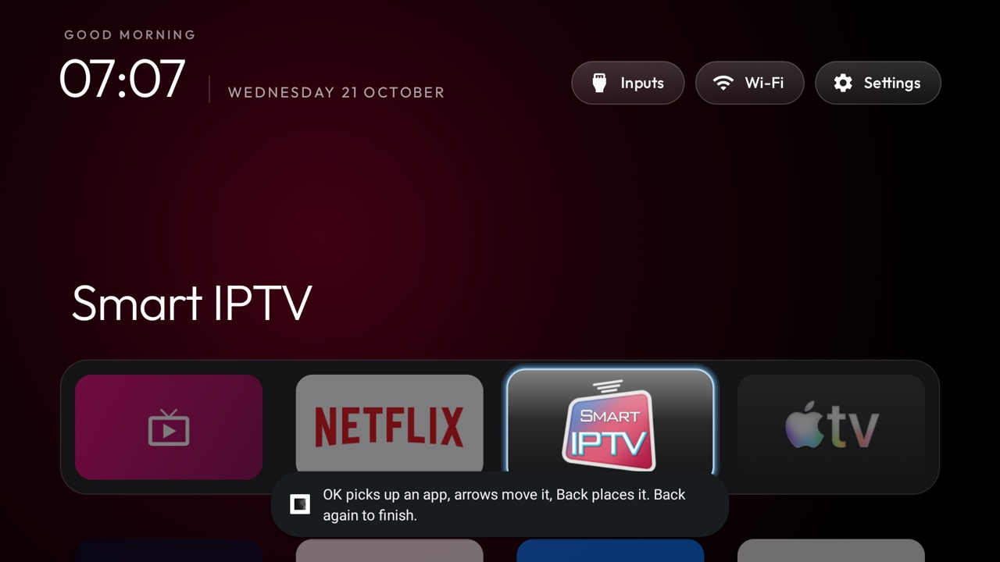
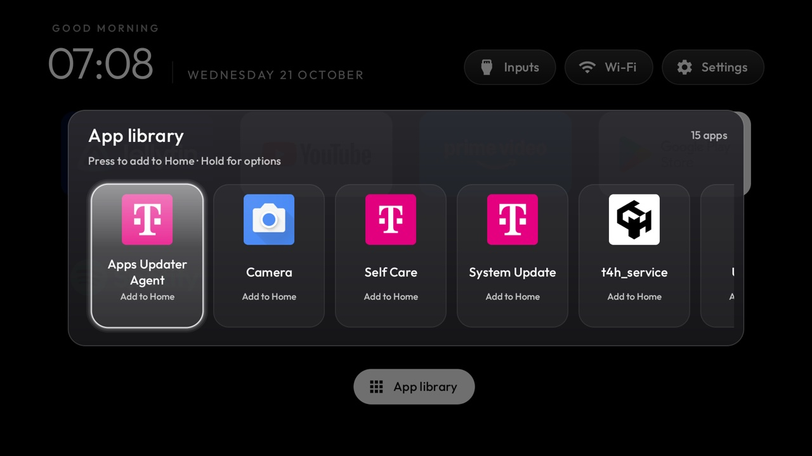

<p align="center">
  <a href="https://cleanyour.tv"></a>
</p>

<p align="center">
  <a href="README.md">English</a> · <a href="README.he.md" lang="he" dir="rtl">עברית</a> · <a href="README.zh-CN.md">简体中文</a> · <a href="README.zh-TW.md">正體中文</a> · <a href="README.vi.md">Tiếng Việt</a> · <a href="README.ja.md">日本語</a> · <a href="README.it.md">Italiano</a> · <a href="README.pt-BR.md">Português</a> · <a href="README.nl.md">Nederlands</a> · <a href="README.de.md">Deutsch</a> · <a href="README.uk.md">Українська</a> · <a href="README.tr.md">Türkçe</a> · <a href="README.uz.md">Oʻzbekcha</a> · <a href="README.fr.md">Français</a> · <a href="README.es.md">Español</a> · Ελληνικά
</p>

<p align="center">
  <a href="https://cleanyour.tv">Ιστότοπος έργου</a> ·
  <a href="PROMPT.md">Οδηγίες για τον βοηθό</a> ·
  <a href="examples/README.md">Λίστα τηλεοράσεων</a> ·
  <a href="SHOWCASE.md">Κοινοτικά έργα</a>
</p>

<p align="center">
  <a href="https://github.com/Gathin23/cleanyourtv/stargazers"></a>
  <a href="https://github.com/Gathin23/cleanyourtv/pulls?q=is%3Amerged"></a>
  <a href="https://github.com/Gathin23/cleanyourtv/network/members"></a>
  <a href="https://github.com/Gathin23/cleanyourtv/graphs/contributors"></a>
  <a href="https://buymeacoffee.com/gathint"></a>
  <a href="https://www.producthunt.com/products/cleanyourtv"></a>
</p>

<p align="center">
  <a href="https://trendshift.io/repositories/310225"></a>
</p>

# CleanYourTV: οδηγός στα Ελληνικά

Συνδεθείτε στην Android TV ή Google TV σας μέσω του οικιακού δικτύου Wi-Fi, απενεργοποιήστε τις προεγκατεστημένες
εφαρμογές, τις διαφημίσεις και τις υπηρεσίες συλλογής δεδομένων που δεν χρειάζεστε και εγκαταστήστε μια καθαρή
αρχική οθόνη (launcher) σε συμβατές τηλεοράσεις.

Δεν απαιτείται root, επανεγκατάσταση firmware ή καλώδιο USB. Οι εφαρμογές συστήματος **απενεργοποιούνται, δεν
απεγκαθίστανται**, και μπορείτε να τις επαναφέρετε με τα παρεχόμενα εργαλεία.

Η σελίδα αυτή παρουσιάζει τις βασικές λειτουργίες και τον τρόπο χρήσης τους. Οι εφαρμογές και οι περιορισμοί
διαφέρουν ανά μοντέλο, περιοχή και έκδοση firmware: ελέγξτε πρώτα όσα αφορούν τη δική σας τηλεόραση.

Σε περίπτωση απόκλισης, υπερισχύει το [αγγλικό README](README.md). Οι σημειώσεις για κάθε μοντέλο βρίσκονται στη
[λίστα τηλεοράσεων](examples/README.md).

> [!WARNING]
> **Samsung, LG, Roku ή άλλη τηλεόραση χωρίς Android TV;**
> <br>Το CleanYourTV δεν λειτουργεί σε αυτές, αλλά μπορείτε να απενεργοποιήσετε την παρακολούθηση βήμα προς βήμα, μόνο με το τηλεχειριστήριο: [cleanyour.tv/not-android](https://cleanyour.tv/not-android).


## Ξεκινήστε από εδώ

| Έχετε | Πού να πάτε |
|---|---|
| **Android TV ή Google TV** | [Γρήγορη εκκίνηση](#γρήγορη-εκκίνηση): ένας βοηθός προγραμματισμού κάνει τη δουλειά σε περίπου δεκαπέντε λεπτά. |
| **Τηλεόραση Samsung, LG, Roku, Vizio ή Hisense VIDAA** | [cleanyour.tv/not-android](https://cleanyour.tv/not-android): το CleanYourTV δεν λειτουργεί εκεί, αλλά μπορείτε να απενεργοποιήσετε την παρακολούθηση με το τηλεχειριστήριό σας. |
| **Κινητό ή φορητό υπολογιστή, χωρίς βοηθό προγραμματισμού** | Μία από τις [εφαρμογές της κοινότητας](https://cleanyour.tv/app) για κινητά Android, Mac και Windows, φτιαγμένες από ανεξάρτητους προγραμματιστές. |
| **Θέλετε πρώτα να δείτε το αποτέλεσμα** | [Τι αποκτάτε](#τι-αποκτάτε): στιγμιότυπα της νέας αρχικής οθόνης. |

**Επίσημοι σύνδεσμοι:** το [cleanyour.tv](https://cleanyour.tv) και αυτό το αποθετήριο. Άλλα domain που
χρησιμοποιούν το όνομα, όπως το cleanyourtv.com, δεν τα διαχειρίζεται αυτό το έργο ([#1004](https://github.com/Gathin23/cleanyourtv/issues/1004)).
Το CleanYourTV δεν δημοσιεύει καμία εφαρμογή σε κανένα κατάστημα εφαρμογών, και ούτε το clean-your-tv.net είναι δικό μας.

[Πώς λειτουργεί](#πώς-λειτουργεί) · [Γρήγορη εκκίνηση](#γρήγορη-εκκίνηση) · [Τι αποκτάτε](#τι-αποκτάτε) ·
[Υποστηριζόμενες τηλεοράσεις](#υποστηριζόμενες-τηλεοράσεις) · [Χειροκίνητη διαδικασία](#χειροκίνητη-διαδικασία) · [Ο launcher](#ο-launcher) ·
[Επαναφορά](#επαναφορά-της-τηλεόρασής-σας) · [Ενημερώσεις firmware](#μετά-από-ενημέρωση-firmware) ·
[Ερωτήσεις](#συχνές-ερωτήσεις) · [Συνεισφορά](#συνεισφορά)

## Πώς λειτουργεί

Οι τηλεοράσεις Android διαθέτουν την ίδια γέφυρα εντοπισμού σφαλμάτων (ADB) με τα κινητά Android. Ενεργοποιήστε τον
εντοπισμό σφαλμάτων USB στις επιλογές προγραμματιστή της τηλεόρασης, επιτρέψτε μία φορά τη σύνδεση από τον
υπολογιστή σας, και όλα τα υπόλοιπα γίνονται με τα τυπικά εργαλεία του Android:

| Βήμα | Τι γίνεται |
|---|---|
| **Αντίγραφο&nbsp;ασφαλείας** | Της λίστας των εγκατεστημένων πακέτων και των ρυθμίσεων. |
| **Απενεργοποίηση** | Της τηλεμετρίας του κατασκευαστή, των υπηρεσιών διαφημίσεων, των σειρών προτεινόμενου περιεχομένου και των άχρηστων προεγκατεστημένων εφαρμογών, με `pm disable-user`. Τίποτα δεν απεγκαθίσταται, οπότε ένα script επαναφοράς μπορεί να αναιρέσει κάθε βήμα. |
| **Εγκατάσταση** | Ενός μικρού, εγγενούς launcher, που ορίζεται ως προεπιλεγμένη αρχική οθόνη. |

**Χωρίς root, χωρίς καλώδιο, χωρίς καμία απεγκατάσταση, και με επαναφορά σε μία γραμμή αν αλλάξετε γνώμη.**

Το περιττό λογισμικό διαφέρει από μάρκα σε μάρκα, γι' αυτό το prompt (οι οδηγίες για τον βοηθό) βάζει τον βοηθό
προγραμματισμού σας να το εντοπίσει στη δική σας τηλεόραση και να σας ρωτήσει πριν αγγίξει οτιδήποτε μπορεί να
χρησιμοποιείτε.

## Γρήγορη εκκίνηση

| Έχετε | Τι να κάνετε |
|---|---|
| **Υπολογιστή** | Χρησιμοποιήστε το prompt με έναν βοηθό προγραμματισμού: τα τρία βήματα παρακάτω. |
| **Υπολογιστή, χωρίς βοηθό προγραμματισμού** | Εκτελέστε τα τρία βήματα μόνοι σας: οι εντολές βρίσκονται στη [Χειροκίνητη διαδικασία](#χειροκίνητη-διαδικασία). |
| **Κινητό ή φορητό υπολογιστή, χωρίς βοηθό προγραμματισμού** | Διαλέξτε μία από τις [εφαρμογές της κοινότητας](https://cleanyour.tv/app): δωρεάν εφαρμογές ανοιχτού κώδικα, φτιαγμένες πάνω σε αυτές τις λίστες τηλεοράσεων από ανεξάρτητους προγραμματιστές. |

Τα τρία βήματα παρακάτω είναι γραμμένα για βοηθό προγραμματισμού: ο υπολογιστής πρέπει να βρίσκεται στο ίδιο Wi-Fi
με την τηλεόραση και να διαθέτει shell, καθώς και Python 3, JDK από 17 έως 22 και Android SDK platform 34
με build-tools 34 (εκεί μεταγλωττίζει ο βοηθός τον launcher).
Χωρίς βοηθό, η [Χειροκίνητη διαδικασία](#χειροκίνητη-διαδικασία)
είναι η ίδια δουλειά, εκτελεσμένη από εσάς, και περιέχει τις εντολές εγκατάστασης.

Κάνει οποιοσδήποτε από τους εξής: Claude Code (στο [0G Private Computer](https://pc.0g.ai/?utm_source=cleanyourtv&utm_medium=github&utm_campaign=readme) ή με [συνδρομή Anthropic](https://claude.com/pricing)), [Codex](https://github.com/openai/codex), [Gemini CLI](https://github.com/google-gemini/gemini-cli), [Antigravity CLI](https://antigravity.google/product/antigravity-cli) ή [DeepSeek Harness](https://github.com/deepseek-ai/deepseek-harness).

| Πού | Τι να κάνετε |
|---|---|
| **1. Στην τηλεόραση** | Ρυθμίσεις → Προτιμήσεις συσκευής → Πληροφορίες → πατήστε OK επτά φορές στο **Build / Αριθμός έκδοσης** → πίσω → Επιλογές προγραμματιστή → ενεργοποιήστε τον **Εντοπισμό σφαλμάτων USB**. Αν δείτε διακόπτη για εντοπισμό σφαλμάτων δικτύου ή ADB, ενεργοποιήστε και αυτόν. Αφήστε την τηλεόραση αναμμένη. |
| **2. Στον υπολογιστή σας** | Κλωνοποιήστε το αποθετήριο και ανοίξτε τον φάκελο αυτόν στον βοηθό σας (`git clone https://github.com/Gathin23/cleanyourtv`), έπειτα επικολλήστε το [`PROMPT.md`](PROMPT.md) και συμπληρώστε το μοντέλο της τηλεόρασής σας. |
| **3. Ακολουθήστε τη διαδικασία** | Αποδεχτείτε το «Να επιτρέπεται ο εντοπισμός σφαλμάτων USB;» στην τηλεόραση και έπειτα απαντήστε στη λίστα ερωτήσεων: ποιες εφαρμογές χρησιμοποιείτε, το μέγεθος του dock και τη σειρά των εφαρμογών, και αν θα κρατήσετε τον φωνητικό βοηθό, το Chromecast και τις ενημερώσεις. |

Η κλωνοποίηση έχει σημασία: ο βοηθός χρησιμοποιεί τα `tools/disable.sh` και `launcher/build-and-install.sh` αυτού
του αποθετηρίου αντί να γράψει δικά του, και εκεί βρίσκονται το αντίγραφο ασφαλείας, η προστασία της αρχικής οθόνης
και η καταγραφή για την επαναφορά.

Ο βοηθός δημιουργεί αντίγραφο ασφαλείας, καθαρίζει την τηλεόραση, μεταγλωττίζει και εγκαθιστά τον launcher, και
ελέγχει κάθε βήμα με στιγμιότυπα οθόνης που τραβά από την τηλεόραση. Με αυτό το αποθετήριο ως πλαίσιο, η διαδικασία
διαρκεί περίπου δεκαπέντε λεπτά.

## Τι αποκτάτε

Μια αρχική οθόνη που θυμίζει Apple TV και δεν σας στέκεται εμπόδιο:

| Στοιχείο | Πώς φαίνεται |
|---|---|
| **Κατάμαυρη αρχική οθόνη** | Ένα dock με τις τέσσερις αγαπημένες σας εφαρμογές σε μια στρογγυλεμένη λωρίδα, εκεί όπου το τοποθετεί και το Apple TV. |
| **Επάνω ράφι** | Δείχνει με μεγάλα γράμματα το όνομα της επιλεγμένης εφαρμογής, με μια διάχυτη λάμψη σε χρώμα παρμένο από την εικόνα της. |
| **Οι υπόλοιπες εφαρμογές σας σε πλέγμα** | Ανεβαίνει όταν πατάτε Κάτω. |
| **Μία αιωρούμενη γυάλινη επισήμανση** | Πηδά από πλακίδιο σε πλακίδιο. Το επιλεγμένο πλακίδιο ανασηκώνεται και δείχνει το όνομά του. |
| **Τρία κουμπιά από θαμπό γυαλί** | Είσοδοι (οι θύρες HDMI με τα ονόματα που τους δώσατε στις ρυθμίσεις της τηλεόρασης, AV, Ζωντανή τηλεόραση), Wi-Fi ή Ethernet με το όνομα του δικτύου, Ρυθμίσεις. |
| **Χαιρετισμός, λεπτό ρολόι και ημερομηνία** | Με τη γραμματοσειρά [Outfit](https://fonts.google.com/specimen/Outfit), μαζί με μια ταιριαστή προφύλαξη οθόνης Ρολόι. Ορίστε το `show_stats` στο config ή σε ένα θέμα για μία γραμμή κάτω από το ρολόι: CPU, ελεύθερη μνήμη και ελεύθερος αποθηκευτικός χώρος. Μένει απενεργοποιημένη αν δεν την ενεργοποιήσετε, και ανανεώνεται μόνο όσο η αρχική οθόνη βρίσκεται σε προβολή. |
| **Θέματα και κάρτες εφαρμογών** | Τα θέματα αλλάζουν χρώματα, ταπετσαρία, dock και στήλες χωρίς νέα μεταγλώττιση, και οι κάρτες εφαρμογών (module cards) επιτρέπουν σε άλλες εφαρμογές να προσθέσουν ένα πλακίδιο, μόνο με τη δική σας έγκριση. |

Και μια τηλεόραση που παύει να δουλεύει εναντίον σας: χωρίς χορηγούμενες σειρές, χωρίς ενοχλητικές προτροπές
«Ανακαλύψτε», χωρίς στατιστικά χρήσης που στέλνονται στον κατασκευαστή, χωρίς εφαρμογές που δεν ζητήσατε ποτέ.

| | |
|---|---|
|  |  |
| *Επάνω ράφι και διάχυτη λάμψη* | *Είσοδοι: HDMI με κατάσταση σύνδεσης, AV, Ζωντανή τηλεόραση* |
|  |  |
| *Το πλέγμα, μία γυάλινη επισήμανση, το όνομα του πλακιδίου* | *Προφύλαξη οθόνης Ρολόι: μετακινείται, ώστε να μην «καίγεται» τίποτα στην οθόνη* |
|  |  |
| *Θέμα Aurora, σταλμένο με `tools/theme.sh`* | *Έξι στήλες και dock έξι εφαρμογών, ο ίδιος launcher* |
|  |  |
| *Κρατήστε πατημένο το OK σε ένα πλακίδιο και επιλέξτε Μετακίνηση: τα βέλη το μεταφέρουν, το Πίσω το αφήνει* | *Βιβλιοθήκη εφαρμογών: ένα πάτημα επαναφέρει στην αρχική οθόνη μια εφαρμογή που είχε αφαιρεθεί* |

## Υποστηριζόμενες τηλεοράσεις

Οτιδήποτε τρέχει **Android TV** ή **Google TV**.

| Πλατφόρμα | Τι λειτουργεί |
|---|---|
| **Android TV, Google TV** | Ο καθαρισμός και ο launcher. |
| **Fire TV** | Μόνο το σκέλος του καθαρισμού, αφού το Fire OS δεν παραχωρεί την αρχική οθόνη σε launcher τρίτων. Και στο Fire TV Box του 2015 (Fire OS 5) αποτυγχάνει ακόμη και αυτό: κάθε διαδρομή μέσω `pm` απορρίπτεται. |
| **Ορισμένες τηλεοράσεις TCL για την κινεζική αγορά** | Αρνούνται να εγκαταστήσουν οποιονδήποτε launcher· οι λίστες τους το αναφέρουν στην κεφαλίδα. |
| **Samsung (Tizen), LG (webOS), Roku, Vizio, Hisense VIDAA** | Δεν υποστηρίζονται (δεν έχουν ADB). Αντί γι' αυτό, απενεργοποιήστε την παρακολούθηση: [cleanyour.tv/not-android](https://cleanyour.tv/not-android). Δείτε το [SHOWCASE.md](SHOWCASE.md#other-platforms-fire-tv-and-lg-webos) για τέσσερις μεταφορές (ports) σε webOS, και το [docs/devices/samsung-tizen.md](docs/devices/samsung-tizen.md) για το τι απαντά μέσω Wi-Fi μια τηλεόραση Samsung του 2021 (χωρίς ADB, άρα χωρίς `pm disable-user`), αν εξετάζετε μια μεταφορά σε Tizen. Για τηλεόραση LG με webOS 26, το [docs/devices/lg-webos.md](docs/devices/lg-webos.md) καλύπτει τις ρυθμίσεις και το φιλτράρισμα DNS, με κανόνα τείχους προστασίας που αποκλείει άλλους διακομιστές επίλυσης DNS. |

Δοκιμασμένες λίστες από συνεισφέροντες, ένας φάκελος ανά μοντέλο στο [`examples/`](examples/).

**Βρείτε την τηλεόρασή σας:** αναζητήστε στο [cleanyour.tv/tvs](https://cleanyour.tv/tvs) ή στην πλήρη λίστα
τηλεοράσεων του [examples/README.md](examples/README.md).

Η τηλεόρασή σας δεν υπάρχει εδώ; Το prompt εντοπίζει μόνο του το περιττό λογισμικό. Προσθέστε έπειτα τη λίστα σας,
και ο επόμενος με το ίδιο μοντέλο θα παραλείψει αυτό το βήμα: [CONTRIBUTING.md](CONTRIBUTING.md).

## Χειροκίνητη διαδικασία

Ό,τι κάνει ο βοηθός μπορείτε να το εκτελέσετε και μόνοι σας. Δύο πράγματα πρέπει να υπάρχουν πρώτα στον υπολογιστή:

| Χρειάζεστε | Για |
|---|---|
| **Python 3** (οποιαδήποτε 3.x) | Τα εργαλεία. Η εντολή venv παρακάτω εγκαθιστά όσα εισάγουν. |
| **JDK 17 έως 22** (πλήρες JDK, μαζί με το `jlink`) και **Android SDK platform 34** με **build-tools 34.0.0 ή οποιαδήποτε νεότερη 34.x** | Τη μεταγλώττιση του launcher. Με JDK 23 και νεότερο το Gradle 8.9 δεν λειτουργεί. Το platform 34 είναι αυτό που διαβάζει η μεταγλώττιση· ένα νεότερο platform δεν το αντικαθιστά. Σε macOS, όταν δεν είναι εγκατεστημένο τίποτα από αυτά: `brew install openjdk@17 android-commandlinetools`, και έπειτα `sdkmanager "platforms;android-34" "build-tools;34.0.0"`. Σε Linux το script εγκατάστασης ψάχνει στο `~/Android/Sdk` και για `java` στο PATH σας. |

Το `tools/tv.py` επικοινωνεί με το ADB δικτύου στη θύρα 5555. Αν η θύρα αυτή μένει κλειστή και η τηλεόραση προσφέρει
Ασύρματο εντοπισμό σφαλμάτων με κωδικό σύζευξης (όπως το Chromecast με Google TV και το Google TV Streamer), κάντε
τη σύζευξη μία φορά με το τυπικό `adb`. Έπειτα είτε εκτελέστε `adb tcpip 5555` για να ανοίξει η θύρα, κάτι που
συνήθως διαρκεί μόνο μέχρι την επανεκκίνηση της τηλεόρασης, είτε αφήστε την κλειστή: ορίστε το `TV_ADB_BINARY` να
δείχνει σε αυτό το ίδιο `adb` και το `TV_HOST` στη θύρα που εμφανίζει η οθόνη του Ασύρματου εντοπισμού σφαλμάτων,
και τα εργαλεία φτάνουν στην τηλεόραση μέσω της συζευγμένης σύνδεσης, χωρίς να ακούει τίποτα στην 5555
([tools/native-adb.md](tools/native-adb.md)). Η [Αντιμετώπιση προβλημάτων](docs/TROUBLESHOOTING.md#connecting)
περιγράφει και τους δύο τρόπους, μαζί με τα βήματα σύζευξης.

```bash
python3 -m venv tools/venv && tools/venv/bin/pip install -r tools/requirements.txt
export TV_HOST=192.168.1.50                                   # η διεύθυνση IP της τηλεόρασής σας

tools/venv/bin/python -I tools/tv.py --probe                 # μοντέλο, έκδοση Android, firmware
tools/venv/bin/python -I tools/tv.py 'pm list packages'      # μία εντολή shell στην τηλεόραση
tools/disable.sh examples/xiaomi-mi-tv-4a/debloat.txt        # εφαρμογή μιας λίστας απενεργοποίησης
tools/restore.sh examples/xiaomi-mi-tv-4a/debloat.txt        # αναίρεσή της, επιστροφή του εργοστασιακού launcher
tools/venv/bin/python -I tools/check.py examples/xiaomi-mi-tv-4a/debloat.txt   # τι αναίρεσε μια ενημέρωση firmware
launcher/build-and-install.sh                                # μεταγλώττιση του launcher και ορισμός του ως αρχικής οθόνης (χρειάζεται το export TV_HOST παραπάνω)
tools/theme.sh themes/aurora                                 # αποστολή θέματος· το --reset το αφαιρεί
tools/venv/bin/python -I tools/wallpaper_prep.py ~/Pictures/trip mytheme/wallpapers   # οι φωτογραφίες σας, σε μέγεθος και φωτεινότητα για την τηλεόραση
```

| Εργαλείο | Τι κάνει |
|---|---|
| [`tools/tv.py`](tools/tv.py) | Πελάτης ADB γραμμένος εξ ολοκλήρου σε Python: shell, δέσμες εντολών, αποστολή και λήψη αρχείων, επανεκκίνηση και στιγμιότυπα οθόνης, προαιρετικά αφού πατήσει πρώτα πλήκτρα του τηλεχειριστηρίου. Λειτουργεί εκεί όπου το τυπικό εκτελέσιμο `adb` είναι μπλοκαρισμένο. Προαιρετικό [backend του Google ADB με σύζευξη](tools/native-adb.md) για κρυπτογραφημένο Ασύρματο εντοπισμό σφαλμάτων. |
| [`tools/docker-build.sh`](tools/docker-build.sh) | Μεταγλωττίζει τον launcher ή ένα πρόσθετο μέσα σε Docker (JDK 17, Android SDK 34), ώστε ο υπολογιστής αυτός να μη χρειάζεται τίποτα άλλο πέρα από το Docker. Εγκαταστήστε το αποτέλεσμα με `SKIP_BUILD=1`. [Οδηγός](tools/docker-build.md). |
| [`tools/b64push.py`](tools/b64push.py) | Ανεβάζει μεγάλα αρχεία, όπως APK, σε τμήματα base64 και επαληθεύει το άθροισμα ελέγχου. |
| [`tools/relay.py`](tools/relay.py) | Προωθεί μια τοπική θύρα στη θύρα ADB της τηλεόρασης, για βοηθούς των οποίων το sandbox δεν έχει πρόσβαση στο δίκτυό σας. Ακούει μόνο σε αυτόν τον υπολογιστή. [Οδηγός](tools/relay.md). |
| [`tools/disable.sh`](tools/disable.sh), [`restore.sh`](tools/restore.sh) | Εφαρμόζουν ή αναιρούν μια λίστα απενεργοποίησης· η αναίρεση γίνεται από την κατάσταση που καταγράφηκε πριν από την αλλαγή. |
| [`tools/recovery.py`](tools/recovery.py) | Γράφει την καταγραφή που χρειάζεται το `disable.sh` για να αναιρέσει τις αλλαγές του, και τυπώνει τη δέσμη εντολών επαναφοράς. |
| [`tools/check.py`](tools/check.py) | Συγκρίνει την τηλεόραση με τη λίστα που εφαρμόστηκε, για να φανεί τι αναίρεσε μια ενημέρωση firmware· το `--fix` το επαναφέρει. |
| [`tools/match.py`](tools/match.py) | Διαβάζει ένα αποθηκευμένο `pm list packages` και τυπώνει, για κάθε πακέτο, πόσες λίστες στο `examples/` το απενεργοποιούν, πόσες το κρατούν σε σχόλιο, και την πιο συχνή σημείωσή τους· τα βασικά πακέτα του Android εμφανίζονται ως `never`. Εκτός σύνδεσης, δεν αλλάζει τίποτα (`tools/venv/bin/python -I tools/match.py packages.txt`). |
| [`tools/adb-closed.py`](tools/adb-closed.py) | Ελέγχει ότι η θύρα ADB δικτύου της τηλεόρασης είναι κλειστή αφού απενεργοποιηθεί ο εντοπισμός σφαλμάτων: τερματίζει με 0 όταν η τηλεόραση αρνείται τη σύνδεση, με 1 όσο η θύρα είναι ακόμη ανοιχτή, με 2 όταν δεν απάντησε τίποτα ή ο ίδιος ο έλεγχος δεν μπόρεσε να εκτελεστεί. Δεν χρειάζεται `nc`. |
| [`tools/philips-api.py`](tools/philips-api.py) | Μόνο για Philips: ελέγχει ότι το API ελέγχου JointSpace που χρησιμοποιεί το Home Assistant εξακολουθεί να απαντά, πριν και μετά από έναν καθαρισμό (`tools/venv/bin/python -I tools/philips-api.py <tv ip>`). Πρώτα η θύρα 1926 μέσω HTTPS, μετά η 1925· διαβάζει μόνο ό,τι απαντά χωρίς σύζευξη. |
| [`tools/privacy.py`](tools/privacy.py) | Ελέγχει την τηλεόραση για υποψήφια πακέτα φωνής, ACR και τηλεμετρίας και τυπώνει τα στοιχεία για το καθένα· το `--write` μετατρέπει τα ευρήματα σε λίστα που τα `disable.sh` και `restore.sh` ήδη καταλαβαίνουν. |
| [`tools/theme.sh`](tools/theme.sh), [`theme_restart.py`](tools/theme_restart.py) | Στέλνουν έναν φάκελο από το [`themes/`](themes/) στον launcher και επανεκκινούν την αρχική οθόνη. |
| [`tools/wallpaper_prep.py`](tools/wallpaper_prep.py) | Μετατρέπει έναν φάκελο με δικές σας φωτογραφίες (JPEG, PNG, WebP, HEIC) σε πιο σκούρα JPEG 1280×720 κάτω από 300 KB, για τον φάκελο `wallpapers/` ενός θέματος. Χρειάζεται το Pillow, και το pillow-heif για HEIC (`tools/requirements-photos.txt`). Δεν αγγίζει ποτέ τα πρωτότυπα. [Οδηγίες χρήσης](#ο-launcher). |
| [`tools/manage.py`](tools/manage.py) | Παραθέτει κάθε πρόσθετο, θέμα και διακόπτη με το στιγμιότυπό του, δείχνει τι υπάρχει στην τηλεόραση, και εγκαθιστά, ενημερώνει ή αφαιρεί κάποιο εκτελώντας το script του ίδιου του δημιουργού του. |
| [`tools/bench.py`](tools/bench.py) | Μετρά τον launcher που απαντά στο HOME: καθυστέρηση πλήκτρων, πόσο μετακινήθηκε η εστίαση, καρέ με κολλήματα, ψυχρή εκκίνηση, επιστροφή στην αρχική οθόνη, και τη CPU και το PSS που καταναλώνει σε αδράνεια. Δεν αλλάζει τίποτα στην τηλεόραση και γράφει τις ανεπεξέργαστες μετρήσεις ανά πλήκτρο σε JSON· δεν χρειάζεται επιπλέον εγκατάσταση. |
| [`tools/trace.py`](tools/trace.py), [`trace_report.py`](tools/trace_report.py) | Καταγράφουν ίχνη Perfetto του launcher (επιστροφή στην αρχική οθόνη, ψυχρή εκκίνηση, D-pad) και αναφέρουν πού πηγαίνει ο χρόνος του, ανά εκτέλεση και σε σύγκριση πριν/μετά. Προαιρετικά: χρειάζονται το [`requirements-perf.txt`](tools/requirements-perf.txt). [Οδηγός](tools/trace.md). |
| [`tools/flamechart.py`](tools/flamechart.py) | Σχεδιάζει ένα flame chart πριν/μετά από αυτά τα ίχνη, για ένα pull request: μία λωρίδα ανά νήμα σε κοινή κλίμακα χρόνου, με την εργασία που στοχεύει μια αλλαγή σε ματζέντα, μαζί με το σύνολό της. Προαιρετικό, όπως τα εργαλεία ιχνών. [Οδηγός](tools/flamechart.md). |
| [`tools/screendiff.py`](tools/screendiff.py) | Συγκρίνει ένα στιγμιότυπο «πριν» με ένα «μετά» pixel προς pixel, αφήνοντας έξω το ρολόι ή ό,τι άλλο καλύψετε με μάσκα, και γράφει το ζεύγος με το όνομα του Wi-Fi σας θολωμένο. Προαιρετικό, όπως τα εργαλεία ιχνών. [Οδηγός](tools/screendiff.md). |
| [`tools/race_calendar.py`](tools/race_calendar.py) | Γράφει το ημερολόγιο της φετινής σεζόν της F1 σε ένα θέμα, για τη λειτουργία αγωνιστικού τριημέρου, από το δωρεάν API του Jolpica. |
| [`launcher/build-and-install.sh`](launcher/build-and-install.sh) | Μεταγλωττίζει μια συρρικνωμένη έκδοση release (περίπου 572 KB), την εγκαθιστά, αλλάζει την αρχική οθόνη, και αναιρεί την αλλαγή αν η αρχική οθόνη δεν καταλήξει σε αυτόν. |

Τα scripts δεν αφήνουν ποτέ την τηλεόραση χωρίς εφαρμογή αρχικής οθόνης: απενεργοποιούν μόνο εργοστασιακό launcher
που αναγνωρίζουν, και παραλείπουν την εφαρμογή αρχικής οθόνης μιας λίστας μέχρι να απαντήσει στο HOME κάποιος άλλος
launcher. Οι δικές σας λίστες μπορούν να βρίσκονται έξω από το αποθετήριο: οι διαδρομές των λιστών είναι σχετικές
με τον κατάλογο από τον οποίο εκτελείτε την εντολή, και λειτουργούν και οι απόλυτες διαδρομές.

<details>
<summary><b>Windows (PowerShell)</b></summary>

Κάθε script έχει δίπλα του το αντίστοιχό του σε PowerShell. Εγκαταστήστε Python 3 και JDK από 17 έως 22, και
προσθέστε στο SDK Manager το platform 34 και τα build-tools 34 (34.0.0 ή οποιαδήποτε νεότερη 34.x). Το script
χρησιμοποιεί το `JAVA_HOME` όταν δείχνει σε JDK αυτού του εύρους, και διαφορετικά το JDK που συνοδεύει το Android
Studio, εφόσον βρίσκεται και αυτό στο ίδιο εύρος:

```powershell
python -m venv tools\venv; tools\venv\Scripts\python.exe -m pip install -r tools\requirements.txt
powershell -ExecutionPolicy Bypass -File launcher\build-and-install.ps1 -TvHost 192.168.1.50
powershell -ExecutionPolicy Bypass -File tools\disable.ps1 -TvHost 192.168.1.50 examples\xiaomi-mi-tv-4a\debloat.txt
powershell -ExecutionPolicy Bypass -File tools\restore.ps1 -TvHost 192.168.1.50 examples\xiaomi-mi-tv-4a\debloat.txt
powershell -ExecutionPolicy Bypass -File tools\theme.ps1 -TvHost 192.168.1.50 themes\aurora
```

Οι δύο τελευταίες γραμμές είναι η αναίρεση και η αποστολή θέματος, δηλαδή οι γραμμές `tools/restore.sh` και
`tools/theme.sh` που οι παραπάνω ενότητες δίνουν σε bash. Σε Google TV η αναίρεση δέχεται και τον εργοστασιακό
launcher: `-Stock com.google.android.apps.tv.launcherx`.

</details>

<details>
<summary><b>Πώς προστατεύουν τα scripts την αρχική οθόνη</b></summary>

Τα scripts εγκατάστασης ρωτούν την τηλεόραση ποιος launcher κατέχει την αρχική οθόνη και απενεργοποιούν μόνο όσους
αναγνωρίζουν, τους πέντε του `KNOWN_STOCK_LAUNCHERS`: `com.google.android.tvlauncher`,
`com.google.android.apps.tv.launcherx`, `com.google.android.leanbacklauncher`, το `com.mitv.tvhome` της Xiaomi
(PatchWall) και το `com.droidlogic.mboxlauncher` της Amlogic (το Next NEK7, κατασκευής MECOOL, και τα υπόλοιπα
κουτιά Droidlogic). Δώστε `STOCK_LAUNCHER=<package>` (`-StockLauncher`) για να ορίσετε άλλον, ή `none` για να
μείνει ανέγγιχτος.

Το `tools/disable.sh` (`disable.ps1`) εφαρμόζει τον ίδιο κανόνα πριν απενεργοποιήσει οτιδήποτε:

- Αν η λίστα περιέχει την εφαρμογή που κατέχει την αρχική οθόνη και καμία άλλη εφαρμογή της τηλεόρασης δεν απαντά
  στο HOME, παραλείπει αυτή την εγγραφή, εξηγεί τον λόγο και απενεργοποιεί την υπόλοιπη λίστα. Έτσι, μια λίστα που
  εφαρμόζεται πριν από την παράδοση στον νέο launcher δεν μπορεί να αφήσει την τηλεόραση χωρίς κάτι να εκκινήσει.
- Ο οδηγός ρύθμισης, οι εφαρμογές ρυθμίσεων, ένα `FallbackHome` του κατασκευαστή και οι εφαρμογές εργοστασιακών
  δοκιμών (το `com.duokan.factorytest` της Xiaomi) απαντούν και αυτές στο HOME και δεν προσμετρώνται.
- Σε Google TV διατηρεί επίσης τον κάτοχο της αρχικής οθόνης όσο το setupwraith απαντά στο HOME και παραμένει
  ενεργοποιημένο (δεν περιλαμβάνεται στη λίστα, ή κρατήθηκε για το δίκτυο Wi-Fi): το setupwraith απαντά πριν από
  έναν εγκατεστημένο launcher που δεν είναι ακόμη η αρχική οθόνη, οπότε θα έπαιρνε εκείνο την αρχική οθόνη.

Εκτελέστε ξανά την ίδια λίστα μόλις το `launcher/build-and-install.sh` ορίσει τον νέο launcher ως αρχική οθόνη, και
η εγγραφή εφαρμόζεται· το `FORCE_HOME=1` (`$env:FORCE_HOME`) την απενεργοποιεί ούτως ή άλλως.

</details>

## Το μικρόφωνο και τι μπορεί να ειπωθεί γι' αυτό

Το ερώτημα «Ποιο από αυτά τα πακέτα ακούει;» δεν έχει έντιμη απάντηση μίας γραμμής: μια σάρωση αδειών δείχνει
πενήντα πακέτα συστήματος με `RECORD_AUDIO` που δεν ηχογραφούν τίποτα, ενώ οι πελάτες ACR βλέπουν την οθόνη χωρίς
καμία άδεια ήχου. Το [`tools/privacy.py`](tools/privacy.py) αναφέρει τι λέει πραγματικά η τηλεόραση, με τα στοιχεία
για κάθε υποψήφιο πακέτο φωνής, ACR και τηλεμετρίας:
`TV_HOST=192.168.1.50 tools/venv/bin/python -I tools/privacy.py`, και το `--write` τα μετατρέπει σε κανονική λίστα
απενεργοποίησης. Αυτό που δεν μπορεί να κάνει ο έλεγχος είναι να αποδείξει πρόθεση: το [docs/privacy.md](docs/privacy.md)
εξηγεί γιατί.

## Ο launcher

Μια μικρή, εγγενής αρχική οθόνη για Android TV: **περίπου 572 KB**, απλή Java, φτιαγμένη για τηλεοράσεις με 1 GB RAM.
Χωρίς θόλωμα, χωρίς βίντεο, χωρίς άδεια δικτύου, χωρίς υπηρεσίες παρασκηνίου. Η **τηλεόραση** χρειάζεται Android 8.0
(API 26) ή νεότερο, το `minSdk` στο [`launcher/app/build.gradle`](launcher/app/build.gradle)· το τι παραμένει εφικτό σε μια
παλαιότερη τηλεόραση βρίσκεται στην [Αντιμετώπιση προβλημάτων](docs/TROUBLESHOOTING.md).

| Τι | Πώς λειτουργεί |
|---|---|
| **Διαμόρφωση** | Σειρά του dock, κρυφές εφαρμογές, εφαρμογή Ζωντανής τηλεόρασης, 4 έως 7 πλακίδια ανά σειρά, μειωμένη κίνηση. Όλα στο [`config.xml`](launcher/app/src/main/res/values/config.xml) |
| **Ρυθμίσεις στην τηλεόραση** | Κρατήστε πατημένο το OK στις Ρυθμίσεις για τις ρυθμίσεις του launcher. Το προαιρετικό `launcher_settings_button` κάνει ένα απλό πάτημα να τις ανοίγει απευθείας· οι ρυθμίσεις της τηλεόρασης παραμένουν στη σελίδα ρυθμίσεων και στο πλακίδιο της εφαρμογής τους. |
| **Θέματα** | Φόντο, ταπετσαρία και διάταξη από ένα `config.json` που στέλνεται μέσω Wi-Fi, χωρίς νέα μεταγλώττιση. 33 θέματα περιλαμβάνονται στο [`themes/`](themes/), μαζί με το ενσωματωμένο `default/` |
| **31 γλώσσες** | Ακολουθεί τη γλώσσα της τηλεόρασης, με πλήρως κατοπτρική διάταξη από τα δεξιά προς τα αριστερά για τα Εβραϊκά |
| **Βιβλιοθήκη εφαρμογών** | Προαιρετική: περιηγηθείτε σε κάθε εγκατεστημένη εφαρμογή και προσθέστε ή αφαιρέστε συντομεύσεις στην αρχική οθόνη. Δείτε [τον οδηγό της βιβλιοθήκης εφαρμογών](docs/app-library.md) |
| **Μενού πλακιδίου** | Ενεργό από προεπιλογή (`tile_menu`): κρατήστε πατημένο το OK σε ένα πλακίδιο για Μετακίνηση και Πληροφορίες εφαρμογής, καθώς και Κατάργηση από την αρχική οθόνη όταν η βιβλιοθήκη εφαρμογών είναι ενεργή. Όταν είναι ανενεργό, το παρατεταμένο OK ανοίγει τις Πληροφορίες εφαρμογής |
| **Κάρτες εφαρμογών** | Οποιαδήποτε εφαρμογή τηλεόρασης μπορεί να προσφέρει το δικό της πλακίδιο· εγκρίνετε το καθένα μία φορά. Δείτε το [`docs/modules.md`](docs/modules.md) |
| **Πρόσθετα** | Προαιρετικές εφαρμογές που συνδέονται ως κάρτες εφαρμογών, φυλάσσονται στο [`addons/`](addons/) και δεν ενσωματώνονται ποτέ στον launcher |
| **Προφύλαξη οθόνης Ρολόι** | Ένα ρολόι που μετακινείται αργά πάνω στη λάμψη, ώστε να μην «καίγεται» τίποτα στην οθόνη |
| **Πλήκτρα τηλεχειριστηρίου** | Διατηρεί σε λειτουργία τα κουμπιά Εισόδου, YouTube και γραναζιού αφού φύγει ο εργοστασιακός launcher |

Θέματα, διακόπτες και πρόσθετα μαζί, με στιγμιότυπα: [cleanyour.tv/addons](https://cleanyour.tv/addons).

**Περισσότερα:** το [docs/launcher.md](docs/launcher.md) περιγράφει τη σελίδα ρυθμίσεων του launcher γραμμή προς
γραμμή, την αλλαγή της προεπιλεγμένης αρχικής οθόνης, τις γλώσσες, τα πλήκτρα του τηλεχειριστηρίου, την προφύλαξη
οθόνης Ρολόι, την πλοήγηση και το πώς να τον μεταγλωττίσετε μόνοι σας.

<details>
<summary><b>Οι δικές σας φωτογραφίες ως φόντο</b></summary>

Ένα θέμα μπορεί να εναλλάσσει έναν φάκελο με εικόνες πίσω από την αρχική οθόνη, χωρίς νέα μεταγλώττιση. Το
αποθετήριο δεν περιέχει εικόνες: φέρνετε τις δικές σας, και εσείς κρίνετε αν έχετε το δικαίωμα να τις προβάλλετε.

1. **Ξεκινήστε έναν φάκελο θέματος.** Αντιγράψτε ένα θέμα που σας αρέσει από τον [φάκελο θεμάτων](themes/), για
   παράδειγμα το `themes/aurora`, σε έναν νέο φάκελο όπως ο `mytheme/`, ή ξεκινήστε με ένα κενό `config.json`.
2. **Ετοιμάστε τις φωτογραφίες.** Μια φωτεινή φωτογραφία 12 MP είναι βαριά για τηλεόραση με 1 έως 2 GB και «πνίγει»
   το ρολόι και τα πλακίδια. Το `tools/wallpaper_prep.py` περικόπτει από το κέντρο σε 16:9, αποθηκεύει JPEG 1280×720
   κάτω από 300 KB, και σκουραίνει την ίδια την εικόνα, ώστε το `wallpaper_dim` να μπορεί να μείνει στο 0. Οι
   φωτογραφίες HEIC των κινητών λειτουργούν. Τα πρωτότυπά σας δεν αγγίζονται ποτέ. Το Pillow εγκαθίσταται στο
   `tools/venv` που δημιουργεί η γρήγορη εκκίνηση, όχι σε Python του συστήματος, η οποία δεν έχει ούτε το πακέτο
   ούτε (σε Ubuntu) pip που να επιτρέπεται να το εγκαταστήσει.

   ```bash
   tools/venv/bin/pip install -r tools/requirements-photos.txt
   tools/venv/bin/python -I tools/wallpaper_prep.py ~/Pictures/trip mytheme/wallpapers
   ```

   Επιλογές: `--brightness 0.25` (0.1 έως 1.0), `--gradient 0.6` (επιπλέον μαύρο προς το dock), `--size 1280x720`,
   `--max-kb 300`.
3. **Ορίστε την εναλλαγή** στο `mytheme/config.json`:

   ```json
   { "wallpaper": true, "wallpaper_rotation_minutes": 1, "wallpaper_order": "shuffle", "wallpaper_dim": 0 }
   ```

   | Κλειδί | Σημειώσεις |
   |---|---|
   | `wallpaper_rotation_minutes` | Ακέραια λεπτά, 0 έως 1440. **Το 1 είναι το ταχύτερο.** Το `0` σημαίνει καμία εναλλαγή, και ένα κλάσμα όπως το `0.25` διαβάζεται ως `0`, που τη σταματά. |
   | `wallpaper_order` | Το `shuffle` δεν δείχνει ποτέ την ίδια εικόνα δύο φορές στη σειρά· το `sequential` ακολουθεί τα ονόματα των αρχείων. |
   | `wallpaper_dim` | Μαύρη επικάλυψη σε ποσοστό. Αφήστε το στο 0 όταν οι εικόνες έχουν ήδη σκουρύνει. |
   | `dock_glass`, `dock_opacity` | Μια λωρίδα dock από θαμπό γυαλί (30 έως 100%), ώστε η εικόνα να φαίνεται πίσω από τα πλακίδια. |
   | `greeting_name` | Ένα όνομα μετά τον χαιρετισμό: «Καλησπέρα, Sam». |
   | `show_stats`, `app_library`, `reduced_motion` | Μια γραμμή στατιστικών κάτω από το ρολόι, ένα κουμπί Βιβλιοθήκη εφαρμογών, πιο ήρεμη κίνηση για αδύναμες GPU. |

4. **Στείλτε το στην τηλεόραση** (αυτό επανεκκινεί την αρχική οθόνη μία φορά και διατηρεί σε λειτουργία τη βοηθητική υπηρεσία του πλήκτρου Home):

   ```bash
   tools/theme.sh mytheme            # Windows: tools\theme.ps1 -TvHost 192.168.1.50 mytheme
   ```

   Στην τηλεόραση, στο **Ρυθμίσεις αρχικής οθόνης → Ταπετσαρία** μπορείτε να κρατήσετε σταθερή μία εικόνα, να
   επιλέξετε **Καμία**, ή **Προεπιλογή θέματος**, που ξεκινά ξανά την εναλλαγή.
5. **Αφαιρέστε το** με `tools/theme.sh --reset`.

Τι δεν γίνεται: δεν υπάρχει crossfade (η εικόνα αλλάζει απότομα), δεν υπάρχει εναλλαγή ταχύτερη από ένα λεπτό, και
η προφύλαξη οθόνης Ρολόι δείχνει μόνο ώρα και ημερομηνία, ποτέ φωτογραφίες. Χωρίς φάκελο `wallpapers/` το θέμα
εξακολουθεί να λειτουργεί και η αρχική οθόνη κρατά το απλό της χρώμα. Μια εικόνα αποκωδικοποιείται στη μνήμη όσο τη
δείχνει η αρχική οθόνη: περίπου 4 MB σε 1080p με το προεπιλεγμένο χρώμα 16 bit, 8 MB με `wallpaper_true_color`
(δείτε το [themes/README.md](themes/README.md)), γι' αυτό κρατήστε τις εικόνες μικρές σε τηλεόραση με 1 GB.

</details>

## Επαναφορά της τηλεόρασής σας

Κρατήστε τη λίστα που εφαρμόσατε. Μία γραμμή επαναφέρει την τηλεόραση όπως ήταν:

```bash
TV_HOST=192.168.1.50 tools/restore.sh examples/<your tv>/debloat.txt                                    # Android TV
TV_HOST=192.168.1.50 tools/restore.sh examples/<your tv>/debloat.txt com.google.android.apps.tv.launcherx  # Google TV
```

| Τι | Πώς |
|---|---|
| **Πρώτα γίνεται καταγραφή** | Πριν το `tools/disable.sh` αλλάξει οτιδήποτε, καταγράφει την κατάσταση της τηλεόρασης στο `~/.cleanyourtv/`. |
| **Η επαναφορά την αναπαράγει** | Ένα πακέτο που είχατε απενεργοποιήσει εσείς οι ίδιοι παραμένει απενεργοποιημένο, και η αρχική οθόνη επιστρέφει στο στοιχείο που την κατείχε. |
| **Ο launcher παραμένει εγκατεστημένος** | Αφαιρέστε τον από τις Ρυθμίσεις → Εφαρμογές της τηλεόρασης, αν δεν τον θέλετε πια. |
| **Χωρίς υπολογιστή;** | Αν η τηλεόραση δεν είναι προσβάσιμη, και η δική της σελίδα Ρυθμίσεις → Εφαρμογές μπορεί να ενεργοποιήσει ξανά πακέτα. |

**Περισσότερα:** το [docs/restore.md](docs/restore.md) εξηγεί τι περιέχει η καταγραφή, πότε μετράει το όρισμα του
εργοστασιακού launcher και τι συμβαίνει χωρίς καταγραφή.

## Μετά από ενημέρωση firmware

Μια ενημέρωση εγκαθίσταται πάνω στο καθαρισμένο σύστημα: τα πακέτα της λίστας επιστρέφουν, η αρχική οθόνη γυρίζει
στον εργοστασιακό launcher, και εμφανίζονται νέες προεγκατεστημένες εφαρμογές που καμία λίστα δεν αναφέρει. Ανοίξτε
ξανά το ADB όπως στο βήμα 1 της [Γρήγορης εκκίνησης](#γρήγορη-εκκίνηση), και έπειτα συγκρίνετε την τηλεόραση με τη
λίστα που εφαρμόσατε· το `--fix` επαναφέρει τις αλλαγές:

```bash
TV_HOST=192.168.1.50 tools/venv/bin/python -I tools/check.py examples/<your tv>/debloat.txt
```

**Περισσότερα:** το [docs/firmware-updates.md](docs/firmware-updates.md) περιγράφει τους κωδικούς εξόδου, έναν
εβδομαδιαίο έλεγχο, τι αλλάζει το `--fix`, τις τηλεοράσεις που κρατούν τον εργοστασιακό launcher ως αρχική οθόνη,
και τις λίστες που απενεργοποιούν το πρόγραμμα ενημέρωσης.

## Όταν κάτι πάει στραβά

Η πλήρης λίστα με όσα μας ταλαιπώρησαν βρίσκεται στο [docs/TROUBLESHOOTING.md](docs/TROUBLESHOOTING.md). Τα τρία
σημαντικότερα:

- 🍎 **Το macOS αναφέρει «No route to host» ενώ η θύρα είναι ανοιχτή**: η προστασία απορρήτου «Τοπικό δίκτυο» κρατά την εφαρμογή τερματικού έξω από το τοπικό υποδίκτυο, και η άδεια ανήκει σε εκείνη την εφαρμογή και όχι στον πελάτη, οπότε το τυπικό `adb` και το `tools/tv.py` αποτυγχάνουν με τον ίδιο τρόπο (παρατηρήθηκε σε macOS 26). Επιτρέψτε το Terminal, το iTerm2 ή το VS Code στις Ρυθμίσεις συστήματος → Απόρρητο και ασφάλεια → Τοπικό δίκτυο, και έπειτα κλείστε το και ανοίξτε το ξανά ([Αντιμετώπιση προβλημάτων](docs/TROUBLESHOOTING.md#connecting)).
- ⚠️ **Απενεργοποιήστε τον εργοστασιακό launcher μόνο αφού ο νέος εγκατασταθεί και τρέχει**, αλλιώς η αρχική οθόνη καταλήγει σε μια εφαρμογή εργοστασιακών δοκιμών. Το script εγκατάστασης φροντίζει για τη σωστή σειρά.
- 🔁 **Σε Google TV ο οδηγός ρύθμισης** (`com.google.android.tungsten.setupwraith`) μπορεί να πάρει την αρχική οθόνη και να ρίξει το σύστημα σε βρόχο καταρρεύσεων αφού απενεργοποιηθεί ο εργοστασιακός launcher. Απενεργοποιήστε και αυτόν, και συμπεριλάβετέ τον στο `debloat.txt` σας, ώστε η επαναφορά να τον φέρει πίσω.
  - Ελέγξτε όμως πρώτα το `dumpsys wifi | grep -o 'cname=[^ ]*'`: αν το δίκτυο Wi-Fi αποθηκεύτηκε κατά την αρχική ρύθμιση, ανήκει στο setupwraith, και η απενεργοποίησή του διαγράφει το δίκτυο (συνδεθείτε πρώτα ξανά σε αυτό από τις Ρυθμίσεις· το `tools/disable.sh` παραλείπει το setupwraith μέχρι να το κάνετε).
  - Στο Chromecast της ίδιας της Google και στο Google TV Streamer χάνεται επιπλέον η μετάδοση (casting) από το κινητό, δείτε την [Αντιμετώπιση προβλημάτων](docs/TROUBLESHOOTING.md).
  - Έχετε ήδη κολλήσει; `tools/tv.py 'pm enable --user 0 com.google.android.apps.tv.launcherx'`. Σε ορισμένες τηλεοράσεις (παρατηρήθηκε σε TCL Smart TV Pro, Android 14) αυτό δεν έχει επιστροφή: για να γυρίσετε μετά σε αυτόν τον launcher χρειάζεται ADB, ή κρατήστε το launcherx και χρησιμοποιήστε το `stock_home_redirect`, δείτε την [Αντιμετώπιση προβλημάτων](docs/TROUBLESHOOTING.md#working-on-the-tv).

## Συχνές ερωτήσεις

<details>
<summary><b>Δεν γράφω κώδικα και δεν έχω φορητό υπολογιστή. Μπορώ παρ' όλα αυτά να το κάνω;</b></summary>

Ναι. Ανεξάρτητοι προγραμματιστές έχουν φτιάξει, πάνω στις λίστες τηλεοράσεων του CleanYourTV, δωρεάν εφαρμογές
ανοιχτού κώδικα που κάνουν τον καθαρισμό μέσω Wi-Fi, χωρίς βοηθό προγραμματισμού. Η καθεμία δείχνει πρώτα ένα πλάνο,
απλώς απενεργοποιεί εφαρμογές, και μπορεί να επαναφέρει τα πάντα:

| Εφαρμογή | Για | Από |
|---|---|---|
| [Clean Your TV app](https://github.com/udhaykumarbala/cleanyourtv-app) | Κινητό Android | [@udhaykumarbala](https://github.com/udhaykumarbala) |
| [Tellyscope](https://github.com/man15h/tellyscope) | Κινητό Android | [@man15h](https://github.com/man15h) |
| [TidyTV](https://github.com/jolan94/tidytv) | Κινητό Android, Google Play | [@jolan94](https://github.com/jolan94) |
| [CleanMyTV](https://github.com/wingedpanther/cleanmytv) | Mac και Windows | [@wingedpanther](https://github.com/wingedpanther) |

Οι εφαρμογές αυτές είναι ανεξάρτητα έργα, δεν συνδέονται με το CleanYourTV ή τον συντηρητή του ούτε έχουν την
έγκρισή τους, και η καθεμία παρέχεται «ως έχει» με τη δική της άδεια χρήσης. Αναφέρετε τα προβλήματα μιας εφαρμογής
στο αποθετήριο της ίδιας της εφαρμογής. Περισσότερα στο [cleanyour.tv/app](https://cleanyour.tv/app).

</details>

<details>
<summary><b>Είναι ασφαλές; Μπορεί να αχρηστέψει (brick) την τηλεόραση;</b></summary>

Δεν γίνεται flash ούτε root, και τίποτα δεν διαγράφεται· τα πακέτα απενεργοποιούνται
στο προφίλ του χρήστη. Ο κίνδυνος είναι να απενεργοποιηθεί κάτι στο οποίο στηρίζεται η τηλεόραση, και γι' αυτό οι
λίστες εφαρμόζονται σε μικρές δέσμες, με ένα script επαναφοράς έτοιμο. Η σελίδα Ρυθμίσεις → Εφαρμογές της ίδιας της
τηλεόρασης μπορεί να ενεργοποιήσει ξανά πακέτα ακόμη και χωρίς τα εργαλεία. Αν η τηλεόραση δεν εκκινεί πλέον αρκετά
ώστε να φτάσετε εκεί, η επαναφορά εργοστασιακών ρυθμίσεων από το μενού recovery είναι συνήθως ο δρόμος της επιστροφής.

Περισσότερα: [docs/faq.md](docs/faq.md#is-this-safe-can-it-brick-the-tv)

</details>

<details>
<summary><b>Τι γίνεται με τις ενημερώσεις firmware;</b></summary>

Στις περισσότερες λίστες το πρόγραμμα ενημέρωσης μένει ενεργό, οπότε οι ενημερώσεις firmware έρχονται κανονικά.
Ορισμένες λίστες απενεργοποιούν το πρόγραμμα ενημέρωσης της ίδιας της τηλεόρασης, και σε αυτές μια ενημέρωση
firmware έρχεται μόνο όταν το ενεργοποιήσετε ξανά. Όταν έρθει μια ενημέρωση, εγκαθίσταται πάνω στο καθαρισμένο
σύστημα, οπότε κάποιο πακέτο επιστρέφει και εκτελείτε ξανά το script: δείτε το
[Μετά από ενημέρωση firmware](#μετά-από-ενημέρωση-firmware).

</details>

<details>
<summary><b>Δεν θα χαλάσουν οι εφαρμογές;</b></summary>

Οι εφαρμογές streaming εξακολουθούν να ενημερώνονται μέσω του Play Store, το οποίο μένει ανέγγιχτο.
Ο launcher απλώς παραθέτει ό,τι είναι εγκατεστημένο και το εκκινεί με intents που παραμένουν σταθερά εδώ και μια δεκαετία.

</details>

<details>
<summary><b>Πώς αλλάζω τη σειρά των εφαρμογών μου;</b></summary>

Κρατήστε πατημένο το OK στις **Ρυθμίσεις** (πάνω δεξιά) και επιλέξτε **Αναδιάταξη εφαρμογών**. Το OK σηκώνει μια
εφαρμογή, τα βέλη τη μετακινούν, το Πίσω την τοποθετεί, και ένα ακόμη Πίσω ολοκληρώνει. Το παρατεταμένο OK σε ένα
πλακίδιο προσφέρει επίσης τη **Μετακίνηση** (`tile_menu`, ενεργό από προεπιλογή), που σηκώνει αμέσως εκείνη την
εφαρμογή. Περισσότερα: [docs/launcher.md](docs/launcher.md#launcher-settings-and-the-default-home)

</details>

<details>
<summary><b>Μπορώ να το κάνω για κάποιον σε άλλο σπίτι;</b></summary>

Ναι, μέσω μιας ιδιωτικής σύνδεσης [Tailscale](https://tailscale.com)
αντί για το ίδιο Wi-Fi: είτε με το Tailscale στην τηλεόρασή του, σε κοινή χρήση με εσάς, είτε με έναν υπολογιστή ή
ένα Apple TV στο σπίτι του που δρομολογεί προς αυτήν. Ποτέ ανοίγοντας τη θύρα ADB στο router του. Βήμα προς βήμα στο
[docs/REMOTE.md](docs/REMOTE.md).

</details>

<details>
<summary><b>Δεν είναι η πρόσβαση ADB κενό ασφαλείας;</b></summary>

Είναι ένα ρητό πάτημα «να επιτρέπεται αυτός ο υπολογιστής» στην τηλεόραση, όπως
ακριβώς όταν αναπτύσσετε μια εφαρμογή Android. Το ADB δικτύου είναι μη κρυπτογραφημένο στη θύρα 5555, και σε ορισμένα
firmware οποιαδήποτε συσκευή του τοπικού δικτύου αποκτά shell, γι' αυτό κλείστε το όταν τελειώσετε:

1. Στην τηλεόραση: Επιλογές προγραμματιστή → απενεργοποιήστε τον **Εντοπισμό σφαλμάτων USB**, τον **Εντοπισμό
   σφαλμάτων δικτύου/ADB** και τον **Ασύρματο εντοπισμό σφαλμάτων**, όποια από αυτά διαθέτει η τηλεόραση, και
   ανακαλέστε τις εξουσιοδοτήσεις εντοπισμού σφαλμάτων USB.
2. Επανεκκινήστε την τηλεόραση και έπειτα επιβεβαιώστε από τον υπολογιστή σας ότι η θύρα έχει κλείσει:
   `python3 tools/adb-closed.py <tv ip>` πρέπει να αναφέρει ότι η θύρα είναι κλειστή.

Ο launcher συνεχίζει να λειτουργεί χωρίς εντοπισμό σφαλμάτων. Περισσότερα, μαζί με τον έλεγχο της ξεχωριστής θύρας
του Ασύρματου εντοπισμού σφαλμάτων: [docs/faq.md](docs/faq.md#isnt-adb-access-a-security-hole)

</details>

<details>
<summary><b>Μπορεί να μπλοκάρει και τις διαφημίσεις μέσα στις εφαρμογές;</b></summary>

Εν μέρει, με το Ιδιωτικό DNS του Android (Android 9 και νεότερο). Ορίστε το
να δείχνει σε έναν διακομιστή επίλυσης DNS που μπλοκάρει διαφημίσεις, όπως το [AdGuard DNS](https://adguard-dns.io),
και τα domain διαφημίσεων και παρακολούθησης κάθε εφαρμογής παύουν να επιλύονται, σε όλο το σύστημα και μετά από
επανεκκινήσεις. Το αντίτιμο: ο διακομιστής αυτός βλέπει πλέον κάθε ερώτημα DNS που κάνει η τηλεόραση, και οι
διαφημίσεις του YouTube δεν αφαιρούνται.

Περισσότερα, με τις δύο εντολές και τον τρόπο επιστροφής: [docs/faq.md](docs/faq.md#can-it-block-ads-inside-apps-too)

</details>

<details>
<summary><b>Υπάρχουν και διακόπτες στις Ρυθμίσεις της ίδιας της τηλεόρασης που αξίζει να αλλάξετε;</b></summary>

Μερικοί, και δεν χρειάζονται ADB: το αναγνωριστικό διαφήμισης, η Τοποθεσία, το «Χρήση και διαγνωστικά» και το
«Η σάρωση είναι πάντα διαθέσιμη», καθώς και η λειτουργία «Μόνο εφαρμογές» εκεί όπου παραμένει ο εργοστασιακός
launcher. Αλλάξτε το «Χρήση και διαγνωστικά» πριν από τον καθαρισμό· σε ορισμένες τηλεοράσεις η σελίδα του χάνεται
μαζί με αυτόν.

Περισσότερα, με τις διαδρομές για Google TV, Android TV και Fire OS:
[docs/faq.md](docs/faq.md#are-there-switches-in-the-tvs-own-settings-worth-flipping-too)

</details>

<details>
<summary><b>AirPlay;</b></summary>

Όχι από αυτό το αποθετήριο. Το ενσωματωμένο Chromecast παραμένει για τα κινητά Android. Για iPhone, λειτουργεί το
[jqssun/android-airplay-server](https://github.com/jqssun/android-airplay-server)· ένα script εγκατάστασής του
βρίσκεται στο [PR #84](https://github.com/Gathin23/cleanyourtv/pull/84).

</details>

<details>
<summary><b>Μπορώ απλώς να κατεβάσω το APK;</b></summary>

Μεταγλωττίστε το με το script μίας γραμμής της ενότητας [Χειροκίνητη διαδικασία](#χειροκίνητη-διαδικασία)· παίρνει
ένα λεπτό και ελέγχετε εσείς τι μπαίνει στην τηλεόρασή σας. Χρειάζονται το JDK και το Android SDK που αναφέρονται
εκεί. Δεν διατίθενται προμεταγλωττισμένα εκτελέσιμα.

</details>

## Η ιστορία

Στις 17 Οκτωβρίου 2026 δημοσίευσα [ένα «πριν και μετά»](https://x.com/gathint/status/2111379569030939102) της
τηλεόρασης των γονιών μου, καθαρισμένης από το Claude Code μέσω Wi-Fi. Έφτασε τα 8,6 εκατομμύρια προβολές, πολλοί
άρχισαν να κάνουν το ίδιο στις δικές τους τηλεοράσεις, και οι απαντήσεις τους έγιναν οι λίστες που βρίσκονται εδώ:
170+ μοντέλα τηλεοράσεων από 200+ συνεισφέροντες μέσα στις πρώτες τέσσερις ημέρες. Το αποθετήριο ονομαζόταν
tv-vibehack μέχρι τις 19 του μήνα· οι παλιοί σύνδεσμοι λειτουργούν.

Δύο εβδομάδες αργότερα ήταν το Νο 1 αποθετήριο στις τάσεις του GitHub για την εβδομάδα 19–25 Οκτωβρίου, με πάνω από
46.000 αστέρια και 5.700 forks, καθώς και 1,4 εκατομμύρια προβολές και 260.000 κλώνους σε 14 ημέρες. Έως τις
20 Νοεμβρίου είχε 59.000 αστέρια και 7.800 forks. Οι λίστες καλύπτουν πλέον 518 μοντέλα τηλεοράσεων από 140 μάρκες.
Η δημοσιογραφική κάλυψη: 595 άρθρα από 58 χώρες και 944 βίντεο στο YouTube και στο Bilibili, όλα στο
[docs/PRESS.md](docs/PRESS.md) (στοιχεία έως τις 23 Νοεμβρίου 2026).

## Συνεισφορά

Η πιο χρήσιμη συνεισφορά είναι η λίστα απενεργοποίησης της τηλεόρασής σας, ώστε ο επόμενος με το ίδιο μοντέλο να μη
χρειαστεί να την ανακαλύψει από την αρχή. Το [CONTRIBUTING.md](CONTRIBUTING.md) περιγράφει τη μορφή και τις δοκιμές
που ζητάμε. Συνεισφέρετε μέσω βοηθού προγραμματισμού; Το [AGENTS.md](AGENTS.md) του δίνει τους ίδιους κανόνες.

| Πώς να βοηθήσετε | Τι σημαίνει |
|---|---|
| **Η λίστα απενεργοποίησης της τηλεόρασής σας** | Η πιο χρήσιμη: ο επόμενος με το ίδιο μοντέλο παραλείπει τον εντοπισμό. |
| **Launcher και prompt** | Βελτιώσεις στον launcher και πιο εύστοχη διατύπωση του prompt είναι επίσης ευπρόσδεκτες. |
| **Φτιάξατε κάτι πάνω σε αυτό;** | Έναν launcher, μια μεταφορά σε άλλη πλατφόρμα, ένα θέμα: προσθέστε το στο [SHOWCASE.md](SHOWCASE.md), όπου βρίσκονται ήδη 284 έργα, ταξινομημένα σε αρχικές οθόνες, forks, πρόσθετα, εργαλεία και άλλες πλατφόρμες, με ευρετήριο ανά μάρκα τηλεόρασης. |

Οι άνθρωποι των οποίων η δουλειά βρίσκεται σε αυτό το αποθετήριο:

<a href="https://github.com/Gathin23/cleanyourtv/graphs/contributors"></a>

<details>
<summary><strong>Ιστορικό αστεριών</strong></summary>

<a href="https://star-history.com/#Gathin23/cleanyourtv&Date"></a>

</details>

## Επικοινωνία

| Για | Πού |
|---|---|
| **Ερωτήσεις για την τηλεόρασή σας** | [GitHub Discussions](https://github.com/Gathin23/cleanyourtv/discussions) |
| **Τύπος και ερωτήματα** | [hello@itsgathin.com](mailto:hello@itsgathin.com) |
| **Ζητήματα ασφαλείας** | Αναφέρετέ τα ιδιωτικά μέσω της [καρτέλας Security](https://github.com/Gathin23/cleanyourtv/security), δείτε το [`SECURITY.md`](SECURITY.md) |

## Νομικά

- Το CleanYourTV είναι ανεξάρτητο έργο ανοιχτού κώδικα. Δεν συνδέεται με κανέναν κατασκευαστή τηλεοράσεων ή
  πλατφόρμα, ούτε έχει την έγκριση ή τη χορηγία τους. Τα ονόματα μαρκών και μοντέλων χρησιμοποιούνται μόνο για να
  δηλωθεί σε ποια τηλεόραση δοκιμάστηκε μια λίστα, και παραμένουν εμπορικά σήματα των κατόχων τους.
- Λειτουργεί μόνο μέσω ρυθμίσεων που η ίδια η τηλεόραση προσφέρει στον ιδιοκτήτη της: τις Επιλογές προγραμματιστή,
  τον εντοπισμό σφαλμάτων ADB και το `pm disable-user` του ίδιου του Android, δηλαδή τον ίδιο διακόπτη με το Ρυθμίσεις >
  Εφαρμογές > Απενεργοποίηση. Δεν κάνει root στην τηλεόραση, δεν γράφει (flash) firmware και δεν παρακάμπτει κανένα
  κλείδωμα, DRM ή προστασία αντιγραφής, και το αποθετήριο δεν περιέχει λογισμικό, firmware ή APK κατασκευαστών.
- Τίποτα δεν απεγκαθίσταται, και το `tools/restore.sh` επαναφέρει τα πάντα. Το εκτελείτε σε τηλεόραση που σας
  ανήκει, με δική σας ευθύνη, και η αλλαγή του λογισμικού μιας τηλεόρασης μπορεί να επηρεάσει την εγγύηση ή την
  υποστήριξή της.
- Όλα όσα βρίσκονται εδώ παρέχονται «ως έχουν», χωρίς καμία εγγύηση, με την άδεια MIT που ακολουθεί.

## Άδεια χρήσης

MIT, δείτε το [`LICENSE`](LICENSE). Η γραμματοσειρά Outfit διατίθεται με την άδεια SIL Open Font License, δείτε το
`launcher/FONT-LICENSE-OFL.txt`.
