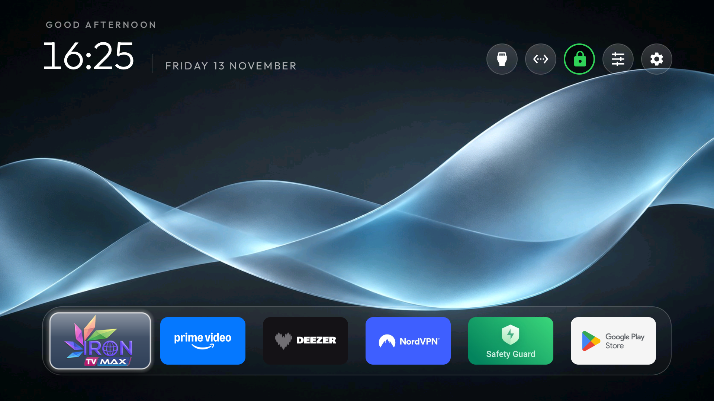
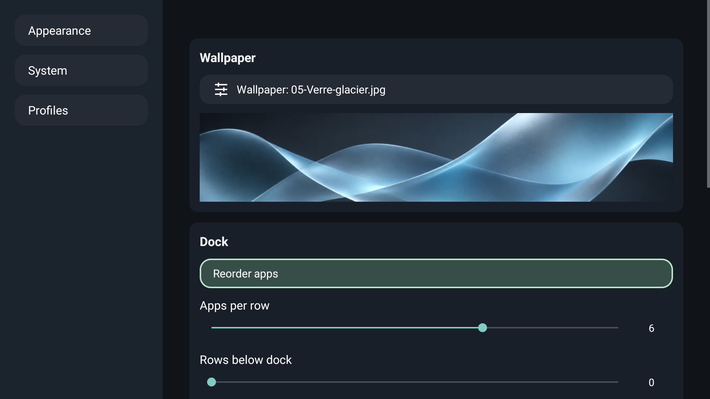
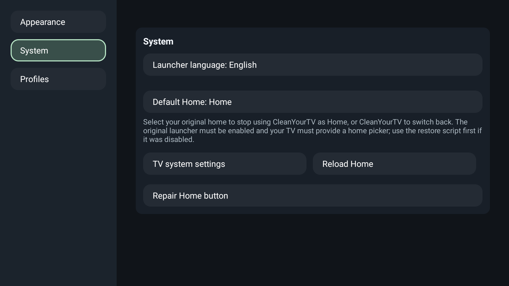
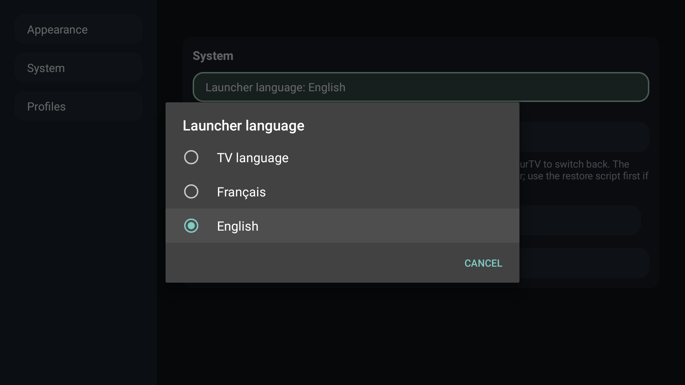
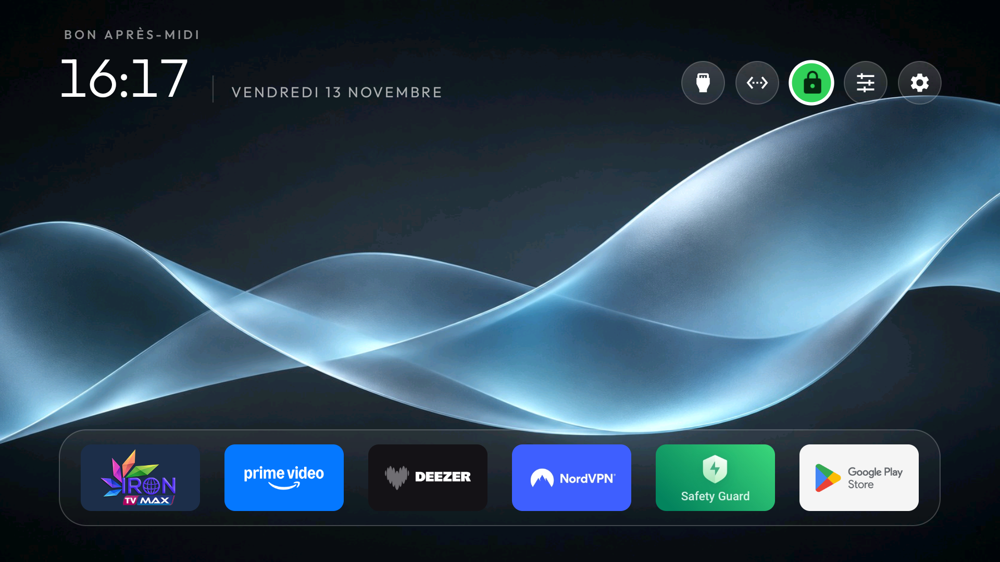
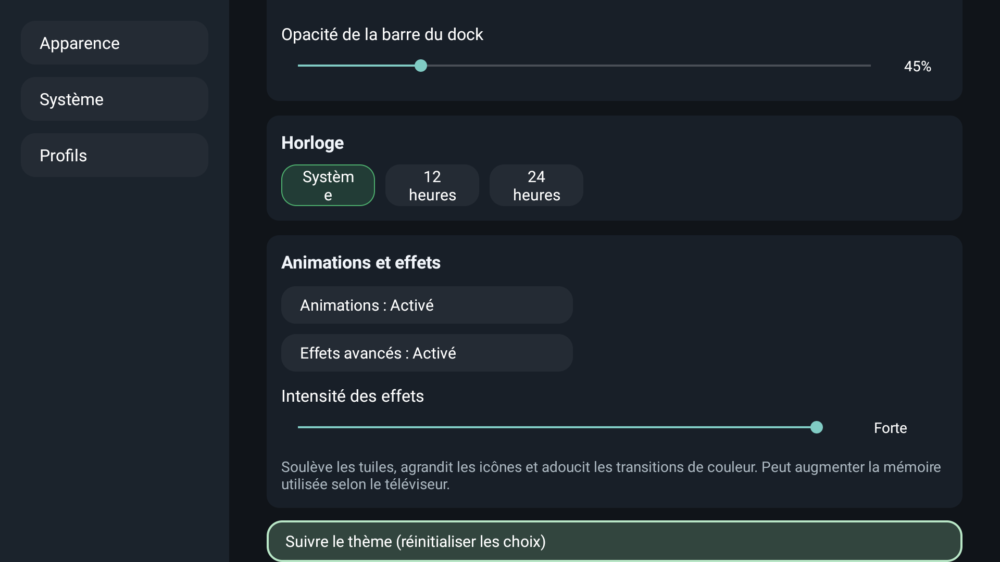
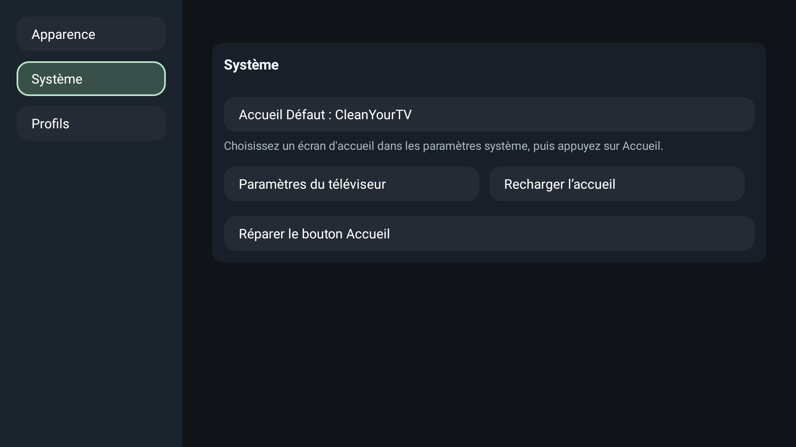
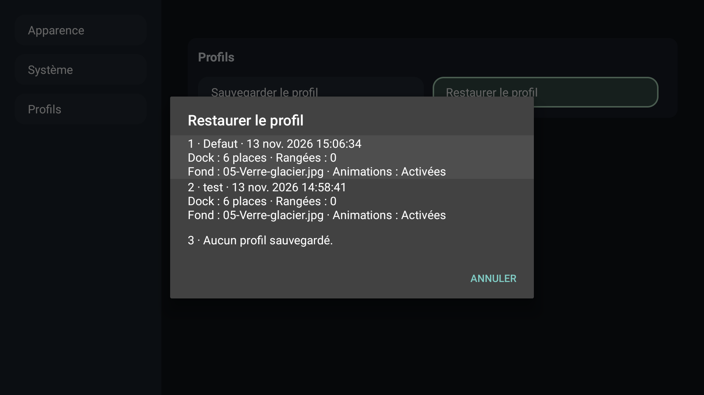

[English](#english) · [Français](#francais)

<a id="english"></a>

# CleanYourTV on the TCL 43P735


An Apple TV-inspired home screen for the TCL 43P735 (Smart TV Pro, BeyondTV4), running Android TV 11 with firmware V8-R51MT05-LF1V620.021315. This adaptation of [CleanYourTV](https://github.com/Gathin23/cleanyourtv) keeps Google TV available for the TCL remote shortcuts and settings.



The green lock shows that Android detects a VPN. Select it to open NordVPN. A kill switch can keep the indicator active when NordVPN is disconnected from its server.

## Default appearance

On a fresh install, the APK includes the look shown here: the Glacier Glass wallpaper, five gallery images, a six-slot glass dock at 45% opacity, no visible rows below the dock and compact top buttons. Missing favourites are replaced by available apps. The VPN shortcut can discover an installed Android VPN app when no configured app is available. Fresh-install behaviour and detection with a second VPN provider still need device testing.

## Make the home screen yours

- Set four to seven apps per row, adjust dock opacity and choose how many grid rows remain visible. Press Down to enter the grid and Back to return to the dock in the same column.
- Pin Google Play Store to the dock for quick access to app updates.
- Preview, import or delete wallpapers from the launcher settings. USB access depends on the Android file picker on your TV.
- Choose a clock format and one of four intensity levels for advanced focus effects.
- Save up to three profiles on the TV, including the app order, appearance and wallpaper gallery. Each slot shows a date and an optional description.



## Play Store update badge

The optional green dot reacts to recognized Play Store update notifications. Enable notification access under **System → Play Store update badge**. On the tested TCL, the settings screen was unavailable and access was granted from the Android shell with `cmd notification allow_listener com.gathin.tvhome/.StoreUpdateListener`. The service was verified. The dot itself still needs testing with a matching notification. Updates can be pending without a dot.

## Language and system settings

Use **System → Launcher language** to follow the TV language or select French or English. The TV's system menus retain their own language. The System panel also opens the default Home picker and offers shortcuts to reload Home and repair the Home button.

| System controls | Language picker |
| --- | --- |
|  |  |

## Verified on this TV

Google TV briefly appears at startup before CleanYourTV takes over. The Home accessibility service needed TCL's APP_AUTO_START permission. HDMI 1, optical audio, Play Store and the tested physical remote shortcuts worked. The two disabled packages, com.tcl.bi and com.tcl.overseasappshow, remained disabled after a reboot. No lasting performance gain was established.

## Build on Windows

Start Docker Desktop and run from the repository root:

    powershell.exe -NoProfile -ExecutionPolicy Bypass -File .\tools\docker-build.ps1

The APK is written to launcher/app/build/outputs/apk/release/. Keep the same signing key for in-place updates.

[Docker build guide](tools/docker-build.md) · [Restore guide](docs/restore.md) · [MIT license](LICENSE)

---

<a id="francais"></a>

# CleanYourTV sur TCL 43P735


Un accueil inspiré d’Apple TV, pilotable à la télécommande, sur une TCL 43P735 (Smart TV Pro, BeyondTV4), Android TV 11, firmware V8-R51MT05-LF1V620.021315. Cette adaptation de [CleanYourTV](https://github.com/Gathin23/cleanyourtv) conserve Google TV pour les raccourcis et les réglages de la TCL.

## CleanYourTV en action

**Accueil** — Le cadenas vert indique un VPN détecté par Android. Le dock vitré accueille six applis, dont le Play Store. Les curseurs et l’engrenage ouvrent deux menus distincts.



**Apparence** — Aperçu du fond sélectionné, réglage de la grille, format de l’horloge et intensité des effets avancés.

| Aperçu et disposition | Animations et intensité |
| --- | --- |
|  |  |

**Système et profils** — Choix de l’accueil Android, réparation du bouton Home et sauvegardes locales datées avec récapitulatif.

| Système | Restauration de profil |
| --- | --- |
|  |  |

[Voir la grille d’applications](docs/tcl-43p735-screenshots/grille.png)

## L’accueil au quotidien

- **Dock vitré et grille d’applications** avec 4 à 7 places par ligne, opacité réglable et 0 à 3 rangées visibles sous le dock. À zéro, les tuiles suivantes restent hors écran.
- **Navigation à la télécommande** avec Bas pour ouvrir la grille et Retour pour revenir directement au dock, dans la même colonne. Maintenir OK sur une tuile permet de la déplacer.
- **Google Play Store** dans la grille, épinglable au dock pour accéder aux mises à jour. Une pastille verte signale les notifications de mise à jour reconnues.
- **Cinq commandes en haut** dans la configuration testée — Sources, Ethernet, NordVPN, réglages du lanceur et paramètres TV. L’engrenage ouvre les paramètres TV et les trois curseurs ouvrent ceux du lanceur. Le cadenas reflète l’état du VPN vu par Android et ouvre NordVPN. Le kill switch peut maintenir cet état même sans connexion au serveur VPN.

## Apparence par défaut

Sur une installation neuve, l’APK embarque l’apparence des captures : fond Verre glacier, cinq images dans la galerie, dock vitré à six places et 45 % d’opacité, aucune rangée visible sous le dock et boutons compacts. Le lanceur complète les places des favoris absents avec les applis disponibles. Le cadenas peut détecter une appli VPN Android installée si aucune appli configurée ne répond. Le premier lancement et la détection avec un autre fournisseur restent à tester sur appareil.

## Personnaliser depuis la télé

| Rubrique | Commandes |
| --- | --- |
| **Apparence** | Aperçu du fond sélectionné, galerie avec vignettes, import JPEG/PNG/WebP jusqu’à 20 Mo via le sélecteur Android, suppression avec confirmation. L’accès à une clé USB dépend de ce que le sélecteur expose sur le téléviseur. |
| **Dock et horloge** | Curseurs pour la disposition et l’opacité, réorganisation des applis et choix du format horaire système, 12 h ou 24 h. |
| **Animations et effets** | Animations désactivables et quatre niveaux d’intensité pour les effets avancés. L’intensité agit sur le zoom, le relief et le soulèvement de la tuile dans la grille. |
| **Système** | Sélecteur Android de l’accueil par défaut, accès aux paramètres TV, rechargement de l’accueil et raccourci vers les réglages d’accessibilité pour réparer Bouton Accueil. |
| **Profils** | Trois sauvegardes sur le stockage de la TV, avec date, description facultative et récapitulatif. La confirmation de restauration affiche l’ordre du dock lorsqu’il a été enregistré. Chaque sauvegarde comprend les réglages, l’ordre des applis, le thème et les images de la galerie. |

La remise aux valeurs du thème demande confirmation. Les profils restent dans les données de CleanYourTV et sont supprimés si ces données sont effacées.

## Pastille de mise à jour Play Store

La pastille verte réagit aux notifications de mise à jour reconnues. Pour accorder l’accès aux notifications, ouvrir **Système → Pastille de mise à jour Play Store**. Sur la TCL testée, cet écran était indisponible et l’accès a été accordé dans le shell Android avec `cmd notification allow_listener com.gathin.tvhome/.StoreUpdateListener`. Le service a été vérifié. L’affichage de la pastille reste à confirmer avec une notification correspondante. Des mises à jour peuvent être disponibles même si la pastille est éteinte.

## Ce qui a été vérifié sur la TCL

- **Démarrage et Home** — Google TV apparaît brièvement, puis CleanYourTV prend la main. Le service d’accessibilité Bouton Accueil assure la redirection et le retour depuis les applications. Sur cette TCL, le firmware bloquait son démarrage automatique avant l’autorisation APP_AUTO_START pour CleanYourTV.
- **Fonctions TV** — HDMI 1 depuis Sources, son optique avec Iron TV Max, Play Store et raccourcis physiques Netflix, Prime Video, Guard, Media, YouTube et TCL Channel testés. L’appui prolongé sur le volume a également fonctionné.
- **Nettoyage ciblé** — com.tcl.bi et com.tcl.overseasappshow sont les deux paquets désactivés et vérifiés après redémarrage. Le profil 50P735 amont a servi de référence. Waterfall et Partner Customizer restent actifs, car le bouton TCL Channel passe par ces composants.
- **Performances** — La navigation et les passages entre applis ont paru fluides. Les relevés n’ont pas montré de saturation sur l’accueil. Safety Guard a libéré environ 282 Mio de RAM sur le moment et moins de 1 Mio de stockage, tout en interrompant Bouton Accueil. Aucun gain durable de vitesse n’a été établi.

## Compiler sous Windows

Démarrer Docker Desktop et lancer à la racine du dépôt :

```powershell
powershell.exe -NoProfile -ExecutionPolicy Bypass -File .\tools\docker-build.ps1
```

L’APK est produit dans `launcher/app/build/outputs/apk/release/`. Une mise à jour conserve les données du lanceur lorsque l’APK garde la même signature. Les sauvegardes locales et les images importées après installation restent dans les données du lanceur.

Pour une autre TV, partir de la documentation amont et vérifier les paquets présents avant toute désactivation. Le dock compilé de cette adaptation contient des favoris propres à la configuration testée. Les applications absentes sont ignorées. Après une intervention ADB, désactiver le débogage et vérifier la fermeture du port avec `tools/adb-closed.py`.

[Guide Docker](tools/docker-build.md) · [Restauration](docs/restore.md) · [Projet officiel](https://github.com/Gathin23/cleanyourtv) · [Licence MIT](LICENSE)
