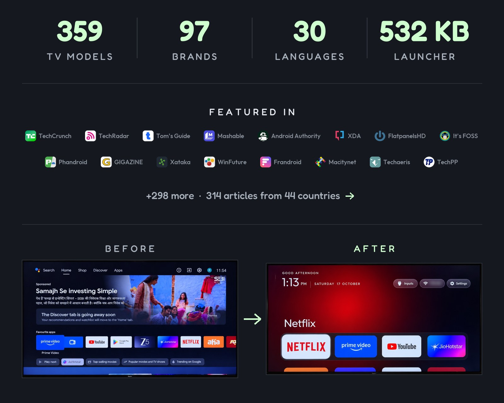

<p align="center">
  <a href="https://cleanyour.tv"></a>
</p>

<p align="center">
  <a href="README.md"></a>
  <a href="README.zh-CN.md"></a>
  <a href="README.zh-TW.md"></a>
  <a href="README.vi.md"></a>
  <a href="README.ja.md"></a>
  <a href="README.it.md"></a>
  <a href="README.de.md"></a>
</p>

<p align="center">
  <a href="https://github.com/Gathin23/cleanyourtv/stargazers"></a>
  <a href="https://github.com/Gathin23/cleanyourtv/pulls?q=is%3Amerged"></a>
  <a href="https://github.com/Gathin23/cleanyourtv/network/members"></a>
  <a href="https://github.com/Gathin23/cleanyourtv/graphs/contributors"></a>
  <a href="https://buymeacoffee.com/gathint"></a>
  <a href="https://www.producthunt.com/products/cleanyourtv"></a>
</p>

<p align="center">
  <a href="https://trendshift.io/repositories/310225"></a>
</p>

<p align="center">
  <a href="docs/PRESS.md"></a>
</p>

**De virale tweet:** [x.com/gathint/status/2111379569030939102](https://x.com/gathint/status/2111379569030939102)

Op 17 oktober 2026 plaatste ik voor-en-na-beelden van de tv van mijn ouders, die ik via wifi met Claude Code had opgeschoond.
Het bericht kreeg 7,4 miljoen weergaven. Mensen gingen hetzelfde doen met hun eigen tv's en hun reacties vormden de basis voor de lijsten hier: meer dan 170 tv-modellen, aangeleverd door ruim 200 bijdragers in vier dagen. Tot en met de 19e heette deze repository tv-vibehack; oude links werken nog.

**Thema's, schakelaars en uitbreidingen:** [cleanyour.tv/addons](https://cleanyour.tv/addons)

**Officiële links:** de website is [cleanyour.tv](https://cleanyour.tv); de code, launcher en hulpmiddelen staan uitsluitend in deze repository. Andere domeinen die de naam gebruiken, zoals cleanyourtv.com, worden niet door dit project beheerd ([#1004](https://github.com/Gathin23/cleanyourtv/issues/1004)).

<a id="how-it-works"></a>
## Hoe het werkt

Android-tv's hebben dezelfde debugbridge als Android-telefoons. Schakel USB-foutopsporing in bij de ontwikkelaarsopties van de tv, geef je computer eenmalig toestemming en gebruik daarna de standaard Android-hulpmiddelen:

| Stap | Wat er gebeurt |
|---|---|
| **Back-up maken** | Maak een back-up van de lijst met geïnstalleerde pakketten en instellingen. |
| **Uitschakelen** | Schakel telemetrie, advertentieservices, inhoudsrijen en vooraf geïnstalleerde overbodige apps van de fabrikant uit met `pm disable-user`. Er wordt niets verwijderd, dus een herstelscript kan elke stap ongedaan maken. |
| **Installeren** | Installeer een kleine native launcher en stel die in als standaardscherm. |

**Geen root, geen kabel, er wordt niets verwijderd en je kunt met één opdracht alles herstellen als je van gedachten verandert.**

De overbodige software verschilt per merk. Daarom laat de prompt je codeerassistent deze op jouw tv inventariseren en eerst toestemming vragen voordat iets wordt aangepast dat je mogelijk gebruikt.

<a id="quick-start"></a>
## Snel aan de slag

| Je hebt | Dit doe je |
|---|---|
| **Een computer** | Gebruik de prompt met een codeerassistent en volg de drie stappen hieronder. |
| **Alleen een Android-telefoon** | Gebruik de door de community gebouwde [Clean Your TV-app](https://cleanyour.tv/app) van [@udhaykumarbala](https://github.com/udhaykumarbala): verbinden, analyseren en opschonen in ongeveer vijf minuten. Geen laptop of codeeragent nodig. |

Met een computer moet je verbonden zijn met hetzelfde wifi-netwerk als de tv en een codeerassistent gebruiken die shell-opdrachten kan uitvoeren.

Je kunt onder meer Claude Code gebruiken (via [0G Private Computer](https://pc.0g.ai) of een [Anthropic-abonnement](https://claude.com/pricing)), [Codex](https://github.com/openai/codex) of [Gemini CLI](https://github.com/google-gemini/gemini-cli).

| Waar | Wat je moet doen |
|---|---|
| **1. Op de tv** | Instellingen → Apparaatvoorkeuren → Over → druk zeven keer op OK bij **Build** → ga terug → Ontwikkelaarsopties → schakel **USB-foutopsporing** in. Schakel ook Netwerk- of ADB-foutopsporing in als die optie beschikbaar is. Laat de tv aanstaan. |
| **2. Op je computer** | Kloon de repository en open die map in je assistent (`git clone https://github.com/Gathin23/cleanyourtv`). Plak daarna de inhoud van [`PROMPT.md`](PROMPT.md) en vul je tv-model in. |
| **3. Volg de stappen** | Accepteer op de tv de melding 'USB-foutopsporing toestaan?' en beantwoord daarna de checklist: welke apps je gebruikt, de grootte en volgorde van het dock, en of je de spraakassistent, Chromecast en updates wilt behouden. |

Het klonen is belangrijk: de assistent gebruikt de scripts `tools/disable.sh` en `launcher/build-and-install.sh` uit deze repository in plaats van zelf scripts te schrijven. De back-up, de bescherming van het startscherm en het hersteloverzicht worden daar beheerd.

De assistent maakt een back-up, verwijdert overbodige software, bouwt en installeert de launcher en controleert elke stap met schermafbeeldingen van de tv. Met deze repository als context duurt dat ongeveer vijftien minuten.

<a id="what-you-get"></a>
## Wat je krijgt

Een startscherm dat eruitziet als Apple TV en niet in de weg zit:

| Onderdeel | Hoe het eruitziet |
|---|---|
| **Een diepzwart startscherm** | Een dock met je vier favoriete apps in een afgeronde balk, op de plek waar Apple TV die ook toont. |
| **Een bovenbalk** | Toont de geselecteerde app in grote letters, met een sfeervolle gloed in een kleur uit de illustratie van die app. |
| **De overige apps in een raster** | Schuift omhoog wanneer je op Omlaag drukt. |
| **Eén zwevende glazen markering** | Springt van tegel naar tegel. De geselecteerde tegel komt omhoog en toont de naam. |
| **Drie matglazen knoppen** | Ingangen (HDMI-poorten met de namen die je in de tv-instellingen hebt ingesteld, AV en Live-tv), wifi of ethernet met de netwerknaam, en Instellingen. |
| **Een begroeting, een subtiele klok en de datum** | In [Outfit](https://fonts.google.com/specimen/Outfit), met een bijpassende klokschermbeveiliging. Stel `show_stats` in de configuratie of een thema in om onder de klok één regel te tonen met CPU, vrij geheugen en vrije opslagruimte. Dit staat standaard uit en wordt alleen bijgewerkt wanneer het startscherm zichtbaar is. |
| **Thema's en modulekaarten** | Thema's wijzigen kleuren, achtergrond, dock en kolommen zonder opnieuw te bouwen. Met modulekaarten kunnen andere apps een tegel toevoegen, maar alleen met jouw toestemming. |

En een tv die je niet langer tegenwerkt: geen gesponsorde rijen, geen opdringerige meldingen van 'Ontdekken', geen analyses die gegevens naar huis sturen en geen apps waar je niet om hebt gevraagd.

| | |
|---|---|
|  |  |
| *Bovenbalk en sfeervolle gloed* | *Ingangen: HDMI met verbindingsstatus, AV en Live-tv* |
|  |  |
| *Het raster, één glazen markering en de naam van de tegel* | *Klokschermbeveiliging beweegt om inbranden te voorkomen* |
|  |  |
| *Aurora-thema toegepast met `tools/theme.sh`* | *Zes kolommen en een dock met zes apps, dezelfde launcher* |
|  |  |
| *Met `tile_menu`: houd OK ingedrukt op een tegel en kies Verplaatsen; verplaats met de pijltjes en druk op Terug om de tegel neer te zetten* | *Appbibliotheek: met één druk zet je een verwijderde app terug op het startscherm* |

<a id="supported-tvs"></a>
## Ondersteunde tv's

Alles waarop **Android TV** of **Google TV** draait.

| Platform | Wat werkt |
|---|---|
| **Android TV, Google TV** | Zowel het opschonen als de launcher. |
| **Fire TV** | Alleen het opschonen: Fire OS staat niet toe dat een launcher van derden het startscherm overneemt. Op de Fire TV Box uit 2015 (Fire OS 5) werkt zelfs dat niet; elke `pm`-opdracht wordt geweigerd. |
| **Enkele TCL-tv's voor de Chinese markt** | Deze weigeren elke launcher te installeren; dat staat bovenaan hun lijsten vermeld. |
| **Samsung (Tizen), LG (webOS)** | Dit zijn andere systemen. Zie [SHOWCASE.md](SHOWCASE.md#other-platforms-fire-tv-and-lg-webos) voor drie webOS-ports en [docs/devices/samsung-tizen.md](docs/devices/samsung-tizen.md) voor wat een Samsung-tv uit 2021 via wifi teruggeeft (geen ADB, dus ook geen `pm disable-user`) als je een Tizen-port overweegt. |

Tested lists from contributors, one folder per model in [`examples/`](examples/):

<!-- tv-brands:start: generated by tools/gen_tables.py from examples/*/tv.json; edit those, not this -->

| | | | | | |
|---|---|---|---|---|---|
| [TCL](https://cleanyour.tv/tvs?q=TCL) · 77 | [Sony](https://cleanyour.tv/tvs?q=Sony) · 41 | [Xiaomi](https://cleanyour.tv/tvs?q=Xiaomi) · 34 | [Philips](https://cleanyour.tv/tvs?q=Philips) · 19 | [Skyworth](https://cleanyour.tv/tvs?q=Skyworth) · 15 | [Hisense](https://cleanyour.tv/tvs?q=Hisense) · 11 |
| [Amazon Fire TV](https://cleanyour.tv/tvs?q=Amazon%20Fire%20TV) · 7 | [SHARP](https://cleanyour.tv/tvs?q=SHARP) · 7 | [Panasonic](https://cleanyour.tv/tvs?q=Panasonic) · 6 | [BenQ](https://cleanyour.tv/tvs?q=BenQ) · 5 | [JVC](https://cleanyour.tv/tvs?q=JVC) · 4 | [OnePlus](https://cleanyour.tv/tvs?q=OnePlus) · 4 |
| [Thomson](https://cleanyour.tv/tvs?q=Thomson) · 4 | [Google](https://cleanyour.tv/tvs?q=Google) · 3 | [Grundig](https://cleanyour.tv/tvs?q=Grundig) · 3 | [Haier](https://cleanyour.tv/tvs?q=Haier) · 3 | [Motorola](https://cleanyour.tv/tvs?q=Motorola) · 3 | [NVIDIA Shield](https://cleanyour.tv/tvs?q=NVIDIA%20Shield) · 3 |
| [RCA](https://cleanyour.tv/tvs?q=RCA) · 3 | [Redmi](https://cleanyour.tv/tvs?q=Redmi) · 3 | [Toshiba](https://cleanyour.tv/tvs?q=Toshiba) · 3 | [Vu](https://cleanyour.tv/tvs?q=Vu) · 3 | [CHiQ](https://cleanyour.tv/tvs?q=CHiQ) · 2 | [EKO](https://cleanyour.tv/tvs?q=EKO) · 2 |
| [FFalcon](https://cleanyour.tv/tvs?q=FFalcon) · 2 | [Hitachi](https://cleanyour.tv/tvs?q=Hitachi) · 2 | [Insignia Fire TV](https://cleanyour.tv/tvs?q=Insignia%20Fire%20TV) · 2 | [Kalley](https://cleanyour.tv/tvs?q=Kalley) · 2 | [Kogan](https://cleanyour.tv/tvs?q=Kogan) · 2 | [Nokia](https://cleanyour.tv/tvs?q=Nokia) · 2 |

<details>
<summary>+53 more brands and 14 projector brands</summary>

**onn** 2 · **RockTek** 2 · **Sankey** 2 · **Sber** 2 · **Vidda** 2 ·
Acer · AiPro2K · AIWA · AQUA · Artel · ASUS · Beko · BGH · Caxium · Cecotec · Challenger · Compac · Dcolor · Dialog ·
DYON · Freebox · Home+ · Impex · INCLO · Karbonn · Koryo · KTC · Liberton · Lumio · Master-G · MECOOL · MTC · Next ·
Noblex · OK. · OPPO · Panavox · PEAQ · Polytron · PPTV · PRISM+ · Prosonic · SANYO · Seleco · Super General · Síragon ·
Tele System · TiVo · Tornado · Turkcell · Tuvio · Verizon · Vision ·
Alwtniet, Anker Nebula, BYINTEK, Epson, Formovie, Gadnic, HOTACK, HY320, JMGO, Magcubic, Portronics, Stellamore, Wanbo and XGIMI projectors

</details>

<!-- tv-brands:end -->

<details>
<summary><strong>The full list</strong></summary>

<!-- tv-table:start: generated by tools/gen_tables.py from examples/*/tv.json; edit those, not this -->

| TV | OS |
|---|---|
| Acer AR55AR2851UDPRO 55" (SCBC R4, Realtek rtd2851m), India | Android TV 14 |
| AiPro2K (Expressluck, dongnae; Changhong AI PONT family) | Android TV 14 |
| AIWA AI PONT SA (Changhong, osaka, ISDB86AW) | Google TV 14 |
| Alwtniet HY320 Mini projector (device adt3, Askey; Allwinner/HTC firmware), 1 GB, 720p | Android 11 |
| Amazon Fire TV 4K smart TV, 50" and 75" Omni Series (AFTTIFF43, brandenburg) | Fire OS 7.7.1.4 / 7.7.1.7, Android 9 |
| Amazon Fire TV smart TV (AFTEU014, greta, MediaTek m7322), Germany | Fire OS 7.6.8.5 / Android 9 |
| Amazon Fire TV Stick 4K Max, 1st gen 2021 (AFTKA, kara), Colombia | Fire OS 7.7.1.3 / Android 9 |
| Amazon Fire TV Stick 4K, 1st gen 2018 (AFTMM, mantis) | Fire OS 6.7.1.1 / Android 7.1 |
| Amazon Fire TV Stick 4K, 2nd gen 2023 (AFTKM, karat), Brazil | Fire OS 8.1.8.5 / Android 11 |
| Amazon Fire TV Stick Lite, 1st gen 2020 (AFTSS, sheldon) | Fire OS 7.7.1.7 / Android 9 |
| Amazon Fire TV, AFTDEC012E (ginza), Android 11 | Fire OS / Android 11 |
| Anker Nebula Cosmos projector D2140 (D2140-Cosmos, SDMC/Amlogic, 2 GB), Vietnam | Android TV 9 |
| Anker Nebula Mars 3 Air projector D2325 (Nebula_Mars_2_V2, taihang, MediaTek m7332), Portugal | Google TV 14 |
| Anker Nebula projector D2426 (D2426_CapsuleIIIPro, baekdu, SDMC/MediaTek m7632, 1.7 GB), Brazil | Android TV 14 |
| AQUA MatrixTV EE 50" 4K (Haier, AQ9676EU, omonia, MediaTek), Indonesia | Google TV 14 |
| Artel smart TV (CVTE TP.MT5510S.PB782, cvt_mt5863_eu, SMART_TV), Uzbekistan | Android 7.0 |
| ASUS M1G Google TV (MOKA, dahu, Realtek RTD2851F), US | Android TV 11 |
| Beko B43B880B (Arçelik, sinchon, MediaTek), Turkey | Android TV 11 |
| BenQ E55-735 (Changhong AI PONT, DVB96BQ) | Google TV 14 |
| BenQ E55-750 (Changhong AI PONT, DVB96BQ) | Google TV (Android 11) |
| BenQ E55-760 (Changhong AI PONT, GTVU64BQ, board alimos) | Google TV 14 |
| BenQ GV32 portable projector (SDMC, BenQ_GV01, himalaya, MediaTek m7332) | Google TV 14 |
| BenQ QS01 Android TV dongle for BenQ projectors (Inspur, Amlogic S905Y2, 2 GB) | Android TV 12 |
| BGH Smart TV (reported model; UKNV.260821.001) | Android TV 14 |
| BYINTEK Love U4 projector, 1080P (Skyworth RG_HS352, HiSilicon Hi3751V350, 1 GB), Brazil | Android 9 |
| BYINTEK T5 Max projector (built-in Google TV stick: SkyworthDigital YYT, Amlogic), Brazil | Google TV 14 |
| Caxium 58" 147 cm UHD Smart TV (Realtek RTD285O, RTK2851P, TopTech + Zeasn), Colombia | Android TV 9 |
| Cecotec VQU10065S 65" QLED (Vestel-built, shandao, MediaTek), Spain | Android TV 14 |
| Challenger 32T22 BT (cvt_mt5863_col, board TP.MT5510.PB781, MediaTek MT5659, 1 GB RAM), Colombia | Android 7.0 |
| CHiQ AI PONT (Changhong GTVU65, dangni, MediaTek mt5867) | Google TV 14 |
| CHiQ AI PONT (DVB93CQ) | Android TV 11 |
| Compac ATV R2 (SCBC R2, Realtek RTD285O) | Android TV 9 |
| Coocaa P9 projector (MediaTek mt5862), China | Android 9 (Coocaa OS) |
| Dcolor GD2 (YHT) | Google TV 14 (SDK 34) |
| Dialog ViU (SEI Robotics SEI103DL, Amlogic, NES middleware), Sri Lanka | Android TV 9 |
| DYON 2K Android TV (MTC, komagome, MediaTek m5621), Germany | Android TV 11 |
| EKO 2K Google TV (MTC-built, tennoji, MediaTek mt5867 / T56) | Google TV 14 |
| EKO 4K Android TV (bangbae, MTC, MediaTek) | Android TV 11 |
| Epson LS800 laser projector (Askey HA90 module, sti6202d101, Amlogic) | Android TV 14 |
| FFalcon (雷鸟) r34a0, China (V8-A920T01-LF1V147, Amlogic T920), 1 GB | Android 5.1.1 |
| FFalcon (雷鸟) 鹤6 PRO 65S585C Pro (China, tcl_mt5879_cn, MediaTek MT9653) | Android TV 11 |
| Formovie / Fengmi projector MiProjM05 (eva, Amlogic) | Android TV 9 |
| Formovie Laser 4K projector / Formovie Theater (hanlla, MediaTek T31 / m7632, 1.8 GB) | Android TV 14 |
| Freebox Player POP (Free, fbx8am, Amlogic), IPTV/DVB-T box | Android TV 10 |
| Gadnic PROJ100W projector (built-in Google TV stick: SkyworthDigital YYT, Amlogic HP46B), Argentina | Google TV 14 |
| Google Chromecast with Google TV 4K (sabrina) | Google TV 14 |
| Google Chromecast with Google TV HD (boreal) | Google TV 14 |
| Google TV Streamer 4K (kirkwood, GZRNL) | Google TV 14 |
| Grundig 50 GFU 7850 B 50" (Arçelik, CO3Plus, sinchon, MediaTek), Turkey | Android TV 11 |
| Grundig 50VLX22LDLBV (Arçelik, CO3Plus, sinchon, MediaTek), Netherlands | Android TV 11 |
| Grundig Android UHD TV (Arçelik, GxGrNM, kunyang, MediaTek), Turkey | Android TV 14 |
| Haier Android TV DVB2K (broadway, HaierATVT56DVB; also sold as the CANDY Android TV DVB2K, CANDYATVT56) | Android TV 11 |
| Haier H32S80EFX (MatrixTV CE, HRT56EU, deto, MediaTek), Thailand | Google TV 14 |
| Haier MatrixTV GE (HR9216EU, haeundae, MediaTek), EU | Google TV 14 |
| Hisense 55QD6QF Fire TV (AFTOLCBC82, ginza), Canada | Fire OS 8.1.8.0 / Android 11 |
| Hisense 65D62QH (VIDAA_TV, MediaTek MT9653), China | Android TV 11 |
| Hisense E5Q Pro (VIDAA_TV, MediaTek MT9653), China | Android TV 11 |
| Hisense Fire TV (AFTCIBFBD1, coyote, MediaTek), US | Fire OS 8.0 / Android 11 |
| Hisense HG9 (HiSmart 4K A4FFM) | Android TV 9 |
| Hisense HiSmartTV A4 (xiaoyushan, MStar m7322), Android 11 firmware RTT2.221108.001 | Android TV 11 |
| Hisense HiSmartTV A4 (xiaoyushan, MStar m7322), India | Android TV 9 |
| Hisense SmartTV 4K FFM (huangshan, MediaTek), Latin America; also the US Hisense U9DG | Android TV 10 |
| Hisense SmartTV 4K FFM (lushan, MediaTek MT9676), Mongolia | Google TV 12 |
| Hisense SmartTV 4K FFM (songshan, MediaTek m7632); also the US Hisense 50A6H4 and 65U6G | Android 11 (SDK 30) |
| Hisense U75 / 75U75N / 65U7ESG (hengshan, MediaTek), Latin America and US | Google TV 12 |
| Hitachi 65QLEDSM20 (MTC, bangbae, MediaTek m7322), Australia | Android TV 11 |
| Hitachi CDH-LE32SMART21 (TCL-built C06, C06_2K_GB, MediaTek MT9221, 1 GB), Argentina | Android TV 11 |
| Home+ STB-6252C (中嘉寬頻, Inspur, MT5221), DVB-C/OTT box | Android TV 11 |
| HOTACK L018 Smart Projector (Allwinner H713, reports ADT-3, LuminaOS) | Android 11 |
| HOTACK SMART2KPJT projector, "Whale TV 95C8" (Amlogic am30b8, WhaleOS S8E, Zeasn firmware) | Android 13 |
| HY320 projector (t950s_be311, Google-certified Android TV) | Android 13 |
| Impex evoQ 4K (Changhong, GTVU64IP, board alimos, MediaTek mt5896), India | Google TV 14 |
| INCLO Google TV 4K (KTC, Realtek, khardi, KTC_INCLO_4K_EU_23GV1), Taiwan | Google TV 11 |
| Insignia 42" F20 Fire TV (NS-42F201NA22, AFTEAMR311, blanche) | Fire OS 6.7.1.1 / Android 7.1.2 |
| Insignia 55" F30 4K Fire TV (NS-55F301NA25, AFTDCT31, duckie) | Fire OS 7 / Android 9 |
| JMGO N1S projector (K80A, holan, MediaTek m7332), Australia | Google TV 14 |
| JVC Android TV (Vestel-built, BARTU_Jvc, menlo, MediaTek mt5867), Spain | Android TV 11 |
| JVC LT-43KM348 (KTC-built, KTC_JVC_2K_25GV1, jagalchi, MediaTek mt5867 / T56) | Google TV 14 |
| JVC LT-58CA810 (UK 4K Android TV, MTC, MTCMSD6886UK, sadang, MediaTek m7322), UK | Android TV 11 |
| JVC LT55MB508 (MTC, seocho, MediaTek MSD6886), Brazil | Android TV 11 |
| Kalley 43G200 (device R3_GTV, MOKA, Realtek RTD2841A), Latin America | Google TV 14 |
| Kalley R10G (device R10G, product ACER_FFM, MOKA, Realtek RTD2875P), Latin America | Google TV 14 |
| Karbonn / Motorola SWTV-20AE (Skyworth OEM, SW4H, MediaTek), India | Android TV 10 |
| Kogan G7 (Expressluck, cottongreen, Realtek), Australia | Google TV (Android 11) |
| Kogan Google TV (Changhong CHiQ AI PONT, GTVU65KG, dangni, MediaTek mt5867), Australia | Google TV 14 |
| Koryo 55" 4K Smart TV (CVTE TP.HV553.PC821B, HiSilicon Hi3751V553, 1 GB) | Android 7.0 |
| KTC 4K Smart TV (device hongkong, MediaTek), Taiwan | Google TV 14 |
| Liberton LTV 24H01AT (Liberton, built by Changhong, device redwood), Ukraine | Android TV 11 |
| Lumio Vision 7 55" (KTC ODM, Realtek, khardi, KTC_LUMIO_4K_EU_23GV1), India | Google TV 14 |
| Magcubic HY300 Pro projector (rk3566_rgo, device adt3, Askey) | Android 11 |
| Magcubic HY300 Pro+ projector (rk3566_rgo) | Android 14 |
| Master-G MGA3200 (SCBC R1, Realtek; Android reports model `ATV R1`), Chile | Android TV 9 |
| MECOOL KM2 Plus | Android TV 14 |
| Motorola / Coocaa SWTV-24AE-FHD (24LP6000G, Skyworth OEM, beomil), India/SEA | Google TV 14 |
| Motorola MT4310 (Newsan; Hisense board, hayward, MediaTek), Argentina | Android TV 11 |
| Motorola SWTV-24AE-4K (Skyworth OEM, eleonas, MediaTek), India | Google TV 14 |
| MTC UK 2K Android TV (tabata, MediaTek m5621; JVC-family firmware, `android.autoinstalls.config.JVC` present), UK | Android TV 11 |
| Next Start Pro 4K TV Box (SDT HPR314-Next, Realtek RTD1325), Turkey, streaming box | Google TV 14 |
| Noblex NoblexTV (Skyworth-built, shinjuku, MediaTek m5621), Argentina | Android TV 11 |
| Nokia Streaming Box 8000 (Sagemcom/NES, SEI600NK4, HND, Amlogic) | Android TV 14 |
| Nokia Streaming Box 8010 (Sagemcom/NES, SEI804NK, YYJ, Amlogic) | Android TV 14 |
| NVIDIA SHIELD TV 2017 (darcy) | Android TV 11 |
| NVIDIA SHIELD TV 2019 tube (P3430, sif) | Android TV 11 |
| NVIDIA SHIELD TV Pro 2019 (P2897, mdarcy) | Android TV 11 |
| OK. AI PONT (Changhong, ikebukuro, MediaTek), Italy; also Nikkei DVB91NK | Android TV 11 |
| OnePlus TV (C00, Cebu, MediaTek m7632), India | Android TV 10 and 11 |
| OnePlus TV (D00, Dubai) | Android TV 11 / Google TV 14 |
| OnePlus TV (Dosa, Oneplus_Dosa_IN) | Android TV 11 |
| OnePlus Y1 43" (Y Series, shibuya) | Android TV 11 |
| onn 4K Streaming Box (2023, Walmart; YOC, Amlogic), US | Google TV 14 |
| onn. 4K Plus Streaming (2025, Walmart; coffey, Amlogic S905X5M), US | Google TV 14 |
| OPPO K9 55 (OPPOCNM632) | Android 9 (ColorOS TV) |
| Panasonic 4KTV-0SU (Skyworth-built SW4H, MediaTek m7332), Gulf region | Android TV 10 |
| Panasonic 4KTV-3MUP (MOKA R4_GTV, Realtek rtd2851m), Taiwan | Google TV 14 |
| Panasonic 4KTV-3SU (Skyworth-built SW6H, MediaTek, same board as `thomson-sppl-4k-sw6h/`), ~1.9 GB | Android TV 14 (Google TV home) |
| Panasonic 4KTV-JUP (Jupiter_PA, MediaTek) | Android TV 11 |
| Panasonic Google TV LCD (OZUM_Panasonic, kowloon, MediaTek) | Android 14 |
| Panasonic TH-40HS550K (Skyworth-built, GS655 shibuya, MediaTek) | Android TV 11 |
| PANAVOX Google TV (dongnae) | Google TV 14 |
| PEAQ PTV 43AQU-5023C (Changhong, reports OK. AI PONT, dundas, MediaTek m7332) | Android TV 11 |
| Philips 50PUD7406/43 (TPV, PH0M_EA_T32, MStar/MediaTek), Chile; 55PUS7906/12, Lithuania; 50PUS7906/12, Germany | Android TV 11 |
| Philips 50PUF7099/T3 (TPV EBONY_V560, Hisilicon), China | Android TV 9 |
| Philips 50PUS8517/12 (TP Vision, PH1M_EA_9970A, MediaTek MT5895), Europe | Android TV 11 |
| Philips 55OLED707/12 / 55OLED887/12 (TP Vision, PH1M_EA_9970A, MediaTek MT5895), UK and Poland | Android TV 11 |
| Philips 55OLED708/12 (TPV, PH1M_WW_9972, MediaTek), Poland | Google TV 12 |
| Philips 55OLED820/12 (TPV, PH1M_WW_9972, MediaTek), Czech Republic | Google TV 14 |
| Philips 55POS9002/12 OLED (TP Vision TPM171E, PH7M_EU_5596, MediaTek MT5891), Europe | Android TV 8.0 |
| Philips 55PUS7503/12 (TP Vision TPM171E, PH7M_EU_5596, MediaTek MT5891), Europe | Android TV 8.0 |
| Philips 65OLED706/12 (TP Vision, PH1M_EA_9970A, MediaTek MT5895), France; 55OLED706/12, Poland | Android TV 11 |
| Philips 65OLED907/12 and 55OLED907/12 (TP Vision, PH1M_EA_9970A, MediaTek MT5895), UK and France | Android TV 11 |
| Philips 65PML9506/12 (TP Vision, PH1M_EA_9970A, MediaTek), Spain | Android TV 11 |
| Philips 65PUS8102/12 (TP Vision TPM171E, PH7M_EU_5596, MediaTek MT5891), Europe | Android TV 8.0 |
| Philips 65PUS8729/60 (TPV, PH1M_WW_9972, MediaTek), Russia | Google TV 14 |
| Philips 65PUS9435/12 / 55PUS9435/12 (TP Vision TPM191E, PH9M_EA_5599, MediaTek MT5887), Germany | Android TV 12 |
| Philips 75PUS8505/12 (TP Vision TPM191E, PH9M_EA_5599, MediaTek MT5887), Europe | Android TV 12 |
| Philips Google TV TA7 (TPV, PH3M_AL_T32, MediaTek), Brazil; 55PUD7908/77, Latin America; 50PUD7408/77, Argentina | Google TV 14 |
| Philips R8G Google TV (MOKA, whitefield, Realtek RTD2851F), US | Google TV 14 |
| Philips Smart 4K TV (Skyworth, eleonas, MediaTek), India | Google TV 14 |
| Philips TPM191E / 50PUS8505 / 55OLED854 / 65OLED804 / 50PUS7354 / 43PUS7304 (TP Vision, PH9M_EA_5599, MediaTek MT5887), Europe | Android TV 12 |
| Polytron 2K (WLTV POLYTRON2K, hayward; Hisense/CVTE board, MediaTek mt5867), Indonesia | Android TV 11 |
| Portronics Beem 470 Smart LED Projector (Allwinner H713, 1 GB), India | Android 11 |
| PPTV p34a4p (Suning PPTV, Amlogic board), China | Android 5.1.1 |
| PRISM+ Q65 Ultra 2026 QLED 4K AI Google TV (R10G, PRISMPLUS_FFM, MOKA, Realtek RTD2875 SoC, RTD6748 platform) | Google TV 14 |
| Prosonic Android TV (Vestel-built, BODRUM, finch, MediaTek m7332), Denmark | Android TV 14 |
| RCA 2K Android TV (KONKA, device lasalle, Realtek RTD2841A, ISDB) | Android TV 11 |
| RCA AI PONT SA (Changhong, redwood, ISDB92RC; also sold as realme 40-inch, AIWA AW32B4SMG, CHiQ AI PONT DVB92CQ and ERGO DVB92YC) | Android 14 |
| RCA RC50A21S-4KSM, Zeasn home (Toptech firmware RTK2851P, Realtek RTD2851P, board mac6p) | Android TV 9 |
| Redmi TV (MiTV-ANTL0, starwars) | Android 5.1.1 (not Android TV) |
| Redmi TV (MiTV-MFTP0, alita), China firmware 23.2.10.6129 | Android TV 9 (CN build) |
| Redmi TV 43" (MiTV-MOOQ3, tarzan) | Android TV 11 |
| RockTek GB1 | Google TV 14 |
| RockTek GX1 (HPR3A1325_4K) | Google TV 14 |
| Sankey SMART2KTVSE (Whale OS, SiliconPlayer am30bm) | Android TV 13 |
| Sankey SMART_TV (CVTE, HiSilicon Hi3751V350, 1 GB) | Android 12 |
| SANYO ATV R2 (SCBC, Realtek RTD285O) | Android TV 9 |
| Sber Salute TV 32" (CVTE TPD.MT9216.PB766, MediaTek MT9256, 1 GB), Russia | StarOS 1.103 / Android 11 |
| Sber Salute TV 43" (CVTE TP.T962D4.PC756, Amlogic T962D4, at30a6, 2 GB), Russia | StarOS 1.101 / Android 13 |
| Seleco TV39020HDA9SMART 39" (AT_SmartScreen, Toptech + Zeasn, Realtek RTK2842P), Italy | Android TV 9 |
| SHARP 2K EU Android TV (Expressluck martin, MediaTek mt5867), EU | Android TV 14 |
| SHARP 2T-C32GH3000I (SHARP 2K Smart TV-A; Skyworth-built, beomil, MediaTek mt5867), Indonesia | Google TV 14 |
| SHARP 55GP6260E (Sharp Google TV, kaitak, MediaTek MTK9612), EU | Google TV 11 |
| SHARP AQUOS 4T-C43DL1 (AQUOS-TVJ21-2, tcve2uj, MediaTek), Japan | Android TV 11 |
| SHARP AQUOS TVE21F (AQUOS-TVE21F, banqiao, CVTE/MediaTek), UK | Android TV 14 |
| SHARP AQUOS TVE23A (AQUOS-TVE23A, sandiego, CVTE/MediaTek mt5889), Denmark | Google TV 14 |
| SHARP AQUOS-TVX19B (AQUOS-TVX19B, gangnam, MediaTek m7322), Taiwan | Android TV 11 |
| Skyworth / Coocaa 8R40_K5C (Realtek rtd285x, 1 GB, 32-bit), China domestic firmware | Android 8.0 (not Google TV) |
| Skyworth 43E6A (open_fhd, MediaTek MT5886) | Android TV 8.0 |
| Skyworth 65A3F (7T641_A3F, MediaTek MT9633), China | Android 13 (CCOS 10.01.250328) |
| Skyworth 7S60_A5 (sky8S34, 1.9 GB), China market | Coocaa OS / Android 8 |
| Skyworth 7T861_A23 (MediaTek MT9638), China market | Coocaa OS / Android 10 |
| Skyworth Coocaa K3 Pro 90P3D Max (8R145_P3DM, Realtek RTD2885N), China market | Android 11 (Coocaa OS) |
| Skyworth SW-22HK NF (SW6H, MediaTek m7332) | Android TV 11 (Google TV home) |
| Skyworth SW-22SA (SW6H, MediaTek), ~1.9 GB | Android TV 14 (Google TV home) |
| Skyworth SWTV-21AE (sunnyvale, MediaTek) | Android TV 14 |
| Skyworth SWTV-22AE-FHD (umeda, MediaTek), Vietnam/Global | Google TV 14 |
| Skyworth SWTV-24AE-4K NF (eleonas, MediaTek mt5896), South Africa/Global | Google TV 14 |
| Skyworth SWTV-24NA-4K NF (eleonas, MediaTek mt5896), US | Google TV 14 |
| Skyworth Xiaopai P3 (Q5001, cupid-p2), streaming box | Android 10 |
| Sony BRAVIA 4K AE2 (BRAVIA_AE2, MediaTek MT5897), North America | Google TV 14 |
| Sony BRAVIA 4K GB (BRAVIA_ATV2_UC, MediaTek mt5891) | Android TV 9 |
| Sony BRAVIA 4K GB (KD-75XE8596, XBR-49X705D; BRAVIA_ATV2_EU, BRAVIA_ATV2_BR) | Android TV 9 |
| Sony BRAVIA 4K UR2 (BRAVIA_UR2_4K, MediaTek) | Android TV 10 |
| Sony BRAVIA 4K UR3 / KD-55X8000H (BRAVIA_UR3, MediaTek mt5893), EU and TW | Android TV 10 |
| Sony BRAVIA 4K VH1 (KD-55XH9096 / KD-65XH9296 / XBR-55X900H, BRAVIA_VH1, MediaTek MT5895), EU, UK and US | Google TV 12 |
| Sony BRAVIA 4K VH2 (KD-55X80J / XR-65A83J, BRAVIA_VH2, MediaTek), EU, North America and India | Google TV 12 |
| Sony BRAVIA 4K VH21 (KD-65X85K, 2022, BRAVIA_VH21, MediaTek MT5895), Australia & India | Google TV 12 |
| Sony BRAVIA 4K VH21 (XR-55A80K, 2022, BRAVIA_VH21, MediaTek mt5895), EU | Google TV 12 |
| Sony BRAVIA 4K VH21 (XR-65A95K, 2022, BRAVIA_VH21, MediaTek), US | Google TV 12 |
| Sony BRAVIA 9 II (K-65XR90M2, BRAVIA_AE3, MediaTek MT5838) | Google TV 14 |
| Sony BRAVIA BF1 (BRAVIA 2 II class, BRAVIA_BF1_4K_A, MediaTek) | Google TV 12 |
| Sony BRAVIA KD-43X8000G (2019, BRAVIA_ATV3_4K, MediaTek), APAC | Android TV 9 |
| Sony BRAVIA KD-43X80L (2023, BRAVIA_VH22, MediaTek MT5895), EU | Google TV 12 |
| Sony BRAVIA KD-49X8000G (2019, BRAVIA_ATV3_4K, MediaTek), Hong Kong | Android TV 9 |
| Sony BRAVIA KD-49X8307C (2015, "BRAVIA 4K 2015", SVP-DTV15, MediaTek), EU firmware | Android TV 7.0 |
| Sony BRAVIA KD-55X75K (BRAVIA_VU3_4K, Realtek rtd2885m) | Google TV 14 |
| Sony BRAVIA KD-55X8000C (2015, "BRAVIA 4K 2015", SVP-DTV15, MediaTek), China firmware | Android TV 7.0 |
| Sony BRAVIA KD-55X82L / KD-65X82L / XR-65X90L (2023, BRAVIA_VH22, MediaTek), India and US | Google TV 12 |
| Sony BRAVIA KD-55X8509C (2015, "BRAVIA 4K 2015", SVP-DTV15, MediaTek), EU firmware | Android TV 7.0 |
| Sony BRAVIA KD-55X85J (2021, BRAVIA_VH2, MediaTek MT5895), South America | Google TV 12 |
| Sony BRAVIA KD-55X9500G (BRAVIA_UR2_4K_CN), China | Android TV 10 |
| Sony BRAVIA KD-55XE8596 (2017, "BRAVIA 4K GB", BRAVIA_ATV2_EU, MediaTek MT5891), UK | Android TV 9 |
| Sony BRAVIA KD-55XF7596 (2018, "BRAVIA 4K GB ATV3", BRAVIA_ATV3_4K_EU, MediaTek MT5891), EU | Android TV 9 |
| Sony BRAVIA KD-55XF8096 (2018, "BRAVIA 4K GB ATV3", BRAVIA_ATV3_4K_EU, MediaTek MT5891), Spain | Android TV 9 |
| Sony BRAVIA KD-65X80J (2021, BRAVIA_VH2, MediaTek), India | Google TV 10 |
| Sony BRAVIA KD-65X9300D (2016, SVP-DTV15, MediaTek), Asia-Pacific | Android TV 8.0 |
| Sony BRAVIA KDL-43W950D (2015/2016, SVP-DTV15, MediaTek), India ("PA") firmware | Android TV 8.0.0 |
| Sony BRAVIA KDL-55W800C (2015, "BRAVIA 2015", SVP-DTV15, MediaTek), Taiwan firmware | Android TV 7.0 |
| Sony BRAVIA TL2 (OD0M_EA_T32, TPV-built, MediaTek), Europe | Android TV 11 |
| Sony BRAVIA VU1 (KD-43X7500H, BRAVIA_VU1_UC, Realtek) | Android TV 11 |
| Sony BRAVIA VU31 4K (BRAVIA_VU31_4K, Realtek), India | Google TV 14 |
| Sony BRAVIA X9000H (2020, BRAVIA_VH1_CN, MediaTek MT5895), China | Android TV 12 |
| Sony BRAVIA XBR-55X850C (2015, "BRAVIA 4K 2015", SVP-DTV15, MediaTek), US firmware | Android TV 8.0 |
| Sony BRAVIA XBR-55X850D (Android model "BRAVIA 4K 2015"), firmware 6.827 | Android TV 8.0.0 |
| Sony BRAVIA XBR-65X900E (2017, BRAVIA_ATV2) | Android TV 9 |
| Sony BRAVIA XBR-65X900F (2018, BRAVIA_ATV3_4K, MediaTek MT5891), US/Canada | Android TV 9 |
| Sony BRAVIA XR-55A95L (A95L, 2023 QD-OLED; Android reports BRAVIA 4K AE1, BRAVIA_AE_M6L, MediaTek MT5838), EU | Google TV 12 |
| Sony KD-55X7500 (BRAVIA 4K GB ATV3, BRAVIA_ATV3_4K_CN), China | Android TV 9 |
| Sony XR-65A80J (65-inch OLED, 2021, BRAVIA_VH2), EU | Google TV 12 |
| Sony XR-65X90J (2021, BRAVIA_VH2, MediaTek MT5895), China | Android TV 10 |
| Stellamore T950S projector (Droidlogic be30a3, Amlogic txhd2) | Android 13 |
| Strong LEAP-S3 box (SkyworthDigital YDA, Amlogic S905Y4), Italy | Google TV 14 |
| Super General 55" 4K (CVTE TP.SK708D.PC821, Amlogic T972, x30a4, 1 GB), Saudi Arabia | Android 9 |
| Síragon 4K Smart TV (KTC, MediaTek MT9676, elliniko, KTC_SIRAGON_4K_24GV1), Venezuela | Google TV 14 |
| TCL / FFalcon China (tcl9655_cn, MediaTek MT9655 "merak", UTT2.250416.001 AU01) | Android 14 |
| TCL 32ES570F (C06, C06_2K_GB, MStar mt5867, 939 MB), Italy | Android TV 11 |
| TCL 32L5A (C06, model "Smart TV", 1 GB) | Android TV 11 |
| TCL 32S334 (BeyondTV5, North America, Realtek RTD2851) | Android TV 9 |
| TCL 32S5400A (C06, C06_2K_GB, MediaTek MT9221, 1 GB), 2023 | Android TV 11 |
| TCL 32S5K (C06, C06_2K_GB, MediaTek MT9221, 918 MB), EU | Android TV 11 |
| TCL 32SF560 (TCL Fire TV, AFTSHN02, shine) | Fire OS 7.7.1.7 / Android 9 |
| TCL 40" Smart TV (G06, MediaTek MT9221 / T221, AR2101, V8-T221T02-LF1V058), Indonesia | Google TV 11 |
| TCL 40S5400A (C06, C06_2K_GB, MediaTek MT9221, 1 GB) | Android TV 11 |
| TCL 43C645 (Smart TV Pro, Realtek RTD2851 / R51MT05, V8-R51MT05-LF1V652); also TCL 50C635 / 60C635 (G03_4K_GB, Realtek rtd288o), Spain | Google TV launcher on Android TV 11 |
| TCL 43EP660 (Europe, BeyondTV, Realtek rtd285o, V8-R851T02-LF1V378) | Android TV 9 |
| TCL 43P615 (Europe, BeyondTV, Realtek RTD2851, AR06) | Android TV 11 |
| TCL 43P725 (Smart TV Pro, BeyondTV4, Realtek rtd288o), Italy | Android TV 11 |
| TCL 43S450F-CA (S4 Fire TV Edition, AFTDEC012E, ginza, MediaTek), Canada | Fire OS 8.1.8.5 / Android 11 |
| TCL 43S5400A (C06, C06_2K_GB, MediaTek MT9221, 1 GB) | Android TV 11 |
| TCL 43S5K / 32V5C (G13, G13_2K_GB, MediaTek MT9221/MT5867, 1 GB), India; also a G13 unit from Brazil, a 40" V5C on AU13 and a 32V51C from Indonesia (AU13) | Google TV 14 |
| TCL 50C725K (Smart TV Pro, BeyondTV4/BeyondTV6, RTD2851M, Realtek rtd288o, 2 GB), AR10 build | Android TV 11 |
| TCL 50DP660 / L49C2US ("Percee TV", tcl_eu, MediaTek MT5658 / board mt5891, V8-T658T01-LF1V602 / V570) | Android TV 8.0 |
| TCL 50EP680 (Europe, BeyondTV, Realtek rtd285o) | Android TV 11 |
| TCL 50J7000A (Thailand, BeyondTV, Realtek RT2851 / rtd285o, AR04, V8-R851T02-LF1V674) | Android TV 11 |
| TCL 50P615 (Greece and Türkiye, BeyondTV, Realtek RTD2851 / rtd285o, AR05) | Android TV 11 |
| TCL 50P735 (BeyondTV4, Smart TV Pro) | Google TV 11 |
| TCL 55" 4K Google TV, 2023 (G10, G10_4K_US_NF); also TCL 55P6K, Spain and TCL 43P69K, Netherlands (G10_4K_GB_NF_32BIT); and TCL 55Q651G, US (G10_4K_US_NF); and TCL 55Q6CS, India (G10_4K_GB) | Google TV 12 |
| TCL 55A300W picture-frame TV (2023, G08, G08_4K_US_NF, MediaTek MT9653), US | Google TV 12 |
| TCL 55C715 QLED (Europe, BeyondTV2, Realtek RTD2851, V8-R851T02-LF1V606); also TCL 55C718 (Finland, same build) | Android TV 9 |
| TCL 55C725 (Smart TV Pro, BeyondTV4, G03_4K_GB, Realtek R51MT05, V8-R51MT05-LF1V620), Italy; also TCL 65C655 Pro (same build) | Google TV launcher on Android TV 11 |
| TCL 55C745, 2023 (G08, G08_4K_GB, MediaTek tcl9618) | Google TV 14 |
| TCL 55C7K QD-Mini LED, 2025, UK (G08, MediaTek tcl9618) | Google TV 14 |
| TCL 55C815 (2020, Europe/Denmark, BeyondTV2, Realtek rtd285o) | Android TV 11 |
| TCL 55C845X2 / 75C845X2, UK/Europe (G08_4K_GB, MediaTek tcl9618) | Google TV 14 |
| TCL 55EP640 (Greece, BeyondTV, Realtek RTD2851 / rtd285o, AR04) | Android TV 11 |
| TCL 55P638 (Smart TV, BeyondTV4) | Android TV 11 |
| TCL 55P7K, Middle East (G10, G10_4K_GB, Realtek RTD2875P) | Google TV 12 |
| TCL 55P8LS QD-Mini LED, Vietnam (G10, G10_4K_GB_32BIT, Realtek rtd6748) | Google TV 12 |
| TCL 55Q10G Pro (China, tcl_mt5879_cn, MediaTek MT9952) | Android TV 11 |
| TCL 55Q6CX1 (Smart TV Pro, G08, G08_4K_GB, MediaTek) | Google TV 12 |
| TCL 55S470G (G10, G10_4K_US_NF, Realtek), US | Google TV 12 |
| TCL 55S546 (5-Series, G03_4K_US, BeyondTV4, GTV93), US | Google TV 11 |
| TCL 58S571F (TCL Fire TV, AFTDEC012E, ginza, MediaTek mt5896), US | Fire OS 8 / Android 11 |
| TCL 65C6K (Smart TV Pro, G08, G08_4K_GB, MediaTek tcl9618 / mt5896, SoC MT9689), Latin America | Google TV 14 |
| TCL 65C725 (Smart TV Pro, BeyondTV4) | Android TV 11 |
| TCL 65C735 (Smart TV Pro, G05, MediaTek), France; also TCL 55C728, Turkey, TCL 65C935, France, and TCL 65C745, France | Google TV 11 |
| TCL 65C7K (Smart TV Pro, G08, G08_4K_GB, MediaTek mt5896), Brazil | Google TV 14 |
| TCL 65C7L (Smart TV Pro, G08, G08_4K_GB, MediaTek tcl9618), 2025, Australia | Google TV 14 |
| TCL 65C8L (Smart TV Pro, G17, G17_4K_GB, MediaTek tcl9655), 2025, Australia | Google TV 14 |
| TCL 65EP640 (Finland, BeyondTV, Realtek RTD2851 / rtd285o, AP06) | Android TV 9 |
| TCL 65EP68 (Europe, BeyondTV, Realtek RTD2851 / rtd285o, V8-R851T02-LF1V722) | Android TV 11 |
| TCL 65P615 (Europe, BeyondTV, Realtek RTD2851, AP06, V8-R851T02-LF1V637) | Android TV 9 |
| TCL 65Q550G (TCL Smart TV, Google TV 11, V8-R51MT08-LF1V095.021344) | Google TV |
| TCL 65Q650G (US Q6 2023, BeyondTV4, Realtek RTD2851 / R51MT08, V8-R51MT08-LF1V095, 2 GB) | Google TV 11 |
| TCL 65QM8L (Smart TV Pro, G17, G17_4K_US, MediaTek tcl9655), 2025, US | Google TV 14 |
| TCL 65X10 QLED (France, BeyondTV2, Realtek RTD2851, V8-R851T02-LF1V363) | Android TV 9 |
| TCL 75P635 (Smart TV, BeyondTV4, G07), AR07 build | Android TV 11 |
| TCL 75P8K, Europe / Nordics (G10, G10_4K_GB / C6KS, Realtek RTD2875P / rtd6748) | Google TV 12 |
| TCL 75T7 / 55Q77K (Smart TV Pro, G08, G08_4K_US, MediaTek tcl9618), US firmware | Google TV 14 |
| TCL 85RM7L (G08, G08_4K_GB, MediaTek tcl9618) | Google TV 14 |
| TCL ak30a5 (China, Amlogic) | Android TV 9 |
| TCL BeyondTV (India) | Android TV 9 |
| TCL BeyondTV, EU/Nordic (Realtek RTD2851, V8-R851T02-LF1V606) | Android TV 9 |
| TCL BeyondTV, Poland (Realtek RTD2851, AP03, 2 GB) | Android TV 9 |
| TCL BeyondTV2 (Latin America / Brazil, Realtek RTD2851); also confirmed on a 55" unit | Android TV 9 |
| TCL BeyondTV2, Android 11 build (AR05, Realtek rtd285o); also sold as the Hitachi CDH-LE554KSMART22 (Argentina); also the TCL 65P615 (product BeyondTV, ME firmware) | Android TV 11 |
| TCL C635 (Smart TV Pro, BeyondTV4, Realtek rtd288o, Android 11/SDK 30), Brazil | Android TV 11 |
| TCL C755 QD-Mini LED, 2024, Australia and UAE (G08, MediaTek tcl9618) | Google TV 14 |
| TCL C89B 85", 2024, a local variant of the C855 (G08, G08_4K_GB, MediaTek tcl9618) | Google TV 14 |
| TCL L40S66E (C06, C06_2K_GB, MediaTek MT9221, 1 GB), Argentina | Android TV 11 |
| TCL Q7C (Smart TV Pro, G08, G08_4K_GB, MediaTek tcl9618), European firmware | Google TV 14 |
| TCL QM6K Pro, 2025 (G08, MediaTek tcl9618) | Google TV 14 |
| TCL Smart TV (G07, G07_4K_GB_NF, Realtek RTD2851A, 2 GB) | Google TV 11 |
| TCL Smart TV Pro (G03, G03_4K_GB / G03_4K_US, BeyondTV4, Realtek R51MT05, V8-R51MT05-LF1V620 / LF1V652 / LF1V813), Middle East, EU (TCL 50C641), US and Latin America firmware | Google TV 11 |
| TCL Smart TV Pro (G05, G05_4K_US, MediaTek MT5889); also TCL 55Q750G | Google TV 11 |
| TCL Smart TV Pro (G08, G08_4K_GB, MediaTek), Australian firmware | Google TV 12 |
| TCL Smart TV Pro (G08, G08_4K_GB, MediaTek), Europe/UK firmware | Android TV 12 |
| TCL Smart TV Pro (G09, G09_4K_GB, Amlogic T5M, 2 GB), UK firmware, Brazil | Google TV 12 |
| TCL Smart TV Pro, UK Freeview Play (BeyondTV4 / BeyondTV6, Realtek rtd288o, 2 GB, AR05) | Android TV 11 |
| TCL tc8000_ay30a2 (China, Amlogic ohm, TC8000, 3.8 GB) | Android 11 |
| TCL UnionTV, Latin America (TCL-built like Thomson 32HE5800, Realtek RT2841); also confirmed on a TCL 32S6500S and L40S6500 (persist.tcl.client_type TCL-LA-RT41KB-S1) | Android TV 9 |
| Tele System TS ON T2/HD (ONT2HD, SDMC, Amlogic), Italy | Android TV 11 |
| Thomson 32HE5800 (TCL-built UnionTV, Realtek RT2841), Spain | Android TV 9 |
| Thomson 43RT1055 FA Series (SPPL-built, sauve, Realtek RTD2841A), India | Android TV 14 |
| Thomson SPPL 4K Google TV (Skyworth SW6H, MediaTek, same board as `skyworth-sw-22sa/`), India, ~1.9 GB | Android TV 14 (Google TV home) |
| Thomson T32RTL6000 (SCBC, Realtek; Android reports model `ATV R1`) | Android TV 9 |
| TiVo Stream 4K (SEI Robotics IPA1104HDW, SEI400TV, Amlogic S905Y2, NES) | Android TV 12 |
| Tornado 65UA1400E (El Araby, Skyworth-built SW4H, MediaTek m7332), Egypt | Android TV 11 |
| Toshiba (Vestel Cosmos170, yeoksam, MediaTek), Spain | Android TV 11 |
| Toshiba 65UA2363DG (Vestel-built, BODRUM_Toshiba, finch, MediaTek m7332), France | Android TV 14 |
| Toshiba Fire TV (AFTHA004, hazel) | Fire OS 7 / Android 9 |
| Turkcell TV+ 4K Box (SDMC DV6069Y, Amlogic), Turkey, operator streaming box | Android TV 10 |
| Tuvio TD43UFBCV5 (Changhong AI PONT, DVB96, MediaTek m7632), Russia | Google TV 14 |
| Verizon Stream TV, 1st gen (WNC JS8V, Amlogic), US | Android 12 |
| Vidda C1S 4K laser projector (VIDAA_TV, device MT9669, board m7642), China JuUI | Android 9 |
| Vidda VIDAA_TV (Hisense sub-brand; device MT9653, board mt5879), China JuUI | Android TV 11 |
| Vision 2024VISION43STV (CVTE TP.T950D4T.PB751, Amlogic T950D4, 1 GB), Europe | Android 13 |
| Vu 4K (HVCL, lushan, MediaTek), India | Google TV 12 |
| Vu Premium FHD 43-inch (Smart 2K ATV4, hamamatsucho), India | Android TV 9 |
| Vu VIBE TV (KONKA, bandra, Realtek), India | Google TV 14 |
| Wanbo X5 Pro projector (built-in Google TV stick: SkyworthDigital YYT, Amlogic), Australia | Google TV 14 |
| XGIMI Horizon S Pro / Halo+ projector (XK03H, xgimigalileo, MediaTek) | Android TV 11 |
| XGIMI MoGo 2 projector (MoGo, xgimiapollo, pokemon) | Android TV 11 |
| XGIMI MoGo 3 Pro projector (G0035, altai, MediaTek) | Google TV 14 |
| XGIMI MoGo 4 Laser projector (WK03K, altai, MediaTek) | Google TV 14 |
| XGIMI MoGo 4 projector (WK08K, altai, MediaTek) | Google TV 14 |
| Xiaomi F2 Fire TV (AFTMA2857F, shine) | Fire OS 7.7.1.7 / Android 9 |
| Xiaomi Mi Box 3 (MIBOX3, once), streaming box | Android TV 9 |
| Xiaomi Mi Box S (MIBOX4, oneday), streaming box | Android TV 9 |
| Xiaomi Mi Box S (MIBOX4, oneday), streaming box, Android 12 update | Android TV 12 |
| Xiaomi Mi Box S 2nd gen (MiTV-AFKR0, jaws), streaming box | Google TV 11 |
| Xiaomi Mi TV (MiTV-MOOQ0, croods; includes P1 43" EU variant) | Android TV 10 and 11 |
| Xiaomi Mi TV 4A (MiTV-MOOQ1) | Android TV 10 and 11 |
| Xiaomi Mi TV P1 43" (MiTV-MOOQ2, croods) | Android TV 11 |
| Xiaomi MiTV-AESP0 stick (aquaman, 1 GB) | Android TV 9 |
| Xiaomi MiTV-ANSP0 (小米电视5 Pro 65", jobs, Amlogic), China firmware 23.6.5.3226, 4 GB RAM | Android TV 9 (CN build) |
| Xiaomi MiTV-ASTP0 (mulan, sold as L55M7-EA), China firmware 22.12.2.1630, 1.5 GB RAM | Android TV 9 (CN build) |
| Xiaomi MiTV-ASTP1 (maverick), China firmware 2.40.641.0514.cn, 1 GB RAM, 720p | Android TV 9 (CN build) |
| Xiaomi MiTV-AXFR0 (rango, Amlogic, 1 GB), India | Android TV 11 |
| Xiaomi MiTV-AXFR1 (rango, Amlogic, 1 GB), India | Android TV 11 |
| Xiaomi MiTV-AXSO0 (dangal; Mi TV 4C Pro 2019 / 4A Pro) | Android TV 9 |
| Xiaomi MiTV-AXSO2 (dangalUHD, India, 2 GB) | Android TV 9 |
| Xiaomi MiTV-MFTR0 (freeguy, MediaTek mt9653), China firmware OS2.0.23.0.RFTMATV (HyperOS TV 2) | Android 11 (HyperOS TV 2, CN build) |
| Xiaomi MiTV-MOOR0 (venom, MediaTek) | Google TV 11 |
| Xiaomi MiTV-MOOR2 / MOOR4 (venom, MediaTek) | Google TV 11 |
| Xiaomi MiTV-MOSR4 (irobot, MediaTek) | Google TV 11 |
| Xiaomi MiTV-MSSP0 / Xiaomi Mi TV 4A 32 (amelie), firmware PI.5926 | Android TV 9 |
| Xiaomi MiTV-MSSP1 (nino), firmware PI.5925 | Android TV 9 |
| Xiaomi MiTV-MSSP2 (volver, MediaTek), firmware PI.4621, low-RAM | Android TV 9 |
| Xiaomi MiTV-MSSP3 (machuca, MediaTek) | Android TV 11 |
| Xiaomi MiTV-MSSP3 (machuca, MediaTek), Android 9 firmware PI.7524 | Android TV 9 |
| Xiaomi Redmi Smart TV A Pro 55" 2025 Energy-saving (MiTV-ASTR0, blueplanet, Amlogic), China firmware OS3.0.106.0.USTAATV, 3 GB RAM | Android 14 (HyperOS 3, CN build) |
| Xiaomi TV A Pro 55"/75" 2026 (MiTV-MZTU0, river, MediaTek) | Google TV 14 |
| Xiaomi TV A43 2025 (MiTV-MOOQ1) | Google TV 11 |
| Xiaomi TV Box S 3rd gen (MiTV-AFMU0, twilight, Amlogic), streaming box | Google TV 14 |
| Xiaomi TV EA Pro 55" (MiTV-MTEQ0, baymax, MediaTek), China firmware 23.6.26.4028 | Android TV 10 (CN build) |
| Xiaomi TV S Mini LED 75 2025 (MiTV-MOEU0, ladybird, MediaTek) | Google TV 14 |
| Xiaomi TV S Pro 100 Mini LED 2025 (小米电视 S Pro 100, L100MB-SP, MiTV-MFFU0, finch, MediaTek), China firmware OS3.0.115.0.UFFMATV, 4 GB RAM | Android 14 (HyperOS 3, CN build) |
| Xiaomi TV Stick 4K (MiTV-AYFR0, soul, Amlogic), streaming stick | Android TV 14 |
| Xiaomi TV Stick 4K 2nd gen (MiTV-AFMU1, twilight, adastra, Amlogic), streaming stick | Google TV 14 |

<!-- tv-table:end -->

</details>

Staat jouw tv er niet bij? De prompt spoort de overbodige software zelf op. Voeg daarna jouw lijst toe, zodat de volgende gebruiker met hetzelfde model die stap kan overslaan: [CONTRIBUTING.md](CONTRIBUTING.md).

<a id="doing-it-by-hand"></a>
## Zelf handmatig uitvoeren

Alles wat de assistent doet, kun je ook zelf uitvoeren. De hulpmiddelen hebben alleen Python 3 nodig.
`tools/tv.py` communiceert via netwerk-ADB op poort 5555. Blijft die poort gesloten en biedt de tv draadloze foutopsporing met een koppelingscode (zoals Chromecast met Google TV en Google TV Streamer), koppel dan eenmalig met de standaardversie van `adb` en voer eerst `adb tcpip 5555` uit, zoals beschreven in [Problemen oplossen](docs/TROUBLESHOOTING.md#connecting).

```bash
python3 -m venv tools/venv && tools/venv/bin/pip install -r tools/requirements.txt
export TV_HOST=192.168.1.50                                   # your TV's IP address

tools/venv/bin/python -I tools/tv.py --probe                 # model, Android version, firmware
tools/venv/bin/python -I tools/tv.py 'pm list packages'      # one shell command on the TV
tools/disable.sh examples/xiaomi-mi-tv-4a/debloat.txt        # apply a debloat list
tools/restore.sh examples/xiaomi-mi-tv-4a/debloat.txt        # undo it, stock launcher back
tools/venv/bin/python -I tools/check.py examples/xiaomi-mi-tv-4a/debloat.txt   # what a firmware update undid
TV_HOST=192.168.1.50 launcher/build-and-install.sh           # build the launcher and make it Home
tools/theme.sh themes/aurora                                 # push a theme; --reset removes it
```

| Hulpmiddel | Functie |
|---|---|
| [`tools/tv.py`](tools/tv.py) | ADB-client in pure Python: shell, batch, push, pull, opnieuw opstarten en schermafbeeldingen maken; desgewenst worden eerst toetsen van de afstandsbediening ingedrukt. Werkt ook waar het standaardprogramma `adb` wordt geblokkeerd. |
| [`tools/b64push.py`](tools/b64push.py) | Uploadt grote bestanden, zoals APK's, in base64-blokken en controleert de controlesom. |
| [`tools/relay.py`](tools/relay.py) | Stuurt een lokale poort door naar de ADB-poort van de tv, voor assistenten waarvan de sandbox je netwerk niet kan bereiken. Luistert alleen op deze computer. [Handleiding](tools/relay.md). |
| [`tools/disable.sh`](tools/disable.sh), [`restore.sh`](tools/restore.sh) | Past een opschoonlijst toe of maakt die ongedaan op basis van de vastgelegde toestand van vóór de wijziging. |
| [`tools/recovery.py`](tools/recovery.py) | Schrijft het herstelbestand dat `disable.sh` nodig heeft om wijzigingen ongedaan te maken en toont de herstelopdrachten. |
| [`tools/check.py`](tools/check.py) | Vergelijkt de tv met de toegepaste lijst om te zien wat een firmware-update heeft teruggedraaid; `--fix` herstelt de lijst. |
| [`tools/adb-closed.py`](tools/adb-closed.py) | Controleert of de netwerk-ADB-poort van de tv gesloten is zodra foutopsporing uitstaat: eindigt met 0 als er geen antwoord komt, 1 als de poort nog open is en 2 als de controle niet kon worden uitgevoerd. `nc` is niet nodig. |
| [`tools/privacy.py`](tools/privacy.py) | Controleert de tv op mogelijke spraak-, ACR- en telemetriecomponenten en toont het bewijs per component. Met `--write` zet je de resultaten om in een lijst die `disable.sh` en `restore.sh` kunnen verwerken. |
| [`tools/theme.sh`](tools/theme.sh), [`theme_restart.py`](tools/theme_restart.py) | Stuurt een map uit [`themes/`](themes/) naar de launcher en start het startscherm opnieuw. |
| [`tools/manage.py`](tools/manage.py) | Toont alle uitbreidingen, thema's en schakelaars met een schermafbeelding, laat zien wat op de tv staat en installeert, werkt bij of verwijdert items via het eigen script van de maker. |
| [`tools/bench.py`](tools/bench.py) | Meet de launcher die op HOME reageert: toetsvertraging, verplaatsing van de focus, haperende frames, koude start, terugkeer naar het startscherm en het CPU- en PSS-gebruik in rust. Wijzigt niets op de tv en schrijft de ruwe metingen per toets naar JSON; extra installatie is niet nodig. |
| [`tools/trace.py`](tools/trace.py), [`trace_report.py`](tools/trace_report.py) | Legt Perfetto-traces van de launcher vast (terugkeer naar het startscherm, koude start en D-pad) en rapporteert waar de tijd per uitvoering naartoe gaat, inclusief vergelijking vóór en na een wijziging. Optioneel; vereist [`requirements-perf.txt`](tools/requirements-perf.txt). [Handleiding](tools/trace.md). |
| [`tools/flamechart.py`](tools/flamechart.py) | Maakt voor een pull request een flame chart vóór en na de wijziging op basis van die traces: één baan per thread op een gedeelde tijdschaal, met het werk waarop de wijziging zich richt in magenta en met de totale duur. Optioneel, net als de trace-hulpmiddelen. [Handleiding](tools/flamechart.md). |
| [`tools/screendiff.py`](tools/screendiff.py) | Vergelijkt schermafbeeldingen van vóór en na pixel voor pixel, laat de klok en alles wat je maskeert buiten beschouwing en slaat beide afbeeldingen op met de wifi-naam vervaagd. Optioneel, net als de trace-hulpmiddelen. [Handleiding](tools/screendiff.md). |
| [`tools/race_calendar.py`](tools/race_calendar.py) | Schrijft de F1-kalender van dit seizoen in een thema voor de raceweekendmodus, via de gratis Jolpica-API. |
| [`launcher/build-and-install.sh`](launcher/build-and-install.sh) | Bouwt een verkleinde release (ongeveer 523 KB), installeert deze, schakelt het startscherm om en draait de wijziging terug als de nieuwe launcher niet het startscherm wordt. |

De scripts zorgen er altijd voor dat de tv een startscherm-app behoudt: ze schakelen alleen een herkende standaardlauncher uit en slaan die app in een lijst over totdat een andere launcher op HOME reageert. Zie hieronder voor meer informatie.

<details>
<summary><b>Windows (PowerShell)</b></summary>

Voor elk script staat ernaast een PowerShell-versie. Op Windows is met Android Studio geïnstalleerd verder niets nodig:

```powershell
python -m venv tools\venv; tools\venv\Scripts\python.exe -m pip install -r tools\requirements.txt
powershell -ExecutionPolicy Bypass -File launcher\build-and-install.ps1 -TvHost 192.168.1.50
powershell -ExecutionPolicy Bypass -File tools\disable.ps1 -TvHost 192.168.1.50 examples\xiaomi-mi-tv-4a\debloat.txt
```

</details>

<details>
<summary><b>Hoe de scripts het startscherm beschermen</b></summary>

De installatiescripts vragen de tv welke launcher het startscherm beheert en schakelen alleen een herkende launcher uit. De vier vermeldingen in `KNOWN_STOCK_LAUNCHERS` zijn `com.google.android.tvlauncher`, `com.google.android.apps.tv.launcherx`, `com.google.android.leanbacklauncher` en Xiaomi's `com.mitv.tvhome` (PatchWall). Geef `STOCK_LAUNCHER=<package>` (`-StockLauncher`) op om dit te overschrijven, of `none` om de launcher ongemoeid te laten.

Voordat `tools/disable.sh` (`disable.ps1`) iets uitschakelt, past het dezelfde regel toe: staat de app die het startscherm beheert in de lijst en reageert geen andere app op HOME, dan slaat het script die regel over, legt uit waarom en voert de rest van de lijst uit. Ook de installatiewizard, instellingen-apps, de `FallbackHome` van een fabrikant en fabrieks-testapps (zoals Xiaomi's `com.duokan.factorytest`) reageren op HOME en tellen mee. Zo kan een lijst die vóór de wissel van launcher wordt toegepast de tv niet zonder startbare app achterlaten. Voer dezelfde lijst opnieuw uit nadat `launcher/build-and-install.sh` de nieuwe launcher als startscherm heeft ingesteld; met `FORCE_HOME=1` (`$env:FORCE_HOME`) wordt de app alsnog uitgeschakeld.

</details>

<details>
<summary><b>Waar je lijsten kunt opslaan</b></summary>

Paden naar opschoonlijsten die je aan `disable.sh` en `restore.sh` meegeeft, zijn relatief aan de map van waaruit je het commando uitvoert. Je eigen lijsten kunnen dus buiten de repository staan. Absolute paden werken ook.

</details>

<a id="the-microphone-and-what-can-be-said-about-it"></a>
## De microfoon en wat daarover te zeggen valt

Op de vraag 'Welke van deze pakketten luistert mee?' bestaat geen eerlijk antwoord in één regel. Een scan van machtigingen maakt het beeld vaak nog onduidelijker: op veel tv's draaien de meeste pakketten als `android.uid.system`, waardoor vijftig pakketten `RECORD_AUDIO: granted=true` kunnen tonen zonder ook maar iets op te nemen. Bij andere tv's zit de microfoon in de afstandsbediening in plaats van in het scherm. En een pakket zonder audiomachtiging kan nog steeds alles op het scherm herkennen: ACR-clients zoals `tv.inscape.tvclient.tvclient.inscapeacr` herkennen inhoud aan de hand van het beeld en hebben alleen `INTERNET` nodig.

`tools/privacy.py` rapporteert wat de tv daadwerkelijk aangeeft, in plaats van te gokken:
`TV_HOST=192.168.1.50 tools/venv/bin/python -I tools/privacy.py` toont kandidaten voor spraak, ACR en telemetrie in drie groepen, telkens met het bijbehorende bewijs. Een kandidaat kan worden genoemd door de eigen `voice_interaction_service` van de firmware, een bekende component uit [`examples/`](examples/) of alleen door een overeenkomende naam. Het rapport vermeldt ook of het pakket `RECORD_AUDIO` declareert, dezelfde systeem-UID deelt en of de teruggegeven AppOps-geschiedenis microfoontoegang bevat. Een ingestelde modus of een geweigerde poging bewijst op zichzelf geen toegang.

Met `--write privacy.txt` zet je de geïdentificeerde kandidaten om in een gewone opschoonlijst. Je gebruikt vervolgens de bekende opdrachten (`tools/disable.sh` en `tools/restore.sh`) om die toe te passen of ongedaan te maken. Pakketten die alleen op naam overeenkomen, worden weggelaten tenzij je `--include-low` opgeeft. Controleer die pakketten eerst met `dumpsys package <name>`.

De controle kan niet bewijzen wat de bedoeling is. `appops` laat zien dat een bewerking is aangeroepen, maar niet wat er daarna met de audiostream is gebeurd. Ook bewijst een scan van pakketnamen niet dat een tv wel of niet opneemt. Een assistent uitschakelen heeft een concreet nadeel, zoals een niet meer werkende microfoonknop op de afstandsbediening of spraakzoeken in apps. Daarom vermeldt het rapport per pakket wat je opgeeft, in plaats van dit zonder meer als winst te presenteren.

<a id="the-launcher"></a>
## De launcher

Een klein, native startscherm voor Android TV: **ongeveer 523 KB**, geschreven in gewone Java en ontworpen voor tv's met 1 GB RAM. Geen vervagingseffecten, geen video, geen netwerktoestemming en geen achtergrondservices.

De **tv** moet Android 8.0 (API 26) of nieuwer gebruiken. `minSdk` stelt de minimale versie in tijdens het bouwen in [`launcher/app/build.gradle`](launcher/app/build.gradle). Het installatiescript vraagt vóór het bouwen de waarde van `ro.build.version.sdk` op, zodat een oudere tv beide versienummers te zien krijgt in plaats van pas bij `pm install` te mislukken. Zie [Problemen oplossen](docs/TROUBLESHOOTING.md) voor wat op zo'n tv nog mogelijk is.

| Onderdeel | Werking |
|---|---|
| **Configuratie** | Volgorde van het dock, verborgen apps, Live-tv-app, 4 tot 7 tegels per rij en minder beweging. Alles staat in [`config.xml`](launcher/app/src/main/res/values/config.xml). |
| **Instellingen op de tv** | Houd OK ingedrukt op Instellingen om de launcherinstellingen te openen. Met de optionele instelling `launcher_settings_button` opent een gewone klik ze direct; de tv-instellingen blijven beschikbaar via de instellingenpagina en de tegel van die app. |
| **Thema's** | Achtergrond, wallpaper en indeling komen uit een via wifi verzonden `config.json`; opnieuw bouwen is niet nodig. In [`themes/`](themes/) staan tien thema's, inclusief het ingebouwde `default/`. |
| **30 talen** | Volgt de taal van de tv, met een volledig gespiegeld rechts-naar-links ontwerp voor Hebreeuws. |
| **Appbibliotheek** | Optioneel: bekijk alle geïnstalleerde apps en voeg snelkoppelingen op het startscherm toe of verwijder ze. Zie [de handleiding voor de appbibliotheek](docs/app-library.md). |
| **Tegelmenu** | Optioneel (`tile_menu`): houd OK ingedrukt op een tegel voor Verplaatsen, Verwijderen van startscherm en App-info. Staat dit uit, dan opent lang indrukken de app-info. |
| **Modulekaarten** | Elke tv-app kan een eigen tegel aanbieden; je keurt elke app één keer goed. Zie [`docs/modules.md`](docs/modules.md). |
| **Uitbreidingen** | Optionele apps die als modulekaart worden toegevoegd. Ze staan in [`addons/`](addons/) en worden nooit in de launcher ingebouwd. |
| **Klokschermbeveiliging** | Een langzaam bewegende klok over de gloed, zodat het beeld niet inbrandt. |
| **Knoppen op de afstandsbediening** | Houdt de knoppen voor Invoer, YouTube en Instellingen werkend nadat de standaardlauncher is uitgeschakeld. |

<details>
<summary><b>Zelf bouwen</b></summary>

Hiervoor heb je JDK 17 en Android SDK-platform 34 nodig. Op macOS: `brew install openjdk@17 android-commandlinetools` en `sdkmanager "platforms;android-34" "build-tools;34.0.0"`. Op Linux vindt het installatiescript `~/Android/Sdk` en de `java` die op je PATH staat.

</details>

<details>
<summary><b>Configureren</b></summary>

[`config.xml`](launcher/app/src/main/res/values/config.xml) bepaalt de volgorde van het dock, verborgen apps, het pakket voor Live-tv, het aantal kolommen (vanaf vijf kolommen worden de tegels kleiner), rijen onder het dock, een optionele VPN-app voor de netwerkindicator en `reduced_motion` voor tv's waarvan de GPU de animaties niet kan bijhouden. Thema's stellen dezelfde sleutels in en voegen een achtergrondkleur en wallpaper toe.

</details>

<details>
<summary><b>Launcherinstellingen en het standaardstartscherm</b></summary>

- Klik op **Instellingen** om de eigen instellingen van de tv te openen. Houd OK ingedrukt om het menu te openen: **Launcherinstellingen** (met `launcher_settings_button` opent een gewone klik deze direct en wordt de optie uit het menu weggelaten), **Native instellingen** wanneer de tv naast Androids instellingen een eigen instellingen-app heeft — onder meer bij Xiaomi China, TCL/FFALCON en Fire OS, vermeld in `settings_fallback_components` — omdat die app pagina's bevat die Android niet aanbiedt, zoals Account en beveiliging van Xiaomi met de ADB-schakelaar; **Modulekaarten** met `module_cards`; **Dock bewerken** met `dock_row`; **Apps herschikken**; en **Opnieuw starten…** wanneer `HomeKeyService` actief is, waarmee het systeemmenu voor energie wordt geopend (een launcher kan de tv mogelijk niet zelf herstarten). De eigen pagina van de launcher bevat van boven naar beneden de volgende opties:
  - **Apps herschikken**, alleen met `launcher_settings_button`: druk op OK om een app op te pakken, gebruik de pijltjes om deze te verplaatsen, druk op Terug om hem neer te zetten en nogmaals op Terug om af te sluiten.
  - **Apps per rij**: 4, 5, 6 of 7; **Rijen onder het dock**: 0 tot 3, het aantal tegelrijen dat onder de dockbalk zichtbaar blijft; **Dekking van de dockbalk**: 100%, 70%, 50% of 30%. De laatste twee opties werken alleen als het dock een eigen rij heeft (`dock_row`, standaard ingeschakeld).
  - **Achtergrondafbeelding**: kies één afbeelding uit de collectie van het thema (of `wallpaper.jpg`), **Geen** of **Standaard van thema**. De gekozen afbeelding blijft actief en de rotatie stopt totdat je Standaard van thema kiest, Thema volgen selecteert of het thema opnieuw toepast.
  - **Animaties** in- of uitschakelen en, zodra animaties zijn ingeschakeld, **Geavanceerde effecten** (tegels optillen, pictogrammen vergroten en vloeiende overgangen tussen omgevingskleuren; deze kunnen meer geheugen gebruiken).
  - **Openen bij opstarten**, alleen met `open_on_start_choice`: Uit, of een app die de eerste keer na het opstarten van de tv wordt geopend in plaats van het startscherm. Dit gebeurt één keer per opstart, zodat Home en Terug daarna nog steeds naar de launcher gaan.
  - **Thema volgen (keuzes op de tv resetten)**: wist alle bovenstaande keuzes. Een thema toepassen of resetten wist deze keuzes ook.
  - **Standaardstartscherm kiezen** opent Androids keuzemenu voor startschermen; **Systeeminstellingen tv** opent de instellingenpagina van de tv.
- **Het standaardstartscherm wijzigen:** via de launcherinstellingen en de optionele tegel Standaardstartscherm (`show_home_settings_shortcut`) open je Androids keuzemenu voor startschermen. Kies de oorspronkelijke launcher om CleanYourTV niet langer als startscherm te gebruiken, of kies CleanYourTV om terug te keren. De oorspronkelijke launcher moet ingeschakeld zijn; als het installatiescript deze heeft uitgeschakeld, voer dan eerst het herstelscript hieronder uit. Sommige tv's bieden geen keuzemenu voor startschermen.

</details>

<details>
<summary><b>Talen</b></summary>

Engels, Duits, Deens, Spaans, Catalaans, Frans, Russisch, Servisch (Latijn), Pools, Tsjechisch, Italiaans, Portugees, Turks, Arabisch, Hebreeuws, Vereenvoudigd Chinees, Traditioneel Chinees (Taiwan), Thai, Fins, Vietnamees, Bangla, Indonesisch, Noors Bokmål, Nederlands, Oezbeeks (Latijn), Oekraïens en Koreaans. De launcher volgt de taal van de tv. Vanaf Android 13 kun je de taal alleen voor de launcher instellen met `tools/tv.py 'cmd locale set-app-locales com.gathin.tvhome --locales ca'`.

Bij Hebreeuws wordt de indeling gespiegeld: menuknoppen staan links, datum en klok rechts met de begroeting erboven, dock en app-rijen beginnen rechts met bijbehorende navigatie via de afstandsbediening, en de pictogrammen en labels van de ingangsselector staan rechts. Datums gebruiken het Hebreeuwse voorvoegsel ב voor de maand (bijvoorbeeld 19 באוקטובר). De klokschermbeveiliging lijnt datum en tijd rechts uit. Het Russisch is op alle schermen vertaald, inclusief raceweekenden, feestdagbegroetingen en de Shamsi-datum. Andere talen behouden hun oorspronkelijke indeling.

</details>

<details>
<summary><b>Modulekaarten</b></summary>

Elke tv-app kan een eigen tegel declareren (label, bijschrift en gloed). De launcher vraagt per app één keer toestemming, verbergt de tegel standaard en onthoudt je keuze voor de ondertekeningssleutel en kaartnaam van die app. Houd OK ingedrukt op Instellingen en kies Modulekaarten om je keuze te wijzigen. Zelf een modulekaart maken: [`docs/modules.md`](docs/modules.md); de specificatie: [`docs/specs/card.md`](docs/specs/card.md).

</details>

<details>
<summary><b>Klokschermbeveiliging</b></summary>

Kies 'Klok' in de instellingen voor schermbeveiliging van de tv, of voer via ADB het volgende uit:

```bash
tools/tv.py 'settings put secure screensaver_components com.gathin.tvhome/.ClockDream; settings put secure screensaver_enabled 1'
```

</details>

<details>
<summary><b>Knoppen op de afstandsbediening</b></summary>

- Een optionele toegankelijkheidsservice zorgt ervoor dat de knop **Invoer** op de afstandsbediening blijft werken op Google TV (`INPUT_KEY_SERVICE=1` tijdens installatie).
- De service kan ook andere knoppen herstellen waarop alleen de standaardlauncher reageerde, zoals de knop **YouTube** (`app_keys` en `input_key_keycodes` in `config.xml` of een thema; `HOME_KEY_SERVICE=1` leest ook `app_keys`).
- Met het voorvoegsel `hold:` in een `app_keys`-item krijgt die knop een tweede app: een gewone druk opent de app zonder voorvoegsel; een halve seconde ingedrukt houden opent de tweede app (via keycode of `hold:scan:...`). Een item kan een activity (`package/.Activity`) aanwijzen, bijvoorbeeld de snelle balk van een uitbreiding, in plaats van het launcher-item van de app.
- In plaats van een app kan een `app_keys`-item een actie noemen: `back`, `home`, `recents`, `mute`, `sleep`, `screensaver`, `settings` of `wifi`. Zo kan een ongebruikte kleurknop het geluid dempen of, als je hem ingedrukt houdt, de tv in stand-by zetten.
- `HOME_KEY_SERVICE=1` herstelt ook streamingsticks waarvan de Home-knop `ALL_APPS` verstuurt en opent Instellingen met de **tandwielknop** op de afstandsbediening, zelfs als Android die knop niet koppelt (scancodes of keycodes in `config.xml`).
- Met `settings_key_panel` opent de tandwielknop een [klein paneel met snelle instellingen](docs/quick-settings-panel.jpg) boven het startscherm of een willekeurige app, met Tv-instellingen, Beeldscherm, Netwerk, Apps en Launcherinstellingen.

</details>

<details>
<summary><b>Navigatie en illustraties</b></summary>

Omhoog en Omlaag verplaatsen de selectie één rij. De bovenste knoppen vallen nooit door naar de tegels; Omlaag vanaf die knoppen brengt je terug naar de docktegel waar je vandaan kwam. De laatst geselecteerde app wordt onthouden en wanneer je een app installeert of verwijdert, worden de tegels bijgewerkt terwijl het startscherm openstaat. Appbanners worden geladen op xhdpi-resolutie of hoger, zodat tv-interfaces met een lage pixeldichtheid ze niet verkleinen voordat de selectie wordt ingezoomd.

</details>

<a id="restoring-your-tv"></a>
## Je tv herstellen

Bewaar de lijst die je hebt toegepast. Met één opdracht zet je de tv terug in de oorspronkelijke staat:

```bash
TV_HOST=192.168.1.50 tools/restore.sh examples/<your tv>/debloat.txt                                    # Android TV
TV_HOST=192.168.1.50 tools/restore.sh examples/<your tv>/debloat.txt com.google.android.apps.tv.launcherx  # Google TV
```

| Wat | Hoe |
|---|---|
| **Eerst wordt een herstelbestand gemaakt** | Voordat `tools/disable.sh` iets wijzigt, legt het vast hoe de tv ervoor staat in `~/.cleanyourtv/`. |
| **Herstellen zet de vorige situatie terug** | Een pakket dat je zelf al had uitgeschakeld, blijft uitgeschakeld en het startscherm keert terug naar de oorspronkelijke component. |
| **De launcher blijft geïnstalleerd** | Verwijder deze via Instellingen → Apps op de tv als je hem niet meer wilt gebruiken. |
| **Geen computer?** | Als de tv niet bereikbaar is, kun je pakketten ook opnieuw inschakelen via Instellingen → Apps op de tv zelf. |

<details>
<summary><b>Wat het herstelbestand bevat en wat er gebeurt als het ontbreekt</b></summary>

Voordat `tools/disable.sh` iets wijzigt, legt het de oorspronkelijke toestand van de tv vast: voor elk pakket in de lijst wordt genoteerd of het was ingeschakeld, al was uitgeschakeld of niet was geïnstalleerd, welke component het startscherm beheerde en wat de drie animatieschalen waren. Dit herstelbestand staat in `~/.cleanyourtv/`, met één bestand per tv en lijst. Bij een tweede uitvoering van dezelfde lijst blijft het eerste herstelbestand behouden; de opgeschoonde toestand overschrijft het dus niet. Als je sindsdien pakketten aan de lijst hebt toegevoegd, worden die vóór het uitschakelen aan het herstelbestand toegevoegd. Een pakket dat eerder niet was geïnstalleerd maar nu wel is geïnstalleerd en ingeschakeld, wordt als ingeschakeld vastgelegd. `check.py --fix` doet hetzelfde voordat het iets uitschakelt.

Bewaar de lijst die je hebt toegepast. Het herstelscript gebruikt het herstelbestand, zodat een pakket dat je zelf had uitgeschakeld uitgeschakeld blijft en het startscherm teruggaat naar de component die het oorspronkelijk beheerde:

Het argument `stock launcher` is alleen een terugvaloptie. Als er een herstelbestand is, krijgt de launcher die het startscherm daadwerkelijk beheerde die rol terug. Het argument wordt alleen gebruikt als destijds geen enkele app op HOME reageerde of als de launcher van dit project het startscherm beheerde. De standaardlauncher wordt hoe dan ook weer ingeschakeld, tenzij deze al was uitgeschakeld toen het herstelbestand werd gemaakt.
Zonder herstelbestand (bij een oudere uitvoering of als het bestand is verwijderd) meldt het script dit en valt het terug op het inschakelen van alle pakketten uit de lijst en het terugzetten van de animatieschalen naar `1.0`, zoals het vroeger werkte.

De nieuwe launcher blijft geïnstalleerd (verwijder hem via Instellingen → Apps op de tv als je hem kwijt wilt). Pakketten die je buiten de lijst om hebt uitgeschakeld, vallen buiten het herstel. Wil je later terugschakelen, voer dan het installatiescript opnieuw uit; het bepaalt welke launcher moet worden uitgeschakeld, zelfs als Android is teruggevallen op het keuzescherm voor startschermen. Als de tv niet bereikbaar is, kun je pakketten ook opnieuw inschakelen via Instellingen → Apps op de tv zelf.

</details>

<a id="after-a-firmware-update"></a>
## Na een firmware-update

Een update wordt over het opgeschoonde systeem geïnstalleerd: pakketten uit de lijst keren terug, het startscherm schakelt over naar de standaardlauncher en er kunnen nieuwe vooraf geïnstalleerde apps verschijnen die niet in een lijst staan. Dit wordt niet automatisch gedetecteerd, dus vergelijk de tv met de toegepaste lijst.

De controle en `--fix` bereiken de tv via netwerk-ADB. Als je ADB hebt afgesloten zoals beschreven bij [Is ADB-toegang geen beveiligingsrisico?](#questions-people-ask), schakel het dan eerst weer in: zet USB-foutopsporing en, als de tv die optie heeft, Netwerk-/ADB-foutopsporing aan volgens stap 1 van [Snel aan de slag](#quick-start). Bij tv's waarbij poort 5555 alleen via Draadloze foutopsporing wordt geopend, schakel je die ook in, koppel je opnieuw met de standaardversie van `adb` en voer je `adb tcpip 5555` uit, zoals beschreven bij [Zelf handmatig uitvoeren](#doing-it-by-hand). Door ADB af te sluiten is de toestemming voor deze computer ingetrokken; accepteer daarom op de tv de melding 'USB-foutopsporing toestaan?' wanneer de controle verbinding maakt. Zolang ADB uitstaat, kan de controle alleen melden dat de tv niet bereikbaar is, ook als de tv aanstaat en `TV_HOST` correct is ingesteld. Sluit ADB na afloop op dezelfde manier weer af. Wanneer ADB actief is:

```bash
TV_HOST=192.168.1.50 tools/venv/bin/python -I tools/check.py examples/<your tv>/debloat.txt
```

De opdracht eindigt met `0` als de tv nog overeenkomt met de lijst, met `1` als er afwijkingen zijn en met `2` als de controle helemaal niet kon worden uitgevoerd. Dat laatste gebeurt bijvoorbeeld als de tv niet reageert, niemand op tijd 'USB-foutopsporing toestaan?' accepteert, het lijstpad niet bestaat, de lijst essentiële Android-pakketten uitschakelt of — bij `--fix` — het herstelbestand voor deze tv en lijst niet kan worden gelezen of bijgewerkt. In dat geval wordt niets op de tv gewijzigd.
Alleen code `1` betekent dat er afwijkingen zijn. Een taak die alleen bij code `1` een e-mail stuurt, blijft dus stil als de controle helemaal niet is uitgevoerd. Laat een melding sturen bij elke code behalve `0`, of ook bij `2`. Een wekelijkse taak op een thuisserver of Raspberry Pi is voldoende om op de hoogte te blijven:

```bash
0 9 * * 1 cd ~/cleanyourtv && TV_HOST=192.168.1.50 tools/venv/bin/python -I tools/check.py examples/<your tv>/debloat.txt
```

`TV_HOST` wordt vooraf ingelezen. Als je die variabele niet instelt, stopt `tools/tv.py` met een eigen melding en eindigt de opdracht ook met code `1`. Stel de variabele daarom in de taakregel zelf in, zoals hierboven; cron neemt deze niet over uit je shell.

De taak krijgt alleen antwoord van een tv waarop netwerk-ADB tussen uitvoeringen actief blijft en die toestemming heeft gegeven aan de computer die de taak uitvoert, met 'Altijd toestaan vanaf deze computer' aangevinkt. Zonder dit vinkje vraagt de tv bij elke uitvoering opnieuw om toestemming; als niemand dit accepteert, eindigt de opdracht met code `2`. De open poort is precies de poort die je volgens [Is ADB-toegang geen beveiligingsrisico?](#questions-people-ask) moet sluiten, omdat elk apparaat op het netwerk erbij kan. Als ADB zoals daar beschreven is afgesloten, eindigt elke uitvoering met code `2`. Voer de controle na een update dan handmatig uit en schakel ADB daarvoor tijdelijk weer in.

`--fix` past de lijst opnieuw toe op onderdelen die zijn afgeweken: het schakelt het startscherm over naar de launcher die de lijst niet uitschakelt (geef als je een fork gebruikt het pakket als tweede argument op), schakelt daarna teruggekeerde pakketten uit en leest de tv opnieuw uit om beide wijzigingen te controleren. Het maakt zelf geen herstelbestand aan, omdat alleen het bestand van de eerste uitvoering de toestand van vóór het opschonen bevat. Als er zo'n bestand bestaat, voegt `--fix` er eerst dezelfde gegevens aan toe als een tweede uitvoering van `tools/disable.sh` zou doen: nieuwe pakketnamen in de lijst en pakketten die eerder niet geïnstalleerd waren maar nu wel zijn geïnstalleerd en ingeschakeld. Zo kan `tools/restore.sh` de tv daarna nog steeds naar de oorspronkelijke toestand terugzetten. Eerst wordt het startscherm hersteld; als er geen launcher overblijft die het kan overnemen, wijzigt `--fix` niets en meldt het dat.

Voordat het iets uitschakelt, voert het dezelfde veiligheidscontroles uit als `tools/disable.sh`, omdat die na een update opnieuw van belang zijn. Het laat setupwraith ingeschakeld zolang het opgeslagen wifi-netwerk daarvan afhankelijk is (`FORCE_SETUPWRAITH=1` bij ethernet), laat pakketten voor HDMI-/AV-ingangen ingeschakeld (`TVINPUT_ALLOW=1` als je ze echt wilt uitschakelen), laat apps ingeschakeld waarmee de tv ingangen en Instellingen opent (`HANDLERS_ALLOW=1`) en stelt het startscherm nooit in op de `FallbackHome` van een fabrikant of een fabrieks-testapp.
Bij elk pakket dat ingeschakeld blijft, wordt de reden vermeld en eindigt de opdracht met code `1`. De tv komt pas weer overeen met de lijst als je dat pakket handmatig hebt afgehandeld.

Met `stock_home_redirect` kan de standaardlauncher bewust het startscherm blijven beheren: de lijst laat die ongemoeid, het installatiescript is uitgevoerd met `STOCK_LAUNCHER=none`, Android houdt die launcher als startscherm en `HomeKeyService` stuurt het startscherm door naar deze launcher. Op de Chromecast met Google TV 4K hoort deze configuratie bij `debloat-keep-cast.txt` in de betreffende map, niet bij `debloat.txt`; die laatste schakelt setupwraith en de twee schermbeveiligingspakketten uit die de omleidingsconfiguratie behoudt. Op de Acer AR55AR2851UDPRO hoort deze bij `debloat.txt`. Controleer deze lijsten met de standaardlauncher als tweede argument. Zonder dat argument verwacht de controle dat `com.gathin.tvhome` het startscherm beheert, waardoor elke uitvoering een afwijking meldt. `--fix` probeert het startscherm dan daarnaar om te zetten, maar deze tv's behouden die instelling niet:

```bash
TV_HOST=192.168.1.50 tools/venv/bin/python -I tools/check.py examples/google-chromecast-gtv-4k/debloat-keep-cast.txt com.google.android.apps.tv.launcherx
TV_HOST=192.168.1.50 tools/venv/bin/python -I tools/check.py examples/acer-ar55ar2851udpro/debloat.txt com.google.android.tvlauncher
```

Laat het argument weg als de standaardlauncher juist uitgeschakeld moet zijn, door de lijst of door het installatiescript. Dat geldt voor de `debloat.txt` van de Chromecast, waarbij het installatiescript launcherx uitschakelt, en voor XGIMI-projectoren, waar de omleiding alleen opvangt dat de firmware de launcher opnieuw inschakelt. In die gevallen is de standaardlauncher als startscherm een afwijking; hem als tweede argument opgeven zou die afwijking verbergen.

Lijsten die ook de updater uitschakelen, ontvangen helemaal geen updates. Om een update te installeren, schakel je de updater op de tv opnieuw in, laat je de update uitvoeren, voer je `check.py --fix` uit en schakel je de updater weer uit.

Op Windows is de overeenkomstige opdracht `tools\venv\Scripts\python.exe -I tools\check.py <list>`.

<a id="when-something-goes-wrong"></a>
## Als er iets misgaat

Een volledig overzicht van bekende problemen staat in [docs/TROUBLESHOOTING.md](docs/TROUBLESHOOTING.md). Dit zijn de drie belangrijkste:

- 🍎 **macOS blokkeert `adb connect`** ('No route to host') door de privacy-instelling voor het lokale netwerk. `tools/tv.py` omzeilt het binaire programma.
- ⚠️ **Schakel de standaardlauncher pas uit nadat de nieuwe launcher is geïnstalleerd en actief is**; anders kan het startscherm op een fabrieks-testapp terechtkomen. Het installatiescript zorgt voor de juiste volgorde.
- 🔁 **Op Google TV kan de installatiewizard** (`com.google.android.tungsten.setupwraith`) het startscherm overnemen en een herstartlus veroorzaken nadat de standaardlauncher is uitgeschakeld. Schakel deze wizard ook uit en neem hem op in `debloat.txt`, zodat herstellen hem weer inschakelt. Controleer eerst `dumpsys wifi | grep -o 'cname=[^ ]*'`: als het wifi-netwerk tijdens de installatie is opgeslagen, hoort het bij setupwraith en wordt het netwerk verwijderd als je die uitschakelt. Maak eerst opnieuw verbinding met het netwerk via Instellingen; `tools/disable.sh` slaat setupwraith over totdat je dat hebt gedaan. Op Google's eigen Chromecast en de Google TV Streamer gaat ook casten vanaf een telefoon verloren; zie [Problemen oplossen](docs/TROUBLESHOOTING.md). Zit je al vast? Voer `tools/tv.py 'pm enable --user 0 com.google.android.apps.tv.launcherx'` uit.

<a id="questions-people-ask"></a>
## Veelgestelde vragen

<details>
<summary><b>Ik kan niet programmeren en heb geen laptop. Kan ik dit toch doen?</b></summary>

Ja. [@udhaykumarbala](https://github.com/udhaykumarbala) heeft een gratis, opensource-[Android-app](https://cleanyour.tv/app) voor telefoons gebouwd die via wifi dezelfde opschoonactie uitvoert: de app maakt verbinding met de tv, toont eerst een plan, slaat een herstelpunt op en schakelt alleen apps uit, zodat alles teruggezet kan worden. De app is door de community gemaakt.

</details>

<details>
<summary><b>Is dit veilig? Kan de tv hierdoor onbruikbaar worden?</b></summary>

Er wordt niets geflasht, geroot of verwijderd; pakketten worden uitgeschakeld in het gebruikersprofiel. Het risico is dat je iets uitschakelt waarvan de tv afhankelijk is. Pas lijsten daarom in kleine stappen toe en houd het herstelscript bij de hand. Via Instellingen → Apps op de tv kun je pakketten ook zonder deze hulpmiddelen opnieuw inschakelen.

Als de tv niet meer ver genoeg opstart om dit te doen of ADB te gebruiken, is een fabrieksreset via het herstelmenu meestal de oplossing ([#1578](https://github.com/Gathin23/cleanyourtv/issues/1578)). Alles wat deze hulpmiddelen wijzigen, staat in gebruikersgegevens die bij de reset worden gewist. Alle uitgeschakelde apps worden dus teruggezet en de nieuwe launcher verdwijnt, samen met je eigen apps en accounts. Als de tv na de reset nog steeds in een herstartlus zit, wijst dat eerder op een hardwareprobleem dan op het opschonen ([#1592](https://github.com/Gathin23/cleanyourtv/issues/1592)). In [Problemen oplossen](docs/TROUBLESHOOTING.md#working-on-the-tv) staan de gevallen die tot nu toe zijn gezien.

</details>

<details>
<summary><b>Hoe zit het met firmware-updates?</b></summary>

In de meeste lijsten blijft de updater ingeschakeld, zodat firmware-updates gewoon binnenkomen. Sommige lijsten schakelen de updater van de tv zelf uit; in dat geval komt een firmware-update pas binnen nadat je die weer hebt ingeschakeld. Een update wordt over het opgeschoonde systeem geïnstalleerd, waardoor pakketten kunnen terugkomen en je het script opnieuw moet uitvoeren. Zie [Na een firmware-update](#after-a-firmware-update).

</details>

<details>
<summary><b>Gaan de apps hierdoor niet stuk?</b></summary>

Streamingapps worden nog steeds bijgewerkt via de Play Store; die blijft ongemoeid.
De launcher toont alleen wat er is geïnstalleerd en start apps met intents die al tien jaar stabiel zijn.

</details>

<details>
<summary><b>Kan ik dit doen voor iemand in een ander huis?</b></summary>

Ja, via een privéverbinding met [Tailscale](https://tailscale.com) in plaats van hetzelfde wifi-netwerk. Dat kan met Tailscale op hun tv, gedeeld met jou, of via een computer of Apple TV bij hen thuis die de verbinding doorstuurt. Open hiervoor nooit de ADB-poort op hun router. Stapsgewijze uitleg staat in
[docs/REMOTE.md](docs/REMOTE.md).

</details>

<details>
<summary><b>Is ADB-toegang geen beveiligingsrisico?</b></summary>

Je moet op de tv expliciet één keer op 'Deze computer toestaan' tikken, net als bij het ontwikkelen van een Android-app. Netwerk-ADB verstuurt gegevens onversleuteld via poort 5555. Op firmware met `ro.adb.secure=0` kan elk apparaat op het lokale netwerk een shell krijgen. Sluit de toegang daarom af zodra je klaar bent:

1. Op de tv: ga naar Ontwikkelaarsopties en schakel **USB-foutopsporing**, **Netwerk-/ADB-foutopsporing** en **Draadloze foutopsporing** uit, afhankelijk van welke opties beschikbaar zijn. Trek ook de machtigingen voor USB-foutopsporing in. Draadloze foutopsporing gebruikt een eigen poort en kan open blijven nadat USB-foutopsporing is uitgeschakeld (dit is waargenomen op een Chromecast met Google TV 4K). Noteer die poort voordat je de functie uitschakelt (`adb mdns services` vermeldt deze als `_adb-tls-connect._tcp`) en controleer direct daarna, vóór de herstart, of de poort gesloten is: `python3 tools/adb-closed.py <tv ip> <port>` moet aangeven dat deze gesloten is. Na de herstart lijkt het oude poortnummer sowieso gesloten: draadloze foutopsporing gebruikt bij elke start een nieuwe poort.
2. Herstart de tv en controleer vanaf je computer of de poort niet meer bereikbaar is: `python3 tools/adb-closed.py <tv ip>` moet aangeven dat de poort gesloten is. Draadloze foutopsporing moet nog steeds uitstaan in de Ontwikkelaarsopties en `adb mdns services` mag voor de tv geen vermelding van `_adb-tls-connect._tcp` tonen. Als die vermelding terugkomt, schakel de functie dan uit en controleer de nieuwe poort zoals beschreven bij stap 1. Bij `nc -vz <tv ip> 5555` telt alleen 'Connection refused' als bevestiging: op macOS kan de privacy-instelling voor het lokale netwerk `nc` blokkeren en de foutmelding 'No route to host' geven, zelfs wanneer de poort openstaat.

De launcher blijft werken wanneer foutopsporing is uitgeschakeld.

</details>

<details>
<summary><b>Kan het ook advertenties in apps blokkeren?</b></summary>

Gedeeltelijk, via Android Private DNS (Android 9 en nieuwer). Stel een advertentieblokkerende DNS-resolver in, zoals [AdGuard DNS](https://adguard-dns.io) Daarmee worden advertentie- en trackingdomeinen voor alle apps op systeemniveau niet meer omgezet, ook na een herstart. Het nadeel is dat die resolver vervolgens alle DNS-verzoeken van de tv kan zien.

```bash
tools/tv.py 'settings put global private_dns_specifier dns.adguard-dns.com'
tools/tv.py 'settings put global private_dns_mode hostname'
```

YouTube-advertenties worden niet verwijderd, omdat ze van dezelfde servers komen als de video's. Als de tv 'Geen internet' meldt, is de resolver uitgevallen of onbereikbaar. Schakel terug om alles te herstellen:
`tools/tv.py 'settings put global private_dns_mode opportunistic'`. Voor die opdracht moet foutopsporing weer ingeschakeld zijn, omdat de Instellingen-app van Android TV geen pagina voor Private DNS heeft (niet in AOSP en ook niet in Google TV 14 op een Chromecast met Google TV 4K). ADB maakt rechtstreeks verbinding met het adres van de tv en kan dus nog verbinding maken terwijl de resolver niet werkt.
Een resolver die wel reageert, kan alsnog één app verstoren. Als één app niet werkt terwijl de rest wel afspeelt, raadpleeg dan
[één app weigert af te spelen](docs/TROUBLESHOOTING.md#one-app-refuses-to-play-while-the-rest-of-the-tv-is-online)
voordat je de app zelf gaat onderzoeken.

</details>

<details>
<summary><b>Zijn er ook nuttige instellingen op de tv zelf?</b></summary>

Een paar. Hiervoor is geen ADB nodig, je kunt ze met de afstandsbediening terugzetten en de opschoonactie laat ze intact (met uitzondering van Gebruiksgegevens en diagnose en de modus Alleen apps). Deze pagina's horen bij Instellingen en Play-services, die in elke lijst behouden blijven. De paden hieronder gelden voor Google TV; andere Android TV-versies kunnen ze verplaatsen.

- **Instellingen → Privacy → Advertenties**: verwijder de advertentie-ID of schakel 'Afmelden voor advertentiepersonalisatie' in. Op Android TV staat dit onder Over → Juridische informatie → Advertenties (op sommige tv's onder Apparaatvoorkeuren).
- **Instellingen → Privacy → Locatie**: schakel dit uit. De netwerkindicator van de launcher kan dan 'Wifi' tonen in plaats van de netwerknaam.
- **Instellingen → Privacy → Gebruik en diagnostiek**: schakel dit vóór het opschonen uit. Op een Chromecast met Google TV 4K wordt deze pagina geleverd door setupwraith, die in de meeste Google TV-lijsten wordt uitgeschakeld om van launcher te wisselen. Op een [Hisense 50A6H4](examples/hisense-smarttv-4k-ffm-android11/debloat.txt) opende de pagina na het opschonen niets meer.
- **Instellingen → Netwerk en internet → Scannen altijd beschikbaar**: schakel dit uit. Hierdoor kunnen de locatieservice van Google en andere apps ook naar wifi-netwerken zoeken als wifi uitstaat. Dit is vooral relevant voor een tv die via ethernet is verbonden.
- **Instellingen → Accounts en inloggen → je profiel → Modus Alleen apps**, waarbij launcherx ingeschakeld blijft (`stock_home_redirect` of `debloat-keep-cast.txt` voor de Chromecast). Het eigen startscherm van Google TV toont dan geen gepersonaliseerde aanbevelingen meer en casten blijft werken, maar Zoeken en de Assistent worden uitgeschakeld. De instelling zit in launcherx en verdwijnt dus als een lijst launcherx uitschakelt.

Op Fire OS: Instellingen → Voorkeuren → Privacy-instellingen. Schakel 'Op interesses gebaseerde advertenties', 'Apparaatgebruiksgegevens' en 'App-gebruiksgegevens verzamelen' uit. Deze instellingen worden gesynchroniseerd met je Amazon-account; wijzig ze daarom in het menu en niet met `settings put`.

</details>

<details>
<summary><b>AirPlay?</b></summary>

Niet vanuit deze repository. Chromecast built-in blijft beschikbaar voor Android-telefoons. Voor iPhones werkt
[jqssun/android-airplay-server](https://github.com/jqssun/android-airplay-server) works; an install
een installatiescript daarvoor staat in [PR #84](https://github.com/Gathin23/cleanyourtv/pull/84).

</details>

<details>
<summary><b>Kan ik de APK niet gewoon downloaden?</b></summary>

Bouw de APK met het script van één regel; dat duurt ongeveer een minuut en je houdt zelf controle over wat op je tv wordt geïnstalleerd. Er worden geen vooraf gebouwde binaire bestanden aangeboden.

</details>

<a id="contributing"></a>
## Bijdragen

De nuttigste bijdrage is de opschoonlijst voor jouw tv, zodat de volgende gebruiker met dat model het wiel niet opnieuw hoeft uit te vinden. In [CONTRIBUTING.md](CONTRIBUTING.md) staan het vereiste formaat en de tests. Werk je met een codeeragent? [AGENTS.md](AGENTS.md) bevat dezelfde regels.

| Hoe je kunt helpen | Wat dit inhoudt |
|---|---|
| **De opschoonlijst voor jouw tv** | De nuttigste bijdrage: de volgende gebruiker met dat model hoeft de software niet opnieuw te inventariseren. |
| **Launcher en prompt** | Verbeteringen aan de launcher en duidelijkere promptteksten zijn ook welkom. |
| **Iets gebouwd op dit project?** | Voeg een launcher, port of thema toe aan [SHOWCASE.md](SHOWCASE.md). Daar staan al 121 projecten, ingedeeld in startschermen, forks, uitbreidingen, hulpmiddelen en andere platforms, met een index per tv-merk. |

De volgende mensen hebben bijgedragen aan deze repository:

<a href="https://github.com/Gathin23/cleanyourtv/graphs/contributors"></a>

<details>
<summary><strong>Geschiedenis van sterren</strong></summary>

<a href="https://star-history.com/#Gathin23/cleanyourtv&Date"></a>

</details>

<a id="contact"></a>
## Contact

| Onderwerp | Waar |
|---|---|
| **Vragen over je tv** | [GitHub Discussions](https://github.com/Gathin23/cleanyourtv/discussions) |
| **Pers en vragen** | [hello@itsgathin.com](mailto:hello@itsgathin.com) |
| **Beveiligingsproblemen** | Meld deze vertrouwelijk via het tabblad [Security](https://github.com/Gathin23/cleanyourtv/security); zie [`SECURITY.md`](SECURITY.md). |

<a id="legal"></a>
## Juridische informatie

- CleanYourTV is een onafhankelijk opensourceproject. Het is niet verbonden aan, goedgekeurd door of gesponsord door een tv-fabrikant of platform. Merken en modelnamen worden uitsluitend gebruikt om aan te geven op welke tv een lijst is getest en blijven handelsmerken van hun respectieve eigenaren.
- Het werkt uitsluitend via instellingen die de tv zelf aan de eigenaar biedt: Ontwikkelaarsopties, ADB-foutopsporing en Androids eigen `pm disable-user`, dezelfde functie als Instellingen > Apps > Uitschakelen. Het voert geen root uit, flasht geen firmware en omzeilt geen vergrendeling, DRM of kopieerbeveiliging. De repository bevat geen software, firmware of APK's van fabrikanten.
- Er wordt niets verwijderd en `tools/restore.sh` zet alles terug. Gebruik dit alleen op een tv die je bezit en op eigen risico. Wijzigingen aan de software van een tv kunnen gevolgen hebben voor garantie of ondersteuning.
- Alles wordt geleverd zoals het is, zonder enige garantie, onder de onderstaande MIT-licentie.

<a id="licence"></a>
## Licentie

MIT; zie [`LICENSE`](LICENSE). Het lettertype Outfit valt onder de SIL Open Font License; zie `launcher/FONT-LICENSE-OFL.txt`.