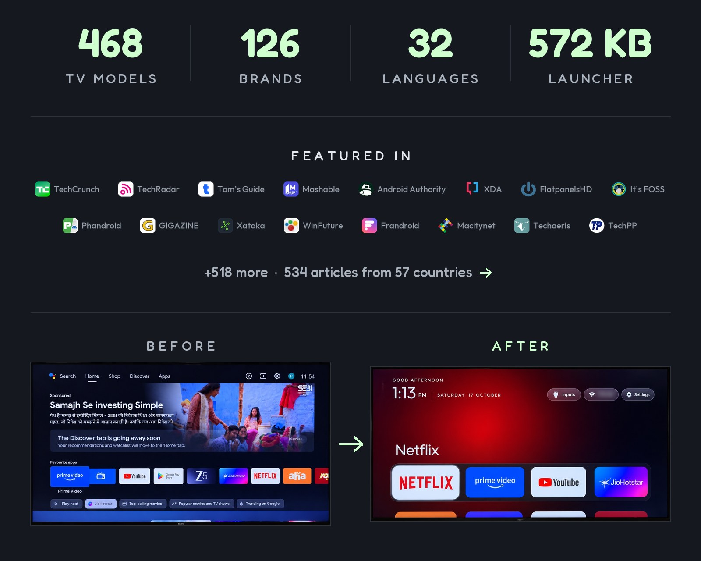

<p align="center">
  <a href="https://cleanyour.tv"></a>
</p>

<p align="center">
  Read in: <a href="README.zh-CN.md">简体中文</a> · <a href="README.zh-TW.md">正體中文</a> · <a href="README.vi.md">Tiếng Việt</a> · <a href="README.ja.md">日本語</a> · <a href="README.it.md">Italiano</a> · <a href="README.nl.md">Nederlands</a> · <a href="README.de.md">Deutsch</a> · <a href="README.uk.md">Українська</a> · <a href="README.tr.md">Türkçe</a> · <a href="README.ru.md">Русский</a>
</p>

<p align="center">
  <a href="https://github.com/Gathin23/cleanyourtv/stargazers"></a>
  <a href="https://github.com/Gathin23/cleanyourtv/pulls?q=is%3Amerged"></a>
  <a href="https://github.com/Gathin23/cleanyourtv/network/members"></a>
  <a href="https://github.com/Gathin23/cleanyourtv/graphs/contributors"></a>
  <a href="https://buymeacoffee.com/gathint"></a>
  <a href="https://www.producthunt.com/products/cleanyourtv"></a>
</p>

<p align="center">
  <a href="https://trendshift.io/repositories/310225"></a>
</p>

<p align="center">
  <a href="docs/PRESS.md"></a>
</p>

## С чего начать

| Что у вас есть | Куда перейти |
|---|---|
| **Android TV или Google TV** | [Быстрый старт](#Быстрый-старт): кодинг-ассистент сделает всю работу примерно за пятнадцать минут. |
| **Samsung, LG, Roku, Vizio или Hisense VIDAA TV** | [cleanyour.tv/not-android](https://cleanyour.tv/not-android): CleanYourTV cам не запустится, но вы можете отключить отслеживание с помощью пульта. |
| **Телефон или ноутбук, без кодинг-ассистента** | Созданное сообществом [community apps](https://cleanyour.tv/app) для телефонов на Android, Mac и Windows - от независимых разработчиков. |
| **Хотите сначала взглянуть что получите** | [Что вы получаете](#Что-вы-получаете): скриншоты нового главного экрана. |

**Официальные ссылки:** [cleanyour.tv](https://cleanyour.tv) и этот репозиторий. ругие домены, использующие это имя, такие как
cleanyourtv.com, не имеют отношения к данному проекту ([#1004](https://github.com/Gathin23/cleanyourtv/issues/1004)).
Мы не выпускаем никаких приложений ни в одном магазине приложений, а сайт clean-your-tv.net нам также не принадлежит.

[Как это работает](#Как-это-работает) · [Быстрый старт](#Быстрый-старт) · [Что вы получаете](#Что-вы-получаете) ·
[Поддерживаемые TV](#Поддерживамые-TV) · [Ручная настройка](#Ручная-настройка) · [Лаунчер](#Лаунчер) ·
[Восстановление](#Восстановление) · [После обновления прошивки](#После-обновления-прошивки) ·
[Вопросы](#Вопросы) · [Участие в проекте](#Участие-в-проекте)

## Как это работает

В Android TV используется тот же способ отладки что и на Android-смартфонах. Включите отладку по USB в настройках разработчика телевизора,
один раз разрешите доступ своему компьютеру, а дальше в дело вступают стандартные инструменты Android:

| Шаг | Что происходит |
|---|---|
| **Резервное копирование** | Список установленных пакетов и настроек. |
| **Отключение** | Отключаются телеметрия производителя, рекламные сервисы, ряды контента и предустановленный мусор с помощью `pm disable-user`. Ничего не удаляется, поэтому скрипт восстановления может отменить любое действие. |
| **Установка** | Небольшой специальный лаунчер, установленный в качестве главного экрана по умолчанию. |

**Без root-прав и кабеля, ничего не удаляется, и восстановление одной командой, если вы передумаете.**

Объём предустановленного «лишнего» ПО зависит от бренда, поэтому кодинг-ассистент сначала обнаружит его на телевизоре и спросит разрешения, прежде чем вносить какие-либо изменения в то, чем вы, возможно, пользуетесь.

## Быстрый старт

| Если у вас есть | Делайте это |
|---|---|
| **Компьютер** | Используйте промпт с кодинг-асисстентом: три шага ниже. |
| **Компьютер, но нет кодинг-ассистента** | Выполните три шага самостоятельно: команды описаны в разделе [Ручная настройка](#Ручная-настройка). |
| **Только смартфон на Android** | Используйте созданное сообществом приложение [community apps](https://cleanyour.tv/app): Бесплатные приложения с открытым исходным кодом, созданные независимыми разработчиками на основе списка Поддерживаемых TV. |

Три шага ниже написаны для ИИ-ассистента: компьютер должен быть подключен к той же Wi-Fi сети,
что и телевизор, иметь командную оболочку, а также установленные Python 3, JDK версий от 17 до 22 и Android SDK platform 34
с build-tools 34 (помощник собирает лаунчер именно там).
Без ИИ-ассистента перейти в раздел [Ручная настройка](#Ручная-настройка)
В разделе есть все те же действия, которые вы выполняете сами, а также необходимые команды для установки.

Подойдет любой из них: Claude Code ([0G Private Computer](https://pc.0g.ai/?utm_source=cleanyourtv&utm_medium=github&utm_campaign=readme) или по тарифу [Anthropic plan](https://claude.com/pricing)), [Codex](https://github.com/openai/codex), [Gemini CLI](https://github.com/google-gemini/gemini-cli) или [Antigravity CLI](https://antigravity.google/product/antigravity-cli).

| Где | Что делаем |
|---|---|
| **1. На вашем TV** | SНастройки → Настройки устройства → Об устройстве → нажать "ОК" на пункте **Номер сборки** семь раз → назад → Для разработчиков → Включить **Отладка по USB**. Если видите переключатель отладки по сети или ADB, включите и его. Оставьте телевизор включенным. |
| **2. На вашем компьютере** | лонируйте репозиторий и откройте эту папку в вашем ассистенте (`git clone https://github.com/Gathin23/cleanyourtv`), затем вставьте [`PROMPT.md`](PROMPT.md) и укажите модель вашего телевизора. |
| **3. Следуйте инструкциям** | Подтвердите «Разрешить отладку по USB?» на телевизоре, затем ответьте на вопросы из чек-листа: какие приложения вы используете, размер панели быстрого доступа и порядок приложений, оставлять ли голосового помощника, Chromecast и обновления. |

Клонирование важно: помощник использует готовые `tools/disable.sh` и `launcher/build-and-install.sh`
из этого репозитория вместо того, чтобы писать свои собственные. Именно там хранятся резервная копия, защита главного экрана и журнал восстановления.

Ассистент делает резервную копию, очищает систему от мусора, собирает и устанавливает лаунчер, проверяя каждый шаг с помощью скриншотов, сделанных с телевизора. При использовании этого репозитория в качестве контекста процесс занимает около пятнадцати минут.

## Что вы получаете

Главный экран, который напоминает Apple TV и не мешает работе:

| Элемент | Как это выглядит |
|---|---|
| **Абсолютно темный домашний экран** | Док-панель с четырьмя вашими любимыми приложениями в скругленной полосе, расположенная там же, где её размещает Apple TV. |
| **Верхняя панель** | Показывает название активного приложения крупным шрифтом с фоновой подсветкой цвета, взятого из его иконки. |
| **Остальные приложения в сетке** | Выезжают снизу при нажатии кнопки «Вниз». |
| **Эффект парящего стекла** | Перемещается от плитки к плитке. Активная плитка приподнимается и показывает свое название. |
| **Три матовые кнопки** | Источники (порты HDMI под именами, которые вы задали в настройках ТV, AV, Эфирное TV), Wi-Fi или Ethernet с именем сети, Настройки. |
| **Приветствие, тонкие часы и дата** | Шрифт [Outfit](https://fonts.google.com/specimen/Outfit), и соответствующая заставка с часами. Установите `show_stats`  конфиге или теме, чтобы под часами появилась одна строка: ЦП, свободная память и свободное хранилище. По умолчанию она выключена, и обновляется только когда активен главный экран. |
| **Темы и карточки модулей** | Темы меняют цвета, обои, док-панели aоличество столбцов без пересборки, а карточки модулей позволяют другим приложениям добавлять свои плитки, но только с вашего разрешения. |

Ваш телевизор перестает работать против вас: никаких спонсорских рядов и панелей, навязчивого «Рекомендуемого», отправки аналитики и приложений, которые вы не просили.

| | |
|---|---|
|  |  |
| *Верхняя панель и фоновая подсветк* | *HDMI со статусом подключения, AV, Эфирное ТВ* |
|  |  |
| *Сетка, эффект парящего стекла, название плитки* | *Заставка-часы, дрейфующие на фоне сияния* |
|  |  |
| *Тема Aurora, применена через `tools/theme.sh`* | *Шесть колонок на шесть док-панелей, этот же лаунчер* |
|  |  |
| *При включенном `tile_menu`, удерживайте OK на плитке, выберите Переместить: стрелки перемещают ее, «Назад» возвращает на место* | *Библиотека приложений: установленные приложения. Добавление на главный экран в одно нажатие* |

## Поддерживаемые TV

Любые устройства на базе **Android TV** или **Google TV**.

| Платформа | Что работает |
|---|---|
| **Android TV, Google TV** | Очистка от мусора и лаунчер. |
| **Fire TV** | Только очистка от мусора, так как Fire OS не позволяет назначить сторонний лаунчер главным экраном. А на Fire TV Box 2015 года (Fire OS 5) не работает даже это: любые команды `pm` блокируются. |
| **Некоторые телевизоры TCL для китайского рынка** | Они вообще отказываются устанавливать любые лаунчеры; об этом сказано в заголовках их списков. |
| **Samsung (Tizen), LG (webOS), Roku, Vizio, Hisense VIDAA** | Не поддерживаются (нет ADB). Вместо этого отключите отслеживание: [cleanyour.tv/not-android](https://cleanyour.tv/not-android). Смотрите [SHOWCASE.md](SHOWCASE.md#other-platforms-fire-tv-and-lg-webos) ля четырех портов webOS и [docs/devices/samsung-tizen.md](docs/devices/samsung-tizen.md), чтобы узнать, как телевизор Samsung 2021 года отвечает по Wi-Fi (без ADB, а значит и без `pm disable-user`), если вы планируете порт на Tizen. |

Протестированные списки от участников, по одной папке на каждую модель в [`examples/`](examples/). Бренды с наибольшим количеством списков, каждый со ссылкой на свои модели на сайте:

<!-- tv-brands:start: generated by tools/gen_tables.py from examples/*/tv.json; edit those, not this -->

| | | | | | |
|---|---|---|---|---|---|
| [TCL](https://cleanyour.tv/tvs?q=TCL) · 81 | [Sony](https://cleanyour.tv/tvs?q=Sony) · 47 | [Xiaomi](https://cleanyour.tv/tvs?q=Xiaomi) · 42 | [Philips](https://cleanyour.tv/tvs?q=Philips) · 22 | [Skyworth](https://cleanyour.tv/tvs?q=Skyworth) · 16 | [Hisense](https://cleanyour.tv/tvs?q=Hisense) · 15 |
| [SHARP](https://cleanyour.tv/tvs?q=SHARP) · 10 | [Amazon Fire TV](https://cleanyour.tv/tvs?q=Amazon%20Fire%20TV) · 9 | [Panasonic](https://cleanyour.tv/tvs?q=Panasonic) · 7 | [BenQ](https://cleanyour.tv/tvs?q=BenQ) · 6 | [Haier](https://cleanyour.tv/tvs?q=Haier) · 6 | [JVC](https://cleanyour.tv/tvs?q=JVC) · 6 |
| [Acer](https://cleanyour.tv/tvs?q=Acer) · 4 | [OnePlus](https://cleanyour.tv/tvs?q=OnePlus) · 4 | [Thomson](https://cleanyour.tv/tvs?q=Thomson) · 4 | [Toshiba](https://cleanyour.tv/tvs?q=Toshiba) · 4 | [Google](https://cleanyour.tv/tvs?q=Google) · 3 | [Grundig](https://cleanyour.tv/tvs?q=Grundig) · 3 |
| [Motorola](https://cleanyour.tv/tvs?q=Motorola) · 3 | [Nokia](https://cleanyour.tv/tvs?q=Nokia) · 3 | [NVIDIA Shield](https://cleanyour.tv/tvs?q=NVIDIA%20Shield) · 3 | [onn](https://cleanyour.tv/tvs?q=onn) · 3 | [RCA](https://cleanyour.tv/tvs?q=RCA) · 3 | [Redmi](https://cleanyour.tv/tvs?q=Redmi) · 3 |
| [Vu](https://cleanyour.tv/tvs?q=Vu) · 3 | [Artel](https://cleanyour.tv/tvs?q=Artel) · 2 | [CHiQ](https://cleanyour.tv/tvs?q=CHiQ) · 2 | [EKO](https://cleanyour.tv/tvs?q=EKO) · 2 | [FFalcon](https://cleanyour.tv/tvs?q=FFalcon) · 2 | [Hitachi](https://cleanyour.tv/tvs?q=Hitachi) · 2 |

<details>
<summary>+67 more brands and 14 projector brands</summary>

**Insignia Fire TV** 2 · **Kalley** 2 · **Kogan** 2 · **Master-G** 2 · **Noblex** 2 · **PRISM+** 2 · **RockTek** 2 ·
**Sankey** 2 · **Sber** 2 · **Síragon** 2 · **TIM** 2 · **Vidda** 2 ·
AiPro2K · AIWA · AQUA · ASUS · Beko · Bell Canada · BGH · Caxium · Cecotec · Challenger · Compac · Dcolor · DEXP ·
Dialog · DYON · Freebox · HAAM · Hikeen · Home+ · Impex · INCLO · Jio · Karbonn · Koryo · KTC · KUNFT · Liberton ·
Lumio · LYNCAST · Magyar Telekom · MarQ · MECOOL · MTC · Next · OK. · OPPO · Panavox · PEAQ · Polytron · PPTV ·
Prosonic · Salora · SANYO · Seleco · Smarttech · Super General · TD Systems · Tele System · TiVo · Tornado · Turkcell ·
Tuvio · Verizon · Vision · X.Vision ·
Alwtniet, Anker Nebula, BYINTEK, Epson, Formovie, Gadnic, HOTACK, HY320, JMGO, Magcubic, Portronics, Stellamore, Wanbo and XGIMI projectors

</details>

<!-- tv-brands:end -->

**Найдите свой телевизор:** используйте поиск на [cleanyour.tv/tvs](https://cleanyour.tv/tvs) или полную таблицу в
[examples/README.md](examples/README.md).

Вашего телевизора здесь нет? Промпт сам найдет мусорное ПО. Добавьте свой список после очистки, и следующему человеку с такой же моделью не придется делать это заново: [CONTRIBUTING.md](CONTRIBUTING.md).

## Ручная настройка

Все, что делает кодинг-ассистент, вы можете выполнить сами. Сначала на компьютере должны быть установлены две вещи:

| Что нужно | Для чего |
|---|---|
| **Python 3** (любая версия 3.x) | нструменты. Команда venv ниже установит необходимые зависимости. |
| **JDK 17 through 22** (полная JDK, включая `jlink`) и **Android SDK platform 34** с **build-tools 34.0.0 or any newer 34.x** | Сборка лаунчера. JDK 23 и новее ломают работу Gradle 8.9. Сборка использует именно Platform 34; более новая платформа ее не заменяет. В macOS, если ничего не установлено: `brew install openjdk@17 android-commandlinetools`, затем `sdkmanager "platforms;android-34" "build-tools;34.0.0"`. В Linux скрипт установки ищет в `~/Android/Sdk` и проверяет наличие `java` в вашем PATH. |

`tools/tv.py` общается с сетевым ADB на порту 5555. Если этот порт остаётся закрытым, а телевизор поддерживает беспроводную отладку (Wireless debugging) с кодом сопряжения - как, например, Chromecast with Google TV и Google TV Streamer, - один раз сопряжитесь с ним штатным `adb`. Дальше либо откройте порт командой `adb tcpip 5555` - обычно это действует лишь до перезагрузки телевизора, - либо оставьте порт закрытым: укажите в `TV_ADB_BINARY` тот же `adb`, а в `TV_HOST` порт, который отображается на экране беспроводной отладки, и инструменты будут обращаться к телевизору через сопряжённое соединение, при этом на порту 5555 не слушает ничего ([tools/native-adb.md](tools/native-adb.md)). Оба варианта, включая шаги сопряжения, описаны в [Устранение неполадок](docs/TROUBLESHOOTING.md#connecting).

```bash
python3 -m venv tools/venv && tools/venv/bin/pip install -r tools/requirements.txt
export TV_HOST=192.168.1.50                                   # IP-адрес вашего телевизора

tools/venv/bin/python -I tools/tv.py --probe                 # модель, версия Android, прошивка
tools/venv/bin/python -I tools/tv.py 'pm list packages'      # консольная команда на телевизоре
tools/disable.sh examples/xiaomi-mi-tv-4a/debloat.txt        # применить список для очистки
tools/restore.sh examples/xiaomi-mi-tv-4a/debloat.txt        # отменить его, вернуть стандартный лаунчер
tools/venv/bin/python -I tools/check.py examples/xiaomi-mi-tv-4a/debloat.txt   # что откатило обновление прошивки
TV_HOST=192.168.1.50 launcher/build-and-install.sh           # собрать лаунчер и сделать его главным экраном
tools/theme.sh themes/aurora                                 # применить тему; --reset удаляет ее
```

| Инструмент | Что делает |
|---|---|
| [`tools/tv.py`](tools/tv.py) | Чистый Python ADB-клиент: shell, batch, push, pull, reboot и скриншоты, с опциональным предварительным нажатием кнопок пульта. Работает там, где заблокирован стандартный бинарник `adb`. Опциональный [сопряженный Google ADB бэкенд](tools/native-adb.md) для зашифрованной беспроводной отладки. |
| [`tools/docker-build.sh`](tools/docker-build.sh) | Собирает лаунчер или аддон в Docker (JDK 17, Android SDK 34), поэтому на этом компьютере не нужно ничего, кроме Docker. Установите результат с `SKIP_BUILD=1`. [Руководство](tools/docker-build.md). |
| [`tools/b64push.py`](tools/b64push.py) | Загружает большие файлы, такие как APK, чанками в base64 и проверяет контрольную сумму. |
| [`tools/relay.py`](tools/relay.py) | Эта команда перенаправляет локальный порт вашего компьютера на порт ADB вашего телевизора. [Руководство](tools/relay.md). |
| [`tools/disable.sh`](tools/disable.sh), [`restore.sh`](tools/restore.sh) | Применяют или отменяют список очистки, откатывая систему к состоянию, записанному до изменений. |
| [`tools/recovery.py`](tools/recovery.py) | Записывает журнал, который нужен disable.sh для отмены своих действий, и выводит batch-скрипт восстановления. |
| [`tools/check.py`](tools/check.py) | Сравнивает состояние телевизора с примененным списком, чтобы узнать, что откатило обновление прошивки; --fix возвращает все как было. |
| [`tools/adb-closed.py`](tools/adb-closed.py) | Проверяет, что сетевой ADB-порт телевизора закрыт после выключения отладки: возвращает 0, если телевизор отказывает в подключении, 1, если порт все еще открыт, 2, если ничего не ответило или сама проверка не смогла запуститься. nc не требуется. |
| [`tools/philips-api.py`](tools/philips-api.py) | Только для Philips: проверяет, что API управления JointSpace, используемый Home Assistant, по-прежнему отвечает - до и после очистки от лишнего ПО (`tools/venv/bin/python -I tools/philips-api.py <tv ip>`). Сначала порт 1926 по HTTPS, затем 1925; считываются только те данные, которые доступны без сопряжения. |
| [`tools/privacy.py`](tools/privacy.py) | Проверяет телевизор на наличие голосовых, ACR и телеметрических служб и выводит доказательства для каждой; --write превращает находки в список, который уже понимают disable.sh и restore.sh. |
| [`tools/theme.sh`](tools/theme.sh), [`theme_restart.py`](tools/theme_restart.py) | Загружают папку из[`themes/`](themes/) в лаунчер и перезапускают главный экран. |
| [`tools/manage.py`](tools/manage.py) | Выводит список всех аддонов, тем и переключателей с их скриншотами, показывает, что установлено на телевизоре, и позволяет установить, обновить или удалить их, запустив скрипт их создателя. |
| [`tools/bench.py`](tools/bench.py) | Измеряет лаунчер, отвечающий за HOME: задержку нажатий, смещение фокуса, лагающие кадры, холодный старт, возврат на главный экран, а также потребление ЦП и PSS в простое. Ничего не меняет на телевизоре и записывает сырые данные по каждой кнопке в JSON; не требует дополнительной установки. |
| [`tools/trace.py`](tools/trace.py), [`trace_report.py`](tools/trace_report.py) | Записывают Perfetto-трейсы лаунчера (возврат на HOME, холодный старт, D-pad) и показывают, на что уходит время, для каждого запуска и в сравнении «до/после». Опционально: требует [`requirements-perf.txt`](tools/requirements-perf.txt). [Руководство](tools/trace.md). |
| [`tools/flamechart.py`](tools/flamechart.py) | Рисует диаграмму-пламя (flame chart) «до/после» на основе этих трейсов для пулл-реквеста: одна дорожка на поток на общей шкале времени, целевая для изменения работа выделена пурпурным цветом с итогом. Опционально, как и инструменты трейсинга [Руководство](tools/flamechart.md). |
| [`tools/screendiff.py`](tools/screendiff.py) | Попиксельно сравнивает скриншоты «до» и «после», исключая часы или любые замаскированные области, и сохраняет пару изображений с размытым именем вашей Wi-Fi сети. Опционально, как и инструменты трейсинга. [Руководство](tools/screendiff.md). |
| [`tools/race_calendar.py`](tools/race_calendar.py) | Записывает календарь Формулы-1 текущего сезона в тему для режима гоночного уик-энда, используя бесплатный API Jolpica. |
| [`launcher/build-and-install.sh`](launcher/build-and-install.sh) | Собирает ужатый релиз (около 561 КБ), устанавливает его, переключает HOME и откатывает изменения, если главный экран не переключился на него. |

Скрипты никогда не оставляют телевизор без приложения HOME: они отключают только распознаваемый ими стандартный лаунчер и пропускают приложение HOME в списке, пока другой лаунчер не начнет отвечать за HOME. Ваши собственные списки могут находиться вне репозитория: пути к спискам задаются относительно директории, из которой вы запускаете скрипт, также работают абсолютные пути.

<details>
<summary><b>Windows (PowerShell)</b></summary>

У каждого скрипта есть PowerShell-аналог рядом. Установите Python 3 и JDK версий от 17 до 22, а в SDK Manager добавьте platform 34 и build-tools 34 (34.0.0 или любую новее из ветки 34.x). Скрипт использует
`JAVA_HOME`, если он указывает на JDK из этого диапазона, а в противном случае — встроенную JDK Android Studio, если она тоже попадает в этот диапазон:

```powershell
python -m venv tools\venv; tools\venv\Scripts\python.exe -m pip install -r tools\requirements.txt
powershell -ExecutionPolicy Bypass -File launcher\build-and-install.ps1 -TvHost 192.168.1.50
powershell -ExecutionPolicy Bypass -File tools\disable.ps1 -TvHost 192.168.1.50 examples\xiaomi-mi-tv-4a\debloat.txt
powershell -ExecutionPolicy Bypass -File tools\restore.ps1 -TvHost 192.168.1.50 examples\xiaomi-mi-tv-4a\debloat.txt
powershell -ExecutionPolicy Bypass -File tools\theme.ps1 -TvHost 192.168.1.50 themes\aurora
```

Последние две команды - это отмена изменений и применение темы, аналоги строк `tools/restore.sh` и `tools/theme.sh` из разделов выше для bash. В Google TV отмена также затрагивает стандартный лаунчер:
`-Stock com.google.android.apps.tv.launcherx`.

</details>

<details>
<summary><b>Как скрипты защищают главный экран</b></summary>

Скрипты установки спрашивают телевизор, какой лаунчер владеет главным экраном, и отключают только распознаваемый, один из четырех в `KNOWN_STOCK_LAUNCHERS`: `com.google.android.tvlauncher`, `com.google.android.apps.tv.launcherx`,
`com.google.android.leanbacklauncher` и Xiaomi' `com.mitv.tvhome` (PatchWall). Передайте
`STOCK_LAUNCHER=<package>` (`-StockLauncher`) чтобы переопределить его, или `none`, чтобы оставить без изменений.

`tools/disable.sh` (`disable.ps1`) применяет то же правило перед отключением чего-либо:

- Если в списке есть приложение, владеющее HOME, и никакое другое приложение на телевизоре не отвечает за HOME, оно пропускает эту запись, объясняет почему и отключает остальные пункты списка. Таким образом, список, примененный до передачи управления лаунчеру, не может оставить телевизор без главного экрана.
- Мастер первоначальной настройки, приложения настроек, вендорский `FallbackHome` и приложения заводских тестов (Xiaomi
  `com.duokan.factorytest`) тоже отвечают за HOME и не учитываются.
- В Google TV он также сохраняет владельца, пока setupwraith отвечает за HOME и остается включенным (не указан в списке или сохранен для Wi-Fi сети): setupwraith отвечает раньше установленного лаунчера, который еще не стал главным экраном, поэтому он перехватил бы HOME.

Запустите тот же список еще раз, когда `launcher/build-and-install.sh` сделает новый лаунчер главным экраном, и запись будет применена; `FORCE_HOME=1` (`$env:FORCE_HOME`) отключит его в любом случае.

</details>

## Микрофон и что о нем можно сказать

На вопрос «Какой из этих пакетов прослушивает?» нет честного ответа в одну строку: сканирование разрешений показывает пятьдесят системных пакетов с `RECORD_AUDIO` , которые ничего не записывают, а клиенты ACR видят экран вообще без разрешения на доступ к аудио. [`tools/privacy.py`](tools/privacy.py) rсообщает то, что телевизор реально говорит, с доказательствами для каждого кандидата на голосовой сбор, ACR и телеметрию:
`TV_HOST=192.168.1.50 tools/venv/bin/python -I tools/privacy.py`, а `--write`превращает их в обычный список для очистки. Чего аудит сделать не может, так это доказать умысел: [docs/privacy.md](docs/privacy.md) объясняет почему.

## Лаунчер
Небольшой нативный главный экран для Android TV: **весит около 572 KB**, чистая Java, создан для телевизоров с 1 ГБ ОЗУ.
Без размытия, без видео, без разрешений на доступ к сети, без фоновых сервисов. **Телевизор** должен быть на Android 8.0 (API 26) или новее, `minSdk` указан в [`launcher/app/build.gradle`](launcher/app/build.gradle); ; что остается на более старых моделях, описано в [Устранение неполадок](docs/TROUBLESHOOTING.md).

| Что | Как это работает |
|---|---|
| **Настройка** | Порядок в доке, скрытые приложения, приложение эфирного TV, от 4 до 7 плиток в ряду, уменьшение движения. Все в [`config.xml`](launcher/app/src/main/res/values/config.xml) |
| **Настройки на телевизоре** | Удерживайте OK на Настройках для перехода в настройки лаунчера. Опциональный `launcher_settings_button` открывает их обычным нажатием; настройки телевизора остаются на странице настроек и на их плитке приложения. |
| **Темы** | Фон, обои и макет из `config.json`, загруженного по Wi-Fi, без пересборки. Двадцать одна тема в [`themes/`](themes/), включая встроенную `default/`. |
| **31 язык** | Следует языку телевизора, с полностью зеркальным макетом справа налево для иврита |
| **Библиотека приложений** | Опционально: просмотр всех установленных приложений и добавление или удаление ярлыков на главном экране. Смотрите [Руководство по библиотеке приложений](docs/app-library.md) |
| **Меню плиток** | По умолчанию (`tile_menu`): : удерживайте OK на плитке для Перемещения, Удаления с главного экрана и Информации о приложении. Если выключено, удержание OK открывает Информацию о приложении |
| **Карточки модулей** | Любое ТВ-приложение может предложить свою плитку; вы одобряете каждую один раз. Смотрите [`docs/modules.md`](docs/modules.md) |
| **Аддоны** | Опциональные приложения, подключаемые как карточки модулей, хранятся в [`addons/`](addons/) и никогда не встраиваются в лаунчер. |
| **Заставка с часами** | Плавающие часы над подсветкой, чтобы ничего не выгорало |
| **Кнопки пульта** | Сохраняет работу кнопок Источника, YouTube и шестеренки после удаления стандартного лаунчера |

Темы, переключатели и аддоны вместе, со скриншотами: [cleanyour.tv/addons](https://cleanyour.tv/addons).

**Подробнее:** [docs/launcher.md](docs/launcher.md) содержит страницу настроек лаунчера построчно, смену главного экрана по умолчанию, языки, кнопки пульта, заставку с часами, навигацию и самостоятельную сборку.

## Восстановление

Сохраните список, который вы применили. Одна команда вернет телевизор в исходное состояние:

```bash
TV_HOST=192.168.1.50 tools/restore.sh examples/<your tv>/debloat.txt                                    # Android TV
TV_HOST=192.168.1.50 tools/restore.sh examples/<your tv>/debloat.txt com.google.android.apps.tv.launcherx  # Google TV
```

| Что | Как |
|---|---|
| **Сначала создается журнал** | Перед тем как `tools/disable.sh` что-то изменит, он записывает, как выглядел телевизор, в `~/.cleanyourtv/`. |
| **Восстановление воспроизводит его** | Пакет, который вы отключили сами, останется отключенным, а главный экран вернется к тому компоненту, который владел им. |
| **Лаунчер остается установленным** | Удалите его через Настройки телевизора → Приложения, если хотите избавиться от него. |
| **Нет компьютера?** | Если телевизор недоступен, его собственная страница Настройки → Приложения тоже может снова включить пакеты. |

**Подробнее:** [docs/restore.md](docs/restore.md) описывает, что хранится в журнале, когда важен аргумент стандартного лаунчера и что происходит без журнала.

## После обновления прошивки

Обновление устанавливается поверх очищенной системы: перечисленные пакеты возвращаются, главный экран возвращается до заводского лаунчера, и появляются новые предустановленные приложения, которых нет ни в одном списке. Снова откройте ADB, как в шаге 1
[Quick start](#quick-start), затем сравните телевизор с примененным списком; `--fix` вернет все на место:

```bash
TV_HOST=192.168.1.50 tools/venv/bin/python -I tools/check.py examples/<your tv>/debloat.txt
```

**Подробнее:** [docs/firmware-updates.md](docs/firmware-updates.md) содержит коды завершения, еженедельную проверку, что меняет
`--fix`, телевизоры, которые оставляют стандартный лаунчер в качестве HOME, и списки, отключающие службу обновлений.

## Когда что-то идет не так

Полный список проблем, с которыми мы столкнулись, находится в [docs/TROUBLESHOOTING.md](docs/TROUBLESHOOTING.md). Три самые важные:

- 🍎 **macOS блокирует `adb connect`** ("No route to host") из-за настроек конфиденциальности локальной сети. `tools/tv.py` обходит это, не используя бинарник.
- ⚠️ **Отключайте стандартный лаунчер только после того, как новый установлен и запущен**, иначе главный экран переключится на приложение заводского теста. Скрипт установки делает это в правильном порядке за вас.
- 🔁 **В Google TV мастер первоначальной настройки** (`com.google.android.tungsten.setupwraith`) может перехватить ваш главный экран и вызвать циклические сбои системы после отключения стандартного лаунчера. Отключите и его, и добавьте в свой `debloat.txt`, чтобы восстановление вернуло его.
  - Но сначала проверьте `dumpsys wifi | grep -o 'cname=[^ ]*'` если Wi-Fi сеть была сохранена во время настройки, она принадлежит setupwraith, и его отключение удалит сеть (сначала переподключитесь к ней в Настройках; `tools/disable.sh` пропускает setupwraith, пока вы этого не сделаете).
  - На собственном Chromecast от Google и на Google TV Streamer это также ломает трансляцию с телефона, смотрите [Устранение неполадок](docs/TROUBLESHOOTING.md).
  - Уже застряли? `tools/tv.py 'pm enable --user 0 com.google.android.apps.tv.launcherx'`.

## Частые вопросы

<details>
<summary><b>Я не умею программировать и у меня нет ноутбука. Я все равно могу это сделать</b></summary>

Да. Независимые разработчики создали бесплатные открытые приложения на основе списков CleanYourTV, которые делают ту же очистку через Wi-Fi без кодинг-ассистента. Каждый сначала показывает план, только выключает приложения и может все вернуть:

| Приложение | Для | Автор |
|---|---|---|
| [Clean Your TV app](https://github.com/udhaykumarbala/cleanyourtv-app) | Телефон на Android | [@udhaykumarbala](https://github.com/udhaykumarbala) |
| [Tellyscope](https://github.com/man15h/tellyscope) | Телефон на Android | [@man15h](https://github.com/man15h) |
| [TidyTV](https://github.com/jolan94/tidytv) | Телефон на Android, Google Play | [@jolan94](https://github.com/jolan94) |
| [CleanMyTV](https://github.com/wingedpanther/cleanmytv) | Mac и Windows | [@wingedpanther](https://github.com/wingedpanther) |

Эти приложения - независимые проекты, не связанные с CleanYourTV или его мейнтейнером и не одобренные ими; каждый предоставляется "как есть" по собственной лицензии. О проблемах с приложением сообщайте в его репозитории. Больше на
[cleanyour.tv/app](https://cleanyour.tv/app).

</details>

<details>
<summary><b>Это безопасно? Можно ли этим сломать телевизор?</b></summary>

Ничего не прошивается, не рутируется и не удаляется; пакеты отключаются в пользовательском профиле. Риск - выключить что-то, на что телевизор опирается, поэтому списки применяются небольшими партиями, имея наготове скрипт отката. Собственная страница телевизора «Настройки устройства → Приложения» может снова включить пакеты даже без инструментов. Если телевизор больше не запускается настолько, чтобы это сделать, обычно возвращает заводской сброс из меню восстановления.

Подробнее: [docs/faq.md](docs/faq.md#is-this-safe-can-it-brick-the-tv)

</details>

<details>
<summary><b>А как же обновления прошивки?</b></summary>

Служба обновлений остается включенной в большинстве списков, поэтому обновления прошивки приходят как обычно. Некоторые списки отключают собственную службу обновлений телевизора, и в них обновление приходит только после того, как вы снова ее включите. Когда обновление все же устанавливается, оно ставится поверх очищенной системы, поэтому пакеты возвращаются, и вам нужно запустить скрипт заново: смотрите
[После обновления прошивки](#После-обновления-прошивки).

</details>

<details>
<summary><b>А приложения не сломаются?</b></summary>

Стриминговые приложения по-прежнему обновляются через Play Store, который мы не трогаем.
Лаунчер просто показывает список установленного и запускает его с помощью интентов, которые остаются стабильными уже десяток лет.

</details>

<details>
<summary><b>Как изменить расположение приложений?</b></summary>

Удерживайте кнопку OK в разделе **Настройки** (в правом верхнем углу) и выберите **Изменить порядок приложений**. Кнопка OK позволяет «подхватить» приложение, стрелки — переместить его,
кнопка «Назад» — зафиксировать его на новом месте, а повторное нажатие «Назад» — завершить операцию. Если удерживать кнопку OK на плитке, также появится опция **Переместить** (`tile_menu`, включена по умолчанию),
которая сразу позволяет «подхватить» соответствующее приложение. Подробнее: [docs/launcher.md](docs/launcher.md#launcher-settings-and-the-default-home)

</details>

<details>
<summary><b>Могу ли я сделать это для кого-то в другом доме?</b></summary>

Да, через приватную ссылку [Tailscale](https://tailscale.com)
lвместо общей Wi-Fi сети: либо Tailscale на их телевизоре, расшаренный с вами, либо компьютер или Apple TV в их доме, маршрутизирующие трафик к нему. Никогда не делайте это, открывая ADB-порт на их роутере. Пошагово в
[docs/REMOTE.md](docs/REMOTE.md).

</details>

<details>
<summary><b>Разве доступ ADB – не дыра в безопасности?</b></summary>

Это всего лишь одно явное нажатие «разрешить этому компьютеру» на телевизоре, точно такое же, как при разработке Android-приложения. Сетевой ADB передает данные в открытом виде на порту 5555, и в некоторых прошивках любое устройство в локальной сети получает доступ к shell, поэтому закройте его, когда закончите:

1. На телевизоре: Для разработчиков → выключите **Отладка по USB**, **Отладка по сети/ADB** и
   **Беспроводная отладка**, в зависимости от того, что есть на телевизоре, и отзовите разрешения на отладку по USB.
2. Перезагрузите телевизор, затем убедитесь с компьютера, что порт закрыт:
   `python3 tools/adb-closed.py <tv ip>` должен сообщить, что порт закрыт.
   
Лаунчер продолжает работать без отладки. Подробнее, включая проверку собственного порта беспроводной отладки:
[docs/faq.md](docs/faq.md#isnt-adb-access-a-security-hole)

</details>

<details>
<summary><b>Реклама внутри приложений тоже блокируется?</b></summary>

Частично, с помощью Приватного DNS в Android (Android 9 и выше). Укажите в нем блокирующий рекламу резолвер, такой как [AdGuard DNS](https://adguard-dns.io), и домены рекламы и трекеров всех приложений перестанут резолвиться на уровне всей системы, сохраняясь после перезагрузок. Обратная сторона: этот резолвер будет видеть каждый DNS-запрос, который делает телевизор, и это не убирает рекламу в YouTube.

Подробнее, с двумя командами и тем, как вернуть все обратно: [docs/faq.md](docs/faq.md#can-it-block-ads-inside-apps-too)

</details>

<details>
<summary><b>Есть ли в настройках самого телевизора какие-то переключатели, которые тоже стоит активировать?</b></summary>

Кое-что – и для этого ADB не требуется: рекламный идентификатор, «Местоположение», «Использование и диагностика» и «Сканирование всегда доступно», а еще режим «Только приложения», где штатный лончер остается. Переключите «Использование и диагностика» до уборки: на некоторых телевизорах страница исчезает вместе с ним.

Более того, с путями для Google TV, Android TV и Fire OS:
[docs/faq.md](docs/faq.md#are-there-switches-in-the-tvs-own-settings-worth-flipping-too)

</details>

<details>
<summary><b>AirPlay?</b></summary>

Не из этого репозитория. Встроенный Chromecast остается для Android-смартфонов. Для iPhone работает
[jqssun/android-airplay-server](https://github.com/jqssun/android-airplay-server); скрипт для его установки есть в [PR #84](https://github.com/Gathin23/cleanyourtv/pull/84).

</details>

<details>
<summary><b>Могу ли я просто скачать APK?</b></summary>

Соберите его с помощью однострочного скрипта в разделе [Ручная настройка](#Ручная-настройка); это займет минуту, и вы будете контролировать, что попадает на ваш телевизор. Для этого нужны JDK и Android SDK, указанные там. Готовых бинарников нет.

</details>

## The story

17 октября 2026 года я опубликовал [До и После](https://x.com/gathint/status/2111379569030939102) телевизора своих родителей, очищенного Claude Code через Wi-Fi. Это собрало 8,6 млн просмотров, люди начали делать то же самое со своими телевизорами, и их ответы превратились в списки здесь: 170+ моделей телевизоров от 200+ участников за первые четыре дня. До 19-го репозиторий назывался tv-vibehack; старые ссылки работают.

Через две недели репозиторий стал №1 в трендах GitHub за неделю 19–25 октября: более 46 тыс. звезд и 5,7 тыс. форков, 1,4 млн. просмотров и 260 тыс. клонов за 14 дней. Теперь списки включают 427 моделей телевизоров от 111 брендов. Публикации: 412 статей из 54 стран и 229 видео на YouTube и Bilibili, все в [docs/PRESS.md](docs/PRESS.md) (на 30 октября 2026 года).

## Участие в проекте

The most useful contribution is your TV's debloat list, so the next person with that model does
not have to rediscover it. [CONTRIBUTING.md](CONTRIBUTING.md) has the format and the testing we ask for.
Contributing through a coding agent? [AGENTS.md](AGENTS.md) gives it the same rules.

| How to help | What it means |
|---|---|
| **Your TV's debloat list** | The most useful one: the next person with that model skips the discovery. |
| **Launcher and prompt** | Launcher improvements and sharper prompt wording are welcome too. |
| **Built something on top?** | A launcher, a port, a theme: add it to [SHOWCASE.md](SHOWCASE.md), where a hundred and ninety-six projects already live, sorted into home screens, forks, add-ons, tools and other platforms, with an index by TV brand. |

The people whose work is in this repo:

<a href="https://github.com/Gathin23/cleanyourtv/graphs/contributors"></a>

<details>
<summary><strong>Star history</strong></summary>

<a href="https://star-history.com/#Gathin23/cleanyourtv&Date"></a>

</details>

## Contact

| For | Where |
|---|---|
| **Questions about your TV** | [GitHub Discussions](https://github.com/Gathin23/cleanyourtv/discussions) |
| **Press and queries** | [hello@itsgathin.com](mailto:hello@itsgathin.com) |
| **Security issues** | Report them privately through the [Security tab](https://github.com/Gathin23/cleanyourtv/security), see [`SECURITY.md`](SECURITY.md) |

## Legal

- CleanYourTV is an independent open-source project. It is not affiliated with, endorsed by or sponsored
  by any TV maker or platform. Brand and model names are used only to say which TV a list was tested on,
  and remain the trademarks of their owners.
- It works only through settings the TV itself offers to its owner: Developer options, ADB debugging and
  Android's own `pm disable-user`, the same switch as Settings > Apps > Disable. It does not root the TV,
  flash firmware, or bypass any lock, DRM or copy protection, and the repo contains no manufacturer
  software, firmware or APKs.
- Nothing is uninstalled, and `tools/restore.sh` puts everything back. You run it on a TV you own, at your
  own risk, and changing a TV's software may affect its warranty or support.
- Everything here is provided as is, without warranty of any kind, under the MIT licence below.

## Licence

MIT, see [`LICENSE`](LICENSE). The Outfit typeface is under the SIL Open Font License, see
`launcher/FONT-LICENSE-OFL.txt`.
