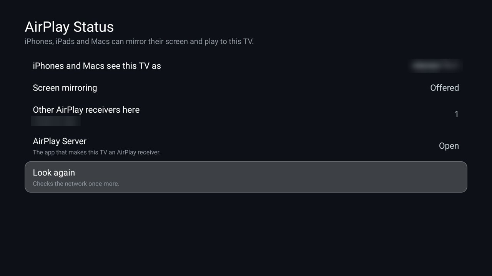

# AirPlay Status

How iPhones, iPads and Macs see this TV: the name it appears under, whether it offers screen mirroring or audio
only, and the other AirPlay receivers on the network. It looks the way an iPhone does, by listening for mDNS
announcements (`_airplay._tcp` for video and mirroring, `_raop._tcp` for audio) for six seconds while the screen
is open. It is for TVs that run an AirPlay receiver such as
[AirPlay Server](https://github.com/jqssun/android-airplay-server) (open source); it is not made by or affiliated
with Apple or that project. For the [Clean Your TV](../../README.md) launcher it declares a
[module card](../../docs/modules.md): once you answer **Show card** its tile reads "AirPlay Status" with a light
blue glow. On any other Android TV home it is an ordinary app.



| Row | What it shows |
|---|---|
| **iPhones and Macs see this TV as** | The name in the AirPlay menu, or Not seen. |
| **Screen mirroring** | Offered, Audio only, or No. |
| **Other AirPlay receivers here** | How many, with their names. |
| **AirPlay Server** | Opens it, or says it isn't installed. |
| **Look again** | Listens once more. |

The line at the top explains what to do. The usual problem it catches: an AirPlay name exactly equal to the TV's
own device name. Android 14 then refuses the second mDNS service under that name, so only the audio service is
announced and iPhones offer no mirroring. A name that looks the same but differs (a non-breaking space) fixes it.

## Permissions

| Permission | Why |
|---|---|
| `INTERNET` | Android requires it for mDNS discovery through `NsdManager`. The app opens no connection to anything: it only listens for announcements on the home network. |
| `ACCESS_NETWORK_STATE` | This TV's own addresses, to tell its announcement apart from other receivers'. |
 Package visibility is limited to
`io.github.jqssun.airplay`. Nothing is sent anywhere: it only listens on the home network, only while open. No
background service, accounts, telemetry, ads or libraries.

## Build and install

JDK 17 and Android SDK platform 34 with build-tools 34.0.0, as for the launcher. From the repo root, with ADB on:

```bash
TV_HOST=<tv ip> addons/airplay-status/install.sh
```

To build only: `cd addons/airplay-status && ./gradlew assembleRelease`; the JVM tests run with
`./gradlew testReleaseUnitTest`.

## Limits

- **AirPlay Server's own settings** answer only ADB (they need the `DUMP` permission), so this app can't read or
  change them; it reports what the network sees, which is what an iPhone sees too.
- **Networks that block mDNS** between devices (guest Wi-Fi, some mesh systems) hide receivers from this app
  exactly as from an iPhone.

## Tested on

MOKA R8G (Android 14) with AirPlay Server 0.0.36, on a home app that implements the module-card spec: the card prompt and the card, the TV found under its AirPlay name with mirroring offered, and one other receiver on the network found by name. Testing found that Android requires `INTERNET` for `NsdManager` (it threw a SecurityException without it). Names in the screenshot are blurred. The JVM tests cover matching this TV's announcements, the `MAC@Name` form and the name clash.

## Maintainer

[@maxhayim](https://github.com/maxhayim)
