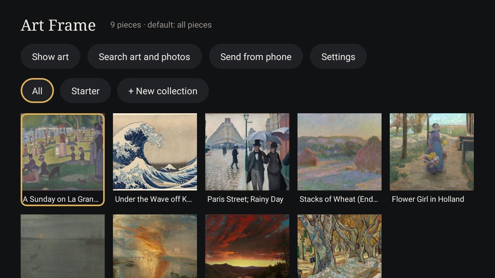

# Art Frame

A picture-frame art mode for Android TV, with no account and no maker's cloud: your own photos and free-to-use
art from museums and photo libraries, shown full screen at the panel's own 4K, in a matte you choose, as the TV's
screensaver and on the remote's art button. Built to replace TCL's art mode on the A300W "NXTFRAME" without its
backend, and it runs on any Android TV 8 or newer.



## What it does

- **Art mode.** The tile, the card and (when mapped) the remote's art button open the default art full screen. Left
  and Right step through the pieces, Up shows the title, OK opens the library, Back leaves.
- **True 4K on 1080p-UI TVs.** Most 4K TVs run apps at 1920x1080 and upscale them. Art Frame hands each picture to the
  TV's own H.264 decoder as a single uncompressed (I_PCM) frame, so it travels the video layer to the panel at
  3840x2160 and gets the TV's picture processing. No encoder is needed and nothing is lost but 4:2:0 chroma. If the
  decoder refuses, it falls back to normal drawing for that visit. Settings > "Draw at the panel's full 4K" turns
  this off.
- **Live adjusting on the wall.** Choosing a piece shows it as it hangs, with a panel: brightness, contrast, framing
  (fill the screen / matte, even / matte, whole picture), crop position, matte colour, width and texture, and depth.
  Left and Right change the real picture within about half a second, saved as you go. The same panel sets the
  default, collections, reset and delete.
- **Mattes.** Nine colours, five widths (hairline to wide), four textures (smooth, paper, linen, suede, drawn in code
  so they stay sharp at 4K) and depth: the picture looks sunk behind the matte, with the cut edge's shadow and bevel.
  "Matte, even" crops the picture to the opening so the matte is equally thick all round.
- **Search.** Any words, in the source you pick: Art Institute of Chicago, Cleveland Museum of Art, The Met
  (public domain / CC0), Wikimedia Commons (featured pictures or everything, public domain, CC0 and CC BY / BY-SA,
  credited), NASA (public domain) and, with your own key, Unsplash. By default only pictures whose shape suits the
  TV are listed ("Shape: fits the TV"); one press shows every shape. Saves fetch the largest picture offered, up to
  3840x2160.
- **Your own pictures.** Send from phone: the TV shows a QR code; a phone on the same Wi-Fi opens a small upload page
  and picks pictures. The page runs only while that screen is open, answers only the local network and needs the
  one-time code in the QR.
- **Starter set.** Nine wide public-domain paintings, bundled so it shows art offline from the first start.
- **Look options.** Title and artist, slow zoom, crossfade, clock: each on or off.
- **Schedules.** Art hours (black, or let the TV sleep, outside them) and night dimming.
- **Home background.** "Home background matches the art" sets the TV's system wallpaper to the default piece (or the
  last piece shown). cleanyourtv's launcher shows it behind Home with the theme key `"system_wallpaper": true`
  (and `"wallpaper_dim"` to darken it, `"ambient_glow": false` so the colour glow does not cover it).
- **Wake into art** (off by default). On TCL TVs the firmware records which key woke the TV; with "when the art button
  wakes the TV", waking with the art button opens art mode, as TCL's own app does, and the power button wakes to Home.

## Install

JDK 17 and Android SDK 34, as for the launcher, and `tools/venv` (see the repository README).

```bash
TV_HOST=192.168.1.50 addons/art-frame/build-and-install.sh
```

It downloads the starter paintings first (`fetch-starter.sh`, from the museums' own servers, into a git-ignored
folder), builds, installs, allows "display over other apps" (used only by Wake into art) and makes Art Frame the
TV's screensaver. `--uninstall` puts the previous screensaver back and removes it.

**Unsplash** needs your own access key, kept out of git: copy `secrets.properties.example` to `secrets.properties`
and fill in `unsplash.access_key`, or set `UNSPLASH_ACCESS_KEY`. It is compiled into your APK only. Without it the
Unsplash source is not offered.

### The art button on a TCL frame TV (A300W, NXTFRAME)

The art button sends keycode 4181 (scancode 507), and TCL's code in the system starts `com.tcl.exhibit` with it.
Disabled, exhibit leaves the key to the launcher, so:

1. Disable TCL's art app: `pm disable-user --user 0 com.tcl.exhibit` (in a list for `tools/disable.sh`, so
   `tools/restore.sh` can undo it). Its art collection, AI art and art picture mode go with it.
2. Add `"4181:com.gathin.artframe"` to `app_keys` in your theme and push it with `tools/theme.sh`, with the launcher
   installed with `INPUT_KEY_SERVICE=1`.
3. Optionally turn on Settings > Wake into art.

## Permissions

| Permission | Why |
|---|---|
| `INTERNET` | Searching and downloading from the picture sources you choose, and the upload page phones on your network open while Send from phone is showing. Nothing else goes out: no account, no analytics. |
| `SET_WALLPAPER` | Only with "Home background matches the art" on: the default picture becomes the system wallpaper. |
| `FOREGROUND_SERVICE`, `FOREGROUND_SERVICE_SPECIAL_USE`, `RECEIVE_BOOT_COMPLETED` | Only with Wake into art on: a small service keeps a screen-on receiver registered (Android delivers SCREEN_ON to no manifest receiver) and is started again after a boot. |
| `SYSTEM_ALERT_WINDOW` ("display over other apps") | Granted by `build-and-install.sh`; used only by Wake into art, to open art mode from the background as the TV wakes. |

No background service runs unless Wake into art is on. Pictures, settings and the library stay in the app's own
storage on the TV.

### Network use

- **Picture sources**, only when you search or save: `api.artic.edu` and `www.artic.edu` (Art Institute of Chicago),
  `openaccess-api.clevelandart.org` and `openaccess-cdn.clevelandart.org`, `collectionapi.metmuseum.org` and
  `images.metmuseum.org`, `commons.wikimedia.org`, `thumb.wikimedia.org` and `upload.wikimedia.org`, `images-api.nasa.gov` and
  `images-assets.nasa.gov`, and with your key `api.unsplash.com` and `images.unsplash.com`. HTTPS only, no cookies,
  no login; Unsplash gets your access key and a download report for each saved photo.
- **Local upload server**, only while the Send from phone screen is open: a small HTTP server on the first free port
  from 8790 to 8799, answering only addresses on the local network (site-local, link-local or loopback) and only
  requests carrying the random one-time code from the QR on the TV. It accepts pictures up to 60 MB each and stops
  when the screen closes.
- Nothing is sent anywhere else: no analytics, no crash reports, no account.

## Licences of the pictures

Searches offer only pictures free to show at home: public domain, CC0, CC BY / BY-SA (credited with author and
licence, shown with the title) and the Unsplash License (credited "Photo by ... on Unsplash", with the download
reported to Unsplash as its API guidelines ask). Your uploads are yours. The starter set is CC0 from the Art Institute
of Chicago and the Cleveland Museum of Art; `app/src/main/assets/starter/starter.json` names each one.

## Build and test

```bash
cd addons/art-frame
./gradlew --no-daemon testReleaseUnitTest lintRelease assembleRelease
```

The unit tests cover the I_PCM bitstream (Exp-Golomb, emulation prevention, BT.709 limited range, brightness inside
the picture only), crops and mattes, the shape filter, licences and the library's JSON.

Tested on a TCL 65A300W (NXTFRAME, G08, Google TV 12, STT2.230203.001): 4K through the video decoder, live adjusting
and the art button on the real remote; wake into art from the TV's log (art-button wake opens it, power wake does not);
the Home background from screenshots.
