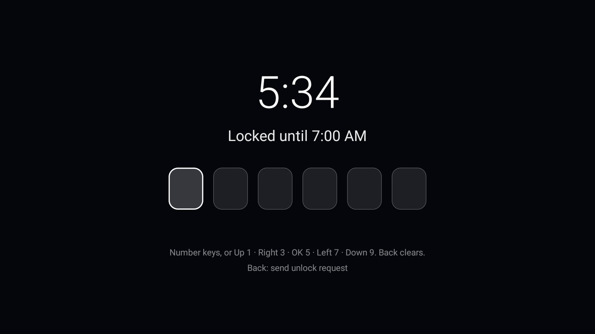

# Bedtime Lock

A code lock for the TV during the hours you choose, 9 PM to 7 AM to begin with. Whatever comes to the front in
those hours (Home, any app, an HDMI input or Live TV, something cast to the TV, an app on the home network such as
Plex) is covered by a full-screen code prompt. Cutting the internet at night would not stop a local server; this
does.



- **A 6-digit code that the screen never shows.** Number keys type their digit; a remote without them uses the
  arrows and OK on the phone-keypad layout: Up 2, Left 4, OK 5, Right 6, Down 8. Every press adds the same dot, so
  someone watching the screen learns nothing but how many presses were made. Back clears a half-typed code.
- **The right code unlocks until the TV goes to standby**, or until the locked hours end, whichever comes first.
  Then the lock is back. Five wrong tries in a row mean a one-minute wait.
- **Already watching at 9 PM?** The lock comes up then, over whatever is playing.
- **TV Settings need the code at any hour** (on by default, switchable), so the lock cannot be turned off or the
  app removed from Settings without it.
- **Setup:** open Bedtime Lock from the app list, choose the code (twice), then turn the lock helper on with the
  row that opens Accessibility settings (Settings > System > Accessibility > Bedtime Lock). Behind the code: on or
  off, the hours (Up and Down move them by 15 minutes), the TV Settings switch, a new code, and a test.

## Phone unlock (optional)

Off until you turn it on behind the code. Then, at night on the lock with nothing typed, **Back** asks on your
phones: each phone subscribed to the lock's private channel in the free [ntfy](https://ntfy.sh) app (Android and
iPhone) gets "The TV asks to be unlocked" with **Unlock** and **Not now**. Unlock lifts the lock as the code would;
the phones then get a short note that it was handled. A request waits up to 5 minutes, and a new one can go out
every 2 minutes.

- **Setup:** turn on Phone unlock; the settings show a channel name like `bedtime-k7q2…`. In the ntfy app on each
  phone, subscribe to that name on `ntfy.sh`. **Send a test to the phones** checks it.
- **Who gets it:** every phone subscribed to the channel, so keep the name private. **New channel** replaces it;
  the old name stops working and the phones subscribe again.
- **How the answer comes back:** the buttons post a one-time token to a second channel no phone subscribes to,
  which the lock reads every 3 seconds while its request waits, and at no other time. An answer for an older
  request, or without the token, is ignored. The code keeps working without a network.

## Permissions

| Permission | Why |
|---|---|
| Accessibility service (`BIND_ACCESSIBILITY_SERVICE`, turned on by the owner) | To see which app comes to the front, so the lock can cover it. It asks for window changes only: it does not read what is on screen and does not filter keys. |
| `INTERNET` | Phone unlock only, while it is on: the request and the answer through ntfy.sh, and the settings' test. Nothing goes online while no request waits. |

No account, no telemetry, no ads. What ntfy.sh sees: the channel names, "The TV asks to be unlocked" with the time,
and the one-time tokens. The code is stored only as a salted SHA-256 in the app's own storage (backups are off).
The service keeps one timer, for the next start or end of the locked hours, and a receiver for the screen turning
off and on.

## Build and install

JDK 17 and Android SDK platform 34 with build-tools 34.0.0, as for the launcher:

```bash
cd addons/bedtime-lock && ./gradlew assembleRelease
TV_HOST=<tv ip> ../../tools/venv/bin/python -I ../../tools/tv.py --push app/build/outputs/apk/release/app-release.apk /data/local/tmp/addon.apk
TV_HOST=<tv ip> ../../tools/venv/bin/python -I ../../tools/tv.py 'pm install -r /data/local/tmp/addon.apk; rm -f /data/local/tmp/addon.apk'
```

Then open it from the app list to choose the PIN and turn the helper on.

## Limits

- It is a lock for a living room, not a safe. Anyone with ADB (keep USB and network debugging off), a factory
  reset, or the TV's own power and volume buttons gets past or around it; nothing plays behind the lock, though.
- With the TV Settings switch off, the helper can be turned off in Settings > Accessibility outside the locked
  hours.
- A force stop of the app from ADB switches the helper off until it is turned on again.

## Tested on

Hisense 75U75N (`hengshan`, MediaTek), Google TV 12 / Android 12, firmware `STT2.230310.002`.

## Maintainer

[@justin-newman](https://github.com/justin-newman)
