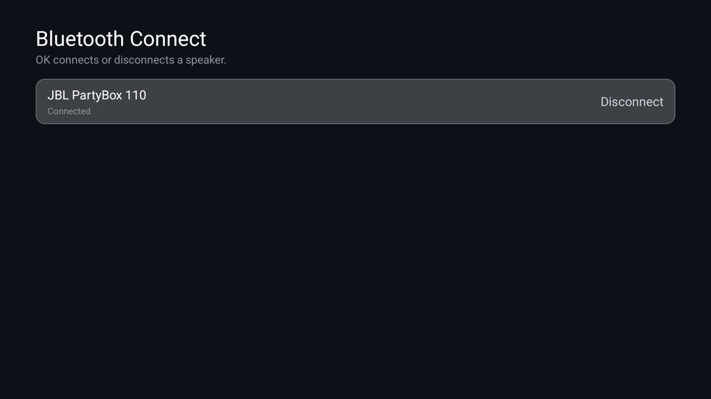

# Bluetooth Connect

The TV's Bluetooth settings offer Connect and Unpair for a speaker, but no Disconnect. This add-on lists the paired
speakers and headphones, each with its state, and OK on one connects it or, when it is connected, disconnects it.
Nothing is unpaired. For the [Clean Your TV](../../README.md) launcher it declares a
[module card](../../docs/modules.md): once you answer **Show card** its tile reads "Bluetooth" with a teal glow. On
any other Android TV home it is an ordinary app.

| Row | What it does |
|---|---|
| **Each paired speaker or headphones** | Shows Connected or Not connected. OK connects or disconnects it; the row says Working... until Android reports the change. A speaker that is switched off stays Not connected. |

Android's public API has neither call, so the add-on uses the audio profile's own connect and disconnect, which a
normal app may call with the Nearby devices permission. It acts on classic Bluetooth audio (A2DP) only. On the
Philips it was made on, the speaker stayed disconnected until connected again; a speaker may reconnect by itself
when it is switched on, as it does without this app. [Headphones](../headphones/) lists the same devices with
battery and a quiet guard but cannot connect or disconnect them.

## Install

`TV_HOST=<tv ip> addons/bluetooth-connect/install.sh` builds it, installs it and grants the permission.

## Permissions

| Permission | Why |
|---|---|
| Nearby devices (`BLUETOOTH_CONNECT`, Android 12+) | To list paired devices and connect or disconnect them. Granted by `install.sh`; otherwise the app asks once. |
| Bluetooth (`BLUETOOTH`, Android 11 and older) | The same on older versions, granted at install. |

No scanning, no location, no internet permission: nothing leaves the TV. No background service, telemetry, ads,
accounts or libraries.

Tested on one Philips (TPV, MediaTek, Android 14) with a JBL PartyBox 110. It calls the A2DP profile's own connect
and disconnect, which other firmware may refuse; the app then shows the error instead of the change.
