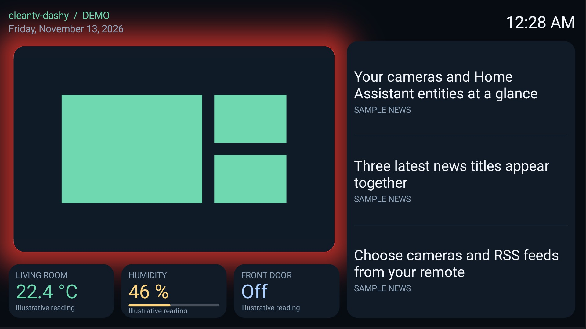

# cleantv-dashy

A separate Android TV screensaver and module card: rotating live Frigate cameras,
three editable Home Assistant entity cards, three RSS/Atom news titles, clock and date.
Its app entry opens settings with a dashboard preview, card editor, camera chooser and feed editor.
The launcher is unchanged.

The Android package remains `com.gathin.homedashboard` so existing installations
keep their settings when updating to this name.

The camera occupies the upper left, with up to three compact entity cards beneath it.
Three news titles separated by thin lines fill the right column below the clock,
with each publisher shown beneath its title.



## Setup

JDK 17, Android SDK platform 34/build-tools 34.0.0 and the repository Python venv are
required. Copy `config.example.json` to a private file under `backup/` and fill it in.
Use a Home Assistant token and a Frigate viewer account. Do not commit that file.
Both servers and feeds need HTTPS with publicly trusted certificates; redirects
are refused to keep credentials on their configured server. No token appears in UI/logs.

```powershell
$env:TV_ADB_BINARY = 'C:/path/to/adb.exe' # paired Wireless debugging, when needed
./addons/cleantv-dashy/setup.ps1 -TvHost '<TV IP:port>' -Config backup/dashboard.json
```

Open **cleantv-dashy** in the apps grid. **Cameras** fetches Frigate's enabled
cameras; select one or more and Save, or **All (automatic)** to include future cameras.
**RSS feeds** adds, edits and removes up to ten HTTPS RSS or Atom URLs. No feeds
are fetched until you add them. Camera rotation can be 10, 15, 30 or 60 seconds.
These choices stay on the TV and take precedence over a subsequent config push.
**Sensor cards** edits each of the three slots: choose an entity from the searchable
Home Assistant list or enter its ID, set its label, value colour and 0–3 decimal
places, and choose a display mode. **Auto** displays the entity state with its own
unit, including temperature, energy, humidity, counts or text/on/off states.
**Percentage** requires `%` within 0–100 and adds a progress bar. **Power** accepts
`W` or `kW` and displays kW. These are read-only cards, including for switches and
other entity domains; they never call services or control devices. Entity attributes
such as a climate entity's target temperature are not separate card values; use a
sensor/helper entity exposing the value as its state.

Turn off **Show this card** to hide a slot; the others expand to share the row.
Hiding all three removes the row. Saved card edits stay on the TV and override the
private file's `sensorCards`. **Use setup defaults** clears only these card edits.
The example configuration uses temperature, humidity and a binary sensor; no solar
setup is required. An empty `sensorCards` array starts with all slots hidden for
configuration on the TV. Existing files using `batteryEntity`, `solarEntity` and
optional `loadEntity` retain their labels, formatting, colours and bindings until
edited. The legacy keys are optional when using `sensorCards`.

**Person alert focus** holds the camera while one qualifying person alert is active;
when multiple selected cameras have person alerts, it cycles among them every eight
seconds. Frigate's existing alert/zone rules decide which reviews qualify. Cars and
ordinary motion do not take focus. Several alerts or zones on the same camera use
one slot. Rotation resumes as soon as all qualifying reviews end. This follows
Frigate's alert lifecycle, rather than estimating physical presence from a picture.
Cameras with no required alert zones can qualify anywhere in their view; the
dashboard does not add zone restrictions that the Frigate server has not configured.
While person focus is active, a wide halo spreads behind the camera card, fading
gradually into the dashboard background over 96 dp. It is drawn behind the cards
without blurring the video or changing panel sizes. **Activity glow**
offers colour presets, a custom `#RRGGBB` colour and Off. It defaults to red and clears
when normal rotation resumes. The demo illustrates the chosen glow with sample data.

This option is off by default. Configure `mqttUrl` and `mqttTopicPrefix` in the private
file, then enable it on the TV (or set `activityFirst` to true in that file).
The supported broker scheme is `mqtt://`; use a trusted LAN because this connection
is not encrypted. The client only subscribes to reviews and availability; it never
publishes camera controls. It reconnects with backoff, seeds ongoing alerts from
Frigate's API, clears focus on broker loss, and closes when the dashboard ends.
**Open dashboard** previews real data; the Menu button returns to settings.
**Show demonstration** uses clearly labelled sample values without network access.

After verifying the preview, select the system screensaver (Google TV hides the chooser):

```powershell
./tools/venv/Scripts/python.exe -I tools/tv.py 'settings put secure screensaver_components com.gathin.homedashboard/.DashboardDream'
./tools/venv/Scripts/python.exe -I tools/tv.py 'settings put secure screensaver_enabled 1'
```

`setup.ps1` records the original selection before installation. Restore it with:

```powershell
./addons/cleantv-dashy/setup.ps1 -TvHost '<TV IP:port>' -Restore
```

The existing idle timer stays unchanged. Any key ends the system screensaver.
cleantv-dashy declares its module card on the same settings activity as its
`LEANBACK_LAUNCHER` intent; approve **Show card** if desired. Module-card spec 1.

## Data and limits

One muted H.264 live stream plays through Frigate's authenticated HTTPS/WSS MSE
endpoint using Android's built-in WebView and video decoder. It prefers a configured
substream to reduce bandwidth; no extra RTSP port is needed. Only validated stream
names from the camera's live mapping are used. The player is app-owned local HTML,
with no external scripts, page navigation or JavaScript bridge. The session cookie
is HttpOnly and cleared when the dashboard closes. Standard TLS validation remains on.

If live playback fails or stalls, snapshots refresh every five seconds with a visible
warning, bounded to 1600×1000 pixels. Live playback retries on the next camera, or
after 30 seconds with a single camera. Camera names, counters and rotation captions
are omitted from the compact card, as are connection progress messages. An empty selection means all enabled cameras,
discovered each time the dashboard opens. A selected camera that no longer exists
is skipped. Camera rotation is independent of the news card.

The HA cards refresh every 15 seconds. Auto uses the entity's reported unit and does
not convert W or kWh. Numeric states are rounded to the chosen precision; Auto drops
trailing zeros. Text states remain text, with on/off shown as On/Off. Only Percentage
requires a numeric 0–100% reading, and only Power converts W to kW (rejecting kWh).
Unavailable or unknown values are shown as unavailable. Source report times remain visible;
network failures retain the last good value with an explicit refresh warning.

Feeds refresh every 15 minutes, with up to 20 items per feed and 60 distinct stories
retained across all feeds. The initial three titles are the newest. Every 15 seconds
the next story enters at the top, the other titles move down, and the bottom story
leaves: 1–2–3 → 4–1–2 → 5–4–1. The carousel loops, skipping stories already visible;
three or fewer stories stay on screen. Each source stays beneath its title. No summaries
are displayed. A successful feed refresh starts a new lineup. Stories older than
48 hours are omitted; undated stories follow dated ones.
Failed feeds do not hide successful ones. Feed data and video buffers stay in memory;
there is no offline news or camera cache. Small scene drift reduces stationary pixels.

All refresh work stops when the preview closes or screensaver ends. On Android 12
and newer, the system screensaver hides non-system app overlays, including Frigate
Glance pop-ups. They become eligible to display again when the screensaver ends;
Frigate Glance keeps running. The ordinary dashboard preview allows overlays.
Android 8–11 do not support this window setting.

## Permissions

- `HIDE_OVERLAY_WINDOWS`: on Android 12+, keep app pop-ups off the system screensaver
  window. This does not revoke another app's overlay permission or stop its service.
- `INTERNET`: read HA entity states and discover entity IDs/names on request, Frigate configuration/snapshots and the
  feeds the owner adds, play a live camera over authenticated WSS, and optionally
  subscribe to Frigate's MQTT reviews while visible. No analytics,
  ads, telemetry, background service, boot receiver
  or device control. Standard HTTPS certificate/hostname validation remains enabled.
- `BIND_DREAM_SERVICE` protects the exported screensaver; it is not requested as an app grant.
- The write-only configuration provider requires the caller to hold
  `WRITE_SECURE_SETTINGS`. The add-on does not request this permission. Configuration
  is stored in app-private files; Android backups are disabled.

## Build and check

```sh
./gradlew --no-daemon testReleaseUnitTest lintRelease assembleRelease
```

Release builds use the same retained local debug signing key as the reference launcher.
Keep it for updates. No extra runtime dependencies. RSS parsing and the Headline
model are adapted from CleanYourTV's News screensaver under the repository MIT license.
The small subscribe-only MQTT client is adapted from Frigate Glance under the same license.
The HA and Frigate clients use their documented APIs. No existing add-on was modified.

## Tested on

Chromecast with Google TV HD (boreal), Android 14/API 34, firmware UTTC.250917.004:
real Frigate snapshots, camera rotation, saved camera subsets and automatic selection,
and Home Assistant battery/PV/load readings. RSS addition/removal and feeds from Inquirer
and GMA News were checked on the TV. The column layout shows the camera above the
three sensor cards and the news carousel in a full-height panel. Publisher labels
and the 1–2–3 → 4–1–2 transition were verified on the real screensaver.
Live MSE streams from the configured cameras reached the TV's H.264 decoder; the owner
confirmed moving video on the physical TV (video is black in screenshots). Android's
system screensaver started both versions in non-preview mode. Key wake and video
decoder release were checked with the live version. The existing idle timer was retained.
Overlay suppression was verified with a Frigate Glance test card: hidden during
the real dream and visible again on Home after waking. DreamService requires an
explicit window-manager layout update for this window attribute to take effect.
Person-alert focus and return to normal rotation were confirmed on this TV. Red
and blue glow presets were selected with the remote UI and verified in the demo.
Entity discovery/search and editing a card's label, entity and display mode were
verified on the same TV: a former load-power card displayed a live temperature in
°C, persisted after restarting the app, and could be hidden while the other two
cards expanded. Use setup defaults restored the original three solar-system cards.
The screenshot is demonstration mode captured on that TV, with sample values and
no private camera image. No performance claim is made.
