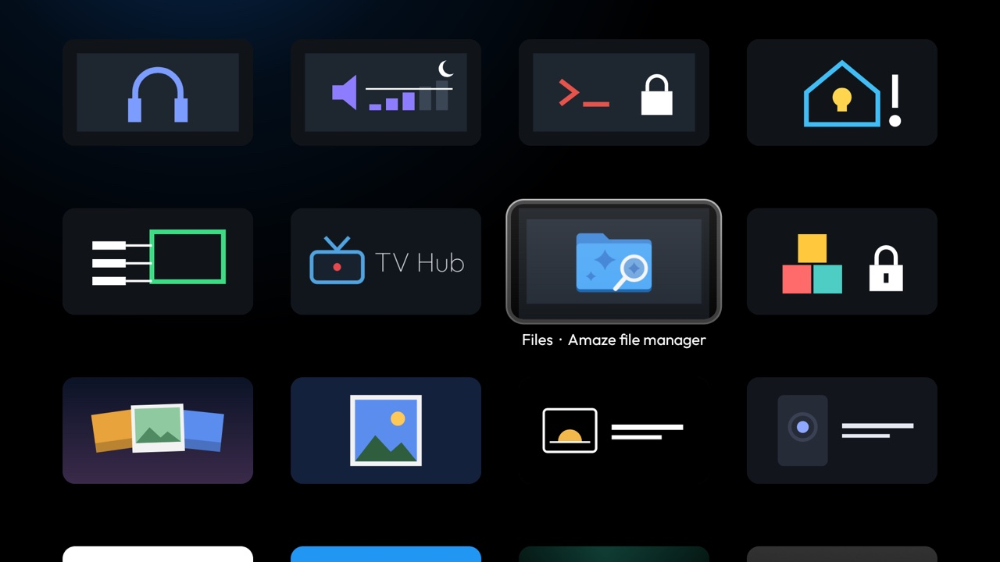

# Files card

A card for your file manager. Android TV has no file manager of its own, and the good ones have no
[module card](../../docs/modules.md). Once you answer **Show card**, this add-on's tile reads "Files ·
Amaze file manager" with a blue glow, and OK opens [Amaze File Manager](https://github.com/TeamAmaze/AmazeFileManager)
(free, open source, no ads, with a TV tile of its own). Without Amaze it opens the first of X-plore, Solid
Explorer, FX File Explorer, CX File Explorer or Files by Google that is installed; with none of them it says so
and names where to get Amaze. It only starts the other app: browsing, copying and network shares are all the
file manager's. The banner is own art in Amaze's colours.



## Permissions

None. Package visibility is limited to the six file managers it can open (`<queries>` in the manifest). No
internet permission, background service, accounts, telemetry, ads or libraries. Nothing is stored.

## Build and install

JDK 17 and Android SDK platform 34 with build-tools 34.0.0, as for the launcher. Install a file manager first
(Amaze: the `app-fdroid-release.apk` of its [latest release](https://github.com/TeamAmaze/AmazeFileManager/releases/latest)
or F-Droid). From the repo root, with ADB on:

```bash
TV_HOST=<tv ip> addons/files-card/install.sh
```

To build only: `cd addons/files-card && ./gradlew assembleRelease`; the JVM tests run with `./gradlew testReleaseUnitTest`.

## Limits

- **One file manager.** With several installed, the card opens the first in the order above. Amaze's own
  tile stays in the grid; the card does not hide it.
- **The caption names Amaze.** The card spec reads a fixed caption, so it says "Amaze file manager" even
  when another file manager is the one that opens.

## Tested on

MOKA R8G (Android 14), on a home app that implements the module-card spec: the card prompt, the card, and OK
opening Amaze File Manager 3.11.4. Also installed on an ASUS M1G (Android TV 11), not yet opened there.

## Maintainer

[@maxhayim](https://github.com/maxhayim)
