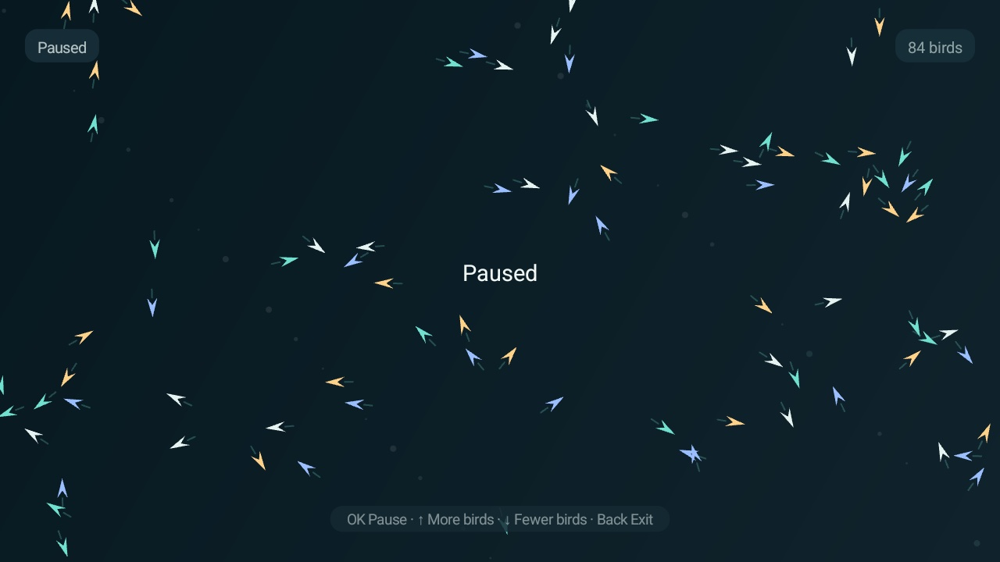

# Flock

An interactive flocking simulation for Android TV. Each bird is an independent agent that reacts to
nearby birds; simple local rules produce the collective movement seen in flocks and schools of fish.
Open the **Flock** module card or the app to watch the simulation full screen.

## Screenshots on TV

Captured on a TCL 32S5K running Android TV 14 at 1280 × 720:




## How it works

The model implements the three classic boids rules:

- **Separation:** steers a bird away from very close neighbors.
- **Alignment:** turns it toward the average heading of nearby birds.
- **Cohesion:** steers it toward the local center of the group.

Each bird considers only neighbors inside a local radius. Position and velocity use elapsed frame time,
speed is capped to keep movement readable, and the screen edges wrap around. The simulation starts with
84 birds; the remote adjusts the flock from 24 to 180. Neighbor lookup is quadratic in flock size and
is capped at 180 agents.

## Controls

| Remote key | Action |
|---|---|
| **OK / Enter** | Pause or resume the simulation |
| **↑** | Add 12 birds, up to 180 |
| **↓** | Remove 12 birds, down to 24 |
| **Back** | Close the simulation |

All on-screen labels are in English.

## Install and run

Requires JDK 17 and Android SDK 34, like the other add-ons in this repository. From the repository root:

```sh
cd addons/flock
./gradlew --no-daemon testReleaseUnitTest assembleRelease
adb install -r app/build/outputs/apk/release/app-release.apk
adb shell am start -n io.github.cleanyourtv.flock/.FlockActivity
```

The app can also be opened from its module card. The launcher asks whether to show the card the first
time; you can change that choice later in **Module cards** in launcher settings.

## Permissions

None. The app does not access the network, files, or location, and it starts no background services.
The simulation and animation stop when the activity closes.

## Tested on

- **TCL 32S5K**, Android TV 14 / SDK 34, G13 platform, 1280 × 720.
- Installation and activity launch confirmed on the TV.
- OK paused and resumed the simulation; ↑ changed the count from 84 to 96; ↓ returned it from 96 to 84.
- The screenshots above show the running and paused states captured on the TV.
