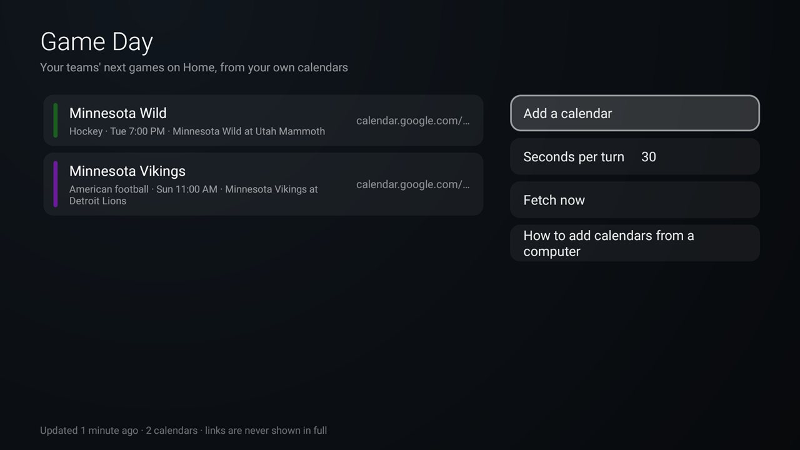

# Game Day

Your teams' next games on Home, counted down, from calendars you already have. For the
[Clean Your TV](../../README.md) launcher it declares a [module card](../../docs/modules.md) ("Game Day", where
OK opens its settings) and, with the launcher's `game_day` key, hands Home each team's next game: the panel under
the clock shows "Minnesota Wild at Dallas Stars" and "Puck drop in 2h 18m", then "Live now" while it is on, and
rotates between your teams every 30 seconds. On any other Android TV home it is an ordinary app with its settings.



- **Any team, any sport, from your own calendars.** Game Day reads calendar subscription links: Stanza, a team's
  own "add to calendar" feed, Google Calendar's "Secret address in iCal format", a fixture site you may use for
  personal use. One link per team. It ships with no schedule source of its own (see below).
- **One turn per team.** Each calendar's next entry within a week takes one turn; a game in two of your calendars
  (following both teams) shows once. Nothing within a week: the panel is hidden.
- **No scores.** There is no live data: "Live now" runs from the calendar's start to its end (or a typical game
  length), and no score, period or inning is ever shown, so nothing is spoiled.
- **The word for the sport.** Each calendar is set to a sport, which sets the word in front of the countdown:

| Sport | Word |
|---|---|
| American football, Rugby, Soccer | Kickoff |
| Australian rules football | First bounce |
| Badminton, Pickleball, Table tennis, Tennis, Volleyball | First serve |
| Baseball, Softball | First pitch |
| Basketball | Tip-off |
| Boxing, MMA | Opening bell |
| Cricket | First ball |
| Curling | First stone |
| Darts | Game on |
| Field hockey | Push-back |
| Gaelic football, Hurling | Throw-in |
| Golf | Tee time |
| Handball | Throw-off |
| Hockey | Puck drop |
| Horse racing | Post time |
| Lacrosse | Face-off |
| Motor racing, flag start (NASCAR, IndyCar, sports cars) | Green flag |
| Motor racing, light start (F1, F2, F3, MotoGP, Formula E) | Lights out |
| Pro wrestling | Bell time |
| Rowing, Sailing | Start gun |
| Cycling, Esports, Other | Starts |

  A calendar entry that is not a game (a draft, a welcome note) shows its own title with "Starts". In racing and
  the other individual sports, practice, qualifying and shootout sessions say "Starts" and the main event gets the
  word.

## Why no schedule source is built in

Free sports data with live scores is not available on terms that allow an app like this: the league sites and
the well-known unofficial feeds forbid automated collection, and the services that allow it need each person to
sign up for a key. Calendars you subscribe to are meant to be fetched by calendar apps, and Game Day is one, for
your own calendars on your own TV. Only you know which calendars you may use; Game Day fetches nothing else.

## Setting it up

With the remote: open Game Day, **Add a calendar**, and type or paste the link, a name, the sport and a colour (36,
in three shades). Long links, like Google's secret address, are tedious to type with a remote, which is why there
is also a script.

From a computer: copy `calendars.example.txt` to `calendars.txt` (git-ignored: the links are secrets), put one
calendar per line as `sport | name | link`, optionally `| colour`, and run

```bash
TV_HOST=<tv ip> addons/game-day/setup.sh        # Windows: addons\game-day\setup.ps1 -TvHost <tv ip>
```

It replaces the list on the TV and prints how each calendar loaded. Links are never printed or shown in full: the
settings show `calendar.google.com/…`.

On Home, set the launcher's `game_day` key to `io.github.justinnewman.gameday` in `config.xml` or a theme (see
[`docs/switches.md`](../../docs/switches.md)). With your theme's F1 panel (`race_calendar`) on as well, the F1
weekend joins the rotation as one turn. Use either that or an F1 calendar here, not both, or the weekend shows
twice.

## Build and install

JDK 17 and Android SDK platform 34 with build-tools 34.0.0, as for the launcher:

```bash
cd addons/game-day && ./gradlew assembleRelease
TV_HOST=<tv ip> ../../tools/venv/bin/python -I ../../tools/tv.py --push app/build/outputs/apk/release/app-release.apk /data/local/tmp/addon.apk
TV_HOST=<tv ip> ../../tools/venv/bin/python -I ../../tools/tv.py 'pm install -r /data/local/tmp/addon.apk; rm -f /data/local/tmp/addon.apk'
```

Press Home: the launcher asks once whether to show the card.

**TCL sets:** the firmware's app boot manager (`TclAppBoot`) refuses to start an app for another app unless it
has TCL's `AUTO_START` app-op, so Home sees no games and the script gets "Could not find provider". The setup
scripts allow it for Game Day; to do it by hand: `tools/tv.py 'appops set io.github.justinnewman.gameday AUTO_START allow'`.
Seen on a TCL 55Q77K (Google TV 14); `appops reset io.github.justinnewman.gameday` undoes it.

## Permissions

| Permission | Why |
|---|---|
| `INTERNET` | Only to fetch the calendar links you add, at most once a day each. Nothing else goes online. |

No account, no telemetry, no ads, no background service: a calendar is fetched only when Home or the settings ask
for the games and its copy is over a day old, and a failed fetch keeps the last good copy. What Home reads (who
plays, when, the colour) is shared through a read-only provider that never holds a link; the setup script's way in
needs `WRITE_SECURE_SETTINGS`, which only the ADB shell has. Nothing is backed up.

## Tested on

Hisense 75U75N (`hengshan`), Google TV 12, firmware `STT2.230310.002`, on 26 October 2026: two calendars from the
setup script (a Stanza feed through Google Calendar's secret address, and a team's own feed through a Google
import), the settings and the 36-colour grid with the remote, and Home with the launcher's `game_day` key: the
countdowns, "Live now" from a test calendar, the rotation with dots, and a test F1 weekend as one turn.

## Maintainer

[@justin-newman](https://github.com/justin-newman)
