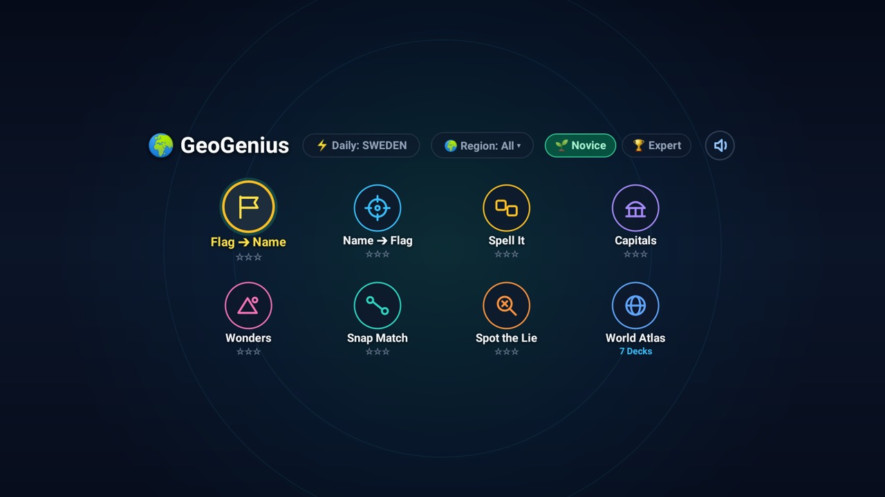

# GeoGenius

An interactive world geography quiz and atlas module-card add-on for Android TV (`com.gathin.geogenius`).



## Features

- **Daily Geography Challenge:** 10 curated questions refreshed daily with an on-screen green tube score meter.
- **Multiple Game Modes:**
  - **Flag to Country:** Identify the country corresponding to a high-contrast national flag.
  - **Country to Flag:** Pick the matching national flag among options for a named country.
  - **Capitals:** Identify the capital city of nations worldwide.
  - **World Wonders & Landmarks:** Historical and natural landmarks across all continents.
  - **Spot the Lie:** 4 geographic statements presented vertically; identify the one false statement.
  - **Spell It:** Virtual Leanback keyboard to spell country names with auto-advancing focus.
  - **World Atlas:** Interactive world record decks (Tallest Mountains, Longest Rivers, Largest Countries by Area, Most Populous Countries, Deepest Lakes, Highest Waterfalls, Largest Deserts) with D-pad pagination and topic switcher.
- **Continental Filters:** Filter daily quizzes by All World, Asia, Europe, Americas, Africa, or Oceania.
- **Two Skill Levels:** Novice / Beginner and Expert.
- **100% Remote-Optimized:** Designed strictly for D-pad navigation with minimal text, high-contrast iconography, and smooth Leanback controls.
- **Optional Ambient Screensaver:** Leanback `DreamService` (`GeoDream`) displaying geography trivia and flags while idle.

## Setup

Build from this folder with JDK 17 and Android SDK 34:

```sh
cd addons/geogenius && ./gradlew --no-daemon assembleRelease
```

Install via ADB:

```sh
adb install -r app/build/outputs/apk/release/app-release-unsigned.apk
```

On Home, approve **GeoGenius** when the launcher prompts about its card, or enable it under Settings → Module cards.

## Permissions

None requested. Runs completely offline on TV without any network access, background services, analytics, or user tracking. The optional screensaver requires Android's `BIND_DREAM_SERVICE` binding restriction, which is not an app-granted permission.

## Tested on

Hisense 65U8G (Android TV 10), verified with full D-pad remote navigation on a physical TV.

## Maintainer

[@anujmishra11](https://github.com/anujmishra11)

