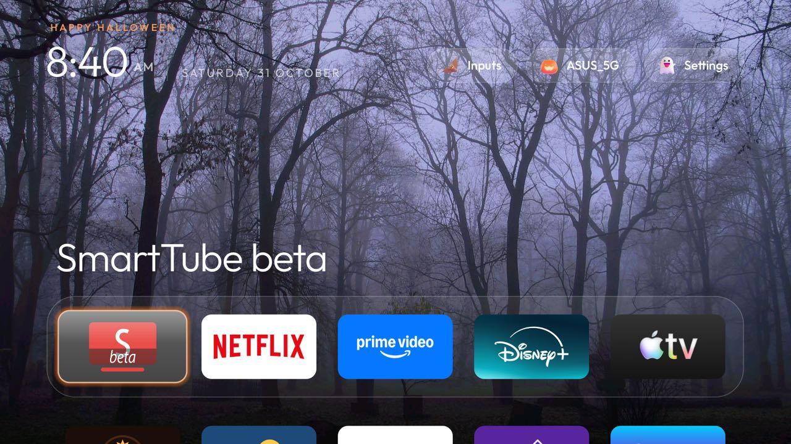

# Hindi Panchang (`हिंदी पंचांग · विक्रम संवत`)

A modern, sacred-themed Hindu Lunar Panchang and Vikram Samvat calendar module-card add-on for Android TV (`com.gathin.hindipanchang`).



## Features

1. **12 High-Resolution Sacred Monthly Artworks (`SacredBackdropView`):**
   - Each Hindu Lunar Month (`चैत्र` through `फाल्गुन`) displays a dedicated 16:9 festival and seasonal backdrop (such as Varanasi Ganga Ghats illuminated by thousands of Diyas for **Kartik**, snow-capped Himalayan peaks for **Shravana**, and kites for **Pausha**).
   - **`सुविचार` (Suvichar):** Opens over a full-screen aged **Bhojpatra / ancient palm-leaf manuscript** with hand-painted lotus borders and gold filigree accents.
2. **Realistic 3D Moon Orbs (`LunarDayCellView`):**
   - Calendar dates float within 3D pearlescent Moon Orbs showing accurate lunar maria surface textures, sunlit limb illumination, a glowing golden corona on **Purnima**, and a subtle ring on **Amavasya**.
   - Sleek **`‹`** and **`›`** month navigation chevrons for smooth D-pad paging.
3. **Circular Glass Dock & Action Icons:**
   - Three circular dock icons below the calendar: **`सुविचार`** (Daily Thought), **`पंचांग`** (Full Panchang: Tithi, Nakshatra, Yoga, Karana, Rahu Kaal), and **`व्रत/पर्व`** (Monthly Fasting & Festivals).
   - Minimal circular icon buttons (`✕` Close, `↻` Refresh) keeping UI clean and clutter-free.
   - Modals open as frosted glass overlays with D-pad focus locked inside the active card.
4. **Optional Ambient Screensaver:**
   - Leanback `DreamService` (`PanchangDream`) drifting the Hindu date, Vikram Samvat year, and sacred quotes during TV standby.

## Setup

Build from this folder with JDK 17 and Android SDK 34:

```sh
cd addons/hindi-panchang && ./gradlew --no-daemon assembleRelease
```

Install via ADB:

```sh
adb install -r app/build/outputs/apk/release/app-release-unsigned.apk
```

On Home, approve **Hindi Panchang** when the launcher prompts about its card, or enable it under Settings → Module cards.

## Permissions

| Permission | Why |
|---|---|
| `INTERNET` | Optional IP-based city detection (`ipwho.is`) and Open-Meteo geocoding search for accurate sunrise, sunset, and solar Tithi calculations. No telemetry, ads, or background polling. |

The optional screensaver requires Android's `BIND_DREAM_SERVICE` binding restriction, which is not an app-granted permission.

## Artwork and licence

The 12 monthly artworks (`bg_month_0.jpg` through `bg_month_11.jpg`) and Suvichar manuscript parchment (`bg_suvichar.jpg`) were generated specifically for this add-on using Google Imagen and are dedicated to the public domain under [CC0 1.0 Universal](https://creativecommons.org/publicdomain/zero/1.0/), released under the repository's MIT licence.

## Tested on

Hisense 65U8G (Android TV 10), verified with full D-pad remote navigation on a physical TV.

## Maintainer

[@anujmishra11](https://github.com/anujmishra11)
