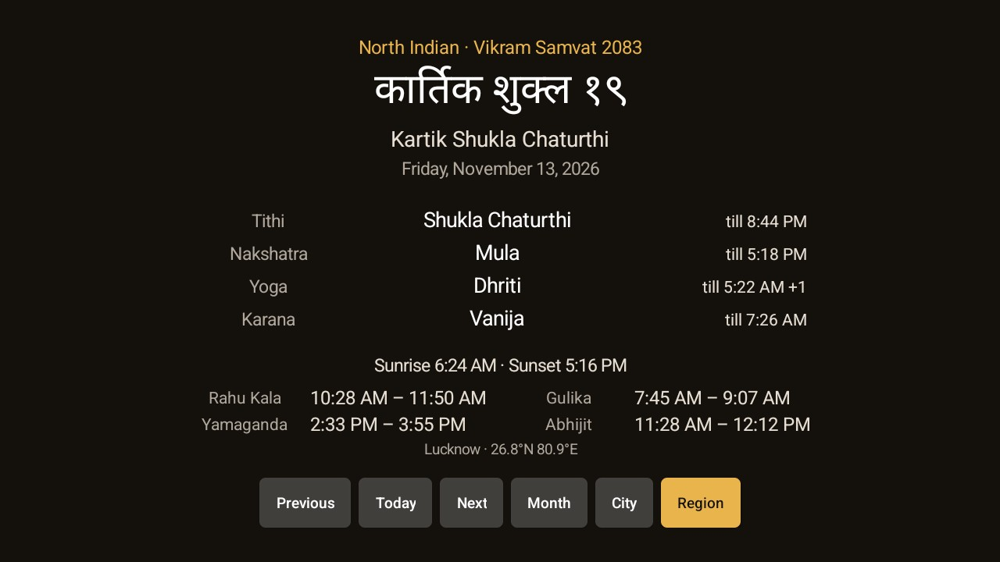

# Panchang

An optional, standalone module card with today's Hindu panchang: tithi, nakshatra, yoga and karana
read at sunrise, the moment each one ends, sunrise and sunset, the day's Rahu Kala, Yamaganda,
Gulika and Abhijit, and today's month and day number in one of five regional calendars, with a
month grid that shows every day's tithi and nakshatra. It works out the astronomy itself, so it
needs no network and no location permission. It also offers an optional system screensaver. Installing it never changes the launcher's header, date line, settings
or theme; it uses only the existing module-card contract.

## Setup

Build from this folder with JDK 17 and Android SDK 34:

```sh
./gradlew --no-daemon testReleaseUnitTest lintRelease assembleRelease
```

Sideload the APK with the repository's normal ADB tools. On Home, approve **Panchang** when the
launcher asks about its card, or enable it later under Settings → Module cards. The card opens the
panchang's own screen; it cannot put a live reading into the launcher header or tile caption.

The screen shows the calendar and era with the year ("North Indian · Vikram Samvat 2083"), today's
month and day in the script and in Latin letters, the Gregorian date in the TV's language, the four
limbs with the time each ends ("till 04:12", "+1" when it falls after midnight), sunrise and sunset,
the day's Rahu Kala, Yamaganda, Gulika and Abhijit as two columns of two, and the city the reading
is for. Purnima, Amavasya and Ekadashi are named in gold beside the Gregorian date. **Previous**,
**Today** and **Next** page by whole days, as do Channel Up/Down, Page Up/Down and
Rewind/Fast forward. **Month** opens the month grid. **City** and **Region** open one-choice lists;
the choice is remembered. Left alone on Today, the screen follows the date by itself.

The first region is the one the TV's language suggests: Tamil, Bengali, Gujarati or Marathi when the
set is in that language, otherwise the north Indian calendar. The first city is the one the TV's time
zone suggests, which is Delhi for `Asia/Kolkata` (or `Asia/Calcutta`) and otherwise the first listed
city in that zone. The list holds 44 cities, the usual Indian ones plus the larger diaspora cities;
pick one and sunrise follows it.

## The five limbs

A panchang is read at sunrise, and this one reads it at the sunrise of the chosen city:

| Limb | What it is | Shown as |
|---|---|---|
| Tithi | the Moon's gain on the Sun in twelfths of a sign, with its paksha | `Shukla Ekadashi` or `Krishna Ashtami`, and when it ends |
| Nakshatra | the lunar mansion the Moon is in, of 27 | `Rohini`, and when it ends |
| Yoga | the combined longitude of Sun and Moon, in 27 parts | `Shiva`, and when it ends |
| Karana | half a tithi, one of 11 names | `Vishti`, and when it ends |
| Sunrise, sunset | computed for the city that day | `Sunrise 06:31 · Sunset 18:28` |

The limb names stay in Latin letters, as the panchang's technical terms, while the month, the paksha
and the day number are written in the region's own script and digits (Tamil keeps Latin digits,
which every TV font can draw). Tithi numbering follows the printed convention: 1 to 15 Shukla, 16 to
30 Krishna. Purnima (15) and Amavasya (30) stand alone, the other tithis carry their paksha, and
Purnima, Amavasya and Ekadashi (tithis 11 and 26) are also named in gold beside the date.

## Muhurta

The daylight from sunrise to sunset is split into eight equal parts. Each weekday gives one part to
Rahu Kala, one to Yamaganda and one to Gulika, in the tables printed panchangs use:

| Weekday | Rahu Kala | Yamaganda | Gulika |
|---|---|---|---|
| Sunday | 8th | 5th | 7th |
| Monday | 2nd | 4th | 6th |
| Tuesday | 7th | 3rd | 5th |
| Wednesday | 5th | 2nd | 4th |
| Thursday | 6th | 1st | 3rd |
| Friday | 4th | 7th | 2nd |
| Saturday | 3rd | 6th | 1st |

Abhijit is the eighth of the day's fifteen muhurtas, so it is centred on solar noon: about 48
minutes around midday on a twelve-hour day, longer in summer. Since every window comes from the
chosen city's sunrise and sunset, the clocks move with the city and the season.

Traditions differ at the edges: some panchangs take Abhijit as a fixed 48 minutes from noon, and a
few use another weekday table for Gulika. This add-on uses the daylight division above and writes
the times to the minute. The rows are the day's windows, not a search for an auspicious time for a
ceremony.

## Month view

**Month** opens the month on screen as a grid: six weeks of seven cells, Sunday first, so the rows
never change height as the months page. The header carries the region's era, the month's name and
the first and last civil dates. Each cell holds the day number in the region's digits and the tithi
with its paksha and the nakshatra at that day's sunrise; Purnima, Amavasya and Ekadashi are gold. The D-pad moves from
day to day and the focused cell takes the gold background; the line under the grid repeats the full
date, the month's day number, the tithi and the nakshatra. **OK** on a day returns it to the card.

Channel Up/Down, Page Up/Down, Rewind/Fast forward and the **Previous**/**Next** buttons page by
month; **Today** comes back to this month and **Day** leaves the grid without changing the day on
the card. The grid follows the same city and region as the day screen, and those are still chosen
there. In the lunar calendars the month runs new moon to new moon or Purnima to Purnima, so it can
open on day 2 or day 17 when a kshaya tithi falls at the seam.

## Regions

Month boundaries, the day number and even the era differ across India on the same day, so the region
is a setting. The astronomy behind all five is the same.

| Region | Months | Year |
|---|---|---|
| North Indian | Purnimanta: full moon to full moon, named for the month the Purnima closes | Vikram Samvat, turning at Chaitra Shukla Pratipada |
| Gujarati | Amanta: new moon to new moon | Vikram Samvat, turning at Kartik Shukla Pratipada, the day after Diwali |
| Marathi | Amanta: new moon to new moon | Shaka Samvat, turning at Chaitra Shukla Pratipada |
| Tamil | Solar: the twelve sidereal signs, Chithirai 1 on the Mesha sankranti | Shaka, turning with Chithirai |
| Bengali | Solar: the twelve sidereal signs, Boishakh 1 the morning *after* the Mesha sankranti | Bangabda, turning with Boishakh |

An adhika (intercalary) month is one whole lunar cycle with no sankranti in it. It keeps its lunar
boundaries and is labelled *adhika* (अधिक, અધિક, அதிக, অধিক), and the months either side of it stop at
the new moons that open and close it. An adhika month does not turn the year.

The two solar regions still show all four limbs and the sunrise; only the month and the day number
follow the Sun rather than the Moon.

## Boundaries, and why two panchangs disagree

A panchang day begins at sunrise, so a lunar month begins at the first sunrise after the new moon or
Purnima that opens it. Two consequences the screen shows plainly:

- A **kshaya tithi** is one that begins after one sunrise and ends before the next, so no sunrise
  sees it. A month that should open on Krishna Pratipada can therefore open on Dwitiya, day 2 in the
  amanta regions or day 17 in the purnimanta ones.
- Around a boundary, two cities half a world apart can be a day apart, and printed panchangs that
  use a different city, a different sunrise rule or a slightly different ayanamsa can differ by one
  day. That is the calendars disagreeing, not a wrong screen.

## Permissions

None requested. No `INTERNET`, no location (the city is picked from a list), no storage, no camera,
no alarms, no boot receiver, no foreground service, no accessibility, no overlays, no analytics and
no ads. Nothing leaves the TV. The only component beyond the card's activity is the optional system
screensaver, a `DreamService`; `BIND_DREAM_SERVICE` is a binding restriction on the caller, not a
permission granted to the app, and Android starts the dream only when the owner selects it. The city
and region are the only things stored, in the app's own preferences.

## Data and validation

The positions come from truncated Meeus series for the Sun and Moon, the Lahiri ayanamsa, and a NOAA
sunrise/sunset, all in plain Java: about a minute of arc of error, which is enough for the limbs.
The muhurta windows inherit the sunrise and sunset, which are good to the minute. Nothing is
tabulated, so the add-on works for any year the Gregorian calendar reaches; it is not tied to a
printed panchang's edition.

The readings were checked against `python-ephem` for five cities (Delhi, London, Chennai, Kolkata,
Sydney) across 2024–2026, 5,480 city-days: three disagreed, each by one on a limb on a day the limb
changed within a minute of sunrise. Structure was checked over 2020–2030 in Delhi, Kolkata, London
and Sydney for every region: no day outside a month, no repeated or skipped number except the
kshaya-tithi skip and a tithi that lasts more than one sunrise.

Unit tests cover Diwali 2024 (Kartik Amavasya), Holi 2025 (Phalgun Purnima), Janmashtami 2024
(Bhadrapad Krishna Ashtami), sunrise and sunset in Delhi and London, the karana cycle's eight names,
the weekday tables for Rahu Kala, Yamaganda and Gulika, Abhijit centred on noon, the marked tithis,
the region the TV's language suggests, the 2023 and 2026 adhika months, the Gujarati new year after
Diwali, the Tamil and Bengali Mesha rules, the 2083/2086 samvat turning, the adhika Chaitra of 2029
where the Mesha sankranti falls minutes after the new moon, that months follow one another
without a gap in all five calendars, and that the month grid holds every civil date once with its
number, tithi and nakshatra and that a date and its sunrise land in the same month.

This is a reading of the day, not a festival calendar: it does not list festivals, vratas,
electional muhurtas for a ceremony, or government holidays.

## Optional screensaver

Open **Screensaver** and select this app if desired. The button appears only where the TV's Settings
answers `android.settings.DREAM_SETTINGS`, which is not every set: this Android TV 14 one has no
screensaver picker, and Google TV has none for other apps' screensavers, so there the button is
hidden. The add-on does not select itself or change the idle timeout. Its dream shows the same
reading larger, drifting a little with the clock, and any key leaves it. It does not replace the
launcher's own idle-clock activity.

## Tested on

Noble Skiodo NS 2K SmartTV (Skyworth sunnyvale), Android TV 14, with the CleanYourTV launcher. On the
set: the screen, Channel Up/Down paging, D-pad Left/Right across the button row, the City and Region
pickers, the Rahu Kala, Yamaganda, Gulika and Abhijit rows, and the north Indian, Tamil, Gujarati,
Marathi and Bengali readings with their own scripts and digits were checked. The month grid was
checked on the same set too: D-pad focus across the cells, Channel Up/Down paging, OK returning a
day to the card, and the grid in the north Indian and Gujarati calendars. The launcher's new-card
prompt appeared when the add-on was installed; it was answered **Keep hidden** so the set's Home was
left as it was. The **Screensaver** button is hidden there because the TV has no activity for
`android.settings.DREAM_SETTINGS`.


