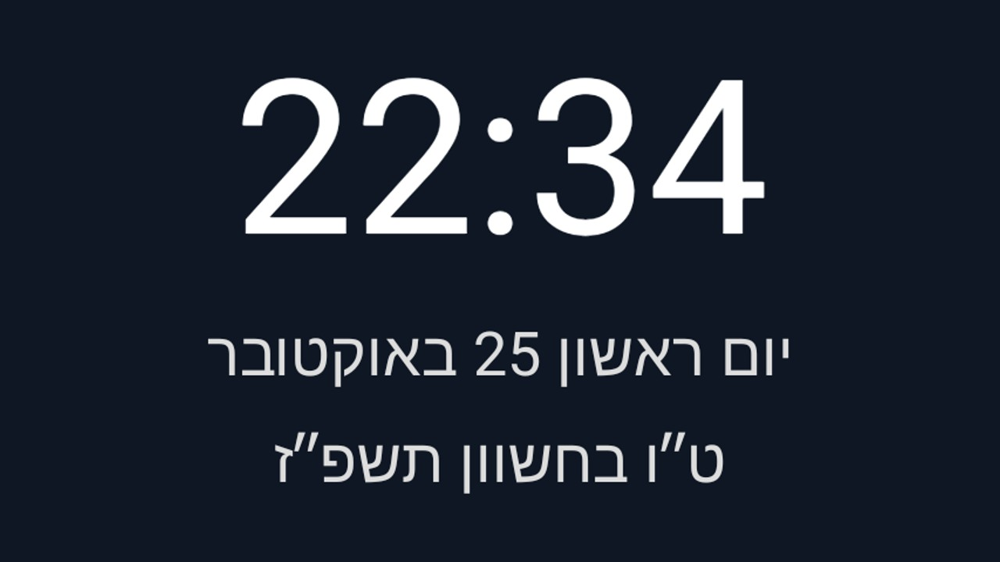

# Jewish Calendar

An optional, standalone module card with Gregorian and Hebrew dates, Jewish holiday/eve and Shabbat
greetings, and a clock. It also offers an optional system clock screensaver. Installing it never changes
the launcher's header, date line, settings or theme. This replaces the launcher-switch proposal in #1284;
it uses only the existing module-card contract.

## Setup

Build from this folder with JDK 17 and Android SDK 34:

```sh
./gradlew --no-daemon testReleaseUnitTest lintRelease assembleRelease
```

Sideload the APK with the repository's normal ADB tools. On Home, approve **Jewish Calendar** when the
launcher asks about its card, or enable it later under Settings → Module cards. The card opens the
calendar's own screen; it cannot put a live date or greeting into the launcher header or tile caption.

Open **Calendar settings**, enter your city's latitude and longitude, and save. Both coordinates are
stored only in this app's private preferences; no coordinates are built in, and no GPS or network lookup
runs. Clearing both removes the location. Use a decimal point and a minus sign for south/west. Keep the
TV's date, time and time zone correct. Invalid/non-finite coordinates are refused. Without a location,
or when the location has no sunset that day, Hebrew dates and holiday greetings are omitted and the
screen explains why. The Gregorian date and clock remain usable.

The Hebrew day changes at approximate local sunset, refreshed once a minute while visible. This is
an informational calendar, **not candle-lighting or Havdalah guidance**. Holiday scheduling defaults
to the app locale's country: Israel for country IL, Diaspora for other explicit countries; Hebrew without
a country uses Israel. Choose Israel or Diaspora explicitly if that does not match the schedule you observe.

Holiday and Shabbat greetings can be disabled independently in this app. Priority is today's holiday,
then an upcoming holiday on the following Hebrew day (holiday eve), then Shabbat. Shabbat uses Friday
sunset to Saturday sunset, not Havdalah. The supported greetings cover Rosh Hashanah, Yom Kippur,
Sukkot/Shemini Atzeret/Simchat Torah, Hanukkah, Purim/Shushan Purim, Pesach and Shavuot. Israel and
Diaspora use the same greeting wording, with their respective observed dates. These are calendar-based
messages, not a complete personal observance schedule.

Hebrew and English UI strings are included. Other locales use English controls and Android ICU's localized
Hebrew-calendar month names. RTL follows the system locale. Hebrew years omit the thousands prefix;
day 5 and Adar I/II markers remain intact. Dates keep the proper Hebrew gershayim character, with its
excess font padding trimmed visually.

## Optional screensaver

Open **System screensaver settings** and select this app if desired. The add-on does not select itself or
change the idle timeout. Its dream shows the clock and “Gregorian date, Hebrew date”, with the greeting
when applicable; it drifts within a padded area. Any key leaves the screensaver. It uses the same private
location and holiday settings as the card. It does not replace the launcher's own idle-clock activity.

## Permissions

None requested. The exported dream requires Android's `BIND_DREAM_SERVICE` permission from its caller;
this is a binding restriction, not a permission granted to the app. No Internet, location, overlays,
accessibility, boot receiver, alarms, foreground service, analytics or ads. The only service is the
optional system-managed `DreamService`; updates stop when the activity/dream is not visible.

## Validation

Unit tests cover sunset boundaries and DST, invalid/polar locations, locale/region precedence,
Israel/Diaspora festival lengths, eight-day Hanukkah, Adar and Hebrew-year punctuation, and
holiday/eve/Shabbat priority. The offline solar helper is copied from the repository's MIT-licensed
launcher; date conversion uses Android's built-in ICU HebrewCalendar (API 24+, app minimum API 26).
Host-side reference validation uses [Hebcal](https://www.hebcal.com/home/developer-apis); no Hebcal
network call or library runs on the TV.

Real-TV validation and an approved date/clock-only crop are recorded in the PR. Device model and
location remain private at the owner's request.


