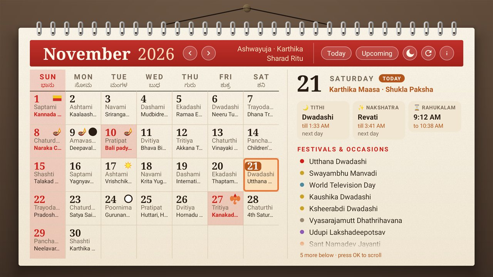

# Kannada Calendar

An optional, standalone module card that shows the month as a Karnataka wall calendar, with the whole of one
day beside it: the Hindu panchanga (ritu, masa and paksha, the tithi and nakshatra with the time each ends,
Rahukalam), the Karnataka public holidays of every faith, and the festivals, temple car festivals, aradhanas and
observance days of the day. Its data comes from the Bangalore Press calendar, through the "add to Google Calendar"
link on the publisher's website; it is an unofficial reader and is not affiliated with Bangalore Press. Installing
it never changes the launcher's header, date line, settings or theme; it uses only the existing module-card
contract.

The data is the publisher's, not this repository's. The add-on ships with no calendar data: you give it the
calendar link the Bangalore Press website offers for "add to Google Calendar", and the TV downloads the
calendar itself.

## Setup

Build from this folder with JDK 17 and Android SDK 34:

```sh
./gradlew --no-daemon testReleaseUnitTest lintRelease assembleRelease
```

Sideload the APK with the repository's normal ADB tools, then give it your link from a computer on the
same network (`TV_HOST` is the TV's address; in a Command Prompt use `gradlew.bat`, and on Windows
`setup.ps1 -TvHost <tv ip> '<link>'` does the same):

```sh
TV_HOST=192.168.1.50 addons/kannada-calendar/setup.sh '<the link from the Bangalore Press website>'
```

The link is the one behind the publisher's "add to Google Calendar" button, with its
`calendar/feeds/<id>/private-<key>/basic` address inside. Google no longer serves that old address, so the
add-on turns it into the iCalendar address of the same calendar
(`calendar.google.com/calendar/ical/<id>/private-<key>/basic.ics`) before it downloads. The `private-<key>`
part is the calendar's secret address: it is stored only on the TV (`setup.sh --remove` forgets it) and
never in this repository, so do not paste it into an issue or a pull request.

On Home, approve **Kannada Calendar** when the launcher asks about its card, or enable it later
under Settings → Module cards. Open the card: the first time it downloads the calendar, which takes a few
seconds.

## The screen

The card is drawn as a wall calendar hanging on its nail: a paper sheet with a spiral binding across the
top, and a red band printed across it with the month and year and the ‹ › arrows that turn the page, the lunar
months and ritus the page spans, and the controls. Below it is the month as a page: weekday heads in English
with the Kannada name under each, the Sunday column tinted and its dates in red, a serif date in each square with
the day's tithi under it and its most important festivals at the foot, and today's date on a saffron badge. Red is
kept for Sundays and public holidays (the date, and the holiday's name first in its square); other festivals are
printed in ink.

The tithi and nakshatra of a day are the ones in force at sunrise, as a printed panchanga gives them. The
publisher lists under each date the ones that end during it, often in the small hours: on 21 November 2026 it
lists "Ekadashi Upto 2:10 AM", and the day is Utthana Dwadashi. So the day's own is the first listed, on that date
or the next, that ends after sunrise in Bengaluru (worked out to within a few minutes from the date). An Amavasya
that runs over two dates is marked on the first only.

Public holidays are printed like Sundays, their square tinted and their date in red. The publisher files the
Karnataka government's holidays in its feed as "Public Holidays" and "Restricted Holiday"; the side column labels
a public holiday in red ("Public holiday · Kannada Rajyotsava") and a restricted one in a quiet outline.

The corner of a square carries a few marks: a full moon on Purnima and a dark one on Amavasya, a small Ganesha
on Sankashta Chaturthi and the yearly Ganesha Chaturthi (not the monthly Vinayaki Chaturthi) and the yellow-and-red Kannada flag on Kannada Rajyotsava (both drawn by
the app), and from the TV's emoji font a lamp for Deepavali (🪔), a sun for Sankranti and Sankramana (☀️), colours
for Holi (🎨) and the national flag for Independence Day and Republic Day (🇮🇳); two at most per day. A TV whose emoji
font lacks one (the lamp is missing before Android 10) gets a lamp drawn by the app instead, and leaves the others out
rather than show an empty box; without a Kannada font the weekday heads are in English only.

Down the right of the sheet is the whole of the highlighted day: the date and weekday (with a TODAY tag on
today), masa and paksha, its holiday if it has one, three tiles for the tithi, the nakshatra and Rahukalam, each
with its name and the time it ends (and what follows it, or "next day" when it runs past midnight), then the
day's festivals and occasions with a coloured dot for their kind: main festivals and the day's listed holidays,
temple utsavs and car festivals, saints' aradhanas and jayantis, vratas and parvas, observance days such as World
Television Day, and the rest. The public holiday comes first, in red, then the main festivals, then the others
as published; a square shows the same order. The publisher's short forms are written out: "CF" is "Car
Festival", "Ara." is "Aradhana".

The band's controls are **Today**; **Upcoming**, a card with the holidays and main festivals of the next 30
days beside every public holiday from today to the end of the saved calendar (OK on a line goes to that day);
the look (a moon for the dark look, a sun for the light one, remembered); the update button; and **ⓘ**, a card
with the remote keys, what the dot colours mean, where the calendar comes from, when the saved copy was made and
how far it reaches, and who made the add-on. OK or Back closes either card. A line under the controls shows
only while an update runs, just after one, or when one failed.

Left and Right move a day, Up and Down a week, and moving past the first or last day turns the page; the ‹ ›
arrows in the band, Channel Up/Down, Page Up/Down and Rewind/Fast forward turn it a month at a time, and the
number keys, on remotes that have them, go to a date of the month on the page (1 then 5 is the 15th). On a touch
panel or with an air mouse, a tap picks a day and a second tap opens its list. Left open past midnight, the page
moves today's badge, and the highlight with it if it was on today. When a day lists more than the column
holds, a line says how many are below: **OK** takes the remote into the list, Up and Down scroll it, and Left or
Back return to the page. Up from the first week reaches the band's controls, and Down from them comes back.

The publisher has written the same facts in a few shapes over the years, so each line is sorted by what it
says: a line with a ritu, masa and paksha is the heading, "<name> Upto <time>" is the tithi or the
nakshatra (told apart by the tithi names), "Rahukalam ..." is Rahukalam, and every other line is shown as a
festival. A day the calendar does not cover says so instead of showing a guess. The feed has no Yamagandam,
Gulika or sunset times, so the add-on shows none. The times are Bengaluru's: on a TV set to another time zone they
are marked IST.

The page fits the TV's own display size and text size: on a narrow screen or with large text the lunar months in the
band give way first, then the month name shrinks, and the two cards are never wider than the screen. The page is
drawn once per month and kept, so moving the highlight stays quick on a slow TV box. It installs on Android boxes
without the TV (leanback) feature too, and opens from the launcher's module card.

## Updates and the saved copy

The calendar is downloaded when the card is opened and there is no saved copy, the copy is over 30 days
old, it no longer reaches today, or you pushed a new link. If the download fails it tries again after an
hour at most (or when you press **Update**) and keeps showing the saved copy, saying so at the top. Only
the days from a month back to fourteen months ahead are kept, about a year of days, in the app's own
storage. Nothing runs in the background: no service, no alarm, no start at boot.

The publisher's feed has an end date (March 2027 at the time of writing); after it the card says the saved
calendar has nothing for the day, until the publisher extends the feed.

## Permissions

`INTERNET`, to download the one calendar link you gave it over https (http and webcal links are upgraded to
https, anything else is refused) and nothing else. No location, no storage permission (the link is read from
the app's own folder on shared storage, where `setup.sh` puts it), no camera, no alarms, no boot receiver, no
foreground service, no accessibility, no overlays, no analytics and no ads. The download is capped at 40 MB
and runs on one background thread only while the card is open.

## Data and validation

The reader keeps events whose start falls in the window and skips recurring ones; a time in UTC is moved to
Indian time, so an event the publisher stamped at 20:15 UTC lands on the next Indian day at 01:45. Unit
tests cover the link forms (the old feed address, the add-to-calendar wrapper, webcal, refused text), the
reader on made-up days (folded lines, the window, the UTC conversion), the sorting of a day in both the
current and the older shapes, the removal of the publisher's desktop-only link markup, the tithi names and
the saved copy's escaping. The tests use invented days, not the publisher's calendar.

## Tested on

Jio JMSD200A set-top box, Android 11, with the CleanYourTV launcher: the card downloaded the calendar from
the link set with `setup.sh` and `setup.ps1`, showed the day (heading, tithi, nakshatra, Rahukalam and a dozen
festivals) beside the month page, moved across days and weeks with the D-pad, turned to December with Channel
Down, scrolled a long festival list after OK, reached the band controls with Up from the first week, switched to the
dark look and back, and showed the November 2026 public holidays like Sundays.


