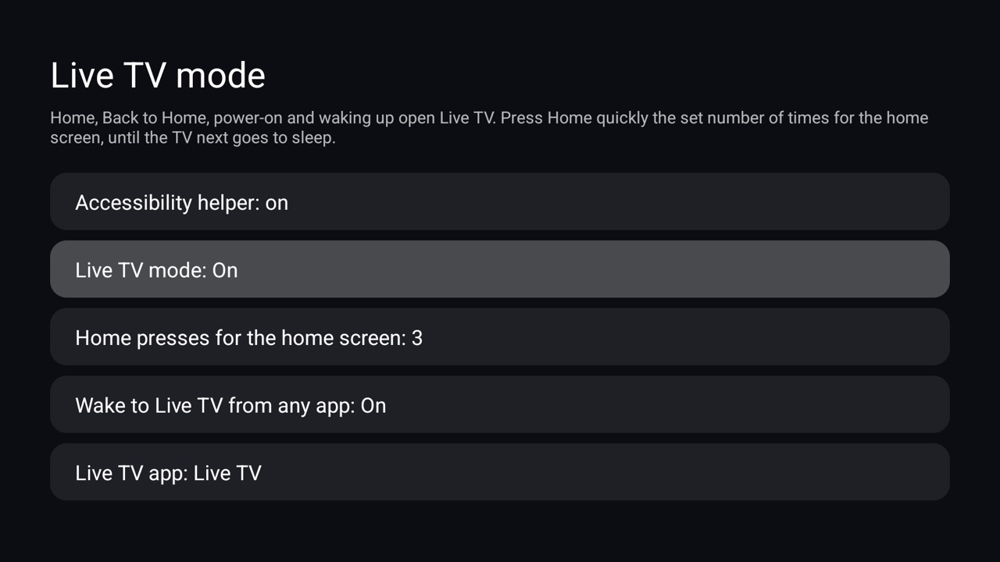

# Live TV mode

For a TV whose viewers only watch broadcast TV, such as a set shared with older relatives. Home, Back to Home,
power-on and waking up from standby open the Live TV app instead of the home screen. A single Home press brings
Live TV straight back, so to a viewer the button seems to do nothing. Pressing Home quickly (2 or 3 times, under a
second apart) shows the home screen, which then works as usual until the TV next goes to standby.

It never touches the launcher: it works with this repo's launcher and any theme, and with a stock launcher too.



## Install

```bash
TV_HOST=<tv ip> addons/live-tv-mode/build-and-install.sh
```

The script builds the app, installs it and switches its accessibility helper on. Android switches an app's helper
off whenever the app is installed again or force-stopped, so run the script again after either, or switch it on
under Settings > Accessibility > Live TV mode. `--off` switches the helper off and keeps the app; `--uninstall`
removes it.

## Settings

The Live TV mode tile, or its card on this repo's launcher, opens one screen. Each row changes on OK:

- **Accessibility helper**: whether it is on. OK opens the TV's accessibility settings.
- **Live TV mode**: on or off, without uninstalling anything.
- **Home presses for the home screen**: 2 or 3 (3 by default).
- **Wake to Live TV from any app**: on (the default), waking up also leaves an app that was open, YouTube or an
  HDMI input, for Live TV. Off keeps that app, and only a home screen left open goes back to Live TV.
- **Live TV app**: found by itself on the boards it knows (MediaTek's `com.mediatek.wwtv.tvcenter`, Google's and
  AOSP's Live Channels, Amlogic, Realtek); OK picks another app with a TV entry point.

## How it works

The accessibility helper is told which app's window comes to the front, and nothing else: it reads no screen
content, filters no keys (so holding a button still repeats) and draws nothing. While the home screen is locked,
its coming to the front opens the Live TV app. Each of those returns within a second of the last counts toward the
presses that unlock it. Screen off and screen on lock it again, and waking up opens Live TV.

- A Live TV app that keeps closing is opened at most ten times in fifteen seconds, then the home screen stays.
- When the unlocking press comes right after one that started Live TV, that start can reach the screen after it,
  so the helper brings the home screen back at 0.4 s and 1 s.
- Android can show the home screen at power-on before it connects the helper. A helper that connects in the first
  three minutes after a boot opens Live TV itself; one switched on later leaves the screen alone.
- Presses closer together than 0.15 s count once (some launchers report one appearance twice). No hand on a remote
  presses that fast.
- A single Home press can show the home screen for a fraction of a second before Live TV is back.

## Permissions

- **Accessibility service** (`LiveTvService`, guarded by `BIND_ACCESSIBILITY_SERVICE`, so only the system can bind
  it): window changes only (`typeWindowStateChanged`), with `canRetrieveWindowContent` false and no key filtering.
  A service the system has bound may open the Live TV app from the background, so the app asks for no overlay
  permission, and Android binds it again at every boot, so there is no boot receiver and no foreground service.
- The manifest asks for no `uses-permission` at all. No network, no storage, nothing collected; the settings stay
  in the app's private preferences.
- **App list**: `<queries>` entries for home screens (to tell when one comes to the front) and apps with a TV entry
  point (the Live TV app picker). No `QUERY_ALL_PACKAGES`.

## Tested on

- Turbo-X TXV-AU4395SMT (Vestel shandao, MediaTek, Android TV 14, firmware UKNV.260304.001), with this repo's
  launcher and the ambient-glass theme. Checked with `dumpsys activity activities` after each step: one Home press
  from Live TV (Live TV again within 0.3 s), two presses (Live TV), three presses at remote pace (the home screen,
  and Home and Back stay on it), sleep and wake with the home screen, Live TV or an app in front, with the wake row
  on and off, the presses row at 2, Back from an app opened over a locked home screen, and a reboot (the home
  screen, then Live TV 1.5 s later). Three presses sent within milliseconds by `input keyevent HOME HOME HOME`
  count as one.
