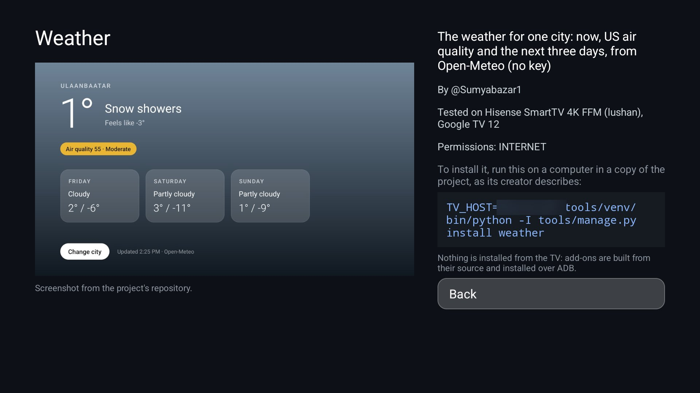

# Manager

The project's add-ons, themes and switches on the TV, read from this repository with their screenshots. It shows
which add-ons are on the TV (with Open and Uninstall), and for everything else the command that installs or
applies it the way its creator describes, to run on a computer. **Nothing is downloaded or installed from the
TV.** Add-ons are built from their source and installed over ADB, as each one's README says. For the
[Clean Your TV](../../README.md) launcher it declares a [module card](../../docs/modules.md): once you answer
**Show card** its tile reads "Manager · Add-ons, themes" with a blue glow. On any other Android TV home it is an
ordinary app.



## What it shows

| Section | From | For each item |
|---|---|---|
| **Add-ons** | The table in [addons/README.md](../README.md) | What it does, its maintainer, the TV it was tested on, its permissions and screenshot. If it is installed: **Open**, **Uninstall** (the TV asks first). The install or update command. |
| **Themes** | The table in [themes/README.md](../../themes/README.md) | What it looks like, and its `tools/theme.sh` command. |
| **Switches** | The `config.json` keys in themes/README.md and [docs/switches.md](../../docs/switches.md) | What the key does, its type, and its `tools/manage.py set` command. |

To tell which add-ons are installed, it reads each one's `applicationId` from its `app/build.gradle` (or
`.kts`) in the repository and looks for that package among the TV's apps. The commands carry this TV's IP
address. Add-ons point to `tools/manage.py install` (from #1216), which runs the add-on's own
`install.sh` when it has one and the steps in addons/README.md when it doesn't.

The READMEs are kept on the TV, so it opens without the network and says when its lists are from last time.
Screenshots are fetched when an item is opened and kept in memory while the app runs.

## Permissions

| Permission | Why |
|---|---|
| `INTERNET` | The READMEs, build files and screenshots, from `raw.githubusercontent.com/Gathin23/cleanyourtv/main/` and nowhere else. |
| `ACCESS_NETWORK_STATE` | This TV's IP address, for the commands it shows. |
| `REQUEST_DELETE_PACKAGES` | **Uninstall** on an installed add-on. It opens the system's uninstall prompt, which asks before anything is removed. |
| Package visibility (`LEANBACK_LAUNCHER` query) | Which add-ons are installed. Every add-on has a TV launcher entry. |

No accounts, telemetry, ads or libraries. Backups are off.

## Build and install

JDK 17 and Android SDK platform 34 with build-tools 34.0.0, as for the launcher. From the repo root, with ADB on:

```bash
cd addons/manager && ./gradlew assembleRelease
adb connect <tv ip>:5555
adb install -r app/build/outputs/apk/release/app-release.apk
```

The JVM tests (the README table parser and the commands) run with `./gradlew testReleaseUnitTest`.

## Limits

- **It reads the main branch.** An add-on shows once its PR is merged. A row it can't parse is left out.
- **Installed means the package is there**, not that it is the version in the repository.
- **Uninstall** is offered only for add-ons. Themes and switches are files on the TV that the launcher reads,
  and the commands it shows are how to change them.

## Tested on

MOKA R8G (Android 14), on a home app that implements the module-card spec, starting from cleared app data (the lists
showed within 5 seconds). Tested: the Add-ons, Themes and Switches lists read from the repository, an add-on's and a theme's screenshot,
an installed add-on (Brightness) with Open starting it, and the commands for an add-on, a theme and a switch.
Uninstall and the offline copy were not tried. The JVM tests cover the table parser and the commands.

## Maintainer

[@maxhayim](https://github.com/maxhayim)
