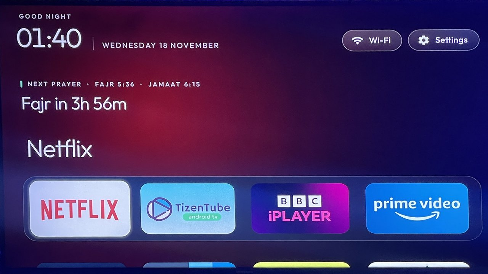

# Masjid Times

The next prayer at **your own mosque**, under the clock on the [Clean Your TV](../../README.md) home screen, with
a countdown:

> Next prayer · Asr 13:40 · Jamaat 14:15<br>
> **Asr in 1h 20m**

Once a prayer has started, the line switches to "Asr has started · Jamaat 14:15" and counts down to the jamaat.
On Fridays Zuhr shows as Jumu'ah, with the mosque's Jumu'ah time. When one passes, the next one takes its place.



- **Data** is the mosque's own timetable from [my-masjid.com](https://my-masjid.com), the service behind the
  My Masjid app (`com.teo.mymasjid`), so the start and jamaat times match what the mosque publishes there rather
  than a calculation. Any mosque listed on my-masjid.com works. No account or key.
- **It uses the launcher's `game_day` panel** ([docs/modules.md](../../docs/modules.md)): the add-on fetches
  and publishes one row, the next start or jamaat, and the launcher only reads it and stays offline.
- It fetches the year-long timetable once, then again when the copy is more than 12 hours old (15 minutes after
  a failure). Offline, the last copy keeps working.
- Times follow the mosque's own 12-hour or 24-hour setting on my-masjid.com.
- **Masjid Times** is also an ordinary app: it shows today's timetable, what Home is showing and when the
  timetable was last fetched. OK fetches it again.

This add-on is independent and is not affiliated with my-masjid.com or the My Masjid app. It reads the same
public timetable the mosque's own screens and the app read.

## Permissions

| Permission | Why |
|---|---|
| `INTERNET` | my-masjid.com: the chosen mosque's timetable. |

That is all. What is sent: the mosque's my-masjid.com id. No account, no telemetry, no ads, no background
service, no location permission. The timetable stays in the app's own storage (backups are off). The provider
Home reads is exported without a permission and holds only the next prayer's name and times.

## Build and install

JDK 17 and Android SDK platform 34 with build-tools 34.0.0, as for the launcher, and network debugging on.
The script finds your mosque, checks today's times, builds, installs and tells Home to show the line.

**Windows (PowerShell),** from the repo root:

```powershell
powershell -ExecutionPolicy Bypass -File addons\masjid-times\install.ps1 -TvHost 192.168.1.50 -City Gravesend
```

**macOS / Linux:**

```bash
TV_HOST=192.168.1.50 addons/masjid-times/install.sh Gravesend
```

It lists the mosques my-masjid.com has in that city; type the number of yours. `-Country` (PowerShell) or a
second argument (`install.sh Gravesend "United Kingdom"`) searches another country; United Kingdom is the
default. Run it again later and it keeps the mosque already chosen; to pick another, empty `masjid_guid` in
`app/src/main/res/values/config.xml` first.

The last step pushes a small theme, `theme/config.json`, that sets `"game_day": "com.cleanyourtv.masjidtimes"`.
It replaces a theme you had pushed before: to keep yours, add that key to your own theme's `config.json`
instead and push that. `tools/theme.sh --reset` (or `tools\theme.ps1 -Reset`) takes the line away again.

The release build is signed with the debug key so it installs over ADB like the launcher.

## Tested on

NVIDIA SHIELD Android TV 2019 (P3430, sif), Android TV 11: Gravesend Shahjalal Masjid's timetable, the next
prayer and jamaat countdown under the clock, and the app's own page.

## Maintainer

[@brokengains](https://github.com/brokengains)
