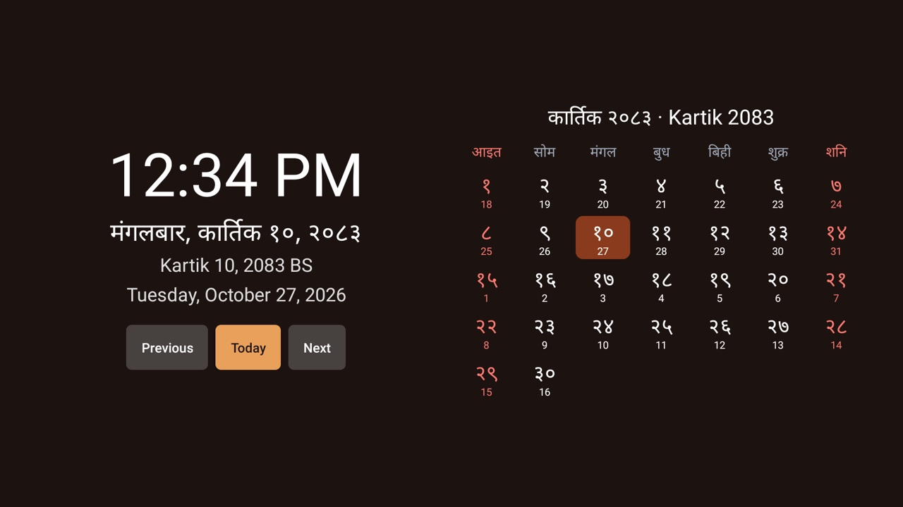

# Nepali Calendar

An optional, standalone module card with today's Bikram Sambat (BS) date in Devanagari and in Latin
letters, the Gregorian date, a clock, and the BS month as a grid. It also offers an optional system
clock screensaver. When a theme opts in with `nepali_calendar`, the add-on publishes today's BS date
and its calendar tithi to the launcher's Home panel. The launcher only reads the add-on's cache; only
this add-on connects to the API.

## Setup

Build from this folder with JDK 17 and Android SDK 34:

```sh
./gradlew --no-daemon testReleaseUnitTest lintRelease assembleRelease
```

Sideload the APK with the repository's normal ADB tools. On Home, approve **Nepali Calendar** when the
launcher asks about its card, or enable it later under Settings → Module cards. The card opens the
calendar's own screen. The optional Home integration is a separate theme panel; it does not change
the launcher's clock/date header or the calendar tile caption.

The screen shows the clock, the date as "मंगलबार, कार्तिक १०, २०८३" and "Kartik 10, 2083 BS", and the
Gregorian date in the TV's language. The grid shows the BS month, Sunday first, each day with its
Gregorian day underneath; today is marked, and Saturdays, Sundays and the fixed-date national days are in red.
**Previous**, **Today** and **Next** page the grid, as do Channel Up/Down and Rewind/Fast
forward. The BS day changes at local midnight, so keep the TV's date, time and time zone correct.

The national days are the ones kept on a fixed BS date: New Year (Baishakh 1), Loktantra Diwas
(Baishakh 11), Republic Day (Jestha 15), Constitution Day (Asoj 3), Prithvi Jayanti (Poush 27), Maghe
Sankranti (Magh 1), Martyrs' Day (Magh 16) and Democracy Day (Falgun 7). On those days the screen shows
the day's name. Dashain, Tihar, Holi, Teej and the other lunar festivals move every year and are not
shown, nor are government-announced holidays. The calendar screen's month grid does not show tithis.
The optional Home line shows the API's daily tithi label; it is not an astronomical calculation for
the current hour or city. This is not a patro for rituals.

English and Nepali UI strings are included; the BS date is always shown in both scripts.

## Home date and tithi

Install this add-on, then set `"nepali_calendar": "com.oneyuv.tv.nepalicalendar"` in the theme's
`config.json`. Home shows the Nepali date and the API's `t` value for that BS day in the open space
between the clock and the app shelf. The date comes from the TV's local calendar; the tithi comes
from the monthly endpoint
[`/calendar/{year}/{month}`](https://api-nepalicalendar.leapcell.app/docs), using the API's
published dataset for the matching BS year and month. The value is the calendar's daily tithi, not
an astronomical tithi recalculated for a city or exact time. It does not need location permission.

The add-on requests `INTERNET` to fetch the current month's public data. It refreshes when Home opens
and retries every 30 minutes while Home is visible if data is unavailable; a successful value is cached
for the current day. The date remains visible with a tithi-unavailable message if the network or API is
unavailable. The request contains only the BS year and month; the API host receives ordinary connection
metadata such as the TV's public IP address. No location, account, or device identifier is sent. The API is by
[S4NKALP/nepali-calendar-api](https://github.com/S4NKALP/nepali-calendar-api) and its code is MIT-licensed.

## Optional screensaver

Open **Screensaver** and select this app if desired. The button appears only on TVs with a
screensaver picker; Google TV has none for other apps' screensavers, so there it is hidden. The add-on
does not select itself or change the idle timeout. Its dream shows the national day when there is one, the clock, the BS date in
both scripts and the Gregorian date, and drifts within a padded area. Any key leaves the screensaver.
It does not replace the launcher's own idle-clock activity.

## Permissions

| Permission | Why |
|---|---|
| `INTERNET` | Fetches the public current-month tithi data from the configured calendar API when the Home theme opts in. |

No location, overlays, accessibility, boot receiver, alarms, analytics or ads. The app stores only
the current date's tithi cache. The exported dream requires Android's `BIND_DREAM_SERVICE` permission
from its caller; this is a binding restriction, not a permission granted to the app. The only service
is the optional system-managed `DreamService`; calendar API updates are short-lived worker threads
started by an on-screen Home/provider request, not a background service.

## Data and validation

BS months have 29 to 32 days set each year by the calendar committee, so conversion needs a table,
kept in `BikramSambat.java`. It covers BS 1970 to 2090 (13 April 1913 to about April 2034); outside
that the screen says so and shows only the clock and the Gregorian date.

Unit tests cover known conversions both ways, the 2082 and 2083 new years, month lengths, a day-by-day
round trip across the whole table, the table's edges, month paging across years, Devanagari digits,
weekday and weekend handling, and that every national day exists in every year.

Tested on a Hisense 50A6H4 (SmartTV 4K, songshan), Android TV 11, with the CleanYourTV launcher: the
card, the screen, D-pad focus from every edge, month paging by button and Channel Down, Back to Home,
and the screensaver started and left with a key.


