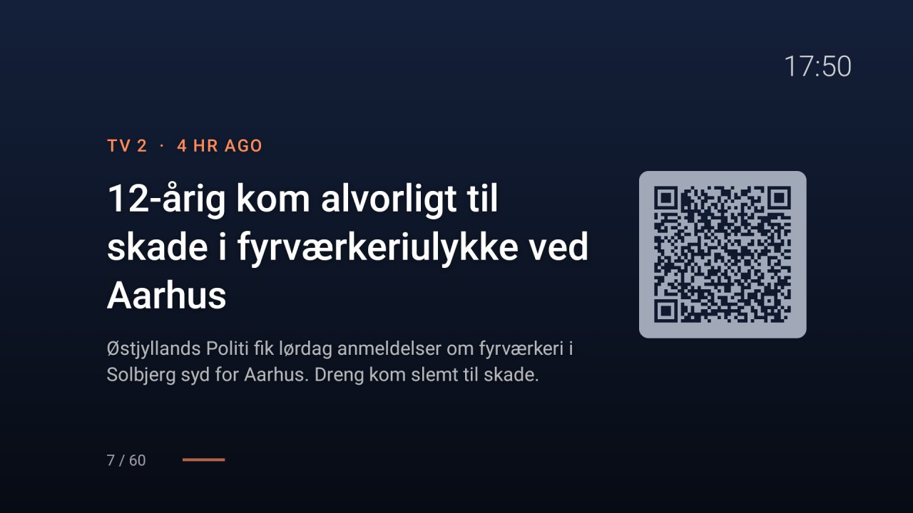

# News screensaver

A system screensaver (Android's "Daydream") for any Android TV or Google TV that shows the news from RSS and Atom
feeds you choose: one headline at a time, large, with its source, how long ago it was published and a short
summary, crossfading to the next after 15 seconds (or what you set). Beside it a QR code opens the article on your
phone, and "3 / 34" under it says where you are. Headlines from several feeds take turns, newest first, and anything
older than two days is left out. A clock sits in the corner. The layout is fixed: source, headline, summary, count and
code keep their places from one headline to the next, and a long headline gets smaller type instead of more lines.
Against burn-in the whole picture drifts together, 6 dp round a small circle, one slow step every two minutes. The
same story carried word for word by two papers (agency copy) is shown once.

Left and Right on the remote page back and forth through the headlines, at once, and the timer starts again. Any other
key wakes the TV back to where it was.

Package `com.gathin.newsdream`. You see it as **News** (Danish: **Nyheder**) in the TV's screensaver settings. On
cleanyourtv's Home it is also a module card, **News**: OK shows the headlines at once, Left and Right page through
them, and any other key goes back to Home, as in the screensaver.



## What you can set

| Setting | Default | Where |
|---|---|---|
| Feeds: up to 10 RSS or Atom addresses, `https://` only | BBC News, World | `feeds.txt` and `setup.sh`, or the settings on the TV |
| Seconds per headline: 5 to 600 | 15 | `SECONDS_PER_HEADLINE` / `-Seconds`, or the settings on the TV (8 to 120 in steps) |
| When the screensaver starts: minutes without a key press | the TV's own | `IDLE_MINUTES` / `-IdleMinutes`, or the TV's own screensaver or energy settings |

The settings on the TV are in the screensaver's own entry (TV settings > Screensaver > News > settings). Google TV
has no settings entry for other screensavers, so there use `setup.sh`. Typing a feed address with the remote works, but `setup.sh` is quicker.

## Install

JDK 17 and Android SDK 34, as for the launcher, and the `tools/venv` from the main README. The small `gradlew`
scripts reuse the launcher's pinned Gradle wrapper with this folder as the project, so keep this folder inside the
repository when building.

```sh
TV_HOST=192.168.1.50 addons/news-screensaver/build-and-install.sh
```

```powershell
powershell -ExecutionPolicy Bypass -File addons\news-screensaver\build-and-install.ps1 -TvHost 192.168.1.50
```

## Choose the feeds and make it the screensaver

Copy `feeds.example.txt` to `feeds.txt` (git ignores it), put one feed address per line (lines starting with `#`
are skipped) and run it. A name before the address and a bar, `Ekstra Bladet | https://...`, is shown as the source
instead of the feed's own title, which is sometimes just "Nyheder". The same form works in the settings on the TV.

```sh
TV_HOST=192.168.1.50 addons/news-screensaver/setup.sh                              # feeds.txt, or pass another file
TV_HOST=192.168.1.50 SECONDS_PER_HEADLINE=20 IDLE_MINUTES=10 START=1 addons/news-screensaver/setup.sh
TV_HOST=192.168.1.50 addons/news-screensaver/setup.sh --default-feeds              # back to the built-in feed
TV_HOST=192.168.1.50 addons/news-screensaver/setup.sh --off                        # previous screensaver back
```

```powershell
addons\news-screensaver\setup.ps1 -TvHost 192.168.1.50 [D:\my-feeds.txt] [-Seconds 20] [-IdleMinutes 10] [-Start]
addons\news-screensaver\setup.ps1 -TvHost 192.168.1.50 -DefaultFeeds
addons\news-screensaver\setup.ps1 -TvHost 192.168.1.50 -Off
```

It makes News the TV's screensaver and changes only what you pass: run it without a feeds file (and with no
`feeds.txt` here) and the feeds on the TV stay as they are. The feeds and seconds are written through the app's own
provider, which only the ADB shell may use. The screensaver the TV had before the first run is remembered for
`--off`; `build-and-install.sh --uninstall` does `--off` and removes the app.

`IDLE_MINUTES` sets `screen_off_timeout`, after which the TV starts its screensaver; on most TVs the same value is
in TV settings > Screensaver (or Energy saving) as "When to start". Some sets go to standby instead of the
screensaver at that point: then pick the time in the TV's own settings.

A feed's address is usually linked from the site as "RSS", or found by adding `/rss` or `/feed` to a section's
address. Some that work:

| Feed | Address |
|---|---|
| DR, latest news | `https://www.dr.dk/nyheder/service/feeds/senestenyt` |
| TV 2 Nyheder | `https://feeds.services.tv2.dk/api/feeds/nyheder/rss` |
| Ekstra Bladet, Nyheder | `https://ekstrabladet.dk/rssfeed/nyheder/` |
| B.T., latest | `https://www.bt.dk/bt/seneste/rss` |
| BBC News, World | `https://feeds.bbci.co.uk/news/world/rss.xml` |
| The Guardian, World | `https://www.theguardian.com/world/rss` |
| NPR News | `https://feeds.npr.org/1001/rss.xml` |

`feeds.example.txt` has the first five switched on, with names.

## The QR code

It holds the item's own link (RSS `<link>`, Atom `<link href>`), drawn on the TV by a small built-in encoder (byte
mode, error correction level M, up to 400 characters), so nothing extra is fetched or sent to make it. An item without
a link, or with a longer one, shows no code. It is drawn in the screen's navy on a muted blue-grey rather than black on
white, so it doesn't glare; phones read it from the sofa at about 9:1 contrast.

## How it fetches

The feeds are read when the screensaver or the card starts, then every 15 minutes while it shows, or 2 minutes after
everything failed. Nothing runs in the background when it is not on screen. The last good list is kept in the app's
storage, so the screensaver shows headlines at once, and with no network the last ones it had. A feed that fails is
skipped and the others still show. Each reply is read up to 2 MB and at most 20 items per feed; 60 headlines in all.

## Memory

No pictures and no web view: one screen of text views, a list of at most 60 short headlines, one QR code at a time
(drawn as rectangles, no bitmap) and one thread for the fetches. The release APK is about 30 KB.

## Permissions

| Permission | Why |
|---|---|
| `INTERNET` | To fetch the feeds you set, over HTTPS, while the screensaver or the card is on screen. |

That is all. What goes out is a plain GET for each feed address, with the user agent
`cleanyourtv-news/1.0`; each news site sees the TV's IP address, as with any visit. No account, no telemetry, no ads,
no background service, no location. Feeds, seconds and the cached headlines stay in the app's own storage (backups
are off). The provider that `setup.sh` writes through requires `WRITE_SECURE_SETTINGS`, which the ADB shell has and
apps don't, so no other app can change the feeds.

## Tested on

Philips 2021/22 UHD Android TV, Android 11: installed with `build-and-install.sh`, feeds and seconds set with
`setup.sh`, the screensaver started, headlines from DR, TV 2, Ekstra Bladet, B.T. and BBC with Danish letters, the QR codes read back from TV
screenshots, Left and Right paging, and Up, Down, OK, Back and a digit each waking the TV to Home. The parser, the
merging and the QR encoder have JVM unit tests (`./gradlew testReleaseUnitTest`).

## Maintainer

[@modist](https://github.com/modist)
