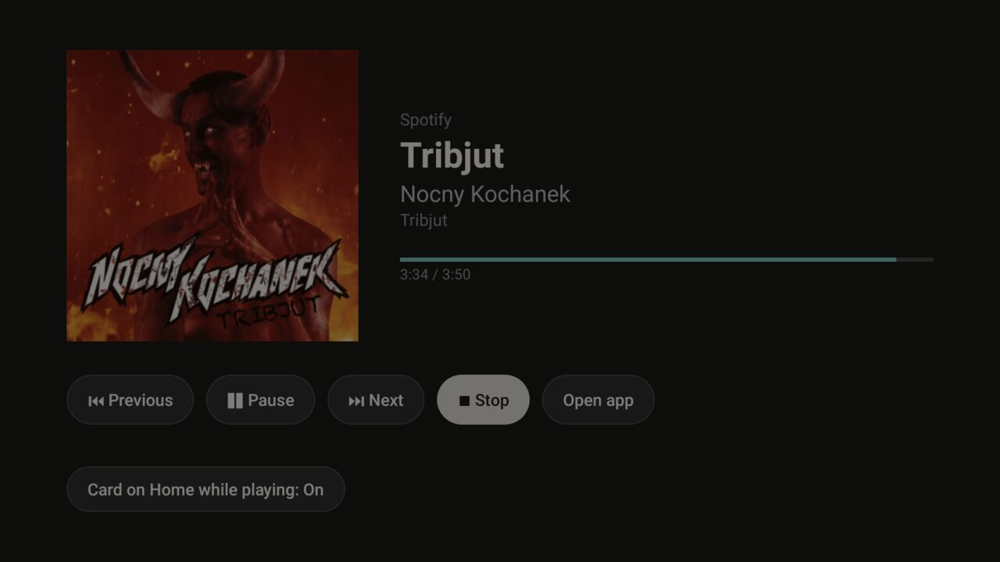

# Now Playing

What Spotify, or any other app that plays media, is playing right now: the cover, title, artist, album and
progress, with **Previous**, **Play/Pause**, **Next**, **Stop** and **Open app**. For the
[Clean Your TV](../../README.md) launcher it declares a [module card](../../docs/modules.md): once you answer
**Show card**, its tile reads "Now Playing" with a green glow and opens the player. On any other Android TV home
it is an ordinary app.



## The card on Home

**Card on Home while playing** is off by default and turned on at the bottom of the player screen. While it is
on, a small card with the cover, title and artist shows over the launcher's Home while music plays. It goes
away when you open any app, and comes back on Home.

- A pause keeps the card up, so play/pause brings the music back.
- **Stop**, as a button or the remote's Stop key, ends the music and hides the card until something plays
  again. Apps that offer no stop, Spotify among them, are paused instead.
- While the card shows, the remote's media keys (play/pause, play, pause, next, previous, fast forward,
  rewind, stop) go to what the card shows. The D-pad, OK, Back, Menu and volume keys always reach Home as
  before.
- It shows over the launcher's own screens too (its clock screensaver and settings), which share its package.

On some firmware, a held Volume key stops repeating while any accessibility service filters keys. This
add-on filters keys only while the card shows.

## Permissions

The manifest asks for no `uses-permission` at all. Two services do the work, both turned on by `install.sh`:

| Service | Why |
|---|---|
| Notification access (`SessionAccess`, bound with `BIND_NOTIFICATION_LISTENER_SERVICE`) | Android lists other apps' media sessions (`MediaSessionManager.getActiveSessions`) only to an app with an enabled notification listener. The service is empty: it reads no notification. `install.sh` turns it on with `cmd notification allow_listener`, next to any listener already on. |
| Accessibility service (`CardService`, bound with `BIND_ACCESSIBILITY_SERVICE`) | Only with the card turned on: window changes (package and class names, never screen content) to know when Home is in front, the card itself as an accessibility overlay window, and the media keys while the card shows. With the card off it asks for no events and no keys. `install.sh` adds it next to the accessibility services already on. |
| Auto-start (`AUTO_START` / `APP_AUTO_START` app-op, TCL only) | Without it, TCL's firmware does not bind the services after a reboot. Other TVs ignore it. |

No internet permission, no telemetry, no libraries, no foreground service and no boot receiver: Android binds
both services by itself at boot. The cover comes from the session's own data, never from the network. The
`<queries>` entry for apps with a main activity is for the playing app's name and icon, Open app, and telling
an app's screen from a dialog; it is not a permission.

## Setup

With ADB on, as for the launcher, from the repo root:

```bash
TV_HOST=<tv ip> addons/now-playing/install.sh
```

It builds the add-on, installs it, turns on notification access and the remote helper, and opens the player.
Press Home and answer **Show card**. Turn the card on from the player screen if you want it on Home.

If the player says notification access is off, run `install.sh` again or turn it on in the TV's settings. If it
says the remote helper is off (Android turns it off when the app is force-stopped or updated by hand), run
`install.sh` again.

## Tested on

Philips 55OLED856/12 (2021/22 Philips UHD Android TV, PH1M_EA_9970A), Android TV 11, firmware RTT2.211108.001,
with Spotify.
