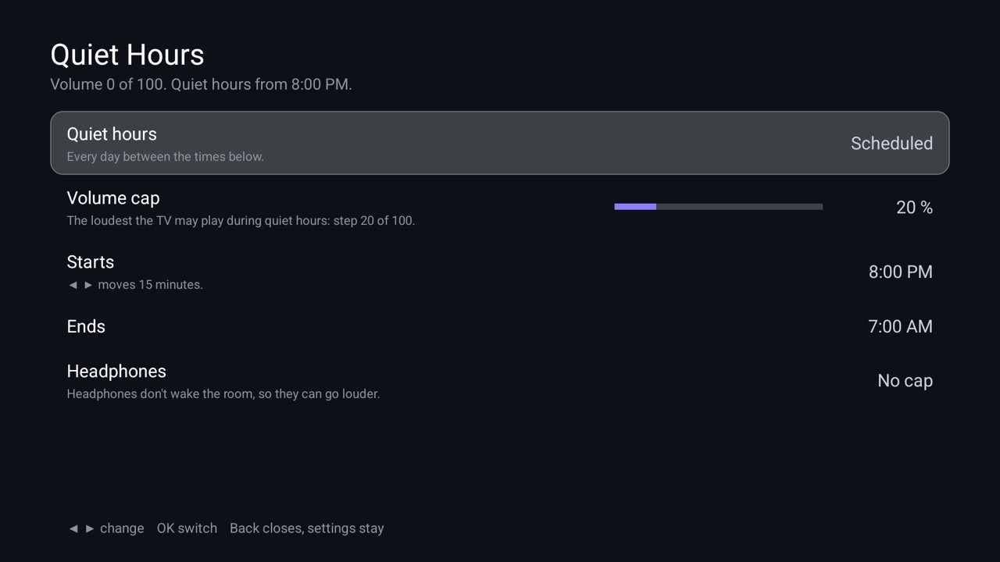

# Quiet Hours

A volume cap for the night: from 20:00 to 07:00 (or all day, or never) the TV's media volume can't go above the
level you set. A press of Volume Up, an app that starts loud or a loud advert is brought back down to the cap at
once. The cap never raises a quieter volume, and headphones can stay uncapped, since they don't wake the room. For
the [Clean Your TV](../../README.md) launcher it declares a [module card](../../docs/modules.md): once you answer
**Show card** its tile reads "Quiet Hours" with a violet glow. On any other Android TV home it is an ordinary app.



| Row | What it does |
|---|---|
| **Quiet hours** | Off, Scheduled (every day between the times below) or Always. Focused first. |
| **Volume cap** | The loudest the TV may play, 5 % to 100 % of its volume range in 5 % steps (◀ ▶). The line under it says which volume step that is on this TV. Never 0, so a cap can't look like a broken TV. |
| **Starts**, **Ends** | The schedule, in 15 minute steps; 20:00 to 07:00 by default, and a window may run past midnight. |
| **Headphones** | No cap (the default) or Capped too, for Bluetooth, wired and USB headphones. |

The line at the top shows the volume now and whether the cap applies, and follows the remote's volume keys while
the screen is open. It pairs with [Headphones](../headphones/) (its quiet guard pauses and mutes when headphones
drop) and [Brightness](../brightness/) (a dim, warm night picture).

## Permissions

| Permission | Why |
|---|---|
| Foreground service (`FOREGROUND_SERVICE`, `FOREGROUND_SERVICE_SPECIAL_USE`) | One service listens for volume changes and brings the volume back to the cap. It runs while Quiet Hours is on (Scheduled or Always) and stops when it is switched off. |
| Start at boot (`RECEIVE_BOOT_COMPLETED`) | To put the cap back after a reboot or an update. |

Changing the media volume needs no permission. No internet permission: nothing leaves the TV. No accounts,
telemetry, ads or libraries. Settings stay in the app's own storage (backups are off).

## Build and install

JDK 17 and Android SDK platform 34 with build-tools 34.0.0, as for the launcher. From the repo root, with ADB on:

```bash
TV_HOST=<tv ip> addons/quiet-hours/install.sh
```

It builds the add-on, installs it (and allows TCL's auto-start), and opens it. Press Home: the launcher asks once
whether to show the card. To build only: `cd addons/quiet-hours && ./gradlew assembleRelease`; the JVM tests run
with `./gradlew testReleaseUnitTest`.

The release build is signed with the debug key so it installs over ADB like the launcher.

## Limits

- **Fixed volume.** When the TV's sound goes through HDMI ARC or an amplifier, Android reports a fixed volume and
  no app can change it; the screen says so and the cap does nothing. Set the amplifier's own maximum instead.
- **A muted TV is left alone.** On Android, setting a muted stream's volume can unmute it, so the cap waits:
  unmuting is a volume change, and the volume comes down to the cap then.
- **A moment above the cap.** The cap follows the volume change; a very loud start can be heard for a fraction of
  a second before it comes down.
- **One output at a time.** Android keeps a volume per output; the cap applies to the one playing now and to each
  output as it starts playing.
- **Memory managers** on 1 GB TVs can stop the service. The cap then stops until the app is opened or the TV
  restarts.

## Tested on

MOKA R8G (Android 14), over ADB, on a home app that implements the module-card spec: the card prompt and the card, the screen with the volume line, and the service running while Quiet Hours is Scheduled. Testing found that lowering a muted stream's volume can unmute it on Android, so the cap now leaves a muted TV alone (a JVM test covers it). The volume being brought down to the cap was not tried with sound: the test TV stays muted because a baby sleeps nearby. The JVM tests cover the decisions (the window past midnight, the cap as a volume step, never silence, headphones, fixed volume, muted).

## Maintainer

[@maxhayim](https://github.com/maxhayim)
