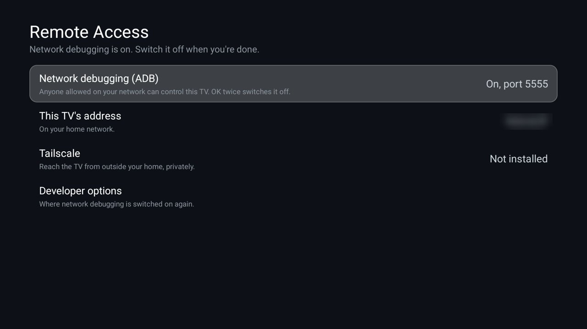

# Remote Access

Is this TV open to remote control right now? One screen says whether network debugging (ADB) is on and on which
port, the TV's address on your home network, and whether [Tailscale](https://tailscale.com) is installed and
connected with its address. One button switches network debugging off: debugging switched on to set a TV up
and then forgotten is the usual way a TV stays open. For the [Clean Your TV](../../README.md) launcher it declares
a [module card](../../docs/modules.md): once you answer **Show card** its tile reads "Remote Access" with a red
glow. On any other Android TV home it is an ordinary app.



| Row | What it does |
|---|---|
| **Network debugging (ADB)** | Off, USB only, On (port 5555) or Wireless debugging. Focused first. OK twice within five seconds switches it off, which also ends any ADB session in progress. |
| **This TV's address** | Its IPv4 address on the home network. |
| **Tailscale** | Not installed, Installed and not connected, or Connected with its 100.x address. OK opens Tailscale. |
| **Developer options** | Opens them, where debugging is switched on again. |

It never switches debugging on: that stays in the TV's own Developer options.

## Permissions

| Permission | Why |
|---|---|
| `ACCESS_NETWORK_STATE` | The TV's addresses, and whether a VPN such as Tailscale is up. |
| `WRITE_SECURE_SETTINGS` | Only to switch network debugging off. Android lets only ADB grant it; `install.sh` does. Without it the button opens Developer options instead. |

It reads `adb_enabled`, `adb_wifi_enabled` and the `service.adb.tcp.port` property, the same values the TV's
settings show. Package visibility is limited to `com.tailscale.ipn`. No internet permission: nothing leaves the
TV. No background service, accounts, telemetry, ads or libraries.

## Build and install

JDK 17 and Android SDK platform 34 with build-tools 34.0.0, as for the launcher. From the repo root, with ADB on:

```bash
TV_HOST=<tv ip> addons/remote-access/install.sh
```

It builds the add-on, installs it, grants the permission for the off button, and opens it. Switching debugging
off from the app ends the ADB connection the script used; that is the point. To build only:
`cd addons/remote-access && ./gradlew assembleRelease`; the JVM tests run with `./gradlew testReleaseUnitTest`.

## Limits

- **The port** comes from a system property that is hidden from apps on some firmware; the row then says On
  without a port.
- **Other remote apps** (a vendor's phone app, Chromecast, AirPlay) are not ADB and are not covered.

## Tested on

MOKA R8G (Android 14), over ADB, on a home app that implements the module-card spec: the card prompt and the card, ADB shown as on at port 5555, the TV's address, Tailscale shown as not installed, and the permission for the off button granted by `install.sh`'s command. The off button itself was not pressed on the test TV, since it would end the ADB session the testing used. The JVM tests cover the states, the port property and the Tailscale address range.

## Maintainer

[@maxhayim](https://github.com/maxhayim)
