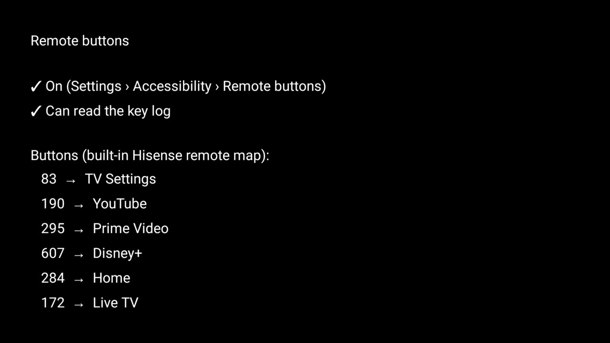

# Remote buttons

Makes the remote's app and gear buttons work again once the stock Google TV launcher is disabled, **without
breaking a held volume key**.

On several Google TV sets (Hisense, TCL) the stock launcher is the only thing answering the YouTube,
Prime Video, Disney+, gear and Live TV buttons. The launcher's own key helpers (`HOME_KEY_SERVICE=1`,
`INPUT_KEY_SERVICE=1`) bring them back, but on those sets any accessibility service that *filters* keys stops
a held volume key from repeating: volume moves one step per press instead of ramping
([`docs/devices/tcl-55p71b-g09-key-repeat.md`](../../docs/devices/tcl-55p71b-g09-key-repeat.md)).

This add-on filters nothing. The firmware's window manager logs every key press, and the add-on reads that log
and opens the app mapped to the button, as described for a TCL G10 in
[`docs/devices/tcl-g10-app-keys.md`](../../docs/devices/tcl-g10-app-keys.md). Volume keeps ramping and the
buttons work. Its card in the launcher shows whether it is on and which button opens what.



## Install

From the repo root, with ADB on and the [`tools/` venv](../../README.md) set up:

```bash
TV_HOST=<tv ip> addons/remote-buttons/install.sh
```

It builds the APK, installs it, grants `READ_LOGS`, allows the background app start, and turns the
accessibility service on. On Home, answer **Show card** to get the card. Don't also install the launcher with
`HOME_KEY_SERVICE=1` or `INPUT_KEY_SERVICE=1` on a set where those stop the volume ramp: the point of this
add-on is that no service filters keys.

## Buttons

Built in, measured on a Hisense 65Q6N (SmartTV 4K FFM, lushan) remote ("SmartRC Consumer Control"). The hengshan
notes in `docs/` list the same codes for its remote:

| Button | keycode | Opens |
|---|---|---|
| Gear | 83 | TV Settings |
| YouTube | 190 | YouTube |
| Prime Video | 295 | Prime Video |
| Disney+ | 607 | Disney+ |
| Apps | 284 | Home |
| Live TV | 172 | Hisense's Live TV app (`com.vt.tv.tvcenter`) |

A button whose app is not installed, or is disabled, does nothing. Netflix and Input already work on these sets
without help, so they are not mapped.

### Your own map

Write a `keys.txt`, one `keycode=target` per line. The target is a package name, `settings` or `home`:

```text
# my remote
190=com.google.android.youtube.tv
606=com.tubitv
172=com.vt.tv.tvcenter
```

and pass it to the install script: `TV_HOST=<tv ip> addons/remote-buttons/install.sh keys.txt`. It replaces the
built-in map, and the add-on picks up a changed file at the next press. Lines it cannot read are skipped.

To find a button's keycode, watch the log while you press it:

```bash
TV_HOST=<tv ip> tools/venv/bin/python tools/tv.py 'logcat -c; sleep 15; logcat -d -s WindowManager:D' | grep 'interceptKeyTi.*down=true repeatCount=0'
```

## Permissions

- `READ_LOGS`: reads the window manager's key lines (`logcat -s WindowManager:D`). It is a development
  permission: only `pm grant` over ADB can give it, which `install.sh` does. The add-on reads only those lines
  and keeps nothing.
- `SYSTEM_ALERT_WINDOW`: lets it open the mapped app while another app is in front (Android 10's background
  start rules), allowed with `appops set` by `install.sh`. Nothing is drawn over other apps.
- An accessibility service, **with no key filtering** (`capabilities=0` in `dumpsys accessibility`) and no
  window content. It exists so Android keeps the add-on running and starts it again after a reboot.
- No network, no boot receiver, no foreground service, no telemetry.

## Limits

- **Firmware specific.** It depends on the firmware logging every key press as
  `interceptKeyTi keyCode=N down=true repeatCount=0`, which Hisense's MediaTek Google TV 12 builds do. Other
  firmware logs keys differently, or not at all: then no button does anything and nothing else changes. A
  firmware update could drop the lines; if the buttons stop, check the log command above first.
- Gear opens the TV's Settings, not the launcher's quick-settings panel, which only the launcher can open.
- A mapped button still does its own job too, because nothing is filtered. Mapping a button the firmware
  already answers (Netflix, Input) would do both.

## Remove

```bash
TV_HOST=<tv ip> tools/venv/bin/python tools/tv.py 'pm uninstall io.github.abner97.remotebuttons'
```

## Tested on

Hisense 65Q6N (Android model string "SmartTV 4K FFM", device lushan, MediaTek MT9676), Google TV 12, firmware `STT2.230929.001.102`, with the
Clean Your TV launcher as Home and `com.google.android.apps.tv.launcherx` disabled. On the real remote, Gear,
YouTube, Prime Video, Disney+, Apps and Live TV opened their targets, and held Volume Up and Down ramped. A
first private build of the same service was bound again after a reboot; this package was not rebooted.

Author: [@Abner97](https://github.com/Abner97)
