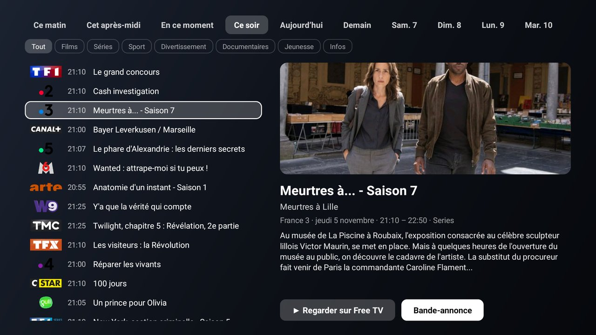

# Salon

A French living-room companion for the [Clean Your TV](../../README.md) launcher: tonight's TV guide for the
French channels, "À voir cette semaine" (new films and series on the household's streaming platforms), a search
across those platforms, French radios, the weather, and a **Réglages** page to set it all up from the sofa. The
words on screen are French; the code and this page are in English for the maintainers.

It declares a [module card](../../docs/modules.md) on the guide, so once you answer **Show card** its tile reads
"Salon"; on any other Android TV home it is an ordinary app with its own tiles (Programme TV, Météo).




A 3½-minute tour filmed on the TV with the remote, in real time: [salon-demo.mp4](https://raw.githubusercontent.com/anhost77/cleanyourtv/pr-assets/addon-salon/salon-demo.mp4) (the QR code and the TV's address are blurred; the home photo is a drawn landscape).

## What it does

- **Programme TV**: the evening (or now, this morning, the next days) on 37 French channels, from the free
  [xmltvfr.fr](https://xmltvfr.fr/) guide, with genre filters and a page per channel. **Regarder** opens the
  channel live in Free TV (OQEE) or myCANAL when one of them is installed.
- **À voir cette semaine** and **Recherche**: films and series from [TMDB](https://www.themoviedb.org/), filtered
  to the platforms installed on the TV. **Regarder sur…** opens the title's own page in the platform's app where
  the app allows it: Netflix (ids from Wikidata, then JustWatch), myCANAL and M6+ (their title pages, from
  JustWatch), Apple TV and Paramount+ (their own links), TF1+ (its programme page), Prime Video and Disney+
  (their search, filled in). Trailers play in the app.
- **Radios**: 18 French stations (France Inter, franceinfo, RTL, FIP, Radio Classique…), played by ExoPlayer in a
  foreground service, so they keep playing on the home screen.
- **Météo**: the weather page of [the Weather add-on](../weather/) by @Sumyabazar1, which Salon starts from
  (Open-Meteo, no key).
- **Réglages** (opened from its own screen, or by a launcher that knows the `.SETTINGS` action): the TMDB token,
  the platforms, channels and radios to show (each one on or off), the city, and the home photo.
- **Depuis le téléphone**: Réglages shows a QR code; the phone opens a small page served by the TV on the home
  network to type the TMDB token and send a photo. Details under [Privacy](#privacy).

Without a TMDB token the guide, the radios and the weather work; "À voir", the search and the title pages stay
hidden until a token is typed in Réglages (or put in `work/tmdb.properties` at build time, which git ignores).

## For launcher forks

Salon publishes read-only rows on `content://io.github.anhost77.salon.now/…` (`now`, `tv`, `picks`, `radio`,
`photo`) and a `RADIO_PLAY` service, for a launcher that wants them as cards on its home screen. The launcher in
this repo does not read them: that would need a launcher change, which is not part of this add-on.

## Permissions

| Permission | Why |
|---|---|
| `INTERNET` | Open-Meteo (weather), xmltvfr.fr (guide), TMDB (films and series), JustWatch and Wikidata (the platforms' title links), the channel and radio logos, the radio streams, and the phone page while it is open. |
| `FOREGROUND_SERVICE`, `FOREGROUND_SERVICE_MEDIA_PLAYBACK` | The radio keeps playing after you leave the app, with its notification, until you stop it. |

No account, no telemetry, no ads, no location permission. Nothing runs in the background except the radio while it
plays.

## Privacy

- **The phone page** listens only while Réglages > Depuis le téléphone is on screen, ten minutes at most, on the
  TV's home-network address. Every request must carry the one-time code from the QR code; anything else is
  refused. It accepts two things: a picture (kept in the app's private files) and the TMDB token.
- **What leaves the TV**: the city name typed in the weather search and its coordinates (Open-Meteo); titles'
  names and TMDB ids (TMDB, JustWatch, Wikidata); nothing about the household.
- The TMDB token and the photo stay in the app's own storage (backups are off). Neither is ever in the sources.

## Build and install

JDK 17 and Android SDK platform 34 with build-tools 34.0.0, as for the launcher:

```bash
cd addons/salon && ./gradlew assembleRelease
TV_HOST=<tv ip> ../../tools/venv/bin/python -I ../../tools/tv.py --push app/build/outputs/apk/release/app-release.apk /data/local/tmp/addon.apk
TV_HOST=<tv ip> ../../tools/venv/bin/python -I ../../tools/tv.py 'pm install -r /data/local/tmp/addon.apk; rm -f /data/local/tmp/addon.apk'
```

Press Home: the launcher asks once whether to show the card. The release build is signed with the debug key so it
installs over ADB like the launcher; sign your own builds with your own key if you hand them out.

## Credits

The weather page and its tests come from [Weather](../weather/) by [@Sumyabazar1](https://github.com/Sumyabazar1).
TV guide: xmltvfr.fr. Films and series: TMDB (this product uses the TMDB API but is not endorsed or certified by
TMDB). Title links: JustWatch and Wikidata. QR codes: [ZXing](https://github.com/zxing/zxing) (Apache 2.0).

## Tested on

Nokia Smart TV (Vestel, MediaTek), Android TV 11: the guide, the channel pages, "À voir", the search, the
platforms' links (Netflix, myCANAL, M6+, TF1+, Prime Video, Disney+), the radios, Réglages and the phone page.

## Maintainer

[@anhost77](https://github.com/anhost77)
