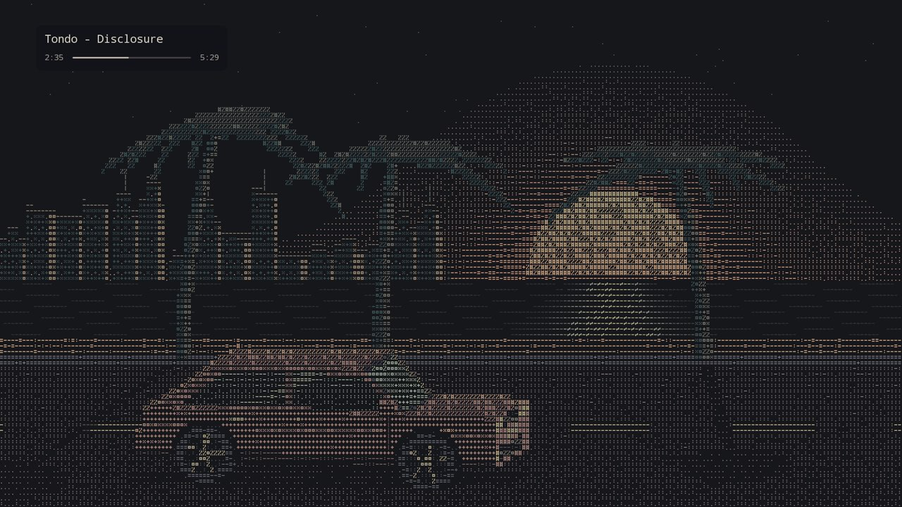
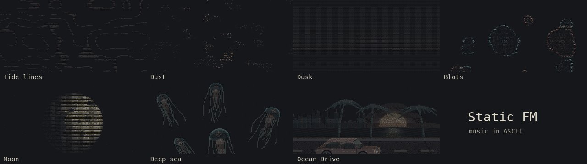

# Static FM

Music in ASCII: whatever the TV plays (Spotify, YouTube, any app) drawn live in small characters on a dark
screen, as a card on Home and as the TV's screensaver. Seven styles, four muted colour sets, and a small card
naming the track that is playing.





| Style | What it shows | What the music moves |
|---|---|---|
| Tide lines | Contour lines of a slow field, one colour per level | The bass thickens and lifts the lines; the highs sprinkle stars |
| Dust | Specks drifting through a beam of lamp light | The bass widens and brightens the beam |
| Dusk | A dithered sky over a dark ground | The bass brightens the sky; the horizon stays put |
| Blots | Nine ink blots with ragged rims | Each blot grows with the bass, the mids or the highs |
| Moon | A shaded moon with seas and craters, and stars | The bass brightens it and its glow; the highs light the stars |
| Deep sea | A few translucent jellyfish drifting through deep water | The bells breathe with the bass, the tentacles sway with the mids |
| Ocean Drive | A car by the sea at dawn: a striped sun, palms, a skyline | The bass pulses the sun; what faces it lights up: the car's front, the towers |

The characters change where the music moves the picture, not at random: each cell keeps its grain for about ten
seconds, so the screen stays calm on a big TV. The frame is drawn at 960x540 and scaled up with sharp pixels, on
one render thread at up to 30 frames a second; on the TV below a frame takes 20 to 45 ms depending on the style.
The icon, the banner and every style are drawn in code for this add-on.

On cleanyourtv's Home it is a module card, **Static FM**:

| Key | What it does |
|---|---|
| Left / Right | The style |
| Up / Down | The colours: teal and coral, ochre and slate, sage and plum, mono |
| OK | How strongly it follows the music: calm, normal, lively |
| Back | Leave |

A line at the bottom names the choice for a few seconds after each change. The choice is kept, and the
screensaver uses it. As a screensaver any key wakes the TV, as usual.

- Package: `io.github.cleanyourtv.staticfm`
- Author: [@jonathantiedchen](https://github.com/jonathantiedchen)
- Tested on: TCL BeyondTV (Thomson), Android TV 9, build PPR1.180610.011, 15 Nov 2026: all seven styles and
  four colour sets with Spotify playing, the track card, the screensaver; 20 to 45 ms a frame against a 33 ms
  budget (Ocean Drive is the slowest)

## Permissions

| Permission | Why |
|---|---|
| `RECORD_AUDIO` | Android asks it of every `Visualizer`. The app reads the spectrum of the TV's own output (session 0), what is playing, never the microphone. Without it the picture breathes on its own. |
| `MODIFY_AUDIO_SETTINGS` | Also required by the `Visualizer` on the output mix. The app changes no audio setting. |

Notification access (not a permission in the manifest, but a switch the owner gives): it lets the app read the
title, artist and position that a player publishes, for the track card. The app does nothing with
notifications themselves, and the card simply stays hidden without it.

No network access (no `INTERNET` permission): nothing leaves the TV. No background service: it runs only while
the screensaver or the card's screen is showing.

## Build and install

JDK 17 and Android SDK platform 34 with build-tools 34.0.0. From the repo root, with ADB on:

```bash
TV_HOST=<tv ip> addons/static-fm/install.sh
```

It builds the APK, installs it, grants `RECORD_AUDIO` and notification access over ADB (so the TV asks for
neither) and opens it. `SCREENSAVER=1` also makes it the screensaver. Without ADB, the first open asks for the
sound permission on screen; notification access is in the TV's settings under Apps > Special app access.

To build only: `cd addons/static-fm && ./gradlew assembleRelease`; the JVM tests run with
`./gradlew testReleaseUnitTest`.

## Undo

```bash
TV_HOST=<tv ip> addons/static-fm/install.sh --uninstall
```

puts the screensaver back to the TV's own if Static FM was it, and removes the app.

## If the picture does not follow the music

`adb logcat -s StaticFM` prints a line every few seconds: `sound=true` with levels above zero means the TV's
sound reaches the picture. `sound=false` means no `RECORD_AUDIO`, or firmware that refuses a `Visualizer` on
the output mix; some protected video plays silent to it too, while music apps usually work.
