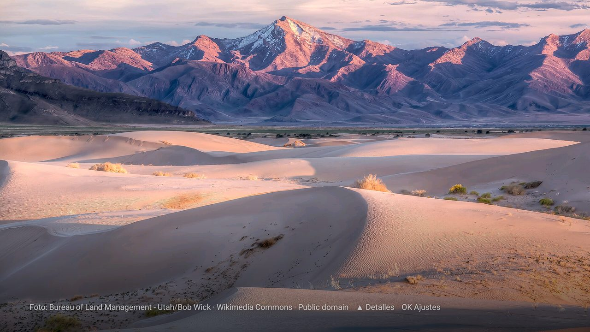

# Topic Photos

Freely licensed photos of the topics you choose, full screen on the TV and as its screensaver. Pick or type a few topics
("mountains, ocean, city at night"), and the app finds matching photos on [Wikimedia Commons](https://commons.wikimedia.org),
keeps them on the TV and changes them on their own. For the [Clean Your TV](../../README.md) launcher it declares a
[module card](../../docs/modules.md), so once you answer **Show card** its tile reads "Topic Photos"; on any other
Android TV home it is an ordinary app.



- **The photos** come from Wikimedia Commons, which needs no account or key. Each topic is one search, with the
  screen's resolution in it: Commons returns only files at least the size of the screen, and scales each one to the
  screen's width before it is downloaded, so a photo is never stretched and never larger than it needs to be. Only
  landscape JPEGs are kept, at most three by one author for each topic, about 30 in all.
- **They stay on the TV.** The set is fetched again when the topics change, when day-and-night photos switch, or
  after three days. In between, and while the TV is offline, the saved photos are shown.
- **The credit** stays in a corner on every photo: the author, Wikimedia Commons, the licence, and the place it was
  taken when the photo has coordinates (the licences most of these photos carry, CC BY and CC BY-SA, ask for it).

## The remote

| Key | In the app | In the screensaver |
|---|---|---|
| Left / Right | The previous or the next photo | The same |
| Up | The photo's details: its description, place, author and licence, the date it was taken, and its size on the TV beside the original's | The same |
| Down | Hides the details | The same |
| OK | Settings | Wakes the TV |
| Back | Hides the details, then closes the app | Hides the details, then wakes the TV |

What a photo's uploader left out reads **Not given**.

## Settings

Press OK in the app (or the settings button of the screensaver in the TV's settings). Choices are kept on this TV.

| Setting | Default | What it does |
|---|---|---|
| Topics | A varied mix: mountain landscape, ocean waves, misty forest, city skyline at night, starry night sky, waterfall, desert dunes, northern lights | Up to eight, on a screen of their own: tick them from suggestions grouped as holidays, seasons, and nature and more, or type your own, which the suggestions complete. English topics find the most photos. |
| Change photo every | 30 s | 10 s to 30 min. |
| Day and night photos | Off | From 7:00 to 19:00 by the TV's clock, daylight photos of your topics; the rest of the day, night photos. No location is asked for. |
| Use as the screensaver | | Opens the TV's screensaver settings, where you pick Topic Photos. |

## Permissions

| Permission | Why |
|---|---|
| `INTERNET` | Wikimedia Commons for the search and the photos; OpenStreetMap's reverse lookup for the place names. |

That is all. What is sent: your topics, as search terms, to Wikimedia Commons; a photo's own coordinates, once per
photo, to OpenStreetMap. Both requests name the app in their User-Agent, as those services ask. No account, no
telemetry, no ads, no background service: photos are fetched only while the app or the screensaver is on screen.
The photos and your choices stay in the app's own storage (backups are off).

## Build and install

JDK 17 and Android SDK platform 34 with build-tools 34.0.0, as for the launcher:

```bash
cd addons/topic-photos && ./gradlew assembleRelease
TV_HOST=<tv ip> ../../tools/venv/bin/python -I ../../tools/tv.py --push app/build/outputs/apk/release/app-release.apk /data/local/tmp/addon.apk
TV_HOST=<tv ip> ../../tools/venv/bin/python -I ../../tools/tv.py 'pm install -r /data/local/tmp/addon.apk; rm -f /data/local/tmp/addon.apk'
```

Press Home: the launcher asks once whether to show the card. Change the answer later by holding OK on
Settings, then Module cards.

The release build is signed with the debug key so it installs over ADB like the launcher. Sign your own builds
with your own key if you hand them out; the launcher pins its Show answer to the signing key.

## Tested on

Chromecast with Google TV 4K (`sabrina`), Google TV 14: the photos fetched for the default topics at the screen's
1920 x 1080, Left/Right, the details on Up and the settings on OK, the place names from OpenStreetMap, the launcher's
prompt to show the card, and Topic Photos in the TV's list of screensavers.
