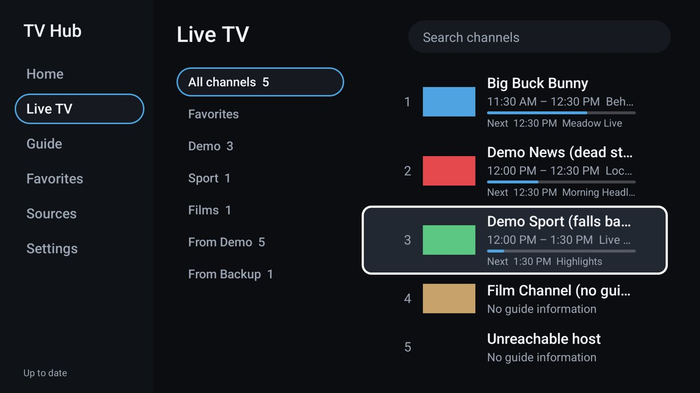
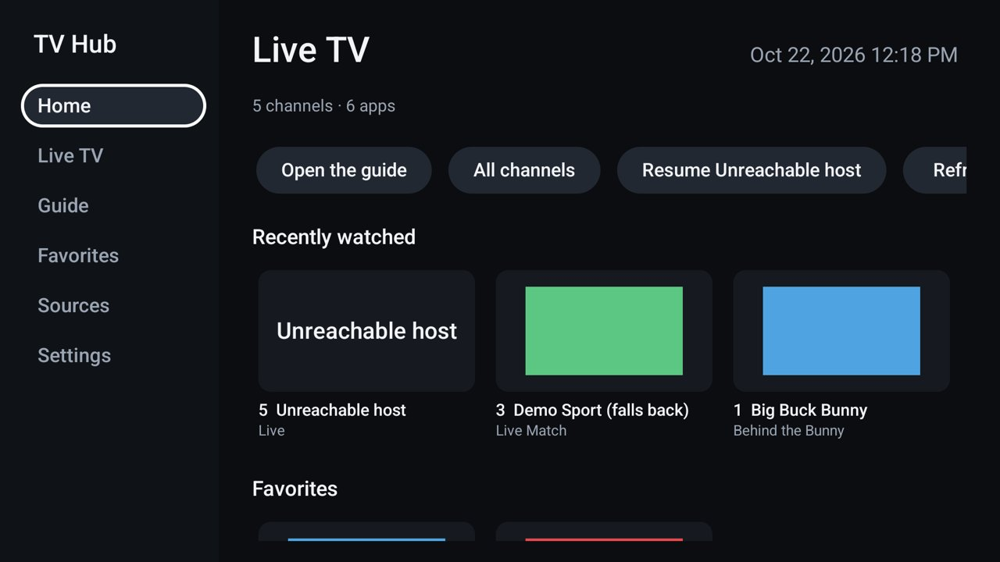
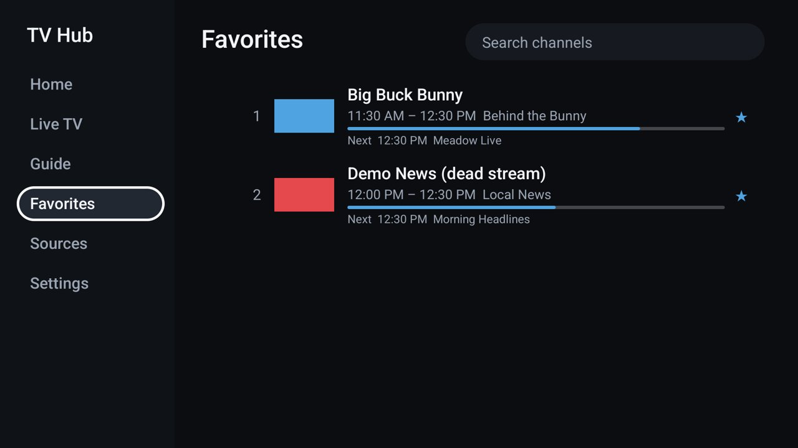
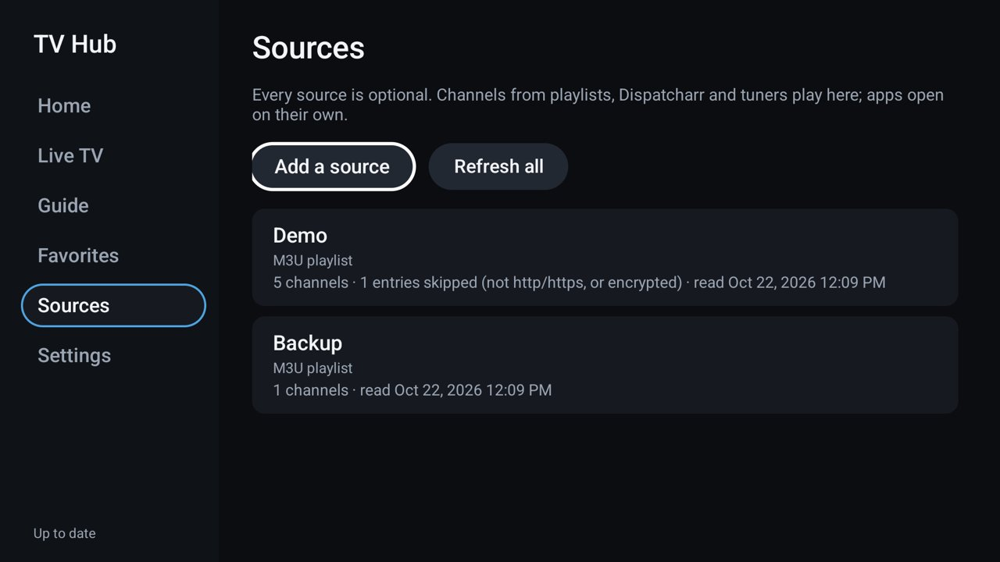
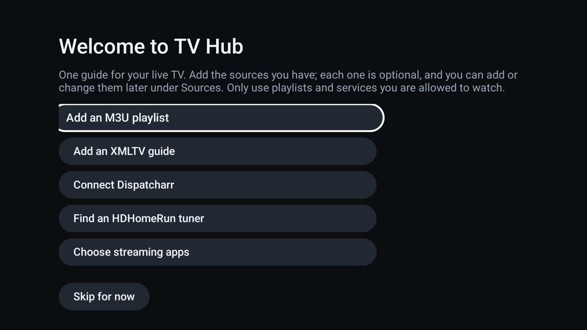

# TV Hub

One live-TV guide for Android TV, Google TV and Fire TV: your M3U playlists and XMLTV guides,
a [Dispatcharr](https://github.com/Dispatcharr/Dispatcharr) server, HDHomeRun antenna tuners, and
shortcuts to the live-TV apps you already have, in one remote-friendly interface.

A CleanYourTV add-on: a normal app you can install on any launcher, with a module card so on
CleanYourTV it can sit in the dock as **TV Hub · Live channels** once you approve it.

Free, MIT-licensed, no ads, no accounts, no tracking, no background services. It comes with no
channels: it plays the sources you add. Only use playlists and services you are allowed to watch.

## Screenshots

Taken on a MOKA R8G (Android TV 14) with the demo sources from `tools/make_fixtures.py`. The video
itself is missing from the player screenshots because the TV keeps it out of screen captures.

| | |
| :-: | :-: |
|  |  |
| Guide | Live TV |
|  |  |
| Home | Favorites |
|  |  |
| Sources | First launch |

## What works

| | Status |
| :- | :- |
| M3U / M3U8 playlists over http and https | Works: `tvg-id`, `tvg-name`, `tvg-logo`, `tvg-chno`, `group-title`, `#EXTGRP`, `#EXTVLCOPT` user agent and referrer, header `x-tvg-url` / `url-tvg` |
| XMLTV guides (.xml and .xml.gz) | Works: streamed, never loaded whole; matched by `tvg-id`, or by display name for channels without one |
| Dispatcharr | Works through its documented `/output/m3u[/profile]` and `/output/epg[/profile]` |
| HDHomeRun network tuners | Works: UDP discovery or a typed address, channel list from the tuner's own `lineup.json`. No guide (see below) |
| Installed live-TV apps | Shortcuts that open the app (Pluto TV, Tubi, Plex, Kodi, Channels, HDHomeRun, YouTube TV, Sling, Philo, Haystack, Live Channels, TiviMate, or any TV app you pick) |
| Guide | Programme grid, now and next, categories, favourites, recently watched, search, programme details |
| Player | Media3: HLS and progressive streams (MPEG-TS, MP4 and the other containers Media3 reads), channel up/down, previous channel, number entry, audio and subtitle tracks, recovery and fallback |
| Merging | Channels with the same `tvg-id` in several sources show once; the player falls back between their streams. Can be turned off |
| CleanYourTV module card | Declared per spec 1 (`res/xml/module_card.xml`) |

### Not done, on purpose or not yet

- **No channels from streaming apps.** Pluto TV, Tubi, Plex and the rest publish no channel list or
  guide to other apps, so TV Hub only opens them. It never shows them as channels.
- **No HDHomeRun guide.** SiliconDust's guide comes from its cloud service with a device token;
  TV Hub stays on your network. Add an XMLTV guide for listings (Dispatcharr can make one).
- **No USB tuners.** That needs a vendor TV input or driver; not attempted.
- **No Xtream Codes login.** Not implemented. Many services also give an M3U address; Dispatcharr can
  take an Xtream account and serve it as M3U.
- **No DASH, RTSP, RTMP or UDP multicast.** Those entries are skipped and counted on the Sources screen.
- **No DRM.** Encrypted channels fail with a message saying so.
- **No recording, catch-up or background guide refresh.** The guide refreshes when the app opens
  (if older than 12 hours by default) or when you press Refresh.
- **English only** so far; strings are in code, not yet in resources.
- **No configuration backup or import** yet.

## Install

Build it (below) and install it from the repo root as with every add-on:

```bash
cd addons/tv-hub && ./gradlew assembleDebug && cd ../..
TV_HOST=<tv ip> tools/venv/bin/python -I tools/tv.py --push addons/tv-hub/app/build/outputs/apk/debug/app-debug.apk /data/local/tmp/addon.apk
TV_HOST=<tv ip> tools/venv/bin/python -I tools/tv.py 'pm install -r /data/local/tmp/addon.apk; rm -f /data/local/tmp/addon.apk'
```

or `adb install -r app/build/outputs/apk/debug/app-debug.apk`. It opens from the TV's app list as
**TV Hub**; on Fire TV it is under Apps > Your Apps.

The debug APK is signed with a throwaway key that changes between machines. For anything you keep,
build a release with your own key (below): the launcher pins its approval of the card to the signing
key, and a different key makes it ask again.

## Set up

On first launch TV Hub offers each source; every one is optional, and **Skip for now** goes straight to
the hub. Later, go to **Sources > Add a source**.

- **M3U playlist**: the playlist's address. If the playlist names a guide in its header, that guide is
  read too (switch off per source). You can give a separate XMLTV address.
- **XMLTV guide**: a guide for channels from any source.
- **Dispatcharr**: the address you open Dispatcharr at, e.g. `http://192.168.1.10:9191`, and optionally
  an output profile name. Dispatcharr only serves its M3U/EPG to networks you allow in its settings;
  "refused access (HTTP 403)" means the TV's network is not on that list yet.
- **HDHomeRun**: **Scan the network**, or type the tuner's address. Broadcast TV is often MPEG-2 video,
  which many Android TV chips cannot decode (Chromecast with Google TV among them); on an HDHomeRun
  EXTEND, tick **Ask the tuner for H.264**.
- **Streaming apps**: tick the installed apps to show as shortcuts on Home.

**Check** reads a source once without saving, so a wrong address shows up straight away.

## Remote control

| Where | Key | Does |
| :- | :- | :- |
| Everywhere | Back | Back to the left menu; from the menu, leaves the app |
| Lists and guide | OK | Play the channel (a future programme opens its details) |
| Lists and guide | Hold OK | Add to or remove from Favorites |
| Guide | Left / Right | Previous or next programme; Left from the first one goes to the menu |
| Guide | Info or Menu | Programme details |
| Guide | Channel + / - | A page up or down |
| Player | Up / Down, Channel + / - | Next or previous channel in the list you started from |
| Player | Left or Last | Previous channel |
| Player | Digits | Tune by channel number |
| Player | OK | Show what is on; after an error, try again |
| Player | Menu, Captions, or hold OK | Audio and subtitle tracks |
| Player | Back | Back to the guide; playback stops and the player is released |

## Module card

`AndroidManifest.xml` puts the `com.gathin.tvhome.category.DOCK_CARD` filter and the
`com.gathin.tvhome.card` meta-data on `MainActivity`, the same exported activity as
`LEANBACK_LAUNCHER`, as [the spec](https://github.com/Gathin23/cleanyourtv/blob/main/docs/specs/card.md) requires:

```xml
<card spec="1" label="TV Hub" caption="Live channels" accent="#4FA3E0" />
```

The launcher finds it the next time Home comes to the front and asks once. Nothing is shown until
you choose **Show card**, and you can change your answer by holding OK on its Settings pill. TV Hub
changes nothing under `launcher/`. On other launchers the card is ignored and TV Hub is an ordinary app.

## Permissions

- `INTERNET` is the only permission: playlists, guides, logos and streams, and only to the sources you add.
- "Scan the network" sends a UDP broadcast on port 65001 to the local network, only when you press it.
- `usesCleartextTraffic` is on because home servers (Dispatcharr, HDHomeRun, a NAS) and many playlists use plain http.
- Package visibility: the known live-TV apps are listed in `<queries>`, and "Show every TV app" uses a
  `LEANBACK_LAUNCHER` intent query. No `QUERY_ALL_PACKAGES`.
- Source settings (addresses, which often hold a user name and password) are encrypted with an AES key
  kept in the Android Keystore. On a TV whose Keystore is broken they fall back to the app's private
  storage, unencrypted; the app logs one line saying so.
- Backups are off, so none of this leaves the TV. Logs never include an address beyond its host.
- No analytics, no crash reporting, no network calls except to the sources you add and the logos they name.
- Nothing runs in the background: no services, no jobs, no alarms. Playback stops when you leave the player.

## Tested on

MOKA R8G (Android 14, 1080p, 2 GB RAM): sources, guide, playback, fallback, favourites and app
shortcuts; results and what is still untested in [docs/TESTING.md](docs/TESTING.md). The card itself
was checked in the built APK but not yet on a TV running this launcher.

## Build

JDK 17 and the Android SDK (platform 34), as for the launcher:

```bash
./gradlew testDebugUnitTest lintDebug assembleDebug
# app/build/outputs/apk/debug/app-debug.apk
```

A release signed with your own key (keep the keystore out of the repo):

```bash
keytool -genkeypair -v -keystore ~/tvhub-release.jks -alias tvhub -keyalg RSA -keysize 4096 -validity 10000
TVHUB_KEYSTORE=~/tvhub-release.jks TVHUB_KEYSTORE_PASSWORD=... TVHUB_KEY_ALIAS=tvhub TVHUB_KEY_PASSWORD=... ./gradlew assembleRelease
apksigner verify --print-certs app/build/outputs/apk/release/app-release.apk | grep SHA-256
```

Publish that SHA-256 with every release, as CleanYourTV's module guide asks.

## How it is built

Kotlin, minimum Android 8.0 (API 26), target 34. Plain Android views and framework SQLite: no
Compose, Room, WorkManager or image library, to stay small on 1 GB TVs (release APK about 1.2 MB).

```
model/      Channel, Programme, SourceConfig
parse/      M3uParser, XmltvParser, XmltvTime, ChannelMerger  (pure Kotlin, unit-tested)
source/     Providers (M3U, XMLTV, Dispatcharr), HdHomeRun, Apps
data/       Repository (refresh, state), Db (SQLite), SecureStore (Keystore), Http, Prefs
ui/         MainActivity and its pages, GuideView (canvas grid), SourceEditorActivity, OnboardingActivity
player/     PlayerActivity (Media3)
```

Testing on a TV, with demo fixtures: [docs/TESTING.md](docs/TESTING.md).
Third-party licences: [THIRD_PARTY_NOTICES.md](THIRD_PARTY_NOTICES.md).
Maintained by [@maxhayim](https://github.com/maxhayim); issues about TV Hub go to them.
