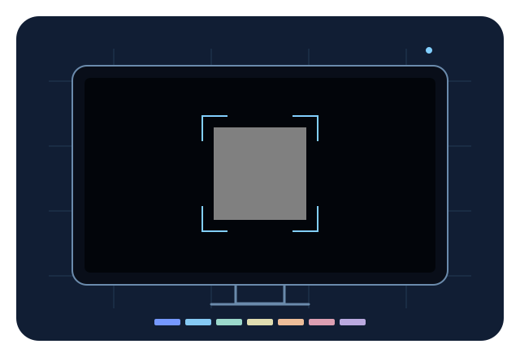

# TV Tune

An optional picture-setup app for Android TV/Google TV, plus a separate phone-camera
compatibility experiment. It uses the existing module-card contract and never changes
the launcher, system settings, picture controls or debloat procedure.

**Status: development preview.** Local builds and automated checks are available.
Physical-TV validation, a real-TV screenshot and physical-phone capture are pending.
This is not a calibrated colour meter or universal automatic calibration tool.

**[Open the public web companion](https://tv-tune-kalt2212.vercel.app/)** — a contributor-hosted
development preview over HTTPS, with Spanish and English interfaces. No account is needed.
The Android add-on remains source-built; the web preview is not an official project release.



The design was discussed in [Discussion #1140](https://github.com/Gathin23/cleanyourtv/discussions/1140).
The maintainer welcomed an independent add-on. See [VALIDATION.md](VALIDATION.md) for
what was actually tested and what remains open, and [DESIGN.md](DESIGN.md) for the UI.

## On the television

- A welcome screen, original icon/banner and English/Spanish interface.
- Five visual checks: edges/aspect, shadow detail, highlights, sharpness and neutral
  appearance. Each has instructions, a full-screen original pattern and explicit
  Seen / Adjusted by you / Skipped outcomes.
- A local checklist and optional original/revised setting notes. The app never reads
  or changes your TV's picture settings. Restore your noted original values in the
  TV's ordinary menu to undo adjustments; deleting a checklist cannot undo them.
- A separate experiment screen with eleven fixed patch IDs, matching the companion.
  Left/Right selects a patch, OK hides/shows labels and Back returns to instructions.
- Static patterns pause after two minutes of inactivity. OK resumes without changing
  the selected patch. Leaving the app clears its screen-on flag and stops the timer.

These are 8-bit sRGB/full-range **app-code** patterns. Black is 0 and white is 255;
they are not video-level PLUGE patterns with black at 16 and white at 235. The app
reports its render size, which need not match the panel's physical pixel grid.
Select and verify an SDR path before tonal checks. Android/OEM processing is not
instrument-verified. Other inputs, picture presets, games and HDR need separate tests.

## The companion is optional

The installed Android app completes all five visual checks, records outcomes and
keeps the local checklist/notes without a phone, account, browser or internet
connection. Its separate phone-experiment entry is optional; using it is not a
prerequisite for the TV-side guide. The app does not contact the companion or
check whether it is available. The public web preview can be unavailable without
preventing the installed TV guide from working. Building/downloading the source
and optional browser companion is separate from offline use of the Android app.

## Permissions

**Android app: none.** No `INTERNET`, camera, microphone, accessibility, overlay,
storage, notification or settings-write permission. No service, boot receiver,
telemetry, analytics, advertising or background network access. Checklist data is
in app-private preferences; cloud backup and device transfer are excluded. Delete
local checklist removes the app's saved observations and notes only.

**Web companion:** asks the browser for camera permission only after Start camera.
It explicitly requests no audio and releases tracks on Stop, background or exit.
Camera images stay in browser memory. The application has no data-collection backend,
image upload, pairing server, analytics code or persistent storage of frames. Its
content policy blocks script-initiated connections (`connect-src 'none'`). This does
not prevent the initial document and static assets from being requested over HTTPS.

The optional JSON download requires reviewing the report first. It allowlists camera
control modes, render dimensions/frame rate, patch ID and numerical capture statistics.
It excludes raw images, device/group IDs, camera labels, user agent, URLs and addresses.
Inspect the preview before sharing even this limited information.

### What is sent, and where

- **Opening the public companion:** the browser requests the HTML, CSS, JavaScript
  modules and artwork from `https://tv-tune-kalt2212.vercel.app/`, hosted by Vercel.
  Vercel receives ordinary request metadata such as the connecting IP address,
  requested URL (including the language/view query), and browser-supplied HTTP
  headers. Hosting may process access/security logs. “No image uploads” does not
  mean “no data is sent.” No retention period or zero-host-logging claim is made;
  see [Vercel's privacy notice](https://vercel.com/legal/privacy-notice).
- **Starting the camera and capturing:** permission is requested locally through
  the browser, with audio disabled. Video frames and derived capture statistics
  are processed in that browser. TV Tune does not send frames, patch selections,
  camera capabilities or capture statistics to Vercel, GitHub or a pairing server.
  It does not connect the phone to the TV; matching the patch is manual.
- **Reviewing/downloading a report:** the JSON is created locally as a browser Blob
  and downloaded only after Review and Download. Downloading is not an upload or
  automatic share. The browser chooses its download destination, which may be
  cloud-synchronised under the owner’s device settings. Any later sharing of that
  file is a separate action by its owner.
- **Following Source code or Read the proposal:** these optional links open GitHub,
  which receives the normal navigation request. They use `noopener noreferrer`;
  the companion does not attach captured data to the link.
- **Self-hosting:** the chosen hosting origin receives page/asset requests instead
  of the public Vercel origin. The same distinction between local capture processing
  and ordinary hosting traffic applies. No third-party fonts or analytics are
  included in the shipped page.

## Build from source

Requirements: JDK 17, Android SDK platform 34 and build-tools 34.0.0, as for the
repository's launcher. Set `JAVA_HOME` and `ANDROID_HOME` for your local installation.
From this directory:

```sh
sh gradlew --no-daemon testReleaseUnitTest lintRelease assembleRelease
```

The source uses the repository's pinned wrapper and the same Android Gradle plugin
as the small reference add-ons. Output is `app/build/outputs/apk/release/app-release.apk`.
Like the reference add-ons it is debug-signed for local testing, not a production
signing identity. No APK or keystore is committed. Build and install your own copy.

To install on a TV you own and have explicitly connected over ADB:

```sh
adb -s <tv-address> install -r app/build/outputs/apk/release/app-release.apk
adb -s <tv-address> shell am start -n io.github.kalt2212.tvtune/.TuneActivity
```

The module label is `TV Tune`, caption `Picture setup`. The launcher asks before showing
its card. The app remains an ordinary leanback app if its card is hidden.

## Try the phone/browser experiment

The [companion source](companion/index.html) is dependency-free static HTML, CSS and
JavaScript. Node 20+ is used only for its tests. From `companion/`:

```sh
npm test
npm run check
npm run test:coverage
python3 -m http.server 8765 --bind 127.0.0.1
```

On that computer, open `http://127.0.0.1:8765/` for the phone-style interface,
`?view=tv` for the manually controlled presenter, and `?lang=en` for English.
The default UI is Spanish. There are no npm dependencies or build step.

### Keep the same patch when moving between screens

The web presenter provides a phone link for the currently selected patch. Opening
its handoff panel pauses the pattern so the instructions cannot cover an active
uniform patch. Close it and resume the pattern before comparing/capturing. The phone
view can open that same patch on a display. Links preserve English/Spanish and use
an allowlisted patch ID in the URL fragment, for example `#patch=grey-128`.
The fragment is not part of the HTTP request sent to the hosting provider.

A link selects a patch; it does not pair devices, track later changes on the TV,
start the camera or confirm what the camera sees. Always compare the visible patch
ID/RGB on both screens and confirm manually before capture. A previously copied
link remains a snapshot of the patch selected when copied, not a live connection.
Unknown patch IDs fall back safely to the default patch.

Copy is an explicit action and never reads the clipboard. If clipboard writing is
unavailable, use the visible link instead. Clipboard synchronisation or sending the
link with another app follows the owner's device settings and choices.

With the local server running and the optional `agent-browser` CLI available, run
`bash addons/tv-tune/companion/test/browser-smoke.sh` from the repository root. It uses
a separate synthetic camera session and verifies sampling-frame alignment, capture,
JSON download, Stop, mobile overflow, accessibility and keyboard-operated TV controls.
It prints a temporary directory with
its evidence and never uses a physical camera. `bash -n` checks the script's syntax.

For an already built/installed app on a disposable **English-language emulator**,
`node addons/tv-tune/companion/test/android-ui-smoke.mjs emulator-<port>` checks the
welcome focus, preparation, all five checks, Back, summary and experiment fields
using D-pad events only. It resets only TV Tune's own data, refuses physical-device
serials and saves screenshots in a temporary directory. These remain emulator evidence.

To check cancellation/restart behaviour with a synthetic camera, run
`bash addons/tv-tune/companion/test/lifecycle-smoke.sh` from the repository root.
Both browser scripts accept a base URL as their first argument, including the public
preview URL. `node addons/tv-tune/companion/test/publication-check.mjs <https-url>`
checks access without authentication and compares every deployed asset with local source.

**A physical phone needs a trusted HTTPS origin.** Use the public preview above or your
own deployment. Its `localhost` is the
phone, not the computer. A computer's LAN HTTP address will not enable iPhone/Safari
camera capture. Deploy these static files to a trusted HTTPS host you control, or
use a separately approved development HTTPS setup. The source build does not install
certificates or weaken browser security. The public preview serves only static files:
the hosting provider receives ordinary page requests, while frames stay in the browser.

Select the same patch ID on the TV and phone, aim the rear camera so the uniform patch
covers the entire sampling frame, confirm the ID and start a capture. Confirmation is manual;
the TV and phone are not synchronised. Up to 45 distinct decoded video frames are
sampled over at most five seconds. No frozen preview is counted as new frames.

The output describes **processed camera video**: means, temporal standard deviations,
endpoint pixels and available controls. Fewer than 15 frames, more than 1% endpoint
pixels in any frame or variation above two 8-bit codes trigger heuristic warnings.
These are capture-quality heuristics, not accuracy thresholds. Endpoint warnings can
be expected for intentionally black/white fields. A stable image can still be wrong.

## Measurement research

[MEASUREMENT_PLAN.md](MEASUREMENT_PLAN.md) defines the proposed camera-control,
reference-instrument, held-out accuracy and reversible-correction gates. It includes
predeclared engineering targets, not achieved results. Browser/DOM simulations and
emulator checks cannot satisfy those gates.

## Before a merge-ready contribution

The new-add-on rules require a **real-TV** `screenshot.jpg` (16:9 JPEG, at most 300 KB)
and a truthful tested-on entry in the add-on index. Neither is supplied by a mockup,
browser screenshot or emulator capture. The real-TV screenshot check will deliberately
remain unsatisfied until that evidence exists; do not add an invented screenshot or
relax the repository test.

See the physical checklist in [VALIDATION.md](VALIDATION.md). Phone colour accuracy
needs camera characterisation and comparison with an independent reference instrument,
including held-out patches. Universal automatic correction, native RAW capture,
HDR/Dolby Vision and OEM control adapters remain research work.

Released under the repository's MIT licence. Proposed contributor: [kalt2212](https://github.com/kalt2212).
