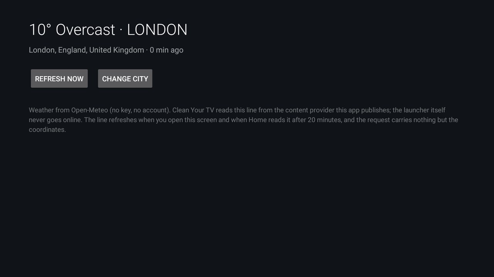

# Weather Glance

The weather for one city as a **single line under Clean Your TV's clock** — a glyph, the temperature and the
condition, say `☀ 14° Clear · Takizawa` — instead of a tile, a pop-up or a page you have to open. The line sits
with the time, where you already look.

The add-on fetches from Open-Meteo (no key, no account); the launcher only reads the line this app publishes
through its content provider, so Home itself still never goes online. The contract is
[`docs/modules.md`](../../docs/modules.md#the-weather-under-the-clock-header_weather), the same shape as the
Game Day add-on.

## Set it up

1. Install the APK (below) and open **Weather Glance** from the app grid.
2. Search for your city and pick it from the list — the screen shows the exact line Home will draw.
3. Tell the launcher to read it: put the package in the `header_weather` key, in `config.xml` or in a theme's
   `config.json`:

   ```json
   { "header_weather": "io.github.lostininaka.weatherglance" }
   ```

   Push the theme as usual (`tools/theme.sh <theme folder>`). Empty, uninstalled or a package that publishes
   nothing means no line at all — nothing to clean up.

The line refreshes when the app's own screen is open, and when Home starts or reads a line older than 20
minutes; the app answers from its cache and then notifies Home, so a slow network never holds up Home's first
frame.

## What it draws

- One line, about 30 characters before the date column gets crowded: `☀ 14° Clear · Takizawa`.
- Temperature in °C, rounded; the condition from Open-Meteo's WMO weather code.
- Text glyphs (`☀ ☁ ☂ ❄ ⚡`), not emoji: a TV's system font may have no colour emoji, and a tofu box under the
  clock is worse than no line.
- The city without its region and country, so the line stays short — the app's own screen shows the full name
  you picked.
- No line at all until a city is picked, when the network is down and nothing was ever fetched, or when Home's
  `header_weather` names something else.

## Permissions

| Permission | Why |
|---|---|
| `INTERNET` | Open-Meteo: the place search and the current conditions. Nothing else leaves the TV, and the request carries nothing but the coordinates of the city you picked. |

The content provider is exported without a permission because the launcher has none to offer; it answers with a
glyph, a line of weather and the time it was fetched, and refuses every write. It holds nothing private.

## Build and install

From the repository root, with JDK 17 and Android SDK 34 as for the launcher:

```bash
cd addons/weather-glance && ./gradlew assembleRelease && cd ../..
TV_HOST=<tv ip> tools/venv/bin/python -I tools/tv.py --push addons/weather-glance/app/build/outputs/apk/release/app-release.apk /data/local/tmp/addon.apk
TV_HOST=<tv ip> tools/venv/bin/python -I tools/tv.py 'pm install -r /data/local/tmp/addon.apk; rm -f /data/local/tmp/addon.apk'
```

Unit tests (the weather-code wording and the line's shape) run without a TV:

```bash
cd addons/weather-glance && ./gradlew testReleaseUnitTest
```

## Tested on

Sharp AQUOS 4T-C70CN1 (`AQUOS-TVJ19`), Android TV 10 (SDK 29), 1920×1080, with Clean Your TV as Home.

## Screenshot



Its card shows as **Weather Glance** once the launcher asks; the card is only the way into this screen.

## Maintainer

[@LostInInaka](https://github.com/LostInInaka).
