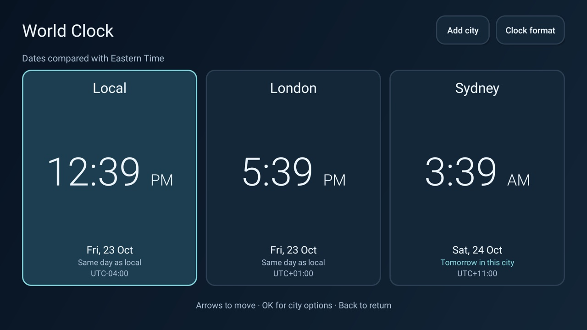

# World Clock

Optional offline CleanYourTV add-on. It opens from a normal Android TV tile or a
spec-1 module card. The first view contains **Local, London and Sydney**. It is an independent
Android app; no launcher source, configuration, signing identity or Home behavior changes.

Choose up to six clocks. Each shows the time, local date, UTC offset and calendar-day difference
from the TV's local date. Local follows the TV's configured time zone. Named zones use the platform's
rules, including daylight-saving transitions and fractional-hour offsets. Accuracy depends on the
TV's clock and installed time-zone data; this app does not download updates or determine location.

## Remote controls

- Arrows move between the clocks, Add city and Clock format. Horizontal movement is mirrored in RTL.
- OK on a clock opens Change city, Move earlier, Move later and Remove city where applicable.
- Add city opens a searchable list. Press OK in the text field to use the TV keyboard, Down to choose
  a result, or the keyboard's Done action to return to the list. Back cancels without editing clocks.
- Clock format offers the TV setting, 12-hour or 24-hour time.
- At least one clock remains. Back leaves the app. Clock updates change text without rebuilding focus.

City names come from the TV's IANA time-zone catalogue, rather than a complete geographical city
database. Search also accepts region/zone names. The legacy Katmandu spelling is displayed and
searchable as Kathmandu. There is no GPS or network lookup.



## Permissions

None. No network permission, telemetry, advertisements, subscription, account, native library,
overlay, accessibility service, background service, boot receiver or alarm. Local SharedPreferences
store only the selected zone IDs and clock format. Automatic backup/device transfer is disabled.
Refresh runs at minute boundaries only while this Activity is resumed, and reacts to system time
and time-zone changes. Leaving the screen stops callbacks; it does not keep the TV awake.

## Build

JDK 17, Gradle 8.9, Android SDK platform/build-tools 34; Android Gradle plugin 8.5.2.

```sh
./gradlew --no-daemon testReleaseUnitTest lintRelease assembleRelease
```

Use `--offline` when the build dependencies are already cached. The release build uses the standard
local Android debug signing configuration. Retain the same private signing
key for later in-place updates; no key or prebuilt APK belongs in a contribution.

The app targets Android 8.0/API 26 and later and has no native ABI restriction. JUnit is test-only;
there are no runtime dependencies. A module card has a static caption and opens this screen; it
cannot display live clocks inside the launcher's Home grid. No screensaver mode is included.

## Validation

Tested on a Samsung C71KW-200 / AT&T Osprey, Android TV 11, ARMv7, at 1920×1080.
The screenshot above is from the physical TV, resized to 1280×720. Navigation was exercised with
ADB-injected D-pad/OK/Back events through Android's actual focus dispatcher, not a physical handset.

Real-TV checks covered all 32 arrow transitions with six clocks, city entry using only D-pad/OK on
the TV keyboard, change/move/remove, empty-search cancellation, the six-clock limit, 24-hour format
and saved cities/format after a cold app restart. With module cards temporarily enabled, Keep hidden,
Shown, card launch and Hidden were exercised; the original launcher configuration was then restored.

The 28 JVM tests cover DST gaps/overlaps, different transition dates, local-zone changes,
date-line differences, fractional-hour offsets, formatting, settings/list edits, search and every
D-pad target/reachability for one to six clocks in LTR and RTL. Build and release lint pass with
zero errors or warnings. There are no runtime dependencies; the locally built release is about 22 KB.

The TV's installed time-zone database supplies the rules. There is no network time sync, screensaver,
working-hours overlay or live clock inside the launcher's grid. Other Android versions, right-to-left
locale rendering and different screen/font scales need broader device testing.
