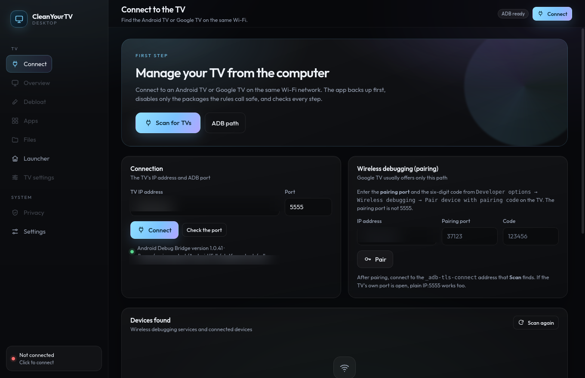
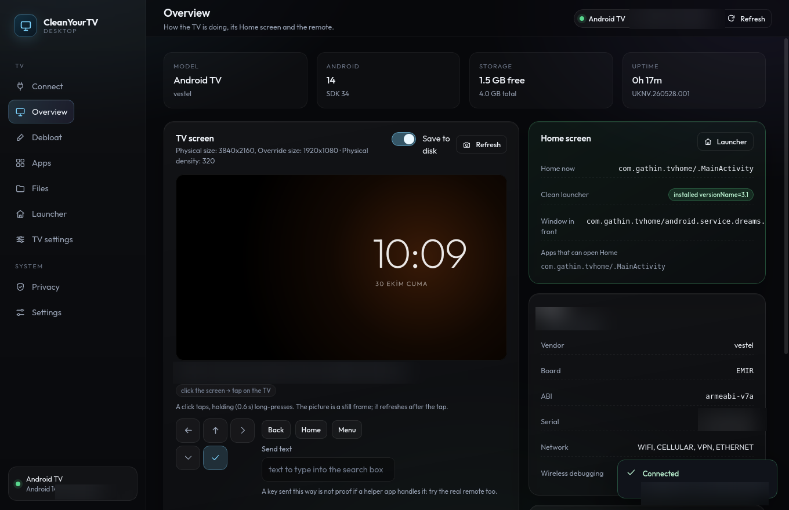
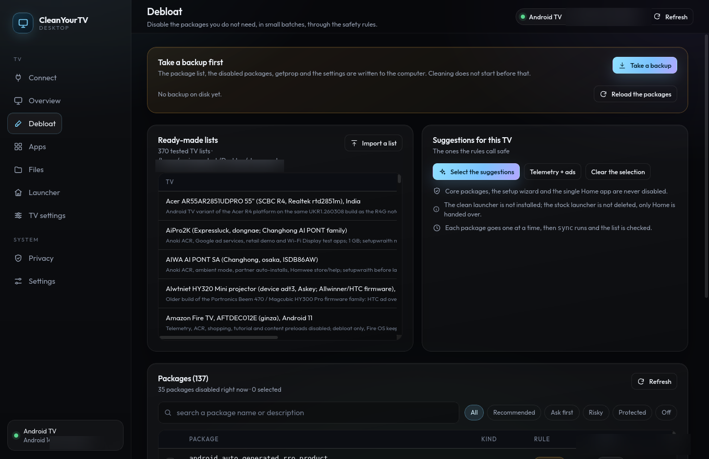
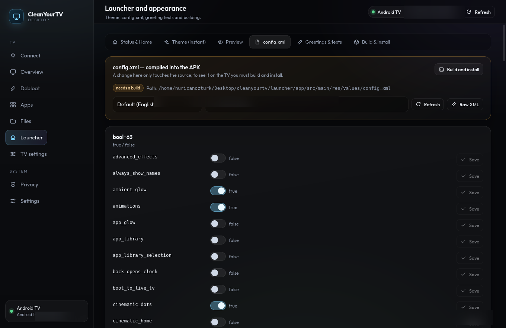

# CleanYourTV Desktop

A desktop app for the same job as [PROMPT.md](../PROMPT.md): connect to an Android TV or Google TV
over Wi-Fi ADB, take a backup, debloat it by the project's rules, browse its files, and dress its
launcher. Linux, Windows and macOS, on amd64 and arm64.

It is a Tauri 2 app: a Rust backend that talks to the `adb` binary, and a React + TypeScript front
end. It has no network access of its own, sends no telemetry, and never bundles a prebuilt APK.

> Status: usable, run from source. There are no release binaries in this repository (the project
> does not ship prebuilt binaries).

## Screenshots

Taken on an Android TV 14 set over wireless ADB. The address, serial number and local paths are
blurred.

| Connect | Overview |
|---|---|
|  |  |
| **Debloat** | **Launcher `config.xml`** |
|  |  |

## What it does

| Screen | What it does |
|---|---|
| **Connect** | Finds Wireless debugging services (`adb mdns services`), pairs with the six-digit code, connects to `IP:port`, checks the port, and remembers the last TV. |
| **Overview** | Model, Android version, build, storage, uptime, the current Home app; a live screenshot you can click to tap the TV, or hold to long-press; a D-pad, Back/Home/Menu and text injection; reboot with the write delay. |
| **Debloat** | The repo's `examples/*/debloat.txt` lists or an imported list; every package with its rule verdict; batch disable one `pm disable-user` at a time, then `sync` and a re-read that proves it. |
| **Apps** | Every package: launch, force-stop, enable/disable, `dumpsys package`, and pull the APK to this computer. APK install (with the Android 14 `pm install` fallback). |
| **Files** | Browse `/sdcard`, `/sdcard/Android/data`, `/data/local/tmp` and the rest; read and edit text files in place; pull, push (md5-verified), rename-free delete with a guard, `mkdir`, install an APK from the TV. |
| **Launcher** | Home handover, the instant `config.json` theme overlay with every documented key as a labelled menu, a preview of the result, `config.xml`, `strings.xml` (the greeting texts) and a build-and-install flow. |
| **TV settings** | The TV's own Android settings the app is allowed to write: Private DNS, clock and time zone, sleep and stay-awake, the three animation scales, font scale and touch sounds. |
| **Privacy** | Private DNS, closing Wireless and USB debugging, and a port check that proves 5555 is shut. |
| **Settings** | `adb` path, the CleanYourTV checkout, the backup folder, defaults, and restore from any backup. |

The Launcher screen, and its `config.xml`, `strings.xml` and build tabs, also work without a TV:
they read and write the checkout on this computer. Everything else needs one.

### The two launcher paths, side by side

| | `config.json` overlay | `config.xml` + `strings.xml` |
|---|---|---|
| Where it lives | `/sdcard/Android/data/com.gathin.tvhome/files/config.json`, written through the launcher's `ThemeProvider` | Inside the APK, compiled from `launcher/app/src/main/res/values*/` |
| Takes effect | Immediately, after Home restarts | After `./gradlew assembleRelease` and an install |
| Can change | Layout, dock, colours, wallpaper, clock, remote keys, `locale`, festival `greeting` | Everything compiled in, including `good_morning` / `good_afternoon` / `good_evening` / `good_night` |
| Remove it | "Katmanı kaldır" writes the overlay away | Rebuild from the original source |

So "Günaydın" → "Merhaba KRALIM" is a `strings.xml` edit plus a build; it cannot be done with the
overlay. The Strings screen says so, edits the four greetings for the chosen locale, and offers to
set all four at once.

## Safety rules, enforced in Rust

The rules are in `src-tauri/src/rules.rs` and the Home/Wi-Fi guards in
`src-tauri/src/commands/packages.rs`. The UI cannot bypass them:

- `pm disable-user --user 0 <one package>`, never `pm uninstall`; every change is undone by
  `pm enable`. Nothing is rooted or flashed.
- Core packages are refused, with no override: `android`, `android.ext.services`,
  `android.ext.shared`, `com.android.*` (except the calendar, contacts, user-dictionary and
  blocked-number providers), `com.google.android.permissioncontroller`,
  `com.google.android.packageinstaller`, `com.google.android.overlay.modules*`,
  `com.android.systemui`, `com.android.shell`, `com.android.phone`, `com.android.settings`,
  `com.android.tv.settings`, the TV middleware (`com.cltv.mal`, `com.mediatek.tis`, …), and the
  clean launcher itself.
- The last app that can answer Home is refused. The stock launcher needs an explicit confirmation
  and only after the new launcher is installed and Home resolves to it. Fallback Home screens,
  factory test apps and the setup wizard do not count as "another launcher", and a launcher that
  goes in the same batch is not a way back either.
- The app that opens Settings, or the one that opens the HDMI/AV inputs on this TV, is marked "ask
  first": disabled, Settings does not open and the input tiles go black (#321, #974). They are found
  by asking the TV, not by their names.
- `com.google.android.setupwraith` needs its own confirmation, and is still refused when
  `dumpsys wifi` says it owns the saved network (it would take the TV off Wi-Fi and ADB). When the
  TV cannot say who owns the network, it stays enabled.
- A CVTE stock launcher (`com.cvte.tv.launcher.*`) is refused outright, with the #741 note: set
  Home, reboot, confirm Home and ADB come back.
- Factory and burn-in test apps are never started.
- A backup (package list, disabled list, `getprop`, settings, `dumpsys wifi`, restore scripts) must
  exist in this session before a batch will run.
- Streaming apps, the voice assistant, Chromecast, Miracast and firmware updaters are "ask first":
  they are only disabled when ticked one by one in the confirmation dialog.
- ADB is closed at the end: network and USB debugging off, then the port is probed from this
  computer. Only the probe's "closed" counts.

## Requirements

To *use* it, an Android TV or Google TV on the same network and **Android platform-tools**
(`adb`). The app looks on `PATH`, in `ANDROID_HOME`/`ANDROID_SDK_ROOT`, in the usual SDK folders, and
can be pointed at a specific binary in Settings.

To *build* it, Node.js 20+, Rust stable and the Tauri system libraries for your OS: the exact
packages and commands are in [Build and run](#build-and-run) below.

For the *build and install* half of the Launcher screen only: **JDK 17** and **Android SDK platform
34** (the same as [CONTRIBUTING.md](../CONTRIBUTING.md)). Debloating, files, screenshots and the
theme overlay work without them. The app looks for a 17 to 21 JDK by itself (`JAVA_HOME`, Gradle's
own `~/.gradle/jdks`, the distro's `/usr/lib/jvm`, Android Studio's `jbr`); on a newer JDK it still
builds the APK and skips Gradle's `lintVital`, which the repo's CI runs instead.

## Build and run

Everything below runs from `desktop/`. The first three steps are one-time; after that it is
`npm run tauri dev` to work on it, `npm run tauri build` to make an installer.

### 1. Toolchain

| Tool | Version | Why |
|---|---|---|
| Node.js | 20 or newer | Vite and the Tauri CLI |
| Rust | stable, 1.77 or newer (`rustup`) | the backend, `adb` handling and the safety rules |
| Tauri system libraries | see below | the window itself (WebKitGTK, WebView2, WKWebView) |

Debian, Ubuntu, Mint and Pop!_OS:

```sh
sudo apt install libwebkit2gtk-4.1-dev build-essential curl wget file \
  libxdo-dev libssl-dev libayatana-appindicator3-dev librsvg2-dev
```

Fedora, RHEL 9+, openSUSE:

```sh
sudo dnf install webkit2gtk4.1-devel openssl-devel libappindicator-gtk3-devel \
  librsvg2-devel libxdo-devel gcc-c++ make
```

Arch and Manjaro:

```sh
sudo pacman -S --needed base-devel webkit2gtk-4.1 libappindicator-gtk3 librsvg libxdo openssl
```

macOS: `xcode-select --install`, then Rust from [rustup.rs](https://rustup.rs). The app builds for
Apple silicon and Intel.

Windows: the **Desktop development with C++** workload from Visual Studio Build Tools, the WebView2
runtime (already on Windows 11; on Windows 10 install the Evergreen runtime), and Rust from
[rustup.rs](https://rustup.rs) with the MSVC toolchain (`x86_64-pc-windows-msvc`).

For the TV side nothing else is needed, but the app talks to a real `adb`: install **Android
platform-tools** and put `adb` on `PATH`, or point Settings at the binary. Without it the app still
opens, and only the screens that need a TV stay locked.

### 2. Front-end dependencies

```sh
cd desktop
npm install
```

Once per checkout, and again whenever `package.json` changes.

### 3. Development run

```sh
npm run tauri dev
```

This starts Vite on `127.0.0.1:1420`, compiles the Rust side in debug, and opens the window. Saving a
file under `src/` reloads the front end; changing anything under `src-tauri/src/` rebuilds the
backend and reopens the window.

### 4. Checks before you ship a change

```sh
npm run check                          # TypeScript, no emit
npm run build                          # TypeScript + Vite into dist/
npm run check:i18n                     # every t() key has an English entry
cd src-tauri && cargo test             # the Rust side: safety rules, allowlists, adb parsing
```

If you also touched the repository's own tools, lists or launcher, run the project's suite from the
repository root as [CONTRIBUTING.md](../CONTRIBUTING.md) describes:
`tools/venv/bin/python -m unittest discover -s tests -v`.

### First run on a TV

This is [PROMPT.md](../PROMPT.md)'s order, in the app. Take a screenshot between the steps
(`tools/tv.py --screenshot shots/01.png`, or the Overview screen) so the TV is checked as it goes,
and leave the stock launcher enabled until the new one has taken Home.

1. **Connect.** On the TV, turn on Wireless debugging and pair it here with the six-digit code.
   Check the port first: a closed port means debugging is off, not that the app is broken.
2. **Overview.** Model, Android version and a screenshot. Clicking the picture taps that spot on the
   TV (holding it long-presses), which is faster than walking the D-pad; both are the same `input
   tap`/`input keyevent` a remote sends. A black
   screenshot of Live TV is the TV's protection, not a fault.
3. **Debloat.** Take the backup (the batch will not run without one), start with `examples/`'s list
   for the same model, or with two or three telemetry packages, and read the skipped reasons.
4. **Launcher → Tema.** This is the no-build path: pick a starting point, or a group ("Düzen",
   "Görünüm", …), pick the dock apps from the TV's own package list, then "Önizleme" shows the mock
   Home before anything is written. Applying writes `config.json` and restarts Home; "Katmanı kaldır"
   puts it back.
5. **Launcher → Selamlama / config.xml.** Edit `good_morning` and friends, then build and install.
   Home is set after the install, and the stock launcher stays enabled until Home resolves to
   `com.gathin.tvhome`.
6. **Reboot once** and confirm Home and ADB come back before disabling the stock launcher, on a
   CVTE board especially (#741).
7. **TV settings.** Private DNS, the clock, sleep and the animation scales, each written and read
   back. These are the TV's own Android settings, not the launcher's.
8. **Privacy.** Turn wireless and USB debugging off, probe the port, reboot, and probe it again.
   Only the probe saying "closed" counts.

## Release builds: `.deb`, `.rpm`, AppImage, MSI, DMG

A release build runs `npm run build` first (TypeScript check plus Vite), compiles Rust with
`--release`, and then packages whatever this operating system can package.

```sh
cd desktop
npm run tauri build
```

On Linux that produces all three formats. To build one, name it:

```sh
npm run tauri build -- --bundles deb          # Debian, Ubuntu, Mint, Pop!_OS
npm run tauri build -- --bundles rpm          # Fedora, RHEL, openSUSE
npm run tauri build -- --bundles appimage     # portable, no install, any distro
npm run tauri build -- --bundles deb,rpm      # two of them in one pass
```

Every artefact lands under `src-tauri/target/release/bundle/`:

| File | Folder | Install |
|---|---|---|
| `CleanYourTV_0.1.0_amd64.deb` | `bundle/deb/` | `sudo apt install ./CleanYourTV_0.1.0_amd64.deb` |
| `CleanYourTV-0.1.0-1.x86_64.rpm` | `bundle/rpm/` | `sudo dnf install ./CleanYourTV-0.1.0-1.x86_64.rpm` |
| `CleanYourTV_0.1.0_amd64.AppImage` | `bundle/appimage/` | `chmod +x` it, then run it; nothing is installed |
| `CleanYourTV_0.1.0_x64_en-US.msi` | `bundle/msi/` | double-click, or `msiexec /i` |
| `CleanYourTV_0.1.0_x64-setup.exe` | `bundle/nsis/` | double-click; per-user install, no admin needed |
| `CleanYourTV_0.1.0_aarch64.dmg` | `bundle/dmg/` | open it, drag the app to Applications |
| `CleanYourTV.app` | `bundle/macos/` | the app bundle itself, for `open` or a copy |

Measured on Linux amd64: the `.deb` and the `.rpm` are 2.4 MB each, and the AppImage is 80 MB
because it carries its own WebKitGTK instead of using the system's. The app itself is small: it
bundles neither `adb` nor an APK, and keeps no network client at all. That is deliberate — see
[Hard rules](../AGENTS.md) — and the same reason the launcher itself stays under 576 KB. Prefer the
`.deb` or the `.rpm` where you can; reach for the AppImage only on a distro those two do not cover.

Windows and macOS, from their own machines:

```sh
npm run tauri build -- --bundles msi,nsis             # Windows: MSI and an .exe installer
npm run tauri build -- --bundles dmg,app              # macOS: disk image and the .app
```

### arm64

```sh
npm run tauri build -- --target aarch64-unknown-linux-gnu
npm run tauri build -- --target aarch64-pc-windows-msvc     # Windows on ARM
npm run tauri build -- --target universal-apple-darwin      # macOS: Intel + Apple silicon in one .app
```

A cross-arch Linux build needs an aarch64 cross linker and the aarch64 WebKitGTK development
packages; building on the target machine (or in an arm64 container) is the shorter path. Raspberry
Pi-class TVs are not a target — the app runs on the computer, not the TV.

### If a build fails

| What you see | What it means |
|---|---|
| `Could not connect to 127.0.0.1` when you run the binary on its own | A plain `cargo build` binary expects the dev server. Use `npm run tauri build`, or launch the packaged app. |
| `webkit2gtk-4.1` not found | Install the development package from step 1; a runtime-only install is not enough. |
| `error: linker 'cc' not found` | `build-essential` (Debian) or `gcc-c++` (Fedora) is missing. |
| The window opens blank | `npm run build` failed before the Rust step; run it alone to see the TypeScript error. |
| Bundle step fails, binary is fine | Build just the formats this machine supports, or pass `--no-bundle` to keep the binary in `src-tauri/target/release/`. |

### Cleaning up

```sh
rm -rf dist node_modules && npm install     # front end from scratch
cd src-tauri && cargo clean                 # Rust from scratch, the slow one
```

### Version, icons, identity

- The version lives in three places and they must agree: `package.json`, `src-tauri/tauri.conf.json`,
  `src-tauri/Cargo.toml`.
- Icons: `npx tauri icon src-tauri/icons/source.png` regenerates every size from the source image.
- `identifier` is `tv.cleanyourtv.desktop`; it names the settings folder and the installed package,
  so changing it moves people's settings.

## Where things are kept

| What | Where |
|---|---|
| Settings | the OS config folder for `tv.cleanyourtv.desktop` (`settings.json`) |
| Backups | `~/CleanYourTV/backups/<host>-<timestamp>/` unless a folder is set in Settings |
| Screenshots | `~/CleanYourTV/shots/` |
| Source-file backups from the XML editors | `<config folder>/repo-edits/` |

Nothing is uploaded anywhere. The only sockets the app opens are to the TV: the `adb` process, and
the TCP probe used to prove a debugging port is closed.

## Notes and limits

- Android 14 can leave `adb install` waiting behind an on-screen confirmation. Both install paths
  fall back to pushing the APK to `/data/local/tmp` and running `pm install` over the shell.
- Live TV, HDMI and some DRM apps return a black screenshot. That is the TV's protection, not a
  fault.
- A key injected with `input keyevent` is not proof for a button that passes through an
  accessibility helper: press the real remote as well (`am force-stop com.gathin.tvhome` turns
  those helpers off).
- Not an Android TV (Tizen, webOS, Roku OS, VIDAA, SmartCast) or no ADB port at all? Nothing here
  applies; see <https://cleanyour.tv/not-android>.
- Port 5555 is plaintext. Close ADB from the Privacy screen when you are done.

## Licence

MIT, like the rest of the repository. The bundled Outfit font is under the SIL Open Font License;
its text is in `src/assets/FONT-LICENSE-OFL.txt`.
