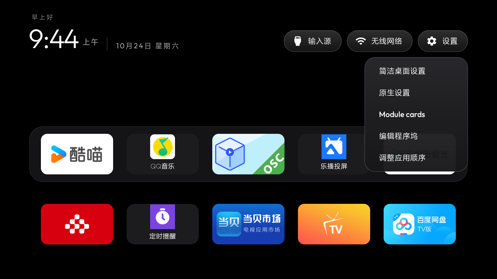

# Xiaomi MiTV-MTEQ0: package-name Home allowlist and the vendor settings app

Tested on MiTV-MTEQ0 (`baymax`, Android 10 / API 29), HyperOS build `22.6.27.2363`.
Stock Home is `com.mitv.tvhome/.MainActivityUserMode`. This is a launcher-only record;
no debloat list was applied.

## The Home allowlist

`MitvConfigParser` prints the cloud-controlled `mitv_security_center.xml` whitelist to logcat
at boot (`adb shell logcat -d -s MitvConfigParser | grep "\[White\]"`; reboot first if the
ring buffer has already wrapped). Only package names on that list may become Home. On this
firmware `com.ts.launcher=511` is on it, `com.gathin.tvhome` is not, and
`com.dangbei.tvlauncher=1280` is on the `[Black]` list - which is why a stock launcher APK
installs fine but `set-home-activity` reports Success while HOME still resolves to Xiaomi.

Build with the opt-in identity, exactly as on [xiaomi-mitv-aetp0-dofus](../xiaomi-mitv-aetp0-dofus.md):

```bash
(cd launcher && ./gradlew assembleRelease -PlauncherApplicationId=com.ts.launcher)
```

The Home component is then `com.ts.launcher/com.gathin.tvhome.MainActivity`; the Java
namespace stays `com.gathin.tvhome`. Check `pm path com.ts.launcher` first: if another
application owns that name, stop rather than overwrite it.

## The settings button and the vendor settings app

This firmware ships the AOSP TV settings (`com.android.tv.settings`) next to Xiaomi's own
(`com.xiaomi.mitv.settings`). The standard `android.settings.SETTINGS` action resolves to the
AOSP one, which has no Account & Security page - where the ADB switch lives - while the
launcher's Settings button would open it. Xiaomi's own entry,
`com.xiaomi.mitv.settings/.entry.MainActivity`, opens the native settings main page.

The Settings long-press menu offers it as **Native settings** - the row is there while one of the
`settings_fallback_components` entries is installed - so the vendor app is one press away regardless of
what the standard action resolves to. Its Account & Security page is also reachable directly:
`com.xiaomi.mitv.settings/.entry.SecurityActivity`.

## Notes from this set

- ADB stays enabled across standby; the port needs about 8 seconds to come back after a wake.
- The voice remote's "open settings" opens Xiaomi's own settings app, not the AOSP one.



