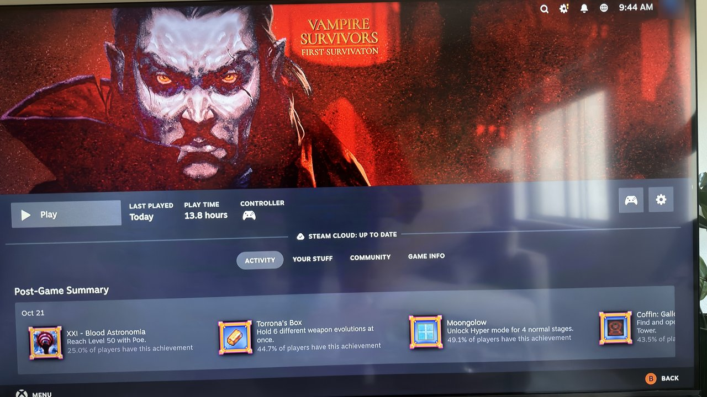
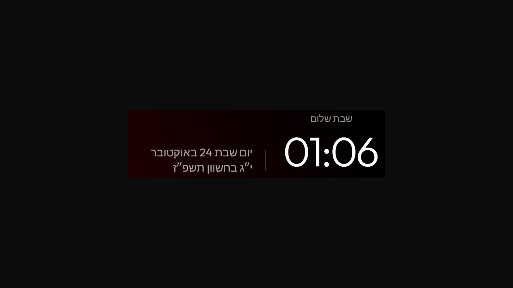
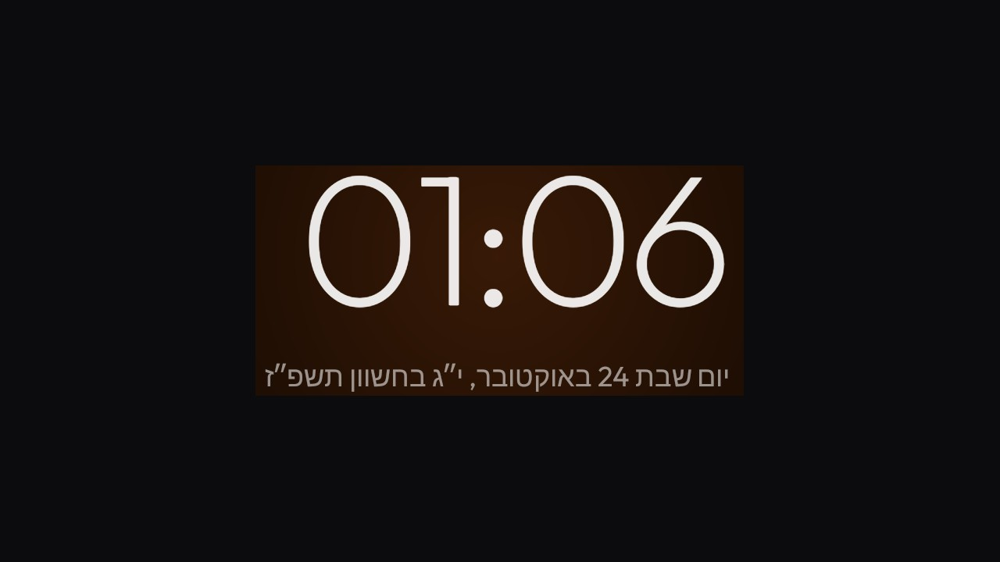
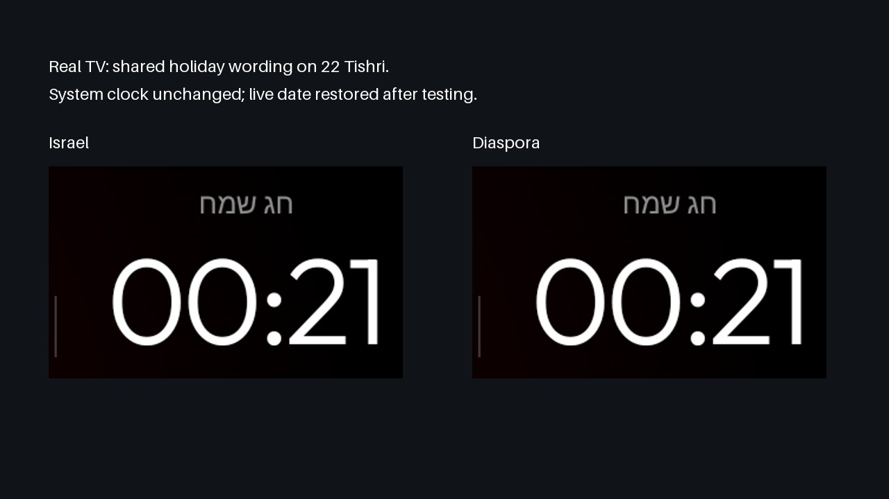

# Switches on a TV

Every key a theme can set (the Keys table in [`themes/README.md`](../themes/README.md)) gets a
screenshot of what it does on a real TV. This table is where they are listed: the repo and
[cleanyour.tv/addons#switches](https://cleanyour.tv/addons#switches) both show them from here.

## Adding a key

A new key needs a screenshot. Put it in `docs/switches/<key>.jpg` (an existing screenshot in the
repo that shows the key at work also counts) and add a row below:

- From a real TV, with the key set, as a JPEG or PNG, 16:9 (1280×720 is plenty), under 300 KB.
- Show where the key changes something you can see. For a key that maps a remote button, show the
  screen the button opens; for one that changes behaviour only, show the setting's effect, such as
  the panel, the menu or the app that comes up.
- Blur anything personal: Wi-Fi names, people, addresses.

`tests/test_switches.py` checks that every key has a row here with an image that exists and fits
the rules. Keys from before this rule are on its wanted list; a screenshot for one of them is welcome.

## Screenshots

| Key | Screenshot |
|---|---|
| `columns` |  |
| `sky_intensity` |  |
| `wallpaper_rotation_minutes` |  |
| `festival` |  |
| `settings_key_panel` |  |
| `home_idle_clock_minutes` |  |
| `gamepad_passthrough` |  |
| `hebrew_date` |   |
| `jewish_holiday_greetings` |  |
| `jewish_holiday_region` |  |

The holiday comparison uses a private test build with its calendar date fixed to 22 Tishri for visual
validation only; the TV's system clock was not changed. Production code always uses the live date.
Only explicitly approved date/greeting/clock crops are shown; the rest of the screen is excluded.
