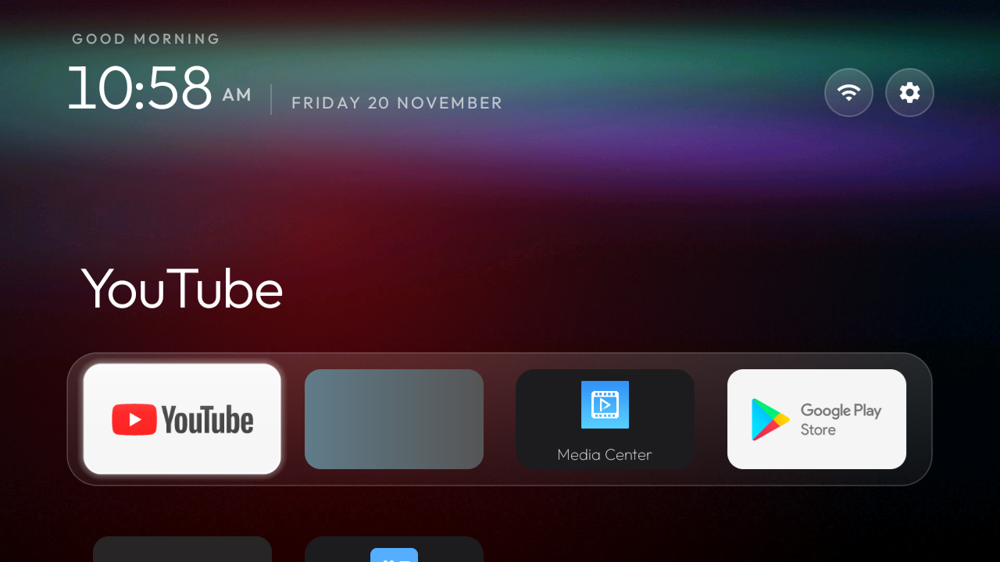

# HY320 Mini (TXBox/Rockchip firmware): ADB on port 3268, a boot-time installer, and what this list changes

A third firmware in the HY320 Mini family. `examples/hy320/` is a Google-certified Android 13
set and `examples/alwtniet-hy320-mini/` is the Allwinner/HTC Android 11 build (its `com.htc.*`
and `com.softwinner.*` packages do not exist here); this one is the TXBox/Rockchip build:

- Android 12 (SDK 32), build `rk3326_sgo-userdebug 12 SQ3A.220705.003.A1 eng.20260919.173827`
- `ro.board.platform=rk3326`, armeabi-v7a, ~1 GB RAM (`ro.config.low_ram=true`), 1280x720
- Stock Home and settings: `com.shzhtxcz.txbox` / `com.shzhtxcz.txbox.launcher` (Shenzhen TXBox)

## Getting ADB: it is already on

adbd listens on **port 3268** from the first boot - `service.adb.tcp.port` is preset - and the
vendor Developer options do not gate it. `ro.adb.secure` is unset, so there is no
"Allow USB debugging?" prompt and no pairing: a shell for anyone on the LAN. adbd also
advertises itself over mDNS as `adb-<serial>._adb._tcp`, so on macOS
`dns-sd -B _adb._tcp local.` finds the port without a port scan (remember `TV_PORT=3268`:
the tools all take it, and 5555 stays closed). The projector's own About page has no Build
row and the TXBox settings hide the real developer options; Activity Launcher
(`de.szalkowski.activitylauncher.oss`, sideloaded from its APK) opens
`com.android.tv.settings/.system.development.DevelopmentActivity` for the day you want the
toggles. Closing it again means switching the vendor's "USB debug"/"Internet ADB" entries off
there; this owner chose to leave the port open.



## What was disabled

The list disables 19 packages, applied 2026-11-20 and lived with since, reboot-checked twice:

- **The TXBox vendor store** (`com.sszztxr.app`): starts at boot and tracks package installs;
  off by choice - `pm enable --user 0 com.sszztxr.app` brings it back to fetch something from
  the vendor's channel. (The owner installed Chrome from it, so it does install.)
- **The OTA updater** (`com.sszztxr.oott`, `com.tx.ota.receiver`): updates come from an unknown
  vendor server. The owner chose no silent firmware changes; re-enable it to check for updates.
- **Ad-carrying "voice UI"**: `com.aispeech.tvui` wraps `com.speed.adv.TransparentAdActivity`.
- **Burn-in and factory test apps**: `com.shzhtxcz.txcz.test` (aging test, boot receiver,
  `LaohuaReceiver`) and `com.rockchip.devicetest`. Disabled, never opened.
- **A Brazilian IPTV "Mango TV" portal** (`com.android.mgstv`, `com.interactive.brasiliptv`)
  with Firebase push, and a dead v9 `com.netflix.mediaclient` that servers reject.
- **Chrome 79**, installed from the TXBox store by the owner: a 2020 build with years of
  unpatched CVEs, off by choice - re-enable it if you want a browser on the projector.
- **AOSP cruft** with tested-list consensus: ctsshim (both), hotspot2.osulogin, htmlviewer,
  onetimeinitializer, sharedstoragebackup, backupconfirm, soundpicker,
  companiondevicemanager, secure element, wallpaperpicker.

## What is kept and why

- `com.shzhtxcz.txbox` - the settings suite (picture, focus, network). It also **reinstalls
  `com.aispeech.tvui` and `com.rockchip.itvbox` at every boot when they are missing**, which
  is why this list disables packages instead of uninstalling them: a disabled package is still
  installed, and the boot restore leaves it alone. Both reboots confirmed the disables hold.
- `com.shzhtxcz.txbox.launcher` - the stock Home, left enabled as the fallback; `com.rockchip.itvbox`
  - txbox's companion, linked into the factory-reset flow.
- `com.bozee.usbdisplay` - the casting receiver (an AirPlay-style "QuickShare" RAOP server,
  `AirTunes/150.x`, on a random port with an RTSP answer) - the owner mirrors a phone.
- `com.rockchips.mediacenter` - the USB media player; `com.android.rockchip.camera2`;
  `com.android.tv.set` (factory reset and inputs); the keyboard, Play Store and Play Services.
- `com.google.android.youtube.tv` - kept by choice, and pinned in the launcher dock.

## Launcher

```sh
TV_HOST=<projector ip> TV_PORT=3268 STOCK_LAUNCHER=none launcher/build-and-install.sh
TV_HOST=<projector ip> TV_PORT=3268 tools/tv.py 'cmd package set-home-activity --user 0 com.gathin.tvhome/.MainActivity'
```

`STOCK_LAUNCHER=none` because `com.shzhtxcz.txbox.launcher` is not a launcher the install
script knows; the stock one stays enabled as the fallback Home. The theme in this folder
(wallpaper, glass dock, the dock apps above) pushes without rebuilding:

```sh
TV_HOST=<projector ip> TV_PORT=3268 tools/theme.sh examples/hy320-mini-txbox/theme
```

## The density fix does not stick

The panel is 1280x720 at density 240, which gives apps a cramped 853x480dp. `wm density 213`
fixes the layout (960x540dp), but on this build the override is gone after every full reboot,
and writing `settings put global density 213` is ignored at boot too. Re-apply
`wm density 213` after each reboot (undo: `wm density reset`). The stock launcher, the
disables and the launcher takeover all survive reboots normally.

## Restore an app / undo everything

```sh
TV_HOST=<projector ip> TV_PORT=3268 tools/tv.py 'pm enable --user 0 <package>'
TV_HOST=<projector ip> TV_PORT=3268 tools/restore.sh examples/hy320-mini-txbox/debloat.txt
```
