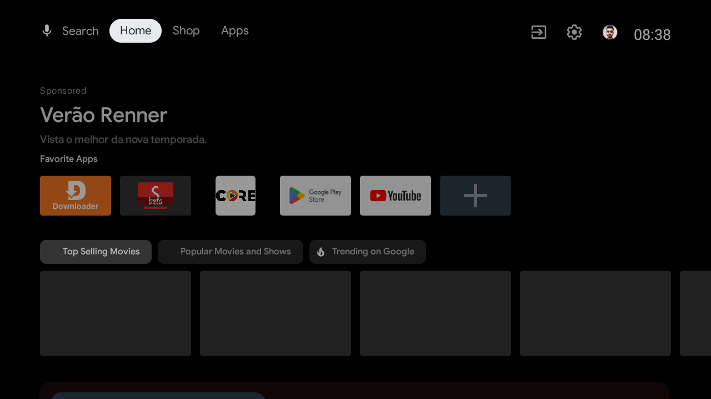

# TCL 40S5400A (C06): the Brazil unit on V034 (TV+ OS)

**TV:** TCL "Smart TV", client type `TCL-LA-MT9221-01` (TV+ OS), device C06, build AR2101,
software `V8-T221T01-LF1V034.000077`, TV+ OS `V5.2.0 (V8-2203260-MF1V520)`, Android TV 11
(SDK 30), MediaTek MT9221, kernel 4.19.116 armv7l, 1280x720 @ 213dpi, ~940 MB RAM
(`low_ram=true`). Same platform as the TCL L40S66E (V030) and as the first Brazilian unit of
`tcl-40s5400a`, on an older build.




## What happened here

One session on this unit, not a several-day test. The debloat ran in three waves (TCL block, voice,
Google/duplicates), each followed by a sync, a wait and one reboot, with a screenshot and a
Chromecast check after every wave and after the reboot; the launcher was installed as Home and the
stock launcher disabled afterwards, as in the list of `tcl-40s5400a`.

## Disabled

14 packages in three waves (TCL block, voice, Google/duplicates), all with
`pm disable-user --user 0`, never uninstalled:

- TCL account/promos: `com.tcl.usercenter`, `com.tcl.waterfall.overseas`, `com.tcl.esticker`,
  `com.tcl.useragreement`, `com.tcl.copydatatotv`, `android.autoinstalls.config.tcl.device`
- Voice: `com.tcl.micmanager`, `com.tcl.smartalexa`, `com.google.android.tv.assistant`
- Google/duplicates: `com.google.android.partnersetup`, `com.google.android.onetimeinitializer`,
  `com.google.android.syncadapters.calendar`, `com.tcl.android.webview`,
  `com.google.android.apps.nbu.smartconnect.tv` (a data-saver VPN, not casting)

`com.google.android.feedback` was already off at the factory and was left alone. So were
`com.google.android.katniss`, `com.google.android.tvrecommendations` (Leanback Core Services
on this chipset), TalkBack, TTS, backdrop, Netflix, Prime Video, Stan and the other preloads.

**Back after reboot:** `com.tcl.usercenter` and `com.tcl.smartalexa` are switched back on by
this firmware at every boot, as on the Brazilian unit in `tcl-40s5400a`. They stay idle;
they are not re-disabled after each boot. A sideload test also re-enabled `com.tcl.esticker`,
which was disabled again. Final count: 28 disabled (15 at baseline + 14 minus the two that
came back, plus esticker re-disabled).

## Kept on purpose

`com.tcl.tv` + `com.tcl.tvinput` (Live TV, HDMI, AV, tuner — four inputs registered),
`com.tcl.suspension` (source Quick Panel), `com.tcl.t_solo`, `com.tcl.keyhelp`,
`com.tcl.autopair` + `com.tcl.tcl_bt_rcu_service` (Bluetooth remote), `com.tcl.system.server`
and `com.tcl.factory.view` (PERSISTENT), `com.tcl.guard` (PERSISTENT on this unit — a vendor
source warns that freezing PERSISTENT packages leaves the system inconsistent),
`com.tcl.settings`, `com.tcl.providers.config`, `com.tcl.initsetup`, `com.tcl.dashboard`,
`com.tcl.messagebox`, `com.tcl.partnercustomizer` (TKey button), `com.tcl.rc.ota`,
`com.tcl.ttvs` (firmware updater; owner choice to keep for Cast safety), `mediashell` +
Play services (Chromecast), `com.google.android.tv.remote.service`, and `setupwraith`
(it owns the saved Wi-Fi network via `cname=`).

## Launcher

Built in Docker (`tools/docker-build.sh`), installed with `launcher/build-and-install.sh`,
which disabled `com.google.android.tvlauncher` after Home moved. `com.gathin.tvhome/.MainActivity`
was confirmed as both `ResumedActivity` and `mFocusedApp`. Plain `tv.py --push` timed out on
the APK and on a 4.4 MB test APK, so `tools/b64push.py` (base64 chunks + md5) was used.

## Verification

Screenshots after every wave; Chromecast checked after each wave and after reboot (port
8009 LISTEN, `mediashell` and `gms` running). Sync + 60 s wait before the reboot — this
firmware loses the disabled state if rebooted immediately after a batch. AdGuard Private
DNS (`dns.adguard-dns.com`, `hostname` mode) resolves normally. One session of a few hours,
not a several-day test; reboot-checked once.

Neither `power_on_home` nor `power_on_home_always` could stop the firmware opening
`com.tcl.tv` a couple of seconds after boot. The owner chose to accept that and press Home.
Do not claim those helpers work on this firmware.

## Re-enable one app / undo

```
TV_HOST=<tv ip> tools/venv/bin/python tools/tv.py pm enable <package>
TV_HOST=<tv ip> tools/restore.sh examples/tcl-40s5400a/debloat.txt
```

The list lives in [`debloat.txt`](debloat.txt) as the Brazil unit, 2026-11-19 (V034) of this
folder. The convenience scripts that
were used on this unit (`install-launcher.sh`, `restore-all.sh`, `batch1-3.txt`) were local to the
session and are not part of this report.
