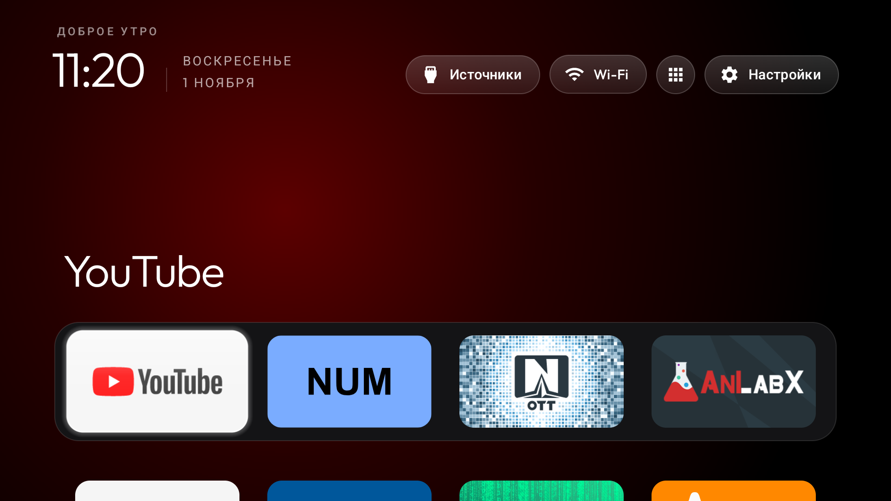

# Tuvio TD43UFBCV5 / TD50UFBCV5 (Google TV 14, AI PONT)

The 43" and 50" models share Changhong's `DVB96` product, `central` board, MediaTek `m7632`
(armv7l), Google TV 14 (API 34) and firmware `UKNV.260506.001`. The original TD43 notes remain
in `debloat.txt`; the TD50 is a second tested unit, not a separate list.

| File | What it is |
|---|---|
| `debloat.txt` | Shared list, with each unit's test notes and optional package choices |
| `config.json` | Dock and layout from the TD50 unit; optional for either size |
| `home.png` | The launcher on the TD50 unit, after the Home handover and reboot |

## Tested on: TD50UFBCV5, Russia

**Tested on:** Tuvio TD50UFBCV5 (50", Changhong AI PONT, DVB96, MediaTek m7632), Google TV 14
(API 34), firmware `UKNV.260506.001`, 1 November 2026. About 1.8 GB RAM, UI at 1920x1080
(320 dpi); no Yandex apps preinstalled.

Same-day test, not a multi-day soak: packages were disabled in six small batches, with two
reboots, the last after the Home handover. Home, the Inputs menu, HDMI, YouTube playback and the
real remote were checked; no FATAL or ANR in logcat. The second unit's package choices were:

- `com.google.android.videos` was not installed; skip that line on the TD50.
- `com.google.android.partnersetup` was disabled on the TD50. It is an optional, commented entry
  in the shared list because it was not tested on the TD43.
- Netflix, Prime Video and YouTube Music were disabled by both owners' choice. The TD50 owner
  also disabled Chromecast, AirPlay, screen sharing, Miracast (`com.mediatek.androidbox`) and the
  USB file/photo viewers; the TD43 kept these. All these choices are commented out in the shared
  list so they are not applied to every household.
- Voice search, Play Store/Services, Live TV, HDMI, remote pairing and firmware updates were
  kept. MediaTek partnercustomizer was left enabled on the TD50; the TD43's re-enable finding
  remains in the list. Private DNS was not set up or tested on the TD50.

The shared list is not a claim that both units ran identical package selections. Review its
per-unit comments and uncomment only the optional apps you do not use.

## Wi-Fi and Home handover

On the TD50, the saved network belonged to `com.google.android.tungsten.setupwraith`.
Check `dumpsys wifi | grep -o 'cname=[^ ]*'` before disabling it. If it owns the network:

1. In Settings → Network & Internet, forget the saved network.
2. Join it again and verify that it now belongs to `android.uid.system:1000`.
3. Only then proceed with the last batch. Otherwise disabling setupwraith takes Wi-Fi and ADB
   down together. `tools/disable.sh` checks this too.

Follow the repository's [TV procedure](../../PROMPT.md), keeping its backup and Home guards.
Install the replacement launcher and verify it before the stock-Home batch; never disable the
stock launcher without a working replacement. On this firmware `set-home-activity` can print
"Success" while `launcherx` still owns Home. After the guarded handover, set Home again and
confirm `dumpsys activity activities | grep mFocusedApp`, then reboot and check Home and Wi-Fi.

## Optional TD50 launcher layout



Once the launcher is installed, apply the layout with the TV's address (the address below is an
example, not the tested unit's address):

```bash
TV_HOST=192.168.1.50 tools/theme.sh examples/tuvio-td43ufbcv5
```

The dock is YouTube, NUM, OTT Navigator and AniLabX, with four columns, a round app-library
button in the top bar and no wallpaper. Live TV (`com.mediatek.wwtv.tvcenter`) is hidden from the
home grid but remains in the app library and the Inputs menu. Edit the dock for your installed
apps before pushing it. This config describes the TD50; it does not change launcher defaults or
claim that the TD43 used this layout.

The TD50 used the launcher's clock screensaver (`com.gathin.tvhome/.ClockDream`) for both
`screensaver_components` and `screensaver_default_component` before disabling dreamx.

## Restore

```bash
TV_HOST=192.168.1.50 tools/restore.sh examples/tuvio-td43ufbcv5/debloat.txt com.google.android.apps.tv.launcherx
```

Use the same edited list and recovery record as when applying it. Nothing is uninstalled.
The restore tool does not restore screensaver settings; the stock value for both
`screensaver_components` and `screensaver_default_component` on the TD50 was
`com.google.android.apps.tv.dreamx/.service.Backdrop`.

## Other TD50 observations

- The remote's Settings key arrives as scancode 498 (`KEY_BRL_DOT2`). A key-filtering accessibility
  helper restored it but broke held-volume repeat, so the helper was left off. Settings remains
  available from the launcher's Settings pill.
- The Netflix key is inert while Netflix is disabled.
- The firmware forces Location off, so the network pill says "Wi-Fi", not the SSID.
- Standby is MediaTek suspend: from deep standby the Bluetooth remote could not wake this unit;
  the IR remote and physical power button could.
- Both legacy ADB and Wireless debugging ports were verified closed after disabling debugging.
  Follow the TV procedure's final reboot and port check; do not leave network ADB enabled.
