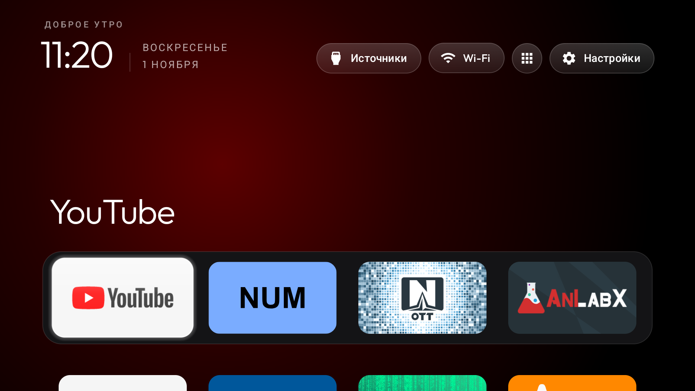

# Tuvio TD50UFBCV5 (Google TV 14, AI PONT)

Tuvio's 50" Google TV model, built by Changhong (`ro.product.model` "AI PONT", product `DVB96`,
device/board `central`, MediaTek `m7632`, armv7l), firmware `UKNV.260506.001`, UI at 1920x1080
(320 dpi), 1.8 GB of RAM. No Yandex apps are preinstalled. Same board and firmware as the
[`tuvio-td43ufbcv5`](../tuvio-td43ufbcv5/) (43") and the BenQ E55-735.

Tested on 1 November 2026 with the list below, the launcher as Home and the real remote: same-day
test, not a multi-day soak.

| File | What it is |
|---|---|
| `debloat.txt` | The packages that were disabled, grouped and commented |
| `config.json` | The launcher's dock and layout for this set; push it with `tools/theme.sh` |



All commands run from the repo root, with the TV's address in `TV_HOST`. They need network ADB on
the TV while they run, and it should be off again afterwards. Port 5555 answered straight away on
this set and survived reboots.

## The Wi-Fi network comes first

The saved Wi-Fi network belongs to the Google TV setup wizard,
`com.google.android.tungsten.setupwraith` (`dumpsys wifi | grep -o 'cname=[^ ]*'`). Disabling it
takes the network with it, and the TV drops off Wi-Fi and off ADB. Before the last batch:

1. Settings → Network & Internet → the saved network → Forget.
2. Join it again. It then belongs to `android.uid.system:1000`.
3. Only then run the list. `tools/disable.sh` refuses a list with setupwraith in it while the
   network still belongs to it.

## Install, from scratch or again

The order matters: the Wi-Fi note first, then the list while Google TV's home still owns Home
(setupwraith goes with it), then the launcher.

```bash
TV_HOST=<tv-ip> tools/disable.sh examples/tuvio-td50ufbcv5/debloat.txt
TV_HOST=<tv-ip> launcher/build-and-install.sh
TV_HOST=<tv-ip> tools/theme.sh examples/tuvio-td50ufbcv5
```

`launcher/build-and-install.sh` builds from source, checks the SDK level against the launcher's
`minSdk`, installs the APK, makes it Home and applies the repository's Home guard: the stock
launcher is only disabled once the new one answers Home. On this firmware `set-home-activity`
prints "Success" while `launcherx` is still enabled, so Home has to be set once more after the
last batch.

The screensaver is the launcher's own clock:

```bash
TV_HOST=<tv-ip> tools/tv.py 'settings put secure screensaver_components com.gathin.tvhome/.ClockDream; settings put secure screensaver_default_component com.gathin.tvhome/.ClockDream'
```

`config.json` is the launcher's layout for this set, as it was on the tested TV: the dock
(YouTube, NUM, OTT Navigator, AniLabX), the Live TV app hidden from the grid but offered in the
Inputs menu, four columns and the app library as a round button in the top bar. `tools/theme.sh`
pushes it to the launcher's own config file; the dock order can be changed there, or in the
launcher's own Settings.

## Undo everything

```bash
TV_HOST=<tv-ip> tools/restore.sh examples/tuvio-td50ufbcv5/debloat.txt com.google.android.apps.tv.launcherx
```

That enables every package the list disabled, using the recovery record `tools/disable.sh` wrote.
Nothing is uninstalled. It does not put the screensaver back: the stock value is
`com.google.android.apps.tv.dreamx/.service.Backdrop` (`screensaver_components` and
`screensaver_default_component`).

## Known behaviour on this set

* The remote's Settings (gear) button does nothing with the stock launcher gone: it arrives as
  scancode 498 (`KEY_BRL_DOT2`). `settings_key_scancodes 498` with `HOME_KEY_SERVICE=1` brings it
  back, but any key-filtering accessibility helper bound on this firmware makes a held volume
  button step once or twice instead of ramping. It is left off; Settings opens from the launcher's
  own Settings pill.
* The Netflix button does nothing while Netflix is disabled (`app_keys` in `config.json` can map
  it to another app).
* The launcher's network pill says "Wi-Fi" and not the network name: Android 14 redacts the SSID
  from an app that has no location permission, and this firmware's privacy service puts the
  location master switch back off by itself.
* Standby is MediaTek suspend: from deep standby the Bluetooth remote cannot wake the TV, the IR
  remote and the power button can. That is not damage.
* The Live TV app (`com.mediatek.wwtv.tvcenter`) is in the app library and at the end of the
  Inputs menu.
