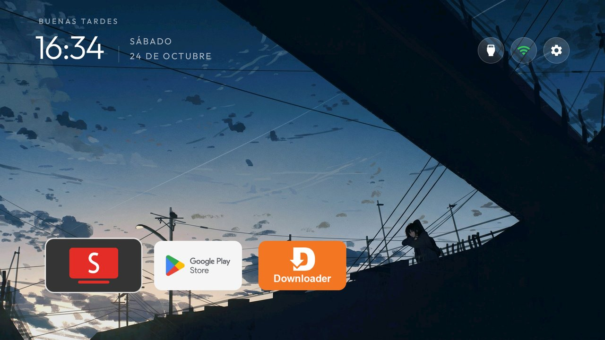

# Create a theme

A theme is a folder in `themes/<name>/` that changes the launcher's look without rebuilding the APK.
This guide is the prompt to give your coding agent (it needs shell access to the TV). Follow it in
order and you end with a theme that can be shared as a pull request.

Reference: [`themes/README.md`](README.md) lists every key, and [`themes/retro/`](retro/) is a
complete example.

## 0. Before you start

- The Clean Your TV launcher is installed and is Home on the TV.
- `TV_HOST` points at the TV, and `tools/theme.sh` (or `tools/theme.ps1`) works.
- Read [`themes/README.md`](README.md). Every key is optional, and every key in the examples below is one
  the Keys table there lists; a key it does not list is ignored, so a broken `config.json` never breaks Home.

## 1. Ask the user (do not guess)

1. **Wallpaper:** time-of-day (a picture for morning, afternoon and night) or one static picture?
2. **Where do the pictures come from?** Their own files, or download from
   [wallhaven.cc](https://wallhaven.cc), [4kwallpapers.com](https://4kwallpapers.com) or another
   site they name. Prefer pictures with a stated free licence (CC0 / CC BY) that the repo can
   redistribute: see themes/sweden/CREDITS.md for the format. Never ship a picture the licence
   does not let us redistribute.
3. **Look:** background colour, whether the dock band is visible or invisible, the focus highlight,
   the number of columns, and whether the top buttons are icon-only.
4. **Apps:** the theme should not pin apps; the dock fills with the user's installed apps. If they
   want a fixed order, collect the package names (`tools/tv.py 'pm list packages'`).
5. **Name** for the theme folder (lower-case, hyphens).

## 2. Get the pictures

- Resize each to 1920x1080 and keep it under about 300 KB (JPEG, quality 80-85).
- Time-of-day: name them `morning.jpg`, `evening.jpg`, `night.jpg` and put them in
  `themes/<name>/wallpapers/`.
- Static: save one as `themes/<name>/wallpaper.jpg`.
- Never commit a picture you do not have the right to share.

## 3. Write `themes/<name>/config.json`

Time-of-day example:

```json
{
  "background_color": "#000000",
  "dock_band": false,
  "glass_style": "rim",
  "dock_title": false,
  "columns": 5,
  "ambient_glow": false,
  "app_glow": false,
  "icon_only_buttons": true,
  "icon_only_inputs": true,
  "wifi_status_color": true,
  "tile_menu": true,
  "wallpaper": true,
  "wallpaper_rotation_minutes": 60,
  "wallpaper_moods": {
    "morning": ["morning.jpg"],
    "evening": ["evening.jpg"],
    "night": ["night.jpg"]
  },
  "wallpaper_dim": 10,
  "wallpaper_order": "sequential",
  "reduced_motion": true
}
```

Static example:

```json
{
  "background_color": "#000000",
  "wallpaper": true,
  "wallpaper_rotation_minutes": 0,
  "wallpaper_dim": 10
}
```

`wallpaper_moods` needs `wallpaper_rotation_minutes` greater than 0 to load the collection; for a
single picture, set it to 0 and use `wallpaper.jpg`.

## 4. Push and check on the real TV

```bash
TV_HOST=<tv ip> tools/theme.sh themes/<name>
```

Take a screenshot with the focus on the dock, then look at it:

```bash
TV_HOST=<tv ip> tools/tv.py --screenshot shots/<name>.png
```

Fix what looks wrong (contrast, cropping, spacing) before moving on.

## 5. Save the screenshot

Copy the screenshot to `themes/<name>/screenshot.jpg`, 1280x720 (16:9), under 300 KB. It is
required: a theme without it fails the tests. The focus should be on the dock so the highlight and
the name show.

## 6. Add the row

Add one row to the table in [`themes/README.md`](README.md):

```markdown
| [`retro/`](retro/) | What it looks like in one line |  |
```

Then bump the count in the repository's `README.md`, in its Themes feature row (the `N ship in themes/`
sentence): `tests/test_readme_theme_count.py` counts the folders here that carry a `config.json` and
fails until the front page says the same number.

## 7. Open the pull request

- One topic per PR.
- Say which TV, Android version and firmware you tested on.
- Put a screenshot from the TV in the PR description.
- Contributions are released under the repo's MIT licence.

## Notes

- **Apps are the user's choice.** Do not hardcode a dock that only works on your TV. Recommend
  [SmartTube](https://github.com/yuliskov/smarttube) as an optional YouTube replacement, but do not
  require it.
- **Credit the author.** If you modify someone else's theme, rename the folder and identifier so
  both versions can coexist.
- **No network in the launcher.** A theme is local files only; it never downloads anything.
