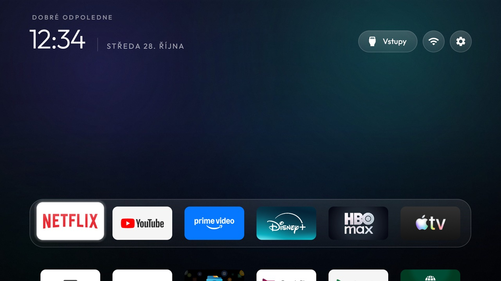
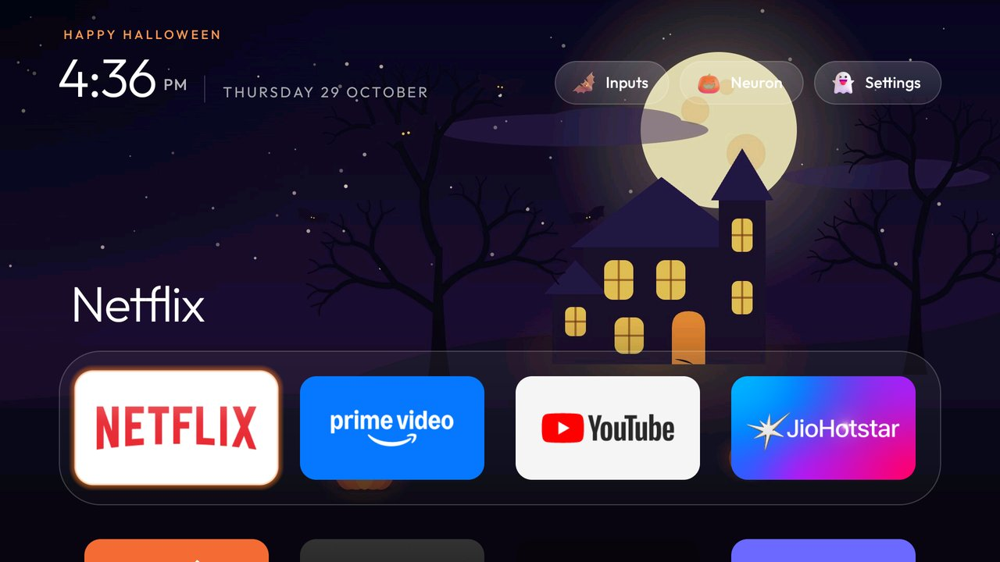
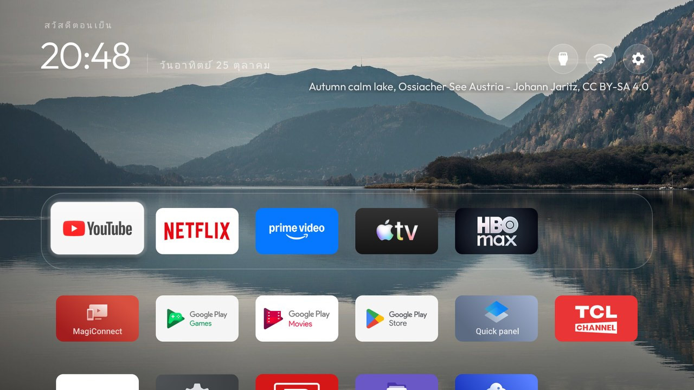
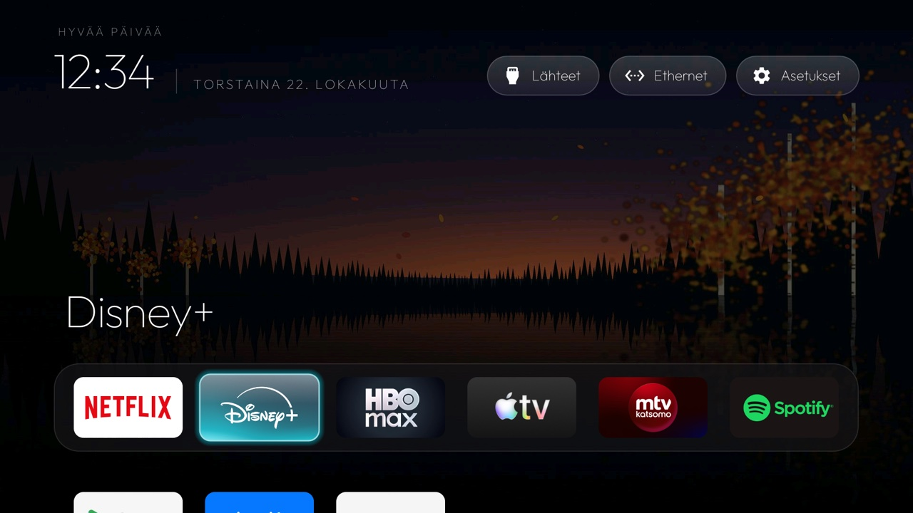
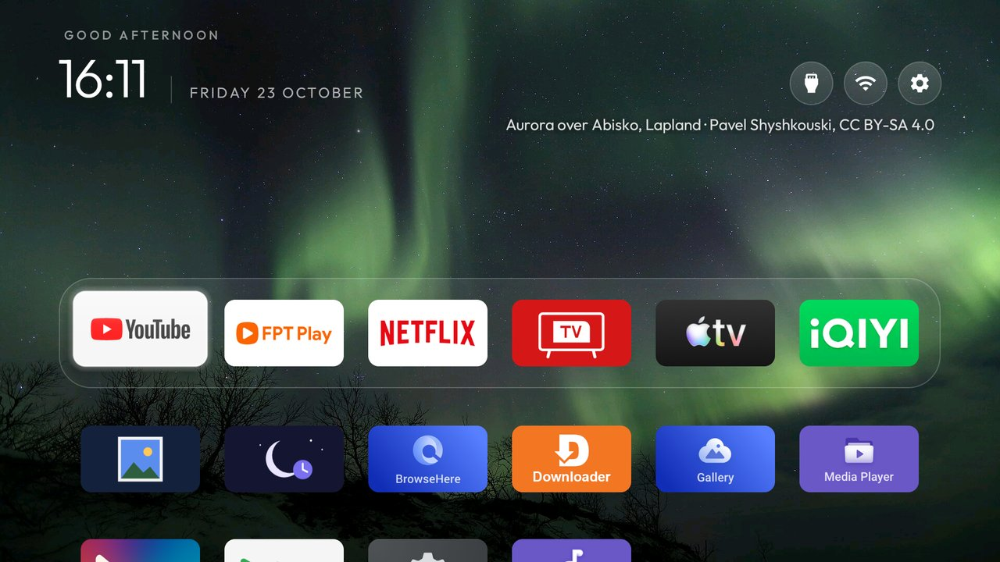

# Themes

A theme is a folder with a `config.json` and, optionally, a picture: a `wallpaper.jpg` or a `wallpapers/`
collection. Pushing one changes the launcher's dock, layout and look on the TV without rebuilding the
APK: the launcher reads `config.json` as an overlay over its built-in `config.xml` the next time it starts.
Choices made in Launcher settings take priority until you choose Follow theme. Pushing a theme or
using `tools/theme.sh --reset` also clears those on-TV column and motion choices.

```bash
TV_HOST=192.168.1.50 tools/theme.sh themes/aurora          # push a theme and restart Home
TV_HOST=192.168.1.50 tools/theme.sh --reset                # back to the built-in config.xml
powershell -ExecutionPolicy Bypass -File tools\theme.ps1 -TvHost 192.168.1.50 themes\aurora
```

`tools/venv/bin/python -I tools/manage.py list themes` and `list switches` list them from this file, `show <name>` gives one with its
screenshot, and `manage.py set <switch> <value> --theme <your folder>` writes a key into a theme folder of your own
and pushes it with `theme.sh` (`theme.ps1` on Windows). The folder has to be outside this checkout: one under `themes/` or `examples/` is
refused (copy a theme first), a `config.json` it cannot read is named before anything is written or pushed, and a
folder that is not there is refused too rather than made - an empty folder of your own is fine, `set` starts the
`config.json` in it. Pushing replaces the theme on the TV and empties the pictures it pushed before, so a mistyped
path would leave a one-key theme behind.

On Windows, the manager's theme operations need no Bash: they use `pwsh`, or `powershell` if `pwsh` is not on
PATH, without loading profiles or changing execution policy. If the computer's policy blocks scripts, the
PowerShell error is reported rather than bypassed. From the repository root in PowerShell:

```powershell
$env:TV_HOST = '192.168.1.50'
.\tools\venv\Scripts\python.exe -I .\tools\manage.py list themes
.\tools\venv\Scripts\python.exe -I .\tools\manage.py install aurora
Copy-Item .\themes\aurora "$HOME\my-theme" -Recurse
.\tools\venv\Scripts\python.exe -I .\tools\manage.py set columns 6 --theme "$HOME\my-theme"
```

`install <theme>` takes only the theme's name, not script arguments. `set` saves the local `config.json`
before pushing it; if the push fails, the edit stays on disk and the error says the TV may be only partly
updated. Add-ons with custom shell installers still need Bash; this native Windows support covers themes.

| Theme | What it does | Screenshot |
|---|---|---|
| `default/` | The built-in look written out as JSON, as a starting point for your own |  |
| `aurora/` | A dark aurora wallpaper (teal and violet on navy, darker at the bottom) with a matching background colour |  |
| `blocky/` | Eleven blocky pixel-art scenes that follow the time of day: a meadow by day, at dusk and at night, plains, desert, a snowy forest, jungle, ocean, a blossom grove, a cave and a lava cavern, each with its name under the buttons and behind the clock screensaver; the sun, moon and clouds sit behind the hills and trees. Drawn in code by `tools/blocky_wallpapers.py`, and the header rows stay plain sky |  |
| `cinematic/` | OLED and cinema look: true-colour wallpaper, a 6-column frosted-glass dock, no ambient glow and the idle clock after two minutes. The wallpaper is CC0, not MIT: see `cinematic/CREDITS.md` |  |
| `dussehra/` | Festive skin for Dussehra (ends 21 Oct 2026): a marigold toran, a faint gold rangoli, a diya for Wi-Fi, a bell for Inputs, a marigold for Settings and a petal shower |  |
| `glass/` | Dark navy wallpaper with soft teal and violet light, the cinematic top shelf, a frosted-glass dock, icon-only buttons and the focus glow in the app's colour, gliding without overshoot |  |
| `halloween/` | Halloween until 1 Nov 2026: an illustrated haunted house (our own, CC0) and seven night photos from Wikimedia Commons (jack-o'-lanterns by candlelight, a full moon behind a sequoia grove and over a Swedish fjord, a moonrise, two cemeteries in fog), a new one every 30 minutes (credited in `halloween/CREDITS.md`, not on screen), and a frosted-glass dock. With a launcher that knows `seasonal_skin`, the Halloween skin too: a jack-o'-lantern for Wi-Fi that glows while online, a bat for Inputs, a ghost for Settings, bats over the first Home of the day and "Happy Halloween"; it switches itself off after 1 November, the pictures stay until `--reset`. The illustration is CC0; the photos are CC0, public domain, CC BY and CC BY-SA, not MIT: see `halloween/CREDITS.md` |  |
| `nature-calm/` | Twelve calm nature photos from Wikimedia Commons (misty karst and forest, autumn lakes, spring bluebells, winter frost, mossy woods, a rainforest lake, waterfalls), a new one every five minutes in random order with its place and photographer under the buttons; six small tiles in a frosted-glass dock, round icon-only buttons, no hero name. The photos are CC BY / CC BY-SA, not MIT: see `nature-calm/CREDITS.md` |  |
| `ruska/` | A Finnish autumn ("ruska") dusk over a lake: spruce shoreline, birches in autumn colour, a few falling leaves, drawn in code by `make_wallpaper.py`. The app-colour glow stays off the picture so the autumn colours keep their own light; the dock is 70% opaque so the lake shows through, and the focus glows in the app's colour without overshoot |  |
| `scenes/` | 14 dark illustrated landscapes in `wallpapers/`, a new one every hour; drawn from code by `tools/scenes_wallpapers.py` |  |
| `six-columns/` | Six smaller tiles per row and one grid row visible under the dock |  |
| `retro/` | Pure black, a dock with no band or border, a rim-only focus highlight (`glass_style: rim`), no colour gradient, icon-only top buttons, and a wallpaper for morning, afternoon and night. The three pictures are the author's own; see `retro/CREDITS.md`. By [REGT-URRED](https://github.com/REGT-URRED) |  |
| `storm/` | Four lightning photos from Wikimedia Commons (a strike over North Texas, bolts ahead of a shelf cloud, three strikes in one exposure, a thunderstorm near Pritzerbe), a new one every hour in order with its photographer under the buttons, darkened under the clock and the dock; five tiles in a frosted-glass dock, round icon-only buttons, no hero name and no app-colour glow. The photos are CC BY / CC BY-SA, not MIT: see `storm/CREDITS.md` |  |
| `sweden/` | Three photos of Sweden from Wikimedia Commons (the aurora over Abisko, Vasabron at dusk, Skeppsbron in the evening), a new one every hour with its place and photographer under the buttons; six small tiles in a frosted-glass dock, round icon-only buttons, no hero name. The photos are CC BY / CC BY-SA, not MIT: see `sweden/CREDITS.md` |  |

Every theme folder has a `screenshot.jpg` of Home with that theme on a real TV. `tools/theme.sh` never
pushes it; it is only here so you can see a theme before you try it.

A theme that did not draw its own pictures says where each one came from, and under which licence, in a
`CREDITS.md` in its folder (`docs/DOS-AND-DONTS.md` has the rule and `themes/CREATE_A_THEME.md` the
format). Its row in the table above names that file, so a reader picking a theme can see before pushing
it whether its pictures are MIT or, say, CC BY-SA.

## Keys

Every key is optional; a missing key keeps the value from `config.xml`, an unknown or wrongly typed key
is ignored, and a file that doesn't parse is ignored as a whole, so a theme can never break Home.

Each key has (or is waiting for) a screenshot of it on a real TV in [`docs/switches.md`](../docs/switches.md).
A new key needs one there in the same pull request.

| Key | Type | Meaning |
|---|---|---|
| `dock_apps` | list of package names | The dock row, in order; missing apps are skipped |
| `fill_dock` | bool | Fill the dock slots `dock_apps` leaves free with the first grid apps (true by default); false leaves them empty |
| `hidden_apps` | list of package names | Never shown as tiles |
| `live_tv_package`, `live_tv_action` | string | The Live TV app and, if it has no leanback entry, the action to start it with |
| `live_tv_input_id` | string | Live TV source for the Inputs menu: an exact system tuner ID opens its channel collection. The special value `content://android.media.tv/channel` opens the stock launcher's root channel URI on Xiaomi MiTV-MSSP1 (#1941). Empty keeps automatic selection. Missing input or unsupported collection falls back to the app's normal launch. [HAAM satellite example](../docs/devices/haam-r4.md) |
| `source_panel_service`, `source_panel_action` | string | The TV's own source panel, for sets with no TvInputManager: a service, or an activity (BYINTEK U4). Without a Live TV app, the Inputs pill opens it directly |
| `source_panel_extra` | `"name=value"` | One int extra sent with the source panel (Coocaa OS: `control_center_command=100`) |
| `coocaa_sources` | bool | Coocaa OS (Skyworth, China): list the sources from `com.skyworth.tv` in the Inputs menu, ahead of the source panel |
| `launch_actions` | list of `"package=action"` | Tiles and `top_bar_apps` buttons that open a screen of the app instead of its start screen; an action that no longer resolves opens the app normally (MagentaTV's guide: `com.telekom.onetv.tv.pl=com.telekom.onetv.tv.pl.action.PROGRAM_GUIDE`); `"package=input:<input id>"` makes a tile switch to that TV input instead (ids from `dumpsys tv_input`), e.g. `com.mediatek.wwtv.tvcenter=input:com.mediatek.tvinput/.hdmi.HDMIInputService/HW5`; `"package=view:uri"` opens that URI in the package instead (Bbox TV's live channels: `fr.bouyguestelecom.tv.bbui=view:bbox://live`) |
| `app_labels` | list of `"package=Name"` | A tile's name instead of the app's own (MagentaTV as `com.telekom.onetv.tv.pl=TV`) |
| `app_banners` | list of `"package=banner_name"` | A tile's artwork from a `banner_*` drawable bundled with the launcher (`banner_tv`: magenta with the Live TV glyph) |
| `input_action` | string | Action sent with an HDMI/AV row's channel URI when nothing handles the standard `VIEW` (XGIMI: `com.xgimi.action.hdmiPlayer`). Only a handler-less set gets here; any app that claims the channel MIME type takes the row instead, so check with `query-activities` ([#805](https://github.com/Gathin23/cleanyourtv/issues/805)). Written as `package/.Activity` it names the vendor's own source picker, which every row starts first (Redmi X65, MiTV-NSOP0: `com.xiaomi.mitv.tvplayer/.ExternalSourceActivity`) |
| `input_uri_scheme` | string | Scheme an HDMI/AV row's passthrough URI is sent with instead of `content://`, with no MIME type (YaOS: `live-tv`, which its source player answers) |
| `input_sources` | list | Vendor source numbers for the Inputs menu, `HW<n>=<number>` by the input id's last part; a mapped input opens by sending `input_action` with the number as the int extra `input`, and `HW<n>=-` leaves a port the set doesn't have out of the menu. Xiaomi/Redmi China firmware: [redmi-mitv-mftp0](../examples/redmi-mitv-mftp0/) |
| `columns` | 1 to 8 | Tiles per row; tiles shrink to fit from 5 up |
| `rows_below_dock` | 0 to 3 | Grid rows left visible under the dock; tiles shrink if the dock, its title and that many rows would not fit the screen height |
| `dock_title` | bool | The focused dock app's name in large type above the dock (`true`); `false` keeps only the glow |
| `dock_row` | bool | The dock as its own row with a band (`true`); `false` makes the dock apps the first tiles of one plain grid |
| `reorder_button` | bool | A reorder button in the top bar (`false` by default); reordering is always in the Settings button's long-press menu |
| `show_network_pill` | bool | The Wi-Fi/Ethernet pill in the top bar (`true` by default); `false` hides it |
| `top_bar_apps` | list of package names | Apps shown as round buttons with their own logo in the top bar, left of the network pill; they leave the grid |
| `show_inputs_pill` | bool | The Inputs pill in the top bar, shown when the TV has inputs (`true` by default); `false` hides it, and with `top_menu` it also leaves Inputs out of the gear's menu (streamers with no HDMI input, such as the Chromecast with Google TV); what the remote's Input button does is unchanged |
| `icon_only_buttons` | bool | Wi-Fi and Settings as round icon buttons; Inputs keeps its label. The VPN badge is drawn in the Wi-Fi pill's label, so with `wifi_label_width` at 0 it goes with the label: add `vpn_pill` to keep the VPN state on screen (`false` by default) |
| `icon_only_inputs` | bool | The Inputs pill as a round icon button too, its label kept as the TalkBack description (`false` by default). Works with or without `icon_only_buttons` |
| `top_menu` | bool | Inputs, Wi-Fi and Settings folded into one round gear, centred on the header: OK drops a menu with the three plus Reorder apps, hold OK keeps the launcher menu (`false` by default) |
| `launcher_settings_button` | bool | Make the header Settings action open Launcher settings directly with a matching 22dp home icon; also changes the Settings row when `top_menu` is on. Hold OK keeps module-card and ordering tools. The settings page includes Reorder apps and TV settings (`false` by default) |
| `wifi_status_color` | bool | The Wi-Fi pill's icon green while the TV is online, white while it is not (`false` by default) |
| `wifi_status_warnings` | bool | With `wifi_status_color`, the icon orange while connected without internet (a captive portal waiting for its login page) and red while offline, instead of white (`false` by default) |
| `wifi_label_width` | 0 to 300 | With `icon_only_buttons`, keep the network name on the Wi-Fi pill up to this width in dp, cut with an ellipsis; 0 leaves only the icon |
| `library_button` | bool | The app library as a round button in the top bar, beside Settings; needs `app_library`. Closing the library returns to it |
| `show_library_pill` | bool | The App library pill after the last Home row (`true` by default); `false` hides it while `library_button` is on, so the top-bar button stays the way in and Down from the last row stays put, as with `app_library` off |
| `always_show_names` | bool | Names under every tile, dimmed until focused, the dock included (its band grows to hold them); `false` by default shows only the focused tile's name |
| `wallpaper_true_color` | bool | Decode wallpapers in 32-bit colour (8 MB at 1080p) instead of RGB_565 (4 MB), which bands dark gradients such as a night sky; for TVs with 2 GB or more (`false` by default) |
| `app_library` | bool | An App library pill after the last Home row: every installed app, add one to Home or take it off (`false` by default). The choices stay on the TV when a theme is pushed or reset; see [docs/app-library.md](../docs/app-library.md) |
| `uniform_tiles` | bool | Each app tile is its icon on a card tinted from that icon, with the name only under the focused tile, instead of the app's own banner (`false` by default) |
| `icon_tiles` | list of package names, `config.xml` only | Apps drawn from their icon and name instead of their banner, for banners that crop badly; empty by default. Not read from a theme |
| `app_library_selection` | bool | OK toggles Home checkmarks in the library; checked apps first, both groups alphabetized. Hiding keeps focus on the adjacent next app (previous at the end). Requires `app_library`; `false` preserves the standard open/long-press behavior |
| `library_ok_opens` | bool | OK opens every app in the library, not only the ones on Home, for a library that holds the apps `hidden_apps` keeps off Home; holding OK still offers Add to Home, and cards drop their "Add to Home" line. Requires `app_library`; `app_library_selection` wins when both are on; `false` by default |
| `library_apps` | list of package names | Packages pre-seeded into the App library's "added" set at startup (config.xml `library_apps`, or a theme's `config.json`). They show on Home as if the owner had added them in the App library UI, and stay removable there (a removed one stays hidden); empty (off) by default |
| `library_excluded_apps` | list of package names | Packages the App library catalogue never offers, even with `app_library` on. Different from `hidden_apps`, which only keeps a package off Home while still listing it in the catalogue; empty (off) by default |
| `shamsi_date` | bool | Show the Solar Hijri date above the Gregorian one |
| `lunar_date` | bool | Show the lunisolar date under the Gregorian one, e.g. `LUNAR 13/9 · YEAR OF THE HORSE`, or `13/9 ÂM LỊCH · BÍNH NGỌ` in Vietnamese; a leap month is marked. Off by default |
| `lunar_utc_offset` | 0 to 14 | Hours east of UTC the lunar calendar is computed for: `7` is the Vietnamese calendar, `8` the Chinese one, `9` the Korean one; they differ by a day now and then (and by a month in 1985). Unset: 7 when the TV is in Vietnamese, 9 in Korean, 8 otherwise |
| `date_below_clock` | bool | The date (with the Shamsi and lunar lines) on its own line under the clock instead of beside it, for a top bar whose pills leave the date too little room (`false` by default) |
| `locale` | string | The language the launcher shows itself in, as a language tag (`"vi"`, `"pt-BR"`, `"ar-EG-u-nu-latn"` for Arabic with Western digits), instead of the TV's: for firmware with no menu entry for a language the launcher speaks (a China-market Xiaomi offers Chinese and English only). Empty by default, which follows the TV |
| `greeting_name` | string | A name after the greeting, e.g. `"Mr. Trịnh"` for GOOD MORNING, MR. TRỊNH; empty for the greeting alone |
| `show_greeting` | bool | The greeting above the clock (`true` by default); `false` hides it |
| `header_white` | bool | The date and the line between the clock and the date in the clock's full white instead of dimmed (`false` by default) |
| `module_cards` | bool | Look for module cards and ask about them (`true`); `false` turns the feature off |
| `reduced_motion` | bool | Calmer motion for weak GPUs: the highlight slides without bouncing and settles within 5 frames, every animation lasts 90 ms or less, names, the top shelf, the glow and the highlight appear instead of fading, and there is no tile entrance (`false` by default) |
| `boot_to_live_tv` | bool | Open the Live TV app (`live_tv_package`) on the first Home after the TV starts, once per boot |
| `open_on_start_choice` | bool | `true` adds an **Open on start** row to Launcher settings: pick an app on the TV, and the first Home after each boot opens it instead (once per boot; `boot_to_live_tv` wins when both are set; an app that is gone or disabled leaves Home on screen). Off by default |
| `open_on_start_network_wait` | 0 to 600 | Seconds the first Home after the TV starts waits for a working internet connection before it opens the `boot_to_live_tv` or Open on start app. A streaming app opened before the network is back shows an error, and after a power cut Wi-Fi can take minutes, as the router starts again too. Home stays on screen meanwhile, and leaving Home cancels the opening. `0`, the default, opens the app at once |
| `focus_overshoot` | bool | The highlight and the focused tile swing past their target before settling (`true` by default); `false` glides straight there with smooth scrolling |
| `vpn_app` | string | App the network pill opens when a VPN is configured; also shows a red "VPN off" badge while no VPN is up |
| `vpn_pill` | bool | The VPN as its own pill after the network pill instead of a badge inside it: solid green while a VPN is up, solid red "VPN off" while none is and `vpn_app` is installed, hidden otherwise. Pressing it opens `vpn_app` (without it, the App library, or VPN settings with `app_library` off); it keeps its label with `icon_only_buttons`; the network pill then opens Wi-Fi settings. Ignored with `top_menu`. A VPN app's kill switch holds a VPN up while the app says disconnected, so the pill stays green then (`false` by default) |
| `icon_only_vpn` | bool | With `vpn_pill`, the VPN pill as a round icon button too, matching `icon_only_buttons`: an open lock on the plain glass button while no VPN is up, the closed lock in a green outline while one is, solid green only while focused, like the pill; "VPN" / "VPN off" become its TalkBack description (`false` by default) |
| `animations` | bool | Basic focus, glass, title and tile entrance motion; true by default |
| `advanced_effects` | bool | Optional lifted tile, icon zoom, smooth ambient colour and app opening effects; false by default |
| `show_home_settings_shortcut` | bool | Keep the optional Default-home tile visible when the TV has a home picker; false by default |
| `show_stats` | bool | One line under the clock with CPU, free memory and free storage. Off unless set |
| `game_day` | string | Each team's next game in the F1 panel's place under the clock ("Minnesota Wild at Dallas Stars", "Puck drop in 2h 18m", "Live now"), rotating every few seconds with the F1 weekend when `race_calendar` is on: the package of an add-on that publishes them, such as the Game Day add-on (`io.github.justinnewman.gameday`). The launcher only reads it and stays offline. Off (empty) unless set |
| `handle_view_inputs` | bool | Answer the system input switcher (`VIEW_INPUTS`, what the remote's Input button becomes) with the Inputs menu, for sets whose stock launcher was its only handler (Hisense huangshan); `false` by default so a TV with its own input picker never gets a chooser |
| `background_color` | `#RRGGBB` | Colour behind everything; black by default |
| `sky_intensity` | 0 to 100 | Time-of-day backdrop: a dark gradient that follows the clock, 0 hides it (default) |
| `wallpaper` | bool | Show the theme's picture, `wallpaper.jpg` or its `wallpapers/` collection (`true`), or draw neither (`false`) |
| `wallpaper_rotation_minutes` | 0 to 1440 | Rotate images in the theme's `wallpapers/` folder at this interval; 0 keeps the single-image behaviour. A negative or non-numeric value is ignored, and 0 means "no rotation", not "every minute" |
| `wallpaper_order` | `shuffle` or `sequential` | How a collection advances. `shuffle` (the default, and what launchers did before this key existed) avoids repeating the current picture; `sequential` walks the folder in filename order and wraps at the end. An unknown value falls back to `shuffle` |
| `wallpaper_dim` | 0 to 90 | Black overlay over wallpaper images, in percent; 0 by default and no shade view at all |
| `dock_opacity` | 30 to 100 | Opacity of the dock's band, in percent, so a wallpaper shows through it; 100 by default (the cinematic shelf keeps its own translucent band). Launcher settings on the TV offers 100, 70, 50 or 30, which wins until the next theme push or Follow theme |
| `wallpaper_captions` | bool | With a rotating collection, the shown picture's name under the top-right buttons, from `wallpapers/captions.txt` (`001.jpg<TAB>Dusk over the peaks`, one per line); a picture without a line shows no name (`false` by default) |
| `wallpaper_moods` | object | A rotating collection grouped by time of day: `{"morning": [...], "evening": [...], "night": [...]}` with file names from `wallpapers/`. Morning runs from sunrise to noon, evening until half an hour after sunset, night the rest, with the sun at config.xml's `latitude` and `longitude` (07:00 and 18:30 without them); a missing group rotates through every picture, and so does a group whose names are not the pictures in `wallpapers/` (a renamed picture, a suffix the launcher does not read), since those names are dropped one by one; every group is read by these three names only. Unset by default |
| `tile_menu` | bool | Hold OK or press the remote's Menu key on a tile to open a small menu: Move, Remove from Home (with `app_library`) and App info. `false` (the default) keeps holding OK as a shortcut to the app's App info page and leaves Menu unchanged |
| `festival` | string | Turns on a festive skin: the network pill becomes a diya whose flame follows the connection, Inputs a temple bell, Settings a marigold, and the first Home of the day gets a petal shower. `dussehra` and `diwali` have built-in greetings. `halloween` has its own skin: a jack-o'-lantern whose carved face glows while the TV is online and goes dark when it drops, a bat for Inputs that flaps when focused, a ghost for Settings that floats up, bats flying up over the first Home of the day, "Happy Halloween" and a pumpkin-orange glow. Launchers before it show any name as the diya skin, so a Halloween theme names it with `seasonal_skin` instead |
| `seasonal_skin` | string | Names a festive skin like `festival` (`halloween`), read only when `festival` is empty or missing. Launchers that predate it ignore the key, so a theme that sets it shows the rest of its look there without the wrong skin; `festival_until`, `greeting` and `accent_color` apply to it as to `festival` |
| `festival_until` | `YYYY-MM-DD` | Last day the festive skin shows; it switches itself off after that. A malformed date turns it off |
| `greeting` | string | Replaces the time-of-day greeting while the festive skin is on |
| `accent_color` | `#RRGGBB` | Colour of the focus glow while the festive skin is on; diya gold if not set, pumpkin orange for `halloween` |
| `settings_key_scancodes` | list, `config.xml` only | The same buttons by Linux scancode, for `HomeKeyService` (`HOME_KEY_SERVICE=1`); the Xiaomi/Fengmi projector remote's gear is scan 384. `Config.java` reads `settings_key_keycodes` out of a theme but never this one, so a `config.json` that sets it is dropped - it belongs in `config.xml` before the build. Find a code with `tools/tv.py 'getevent -lt'` |
| `settings_key_keycodes` | list of keycodes | Remote buttons that open Settings, for `HomeKeyService` (TCL Google TV gear: `[83]`) |
| `settings_key_panel` | bool | Those buttons open a small quick settings panel (TV settings, Display, Network, Apps, Launcher settings) instead of the TV's Settings |
| `settings_fallback_components` | list, `config.xml` only | Vendor screens tried in order when nothing usable answers the standard Settings action (Xiaomi China, TCL/FFALCON, and Fire OS, where the real menu lives in its launcher), each as `package/activity`; the first one whose package is installed wins, and when none is, the standard intent is sent anyway and may open nothing. Fire OS answers that intent with a `CTSDummy` stub, which counts as missing so the fallback runs. A package named here also has to be listed in the launcher's `<queries>` (Android 11 package visibility), so a set whose settings app is neither of these needs a build, not a theme push. Not read from a theme |
| `restore_key_services` | bool | After a force stop of the launcher, Home puts the remote's accessibility helpers (`HomeKeyService`, `InputKeyService`) back on the enabled list; needs `RESTORE_KEY_SERVICES=1` at install. Off by default |
| `input_key_keycodes` | list of keycodes | More remote buttons that open the input switcher, for `InputKeyService` (`KEYCODE_TV` and `KEYCODE_TV_INPUT` always do) |
| `app_keys` | list of strings | Remote buttons that open an app, as `"190:com.google.android.youtube.tv"` or `"KEYCODE_BUTTON_3:com.google.android.youtube.tv"`, or by scancode as `"scan:490:com.wbd.hbomax"` for remotes that share one keycode between app buttons (Sony BRAVIA), for `InputKeyService` or `HomeKeyService`. `"input:<input id>"` in place of the package switches to a TV input instead, e.g. `"scan:227:input:com.tcl.tvinput/.passthroughinput.TvPassThroughService/HW1413744640"` for an HDMI port (ids from `dumpsys tv_input`). `"inputs"` in place of the package opens the Inputs menu, for a remote whose source button sends a key Android does not map, e.g. `"scan:365:inputs"` (TCL 65C745). An action word in place of the package runs that action: `back`, `home`, `recents`, `mute`, `sleep` (standby, Android 9 and later), `screensaver`, `settings`, `wifi` or `ignore` (swallows the button so it does nothing, for a shortcut pressed by accident), e.g. `"KEYCODE_PROG_YELLOW:mute"` or `"scan:586:ignore"`. Prefix an entry with `hold:` to make it the long-press action, e.g. `"hold:190:com.netflix.ninja"`, while the unprefixed entry still opens on a tap. Prefix it with `front:` for what a tap does while the button's own app is already in front (`HomeKeyService` only), and use `"guide:<package>"` as a target to open that Live TV app's program guide: `"172:com.vt.tv.tvcenter"` with `"front:172:guide:com.vt.tv.tvcenter"` opens Live TV, then its guide, on a Hisense hengshan set whose firmware sends the Live TV button (`KEYCODE_GUIDE`) only to the stock launcher |
| `key_filter` | bool | `false` makes the key helpers stop filtering keys while staying enabled. Use it on firmware where any key-filtering accessibility service breaks long-press repeat (TCL Google TV on Android 12): the remote buttons above stop working, and volume repeat comes back |
| `gamepad_passthrough` | bool | `true` makes the key helpers stop filtering keys while a game controller is connected, so games see its buttons (Steam Link with an Xbox controller, Moonlight with two controllers); the remote buttons above do nothing until it disconnects. Needs `key_filter` on. A voice remote that reports a joystick does not count. Off by default |
| `consume_volume_keys` | bool | `true` makes the key helpers swallow Volume Up/Down and repeat a held one themselves (after 500 ms, every 60 ms). Use it on firmware that applies a volume key both before the helper and when the helper hands it back, so one tap moves two steps (TCL G03 / BeyondTV4, Android 11, #1100). Needs `key_filter` on. Off by default |
| `stock_home_redirect` | string | Stock launcher package; if the firmware turns it back on (XGIMI), its home screen is sent straight back here (`HOME_KEY_SERVICE=1`) |
| `power_on_home` | bool | For firmware that opens the Live TV app (`live_tv_package`) by itself at every power-on (Changhong / Homwee): until the first key press after boot or screen-on, that Live TV window is sent back to Home (`HOME_KEY_SERVICE=1`). Ignored with `boot_to_live_tv`, or with Live TV as the Open on start app. Off by default |
| `home_long_press_home` | bool | Every Home press opens Home, a held one too. Android turns a Home press held past 400 ms into ALL_APPS for the system-image launcher, which nothing answers once the stock launcher is disabled, so a firm press on a slow remote did nothing (Philips TPM191E, Android 12, where `long_press_timeout` does not move that limit). Needs `key_filter` (`HOME_KEY_SERVICE=1`), so held keys such as Volume Up/Down stop repeating, confirmed on that Philips; single presses still step. Off by default |
| `power_on_home_always` | bool | Home at every power-on, whatever the TV put in front: the last HDMI input, Live TV or an app, for TVs that come back to the last source (Philips). Unlike `power_on_home`, it does not wait for a window to show: the Home screen comes up about a second after the screen turns on (`HOME_KEY_SERVICE=1`). A key pressed before that wins. Ignored with `boot_to_live_tv`, or with an Open on start app. Off by default |
| `inputs_connected_only` | bool | The Inputs list shows only HDMI ports and CEC devices that report connected; empty ports, the AV jacks and devices asleep in standby fold behind a "More inputs" row that expands them. Some TVs (TCL) report an empty HDMI port as connected-standby, the same state a sleeping device has, so a device in standby is folded too. An HDMI row whose state the TV cannot be trusted with stays (`false` by default) |
| `clock_format` | `12`, `24` or `system` | The launcher's clocks (Home and the clock screensaver) in 12- or 24-hour time whatever the TV is set to; `system` (the default) follows the TV. Launcher settings' Clock row sets it too |
| `race_calendar` | list of races | F1 race-weekend mode: from 12 hours before a weekend's first session until 4 hours after the race starts, a panel under the clock shows the next session with a countdown (or the live one) and the weekend's session times in the TV's time zone. Write it with `tools/venv/bin/python -I tools/race_calendar.py <theme folder>`, which fetches the season from the free Jolpica API; the launcher itself never goes online |
| `home_idle_clock_minutes` | 0 to 1440 | Minutes Home may sit untouched before it shows the clock screensaver (a thin clock and date drifting over a slow glow, as the system "Clock" screensaver does). Any key returns to Home. It starts only from Home, never over Live TV or an app; 0 is off (default) |
| `back_opens_clock` | bool | Back on the Home screen opens the clock screensaver (the same screen as `home_idle_clock_minutes`) instead of doing nothing. Back inside apps, Settings and the App library is unchanged; any key leaves the clock for Home. `false` by default |
| `clock_wallpaper` | bool | The clock screensaver over Home's wallpaper instead of black with a coloured glow; the clock still moves every minute (`false` by default) |
| `clock_wallpaper_dim` | 0 to 90 | How dark that wallpaper is behind the clock, in percent (50 by default) |
| `clock_glow` | bool | The clock screensaver's coloured glow (`true` by default); `false` leaves the moving clock on plain black, e.g. for an OLED |
| `glow_style` | string | Shape of the glow behind the focused app, in its colour: `radial` (default) or `horizon`, the colour washing down from the top edge to black; the cinematic shelf keeps its own |
| `glass_style` | string | Look of the focus highlight: `glass` (default: a translucent slab with a bright top sheen, a crisp rim and a faint outer glow), `rim` (the crisp rim alone, no sheen, fill or glow, for a quiet focus over a wallpaper) or `halo` (the rim with a lighter outer glow) |
| `cinematic_home` | bool | Cinematic top shelf: the focused dock app's artwork, softened, fills the top of the screen in its colour, with a larger name, "Last opened" (apps opened from Home), dock position dots, a focus glow in the app's colour and a translucent dock band; off by default |
| `cinematic_dots` | bool | With `cinematic_home`, the dock position dots under the app's name (`true` by default); `false` leaves them out |
| `cinematic_white_focus` | bool | With `cinematic_home`, the focus highlight stays white on the dock instead of taking the focused app's colour (`false` by default); `app_glow` still colours every tile |
| `cinematic_scrim` | 0 to 100 | With `cinematic_home`, the strength of the dark scrim behind the shelf's name (`100` by default); lower lets a wallpaper show through |
| `cinematic_art` | 0 to 100 | With `cinematic_home`, the opacity of the focused app's softened artwork (`50` by default); `0` leaves the wallpaper uncovered |
| `dock_even_padding` | bool | The dock band's padding equals the gap between its tiles on all four sides, as far as the grid's edges leave room (`false` by default) |
| `dock_glass` | bool | The dock band as light frosted glass like the top bar's pills (`false` by default); suits `sky_intensity` or a wallpaper, where the solid band reads as a dark slab |
| `dock_band` | bool | Draw the dock band and its edge (`true` by default); `false` leaves the tiles floating on the wallpaper with no band, border or dark slab |
| `single_row` | bool | Every app in the dock's row, the dock apps first, scrolling sideways; no grid below (`false` by default; needs `dock_row`) |
| `dock_band_all` | bool | With `single_row`, the band runs behind every app in the row, not only the dock apps (`false` by default) |
| `ambient_glow` | bool | The glow behind the dock in the focused app's colour (`true` by default); `false` keeps only `background_color` or the wallpaper, e.g. for a calm photo background |
| `app_glow` | bool | The focus highlight glows in the focused app's colour on every tile, as `cinematic_home` does for the dock (`false` by default) |
| `fade_rows` | bool | The rows fade out as they scroll up under the clock instead of being cut off at a hard line; the wallpaper or sky shows through. The grid then draws into a hardware layer (about 6 MB of graphics memory at 1080p) (`false` by default) |

## Wallpapers

`wallpaper.jpg` is drawn full screen behind the launcher, centre-cropped. Keep it dark, 1920×1080 and
under about 300 KB: the text, the hero name and the dock band are designed for black, and a 1 GB TV
decodes the picture into memory on every Home start. Pictures larger than the screen are scaled down to
it; a picture that is still over 4K (about 8.4 million pixels) after it is sampled down to the screen is not shown at all, and the plain colour stays.

For a wallpaper collection, place JPEG, PNG or WebP files in the theme’s `wallpapers/` folder beside `config.json`, then set:

```json
{ "wallpaper": true, "wallpaper_rotation_minutes": 30, "wallpaper_dim": 40, "wallpaper_order": "sequential" }
```

The last displayed picture is remembered on the TV, so a restart or reboot resumes from it rather than
starting over at the first image in `sequential` mode. Missing an interval while the TV is asleep or
unplugged does not replay the missed pictures: Home moves on at most once when it wakes. Replacing the
collection starts playback from the new collection's first picture. A collection with one picture is
shown once and never blanked on a timer. Images are centre-cropped to fill the 16:9 screen; dimming is
drawn as a black overlay above the picture and below the launcher's text.

When you apply a theme, its collection replaces the one already on the TV. Use filenames containing
only letters, digits, underscores, dots and hyphens, with no two dots in a row; the theme scripts refuse
any other name before they change anything on the TV. Images can come from any source; check that you
have permission to use them. The launcher considers
up to 100 nonempty images, at most 10 MB each, skips unreadable files and keeps the last good background.
An empty collection falls back to `wallpaper.jpg`, or the background colour if no image is available.
`"wallpaper": false` disables both single-image and collection backgrounds.

Selection is random without an immediate repeat when alternatives exist. The current image and its
change time survive app/process restarts. Rotation runs only while Home is visible; on return from
another app, an overdue background changes then. Images are decoded on a worker thread and bounded
to the screen size. There is no download service, Internet permission or computer-side scheduler.
The original system idle screensaver is left unchanged.

On the TV, Launcher settings has a Wallpaper row: pick one picture from the collection (or the theme's
`wallpaper.jpg`), or None. A pick shows that one picture and stops the rotation until you choose Theme
default, press Follow theme, or push a theme again.

## Reduced motion

`"reduced_motion": true` keeps the look but calms the movement and draws far fewer frames: the
highlight slides without bouncing and settles within 5 frames, every animation (tile zoom, dropdowns,
the app library) lasts 90 ms or less, names, the top shelf, the glow and the highlight appear instead of
fading, and there is no tile entrance. Use it on TVs whose GPU cannot keep up; a MediaTek MT5895 on
Android 10 is the known case. The default, `false`, keeps the normal motion.

```json
{ "reduced_motion": true }
```

## Time-of-day backdrop

`"sky_intensity": 60` draws a dark gradient over the wallpaper and behind everything else, that follows the
clock: night blues, a soft blue day, then a warm horizon that peaks at seven in the evening.
The glow near the bottom edge travels from left to right with the sun. The colours stay dark so the
white clock, the hero name and the dock band keep their contrast. It is drawn as one 480×270 bitmap
and redrawn once a minute, never animated, so even a 1 GB TV has nothing to keep up with. `0` keeps
the plain background; the default is off (the reference launcher looks exactly as before).

```json
{ "sky_intensity": 60 }
```

That evening peak is a fixed reference day, sunrise 07:30 and sunset 19:00 on the TV's clock. The
launcher follows the real sun only when `latitude` and `longitude` are set in
`launcher/app/src/main/res/values/config.xml`, which is a build setting a theme cannot carry: see
[docs/sky.md](../docs/sky.md) for the two lines and what still falls back.

## Adding a theme

Want a step-by-step prompt to hand to a coding agent with shell access to the TV?
[`CREATE_A_THEME.md`](CREATE_A_THEME.md) walks this from the TV side, in the keys below.

Open a PR with a new folder here containing:

- `config.json`, the theme itself.
- `screenshot.jpg`, **required**: Home on a real TV with the theme pushed, not a mock-up or an
  emulator. Take it with `tools/tv.py 'screencap -p /sdcard/s.png'` and
  `tools/tv.py --pull /sdcard/s.png s.png`, then save it as a JPEG at 1280×720 (16:9) under 300 KB,
  for example `sips -z 720 1280 -s format jpeg s.png --out screenshot.jpg` on macOS. Leave the focus on
  the dock so the glow and the hero name show. A PR without it fails CI (`tests/test_themes.py`).
- `wallpaper.jpg` or `wallpapers/` if the theme uses them.

Then add a row to the table above with the screenshot, the same way as the others, and bump the count in
the repository's `README.md`, in its Themes feature row (the `N ship in themes/` sentence):
`tests/test_readme_theme_count.py` counts the folders here that carry a `config.json` and fails until the
two agree. Keep the dock list generic (the big streaming apps) unless the theme is for a specific TV,
and say which TV you tried it on in the PR description.
