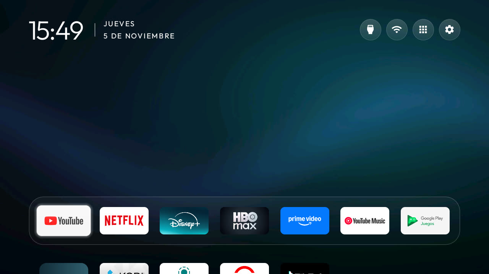

# Glass Gallery

Seven app slots in a translucent glass dock, an app library for the rest, and three original abstract wallpapers rotated in order every 30 minutes. The white header uses icon-only controls; app-colour glow and advanced effects are off. It uses only existing theme keys and adds no code or permissions.

Tested on Kenwood K32M15G6 / 2K SMART TV (KTC jagalchi), Google TV on Android 14, firmware UKN6.260116.001, at 1280×720. Home, the library and D-pad navigation were checked. Native held-volume repetition remains available with key accessibility helpers off; this theme does not enable them.

The optional dock preset is YouTube, Netflix, Disney+, Max, Prime Video, YouTube Music and Play Games, in that order. Missing apps are skipped; edit dock_apps for your own apps. The library keeps other installed apps accessible.

Apply with the repository's normal theme tool. Replace the three pictures with your own if desired; keep private photos and calendar content out of screenshots you share. The included wallpapers are CC0; [CREDITS.md](CREDITS.md) records their source and how to regenerate them.
