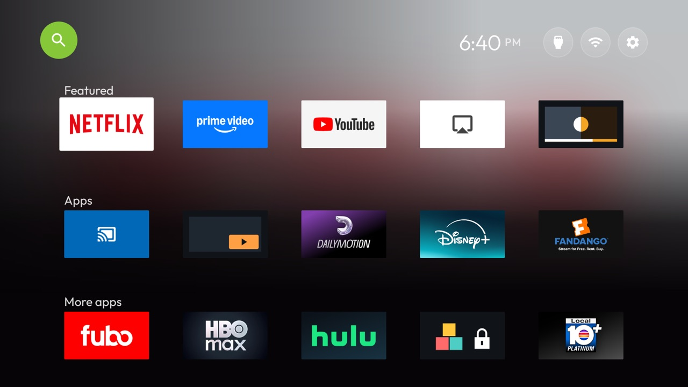

# 2014 Leanback Launcher

A tribute to the first Android TV home screen: the Leanback Launcher that came with Android 5.0 Lollipop
and the Nexus Player in 2014. Its parts are here. A blue microphone orb for search sits at the top left and
the time alone at the top right. The app banners come in rows with a heading over each, the focused app's
artwork washes the top of a dark slate screen, and the focus is plain white. Inputs, Wi-Fi and Settings
sit in a row of round buttons at the end of the page, where Leanback kept its settings.

The slate (`#263238`) is the `lb_default_brand_color_dark` default in Google's own Leanback library. The orb
is Google blue (`#4285F4`), as on Leanback's search orb.

## What it changes

| Key | Value | Effect |
|---|---|---|
| `search_orb` | `#4285F4` | Leanback's round blue microphone orb at the top left; OK opens the TV's search |
| `buttons_at_end` | `true` | Inputs, Wi-Fi and Settings as round blue buttons after the last row; their menus still open at the top right |
| `clock_right` | `true` | The time alone at the top right |
| `row_titles` | `Featured`, `Apps`, `More apps` | A heading over each row, like Leanback's row headers |
| `tile_corner_radius` | `2` | Nearly square banner corners, as on the original |
| `background_color` | `#263238` | Leanback's dark slate; no wallpaper and no time-of-day sky |
| `cinematic_home`, `cinematic_art` | `true`, `70` | The focused app's artwork fills the top of the screen, as Leanback's backgrounds did |
| `cinematic_dots`, `cinematic_white_focus` | `false`, `true` | No position dots; a plain white focus |
| `dock_title`, `show_greeting`, `dock_band` | `false` | No large app name, no greeting, no band behind the first row |
| `columns`, `rows_below_dock` | `5`, `2` | Rows of five banners, three rows on screen |
| `glass_style`, `focus_overshoot` | `rim`, `false` | A quiet rim on the focused banner, no bounce |
| `ambient_glow`, `app_glow` | `false` | No colour glow behind the rows |

The headings are names, not sorting: the rows hold your own apps in your order, as everywhere else in the
launcher. Change `row_titles` to suit (Leanback's own rows were "Apps" and "Games"). On a TV with no
search app, the orb says it can't open search.

Tested on an ASUS/MOKA M1G, Android TV 11.

## Not affiliated

An unofficial tribute, made only from the launcher's own keys: no Google logos, artwork or code are copied. The
microphone is the Material Icons "mic" (Apache 2.0) and the colours are plain values. Android TV and Leanback
are trademarks of Google LLC, named here only to say which home screen this recalls.
